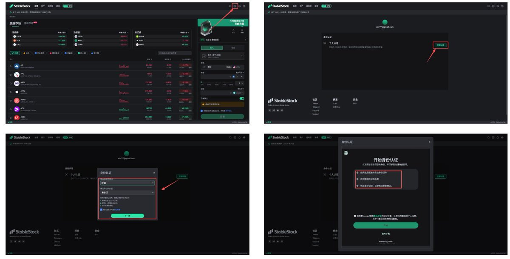
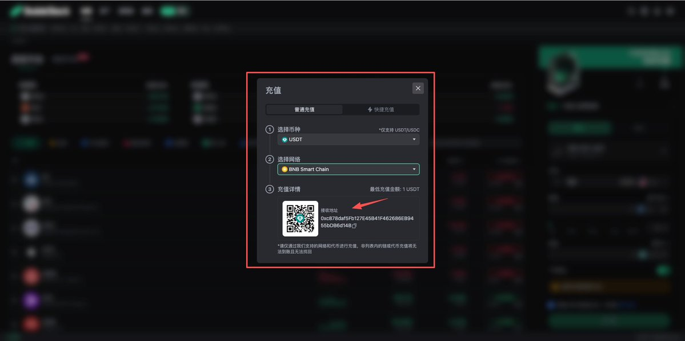
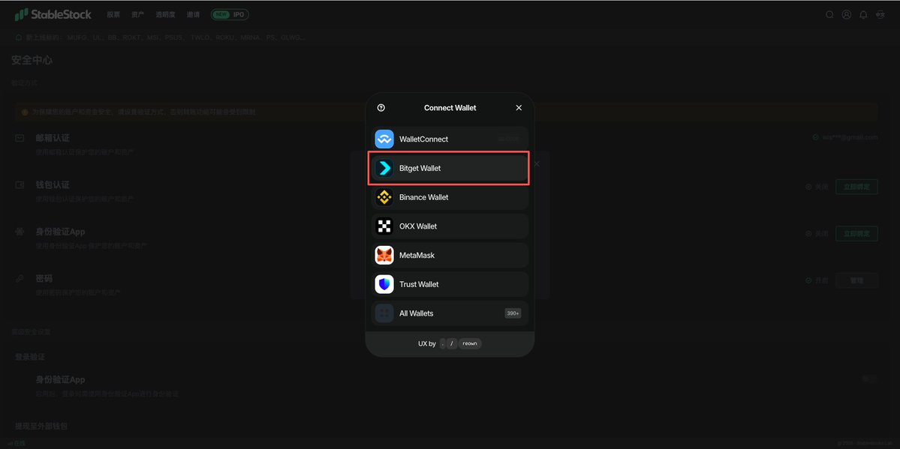
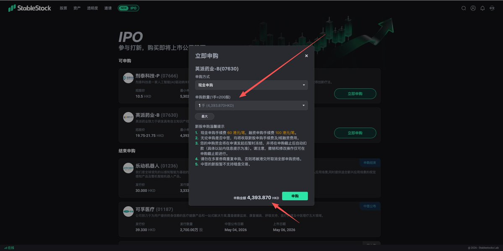
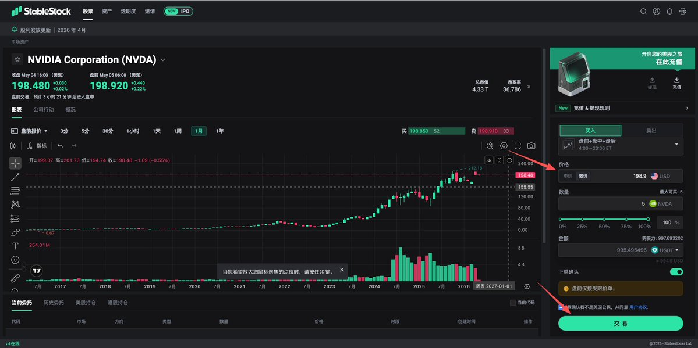

## 一、先认识需求与核验范围

**StableStock 怎么入金买港股？** 手里的资金以稳定币为主、却希望了解股票与 IPO 时，最先要弄清账户、资产权利和退出路径。本文沿原有截图说明注册、入金、申购和交易时应该检查什么。

同类入口可对照 [StockCoin 使用指南](/articles/onchain/YGkvEHeX) 与 [BiyaPay 怎么用](/articles/onchain/KewUM4Og)；若你其实走传统港卡+券商，见 [港卡与港股券商开户入金](/articles/series/hk-stock-funding)。稳定币从交易所转出前，建议先看 [转账网络与到账检查](/articles/crypto/oWHIVCLt?series=crypto-basics)。

这次可以读取官网产品介绍，但尚未核实完整的本人适用账户协议与最新费率明细。因此，下文把**已经看到的旧界面**和**必须进一步取得的文件**分开说明，不把它写成已经确认全部法律结构的开户结论。

能够使用稳定币的入口，不等于免除资格审核；页面上有股票名称，也不足以证明每个模块都提供相同的证券权利。

## 二、产品入口与需要取得的文件

[StableStock 官网](https://www.stablestock.finance/)介绍证券基础设施、代币化股票和策略等功能。官网对产品的描述可以帮助定位问题，但不能替代实际开户合同、发行文件或持仓证明；也不能仅凭介绍页确定每个模块的法律归属。

原稿提到 StableBroker、sStocks，以及 Vault / Swap 等入口。使用前应将以下问题对应到**自己准备使用的具体产品**：

| 要核对的问题 | 需要看到的材料 |
| --- | --- |
| 与谁建立关系 | 开户或产品协议、服务实体及本人适用地区 |
| 持有的是什么 | 资产完整名称、证券或代币权利、发行与保管安排 |
| 如何证明持仓 | 账户记录、持仓凭证、公司行动及转仓说明 |
| 如何退出 | 卖出、赎回或转出条件，结算时间和费用 |
| 资金如何使用 | 订单、策略或授权的用途，损失承担与流动性限制 |

没有取得这些文件时，可以先了解界面，但不应据此完成大额转入。合作机构名称和宣传介绍不能替代实际账户关系；本次未核实的部分，也不据此断言其不存在。

## 三、注册认证、链上或钱包入金

### 注册之后，确认产品资格

原操作图使用 Web 入口。符合本人适用资格后，可使用下方邀请链接，提交前确认邀请码 **WISE666**。原稿列出的邀请福利是 **20% 返现**；返还基数、适用交易和领取方式尚需补充，这不表示交易本金返还 20%。

> [注册 StableStock 账户](https://app.stablestock.finance/?join=WISE666) · 邀请码：**WISE666**

进入实名认证页面后，按本人实际情况填写身份与税务等所需资料，使用有效证件完成当前要求的验证。提交后检查审核结果和补件通知；**提交成功、认证通过、产品权限开放，是三个不同的状态。**

### 链上地址入金：先验证本人地址和网络

从自己账户取得实时充值信息，核对币种、网络、最低到账、费用以及是否需要附加标签。再到本人转出账户填写同一组信息，检查预计净到账，首次用满足最低要求的小额确认。

**不要扫描文章截图中的充值二维码，也不要复制旧图地址。** 提交后保存交易哈希，分别核对转出端、链上确认和 StableStock 账户记账。接收端余额、币种与金额正确后，再进入后续步骤。

### 连接钱包：连接、授权和转账分别读清楚

旧图还展示钱包连接入口。先核对域名与钱包所处网络，再逐项阅读签名内容：仅连接账户、授权使用代币、实际转移资金并不是同一种操作。

查看授权对象、资产与额度，不理解的签名先取消；不向网站输入助记词。操作后通过钱包与平台记录核对是否发生转账，不能把“连接成功”理解为资金已经到账。

## 四、港股申购前后的检查流程

旧界面中存在港股申购入口，但“找到产品直接申购”省略了最关键的判断。**先查标的与权益，再查资金和订单状态。**

1. **确认具体标的。** 核对名称、代码、发行文件和申购期限，检查实际认购的是何种权利。
2. **确认本人资格。** 账户已认证，也不代表每个产品都能申请；查看该期申购与地区限制。
3. **确认现金或融资安排。** 现金方式看冻结金额，融资方式还要看利率、计息时间、保证金、补款与还款规则。
4. **核对订单预览。** 手数、币种、汇兑、申请费与可能的其他成本都确认后，再提交。
5. **保存订单并跟踪分配。** 查看受理状态、获配数量、实扣金额和未获配退款；扣款不等于中签。
6. **获配后核对持仓与退出。** 确认可交易时间、卖出通道、结算和提现条件，不能仅凭申购完成结束检查。

> 原稿记录过**现金申购 60 港币/笔、融资申购 100 港币/笔**，仅作历史报价。实际提交前取得当期费用明细，检查未获配是否退费、融资何时开始与停止计息；旧价格不能当作现在的订单报价。

## 五、买入卖出与订单记录

买卖前先确认产品类型。相同公司名称可能出现在证券、代币或其他产品中，其权利与退出安排不能相互替代。

可以按下面的文字顺序检查一次订单：

- **选产品：** 核对完整名称、代码、交易市场与计价币种，查看本人权限。
- **看资金：** 确认可用余额与待结算、冻结或策略占用资金的区别。
- **填订单：** 看清买入或卖出、数量与金额单位、订单类型、价格及预计费用。
- **提交后查状态：** 待成交、部分成交、全部成交和取消分别确认；提交成功不是成交证明。
- **对账：** 用成交数量、均价和扣费记录核对持仓变化。若只部分成交，剩余挂单如何处理要另行检查。

限价订单可能等待或无法成交，市价执行也可能出现价差；这属于理解订单的基础，不能据此推断当前平台一定提供某种具体按钮。实际使用时只按本人页面已开放的订单类型操作。

卖出之后，继续核对何时结算、资金何时可提，以及转出时使用什么资产和网络。不要把成交后的账户显示金额直接当成已回到自己钱包的现金。

## 六、历史费用样本与计算方法

下面保留原稿费用作为**历史样本**。本次仍未成功读取完整[官方费用页](https://stablestock.gitbook.io/ss/concepts/stablebroker/fee)，不能确认金额与项目仍然适用；下单前需要取得本人适用的当期报价和收费说明。

先分开平台费用与上游通道、交易及监管相关费用，再看每项是按金额、股数还是订单收取。原稿曾列 StableStock 服务费 **0.1%**，但不能因此忽略其他费用或断言总成本“很低”。

### 美股历史费用明细

| 费用项目 | 原稿历史记录，非当前报价 |
| --- | --- |
| StableStock 服务费 | 交易金额 × 0.1% |
| 上游经纪商平台费 | 0.005 美元/股，每笔最低 1 美元 |
| FINRA Trading Activity Fee，仅卖出 | 约 0.000166 美元/股 |
| Settlement Fee，结算费 | 0.003 美元/股 |

按股计费还受股数和最低收费影响。同样 1 万美元的订单，买入不同单价的资产，股数就可能不同；不能只按金额算出统一总费用。上表监管费用也需重新查证当期适用值。

### 港股历史费用明细

| 费用项目 | 原稿历史记录，非当前报价 |
| --- | --- |
| StableStock 服务费 | 交易金额 × 0.1% |
| 上游交易佣金 | 0.02%，最低 15 港币 |
| 印花税 | 0.1% |
| 交易所交易费、结算费与其他监管费 | 合计约 0.012% |
| 上游平台费 | 2 港币/订单 |

不同证券和订单可能涉及不同收费范围，不能将表里的合计比例用于所有产品。

### 自己估算一次完整买卖

先列出**买入金额、股数、币种**，按当期报价逐项计算平台费、按股费、最低收费和适用税费；再对卖出侧单独计算，最后加上换汇、链上与提现费用。价差和滑点另外观察。

提交前保存报价，成交后用实际账单逐项对照。金额不同就查原因，不把历史样本与本次实际扣费混在同一张“现行费率”表里。

## 七、资金退出与异常处理

准备退出时，先检查资金属于哪个状态：未成交订单冻结、申购中、已成交待结算、策略锁定，或已经可提现。**先解除相应占用或完成结算，再核对可提金额。**

1. 从当前账户说明确认允许的提现资产、网络、最低金额、费用与审核条件。
2. 在本人接收账户取得实时地址；涉及钱包授权或兑换时，分别读清楚动作和费用。
3. 提交后保留订单号或哈希，直到接收端实际记账。平台受理与最终到账不能画等号。
4. 状态异常时整理时间、币种、网络、金额、订单号和哈希，从官方支持入口查询；不向陌生地址支付“解冻费”。

账户和税务义务也需要结合实际服务实体与本人身份核对，不能由稳定币入金推断“不用申报”。当期协议、费用或退出说明仍缺失时，先把缺项补齐，再决定是否使用。

## 八、总结与进一步核验

决定使用前，把**账户协议、当期费率和退出条件**补齐；操作时记录日期、具体产品、费用、确认与实际到账结果。能解释资金在每个节点的状态，才算读懂了这条流程。

如需交流原教程的操作记录，可以联系 **@ShuYu622**。以下保留原微信群二维码；若失效，可通过站内联系入口获取新的加入方式。

