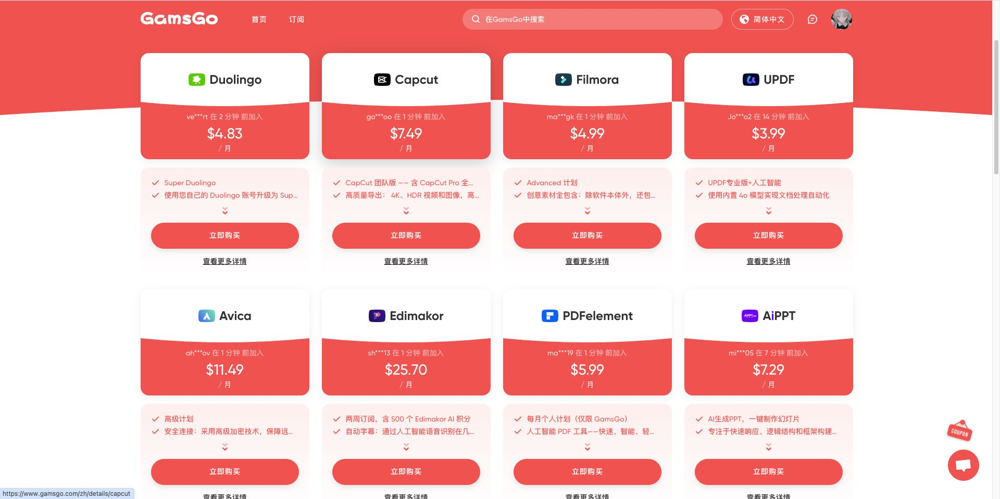
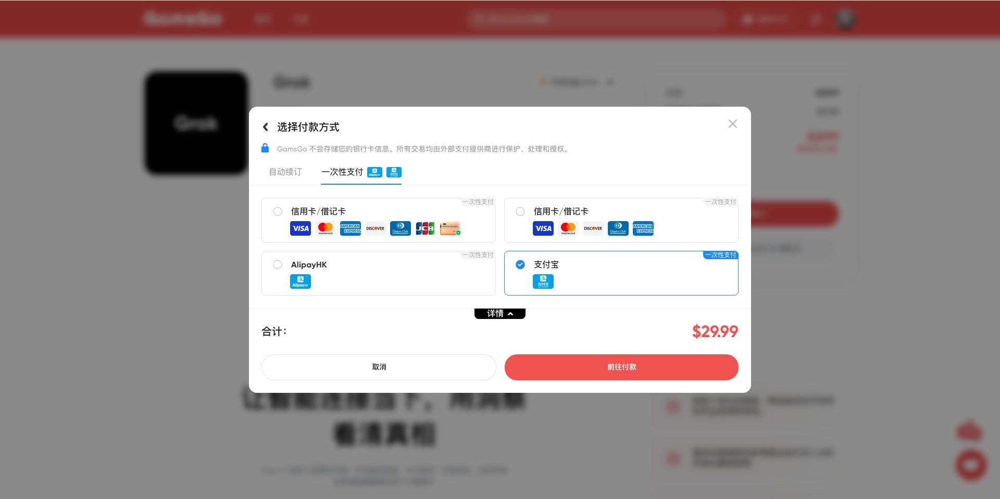
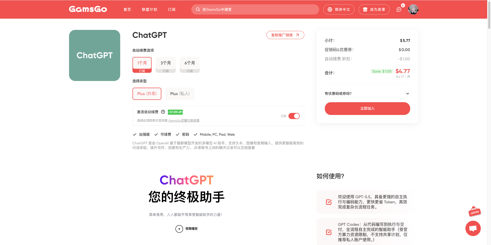
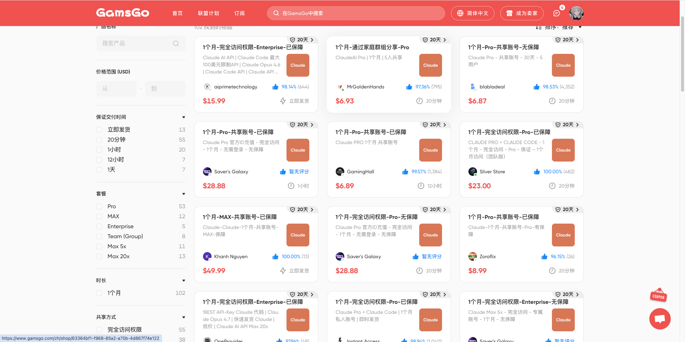

## 一、GamsGo 是什么，适合解决什么问题

当多个工具都需要订阅时，月费很容易累积起来。GamsGo 是一个第三方订阅购买入口，提供的具体产品可能涉及共享方案、账号交付或其他订阅方式。它与直接向工具开发商购买，不一定是同一种账户关系。

这一篇先解释套餐差别，再介绍购买和交付检查。适合愿意研究第三方条款、希望比较订阅成本的用户；用于长期工作或涉及私人资料时，还应优先考虑账户控制权和数据边界。

## 二、选套餐之前，先看清你买到什么

| 检查项 | 需要确认的内容 |
| --- | --- |
| 账号形式 | 自己名下的独立账号、共享账号，还是团队中的一个席位 |
| 实际权限 | 可用功能、额度、设备数、地区与使用限制 |
| 服务期限 | 起算时间、是否自动续费、到期后的资料处理 |
| 故障处理 | 由谁提供客服、退款或替换条件、处理时限 |

原稿介绍过 ChatGPT、Gemini、Canva 等工具，以及支付宝付款选项。产品是否在售、能否使用该支付方式，要在具体商品和结算页确认；不能用平台成立时间或用户数量推导“不会跑路、保证安全”。

## 三、比较价格时，把交付方式一起比较

原稿曾记录 ChatGPT 相关方案约 **$4.77/月**、Gemini 相关方案约 **$20/年**。这些是当时的展示价格，不是当前报价，更不能直接认定与开发商的独立订阅具有相同权益。

把“同一个工具”继续拆成账号形式、权限、期限和售后，再比较总价。共享或第三方交付还可能存在额度互相影响、账号变更和隐私问题。转售前必须核实授权与条款，不能把买低卖高写成没有成本和责任的套利方案。

## 四、购买

准备购买时，可通过下方邀请链接注册 GamsGo，再选择适合自己的订阅方案。

> [注册 GamsGo 账户](https://gamsgo.com/partner/GwZjT) · 邀请链接

注册后，打开具体商品，核对适用地区、账号形式、期限、退款条件与总价，再选择付款方式。若产品不向你的地区提供，不要仅通过改变网络位置就假设获得使用资格。

付款完成后，按订单页领取服务，测试登录及实际权限。截图中的产品名称和套餐作为旧界面示例，购买时需逐项核对；“保障”字样的具体内容，以订单对应条款为依据。

> 收到交付后保存订单号、服务期限和售后入口。未确认权限正常前，不要立即导入重要工作资料。

---

## 五、注意事项：账号控制权比低价更重要

共享方案中，先确认其他成员和管理员能看到什么、谁能重置密码、服务终止后能否导出资料。不要在共享环境上传证件、客户数据或未公开项目；重要账号也不要复用密码。

检查自动续费开关、下一次扣款时间和取消方法。需要退款或修复时，从订单对应的客服渠道处理，不把验证码或主邮箱密码交给陌生人。

## 六、总结：先试用和核对，再决定长期订阅

GamsGo 提供的是一种购买渠道，最终是否合适，要看具体交付和使用条件。先确认账号与数据归属，再比较价格；对长期工作依赖很高的工具，稳定性和可迁移性同样是成本。
