## 一、SGB 是什么，为什么先看监管主体？

如果你的资金需要在银行和数字资产平台之间流转，首先要确认谁为你开户、谁保管资金，以及每一步是否对本人开放。名字相似或标注“加密友好”，都不能替代这些检查。

**Singapore Gulf Bank（SGB，新加坡海湾银行）由巴林中央银行监管。** 名称里的“新加坡”不能理解为账户在新加坡受监管，也不能据此推断存款保障或税务待遇。[SGB 官方 FAQ](https://www.sgb.com/faq)说明了其背景与服务资格。

本文先说明账户和材料，再保留原稿的 App 注册及转账截图，方便你理解办理顺序。截图是操作示例，不代表每个人拥有相同权限。

## 二、开户前确认：资格、材料与服务范围

- **资格：** 居住地、国籍和适用规则会影响能否申请及可用产品，应先在官方入口确认。
- **材料：** 原稿以护照、身份证核验为例；银行仍可能要求地址、资金来源或其他证明，不能承诺所有人都免地址证明。
- **产品：** 银行收付款、稳定币服务及证券交易是不同业务。官方说明中，部分数字资产服务仅面向符合条件的客户；是否能买某只股票，应另查实际服务提供方和交易权限。
- **成本：** 分别检查兑换价差、转账费用、第三方平台费用和到账时间，不用“零损耗”概括全部路径。

## 三、注意事项：隐私、税务与资金记录

**巴林监管不等于“没有 CRS”。** 巴林税务机关设有[国际税务信息交换系统](https://ities.nbr.gov.bh/)，其中包含 CRS 申报。具体账户如何处理需核对银行条款和本人税务身份，不能将开户地点当作免申报或免税承诺。

银行的[隐私说明](https://www.sgb.com/privacy-notice-copy)列有身份、地址、财务与税务资料的收集范围。申请时如实申报，留存资金来源和交易记录；保护隐私与履行申报义务并不冲突。

持牌和使用托管技术不代表没有风险，也不能据此断言比所有券商更安全。先看合同主体、资金保管方式、提款规则和争议处理渠道，再决定是否使用。

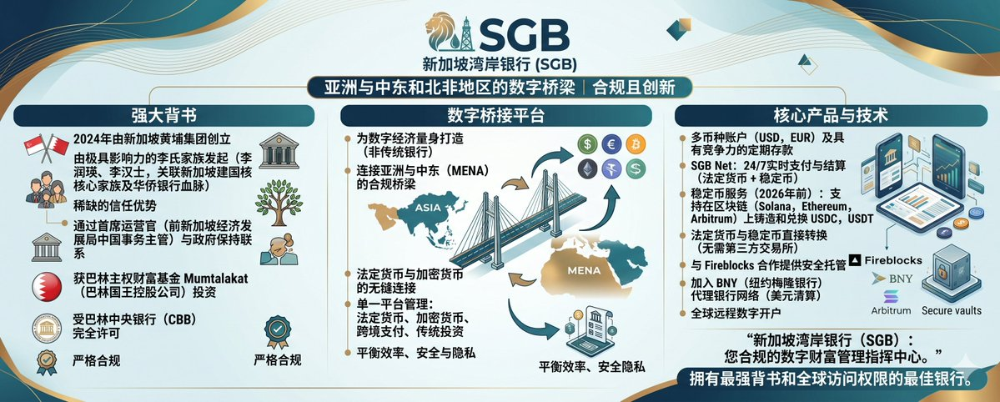

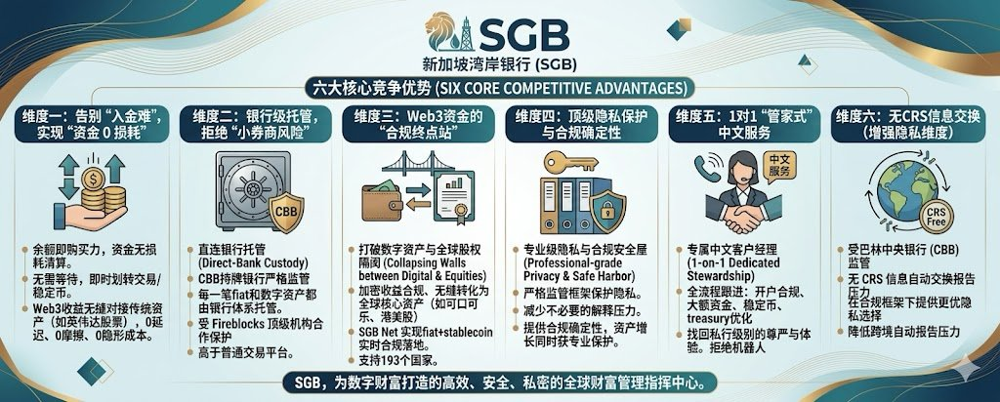

## 四、SGB 开户流程

ok，聊完了基本的情况之后，我们来聊一下具体的开户！

下文是原稿的申请示例，使用**护照与身份证**进行验证。实际材料以本人申请页面和补件要求为准，提交申请也不等于已获批。

**1、** 首先在应用商店检索"**SGB**"（新加坡海湾银行），点击**开始注册**即可看到提供的功能，然后输入邀请码 **"3p1o5t"** 点击继续即可进行下一步。

> 注册 SGB 新加坡海湾银行 账户 · 邀请码：**3p1o5t**

**2、** 接着确定信息和创建账号对应的一个**六位数登录验证码**。

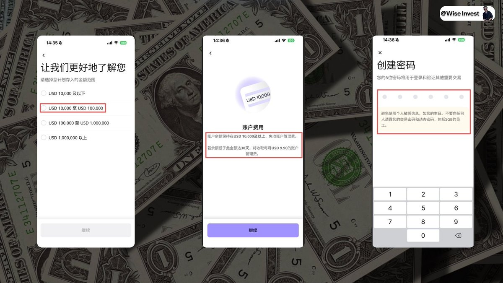

**3、** 输入手机号，如实填写居住国家、出生地与税务身份，再按页面要求准备证件。不能为符合资格而把美国关联身份或其他资料改成“否”。

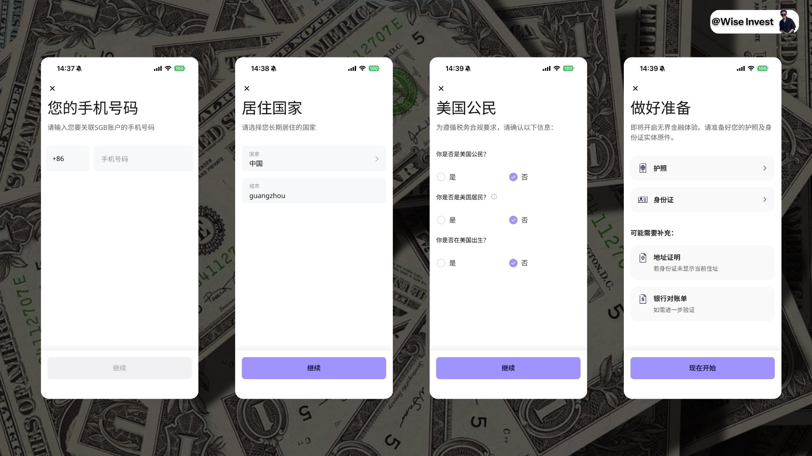

**4、** 然后就是上传护照，这里只需要进行**拍照实时识别**，识别完毕之后记得查阅识别出来的信息是否正确，确定数据没有问题就继续开始**身份证上传和认证**。

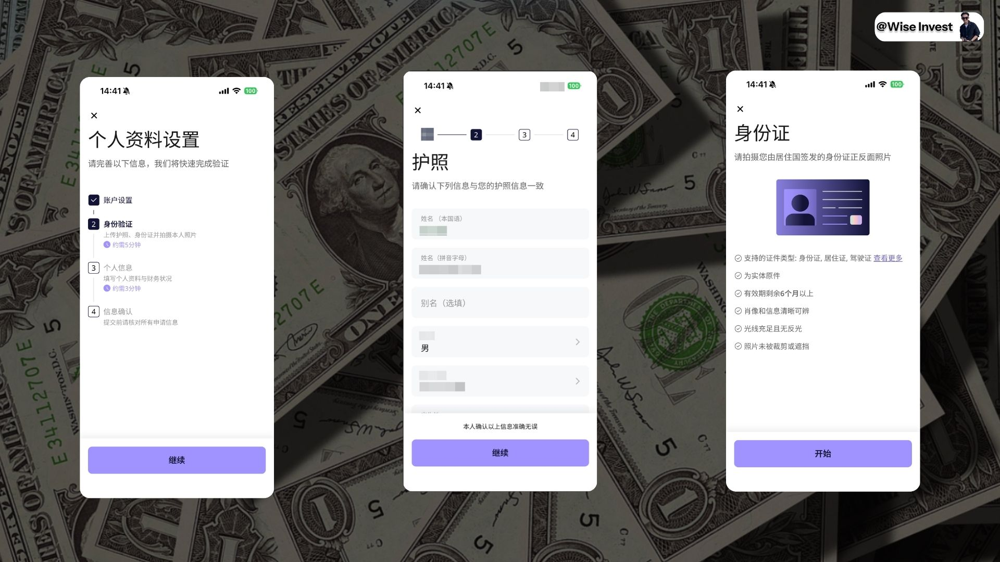

**5、** 如实填写职业、政治公众人物关联情况、收入来源与开户用途。薪资、投资收益或其他来源分别按实际情况选择，并准备可能要求的证明。

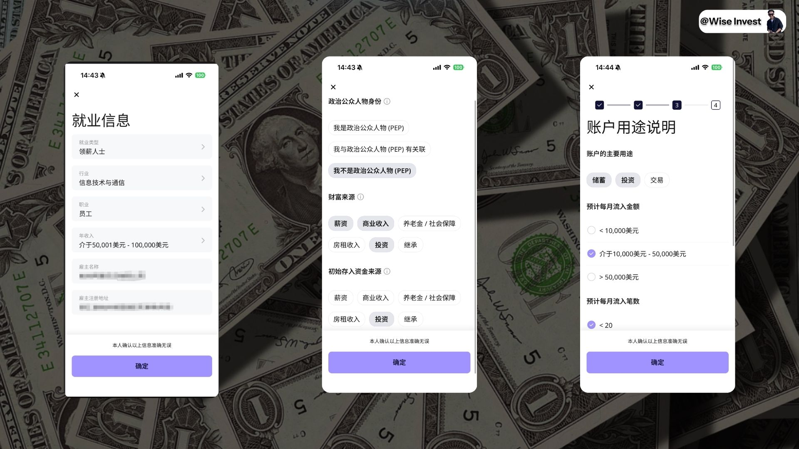

**6、** 确定填写一些基础的信息，例如**交易次数、每月流出的金额**等，最后再确定**税务信息和账户信息**，没有问题之后即可进行下一步。

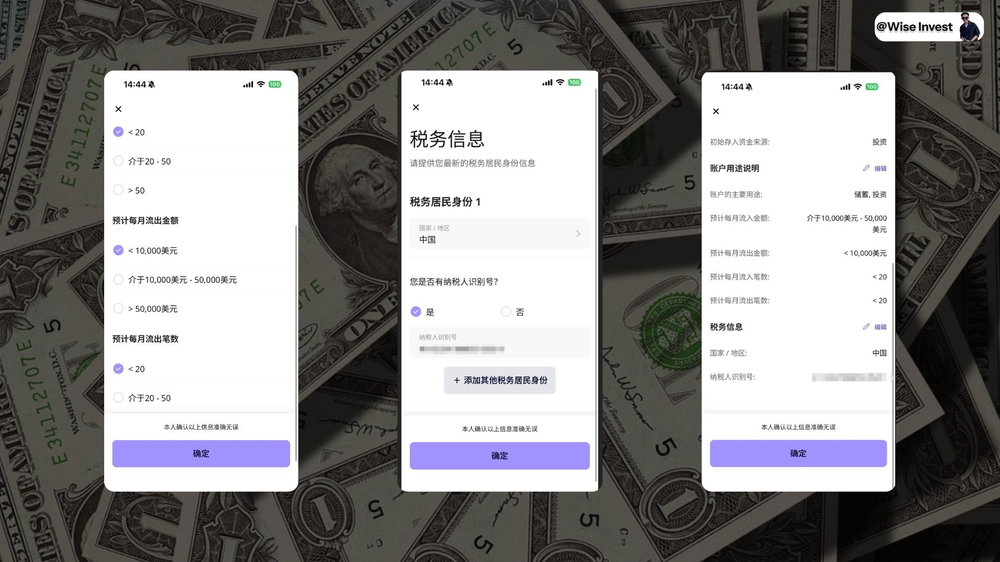

**7、** 确定完毕之后即可**提交申请**，而后就是等待审核，审核通过之后就会看到开户成功的界面。

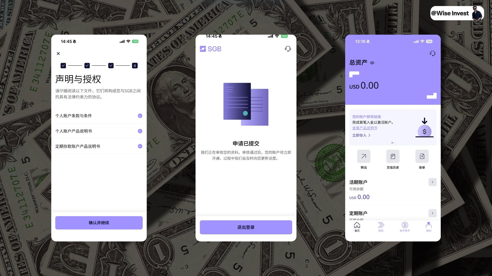

以上就是完整的注册流程，其实从整个注册流程来看整体上不算困难，等同于一个"虚拟银行"的注册流程和简约程度。

---

## 五、存款费率

比较存款时，要同时看币种、年化利率、期限、最低金额和提前支取条件。下图保留原稿展示的报价，不能把截图中的数字当作当前可获得的利率，也不能直接与另一币种的存款相比。

资金跨境转移仍须符合真实用途和相应规则。银行开户不提供规避税务信息交换或绕过购汇用途限制的通道。

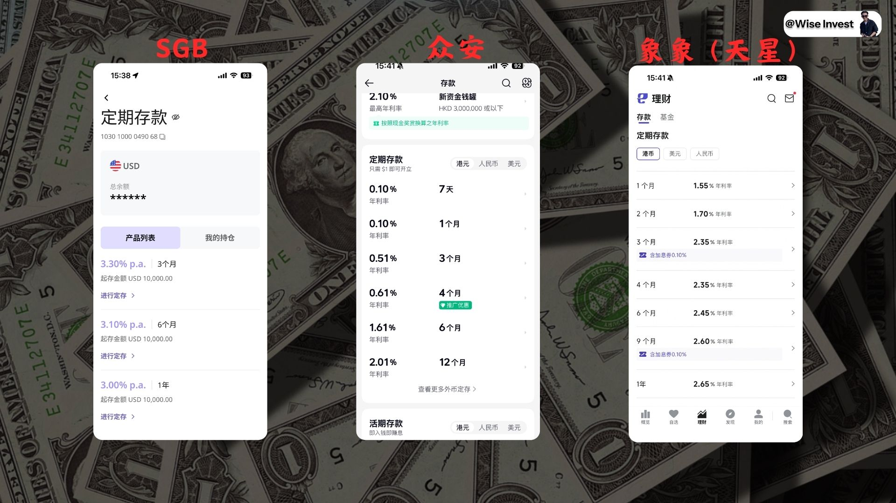 

---

## 六、数字资产相关转账示例：先确认账户已支持

以下保留原稿中 SGB 与币安巴林关联转账的操作记录。它要求两侧账户均符合资格、完成认证并支持该功能；如果本人页面没有相应入口，先向官方客服确认，不通过改地区或另造身份获取权限。

**1、** 想要开启丝滑出金？确保完成以下三步：

- ✅ **账户准备**：注册并开通 SGB（新加坡海湾银行）账户
- ✅ **账户绑定**：只需在 SGB App 中选择【数字货币】发起关联请求，系统会引导您注册**币安巴林账户**。请准备一个未注册过的新邮箱进行操作，注册成功后，您的两个账户将自动完成绑定
- ✅ **白名单申请**：发送申请邮件至 **clientservices@sgb.com** 即可完成（提供您的法律姓名、SGB 注册邮箱、币安巴林 UID）

**2、** 在**币安全球**页面将稳定币转至币安巴林账户。

选择【资产】→【提现】，通过**"转账给币安用户"**功能，将稳定币（如 USDT）划转至您的巴林币安 ID。核对接收 UID、资产和确认页费用后再提交，实际处理速度与可用方式以两侧账户状态为准。

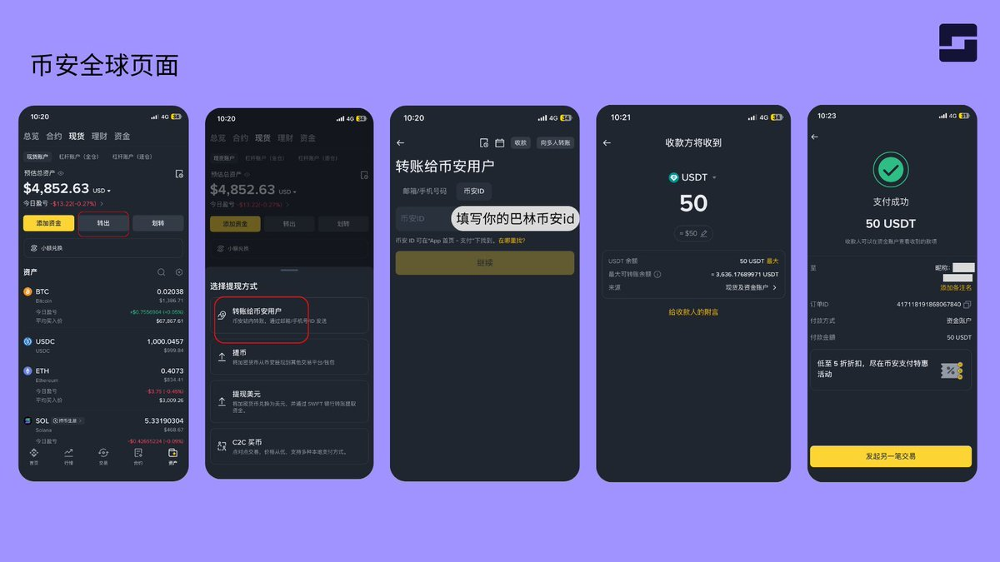

**3、** 切换至**巴林币安（Binance Bahrain）**账号。

✅ 点击左上角头像 → 切换账户 → 选择标记有 **Binance BH** 的选项。

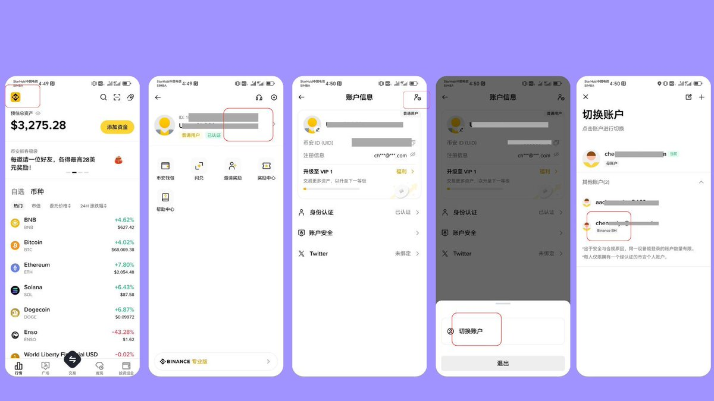

**4、** 在币安巴林页面将系统语言切换为繁体中文后，点击【**出金至法币**】将稳定币兑换成美元。

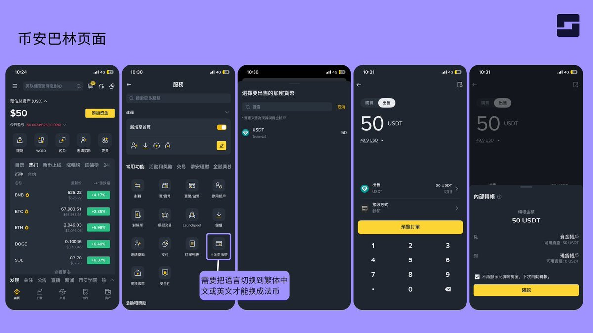

**5、** 兑换成功后，发起**提现至 SGB 银行账户**。

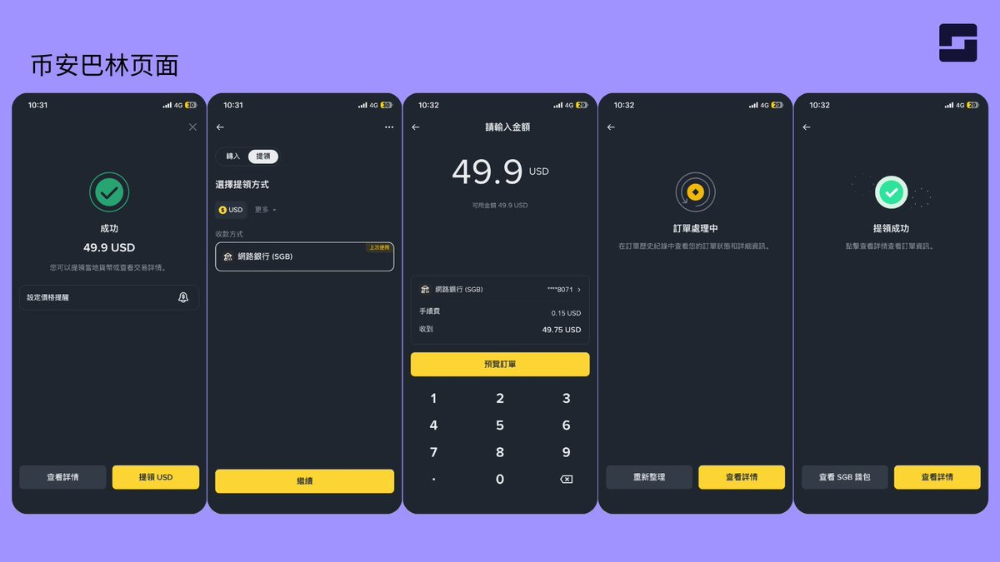

**6、** 返回 SGB 核对实际入账金额与币种，保存回单。若未到账，凭交易记录向两侧客服核查，不以截图速度作为承诺。

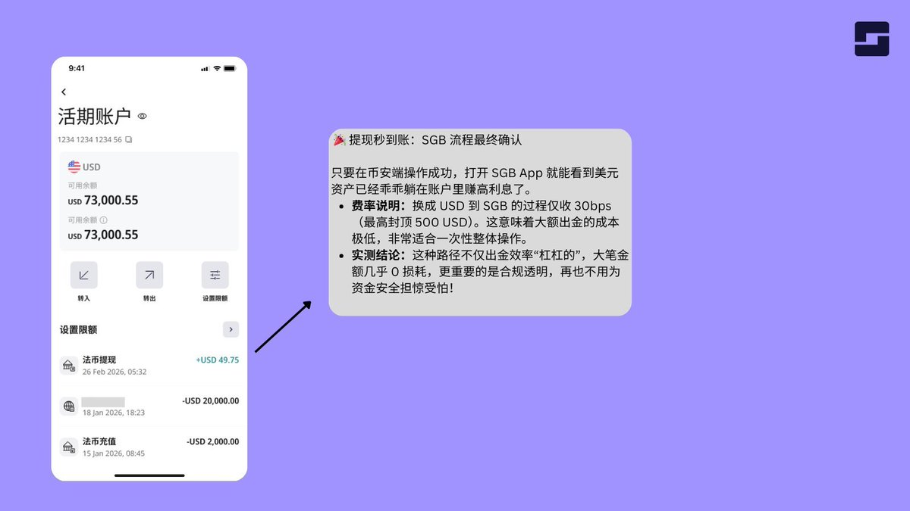

---

## 七、总结：先确认本人资格，再验证完整路径

SGB 的申请顺序是确认服务资格、准备真实资料、提交认证并等待审核。需要数字资产相关收付款时，再核对关联账户、兑换及转账环节；一处入口可用，不代表整条路径都可用。

| 核对项目 | 应确认的内容 |
| --- | --- |
| 监管与合同主体 | 巴林监管主体、本人账户条款及适用保护 |
| 开户材料 | 护照、身份证及银行可能要求的补充文件 |
| 邀请码 | 原稿提供的 **3p1o5t**，在实际注册步骤填写 |
| 费用与到账 | 兑换价差、汇款费用、收款金额及状态 |
| 税务资料 | 按真实税务居民身份申报，不把“隐私”当成免申报 |
| 投资服务 | 另查服务主体、适用地区和实际交易权限 |

准备材料前先读官方资格说明，提交后保留审核和转账记录。遇到不确定的权限或材料要求，向银行取得针对本人账户的答复再操作。
