## 一、众安银行是什么，本文带你完成什么

**众安银行怎么开户？** ZA Bank 是香港数字银行，主要通过 App 办理。本文围绕内地访港用户示例：先整理材料，再讲身份验证、提交申请和开户后的检查。

银行账户、银行卡支付和投资服务是不同功能。想用它支付消费或向券商转账，应分别核对开通条件与限额——不能仅凭开户成功推断后续都能用。开户后的转账、卡片与投资边界见 [众安银行怎么用](/articles/bank/4EB0zNOS)；用众安给复星入金见 [众安与 iFAST 入金复星](/articles/broker/myu8sVmc)；若暂时不能赴港，可比较 [见证开户怎么办理](/articles/bank/QonLSJp0)。

开户要求：

- 本人**亲自在港**
- 持有**内地居民身份证**
- 提供**内地储蓄银行卡卡号**
- 提供**出入境证明**

---

## 二、众安银行开户流程

**1、** 打开 App Store 输入"**ZA Bank**"下载众安银行。

**2、** 点击**立即开户**，勾选自己的证件是**居民身份证**，然后看一眼要求，比其他的银行多了一个要求你填写**内地储蓄银行卡卡号**的要求。

 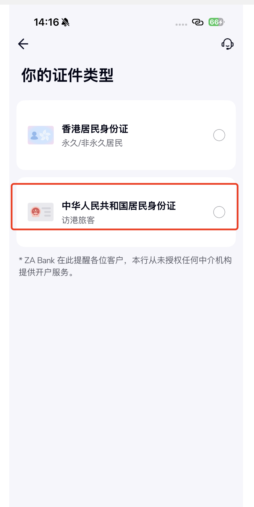 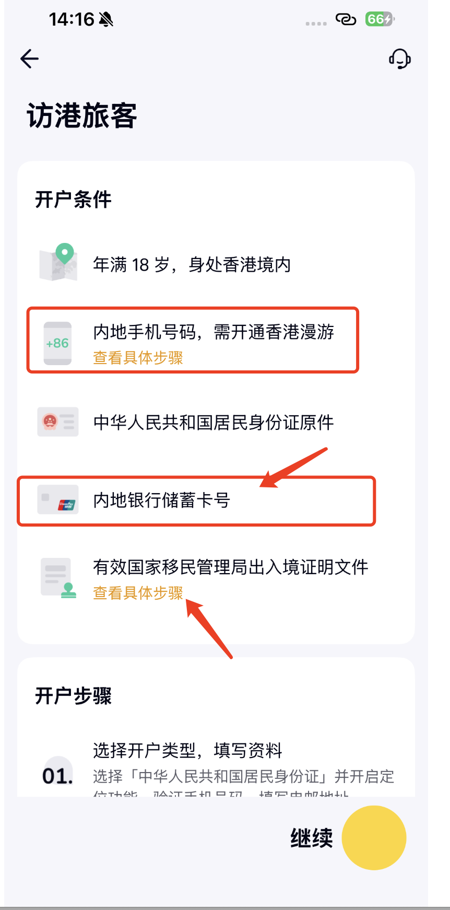

**3、** 可以看到众安银行的优势展示，这个设计要比另外两家好，会给你说自己的优势。

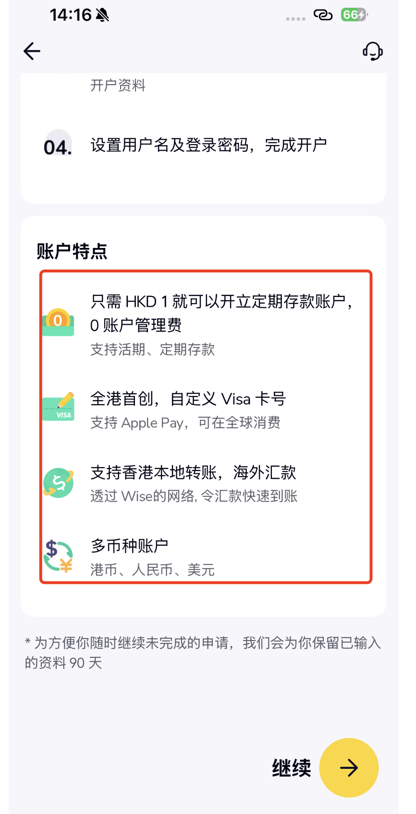

**4、** 填写自己的**手机号和邮箱**，然后进行**身份证验证**，最后再确定一下。

开户页面提示填写邀请码时，可复制下方的邀请码。

> [注册 众安银行 账户](https://l.za.group/Dsh3x) · 邀请码：**T659B7**

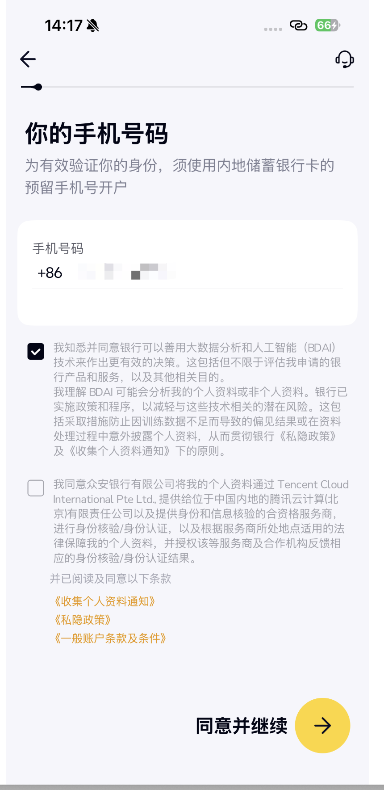 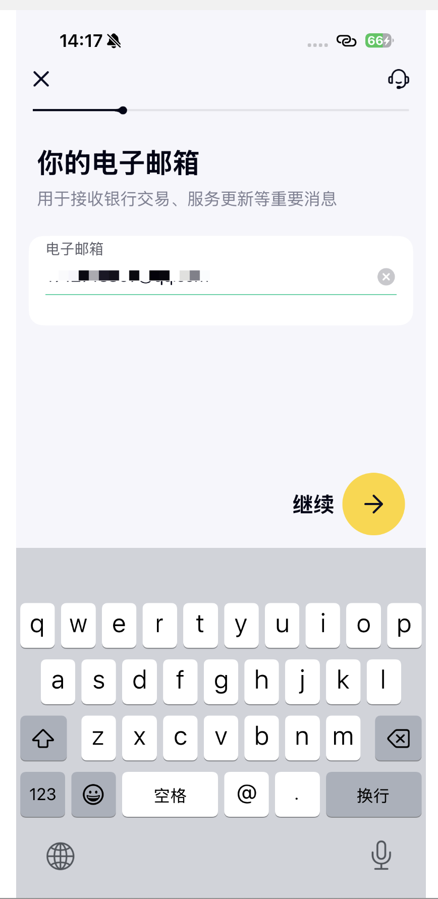 

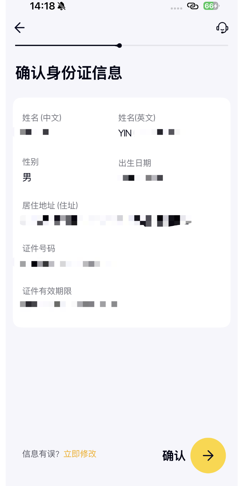

**5、** 同样是**英文名字**要格外注意，每个银行都会侧重再提醒一下。

> ⚠️ 英文姓名必须与证件上的拼音完全一致，填写有误后续可能需要重新认证。

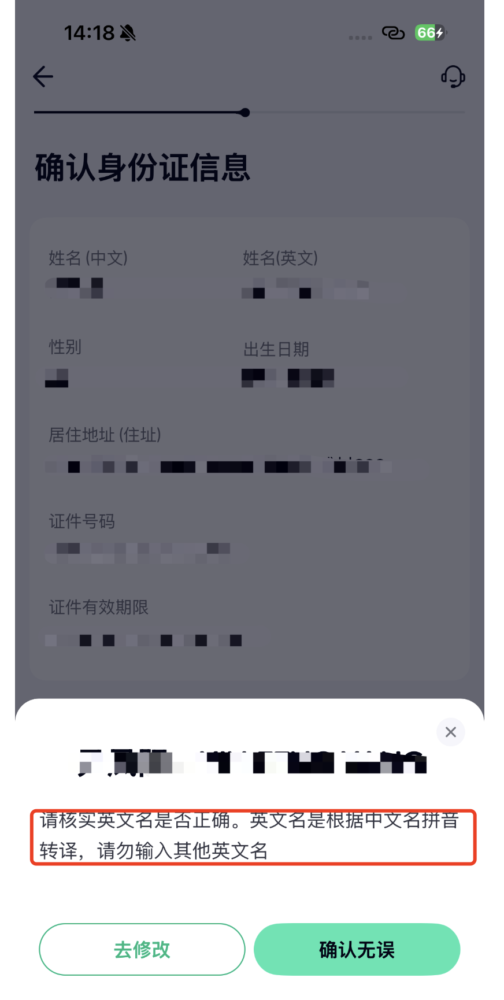

**6、** 填写自己的**纳税信息**和自己的**职业信息**。

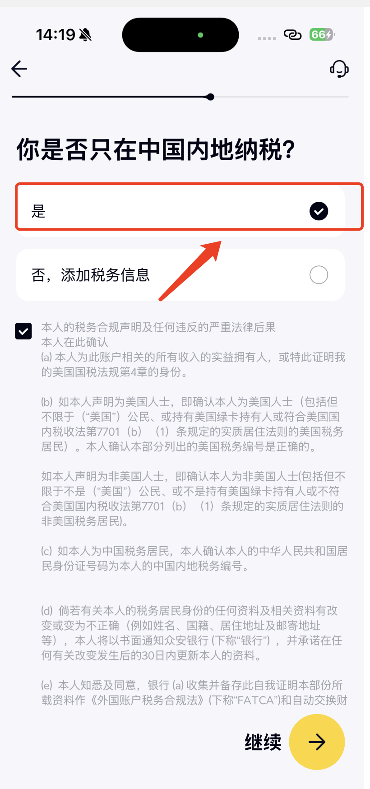 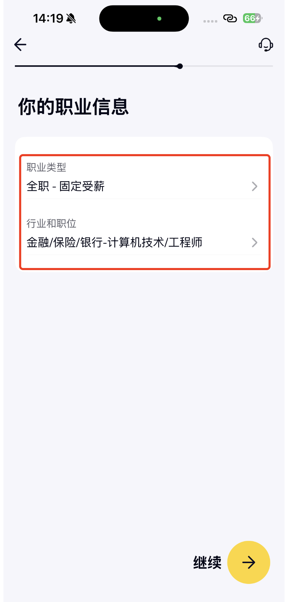

**7、** 按真实用途选择开户目的，例如储蓄或日常开支，再逐项核对开户信息。

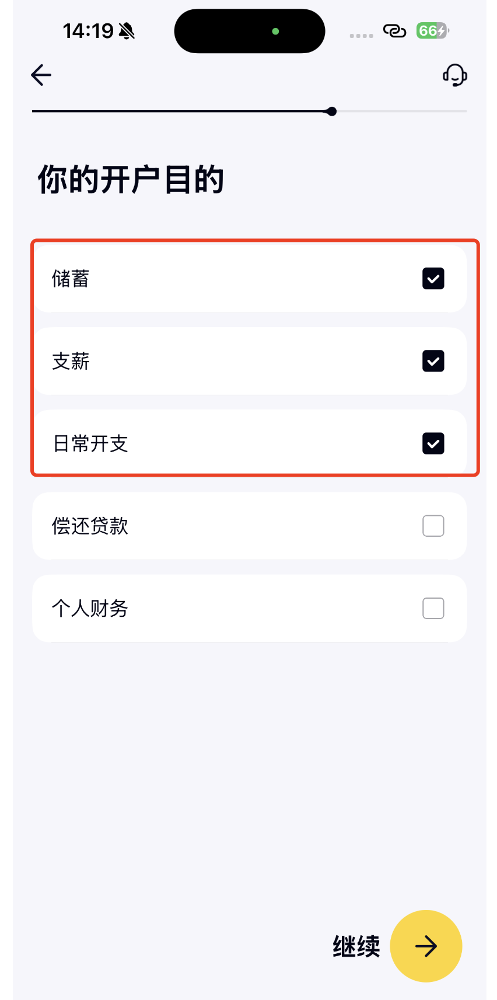

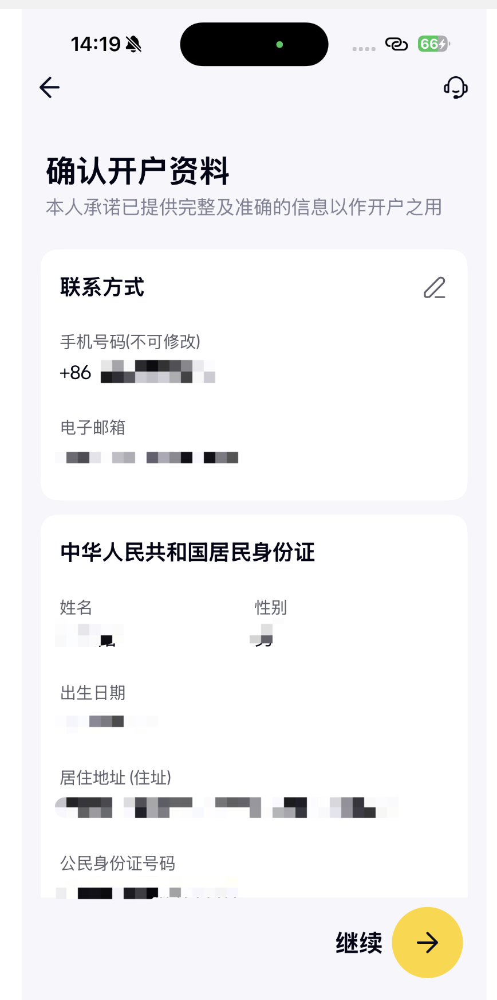

**8、** 设置**密码**，然后进行**个人银行卡验证**，最后按照我们前面一直讲到的提交自己的**出入境证明**即可。

> 💡 出入境证明通过 **12367 小程序** 下载：选择中国人服务 → 出入境证明，下载后另存为文件即可上传。

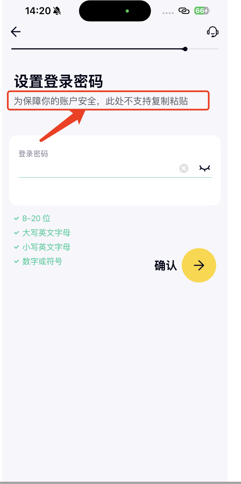 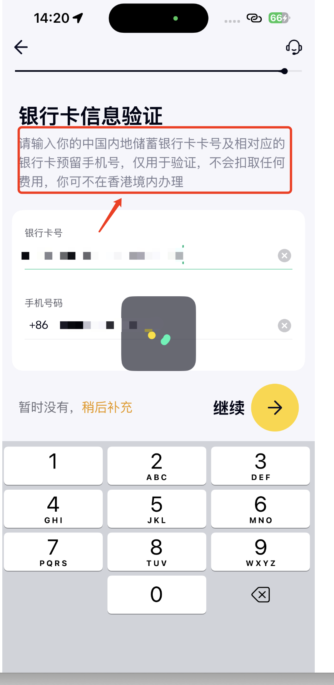 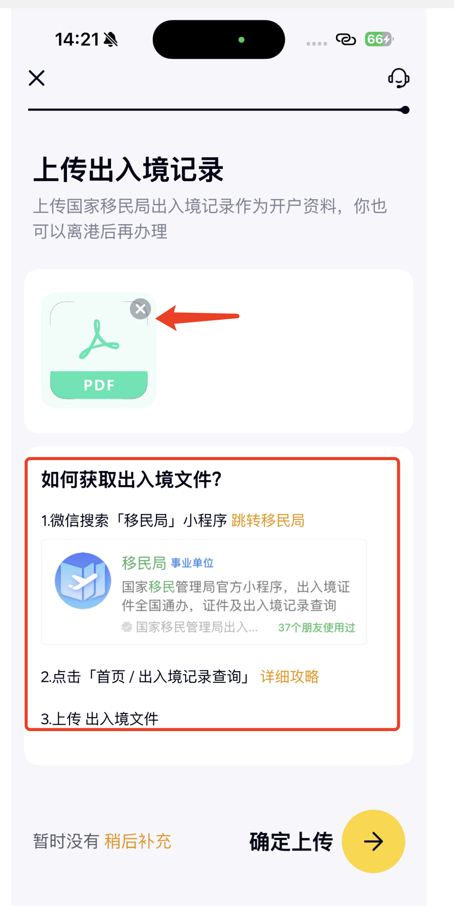

**9、** 如果确有投资需求，再申请**投资账户**并阅读相关风险与费用说明；只需要银行账户时，不必为了走完截图而开通全部附加服务。

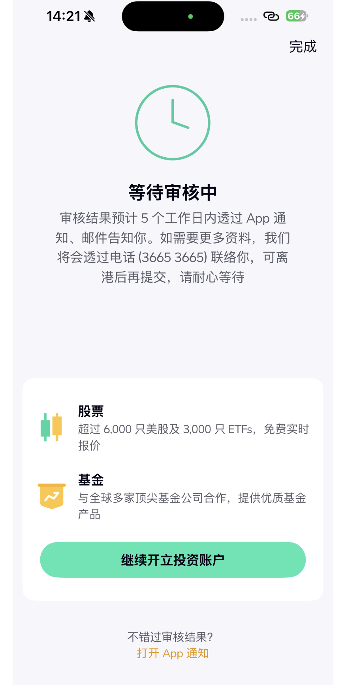

**10、** 把信息顺着填写完毕即可。

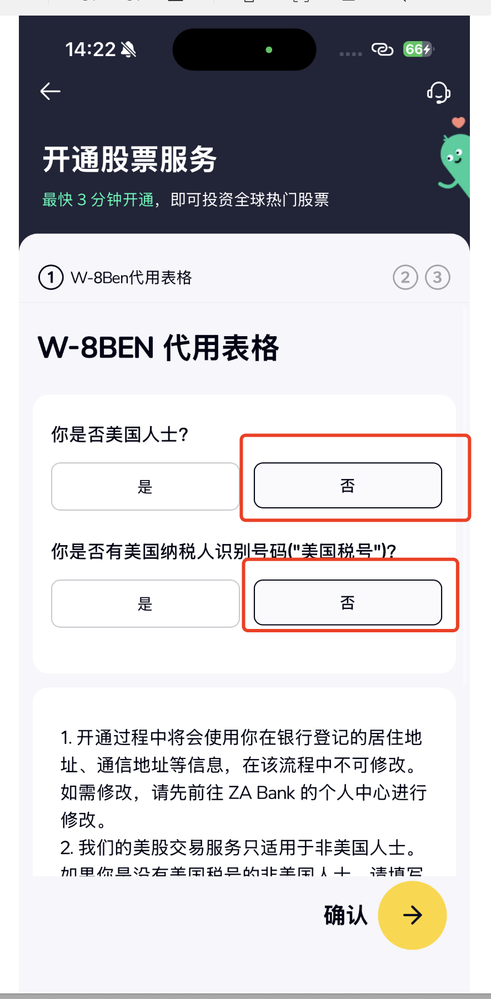 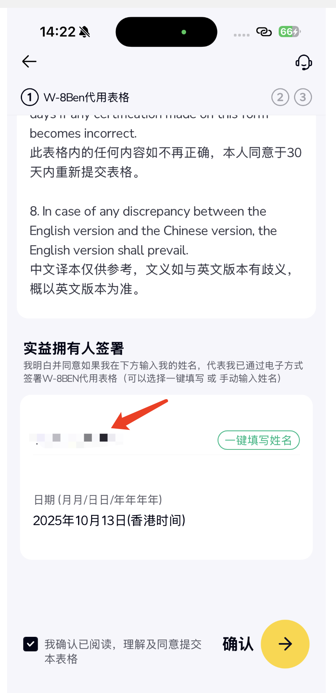 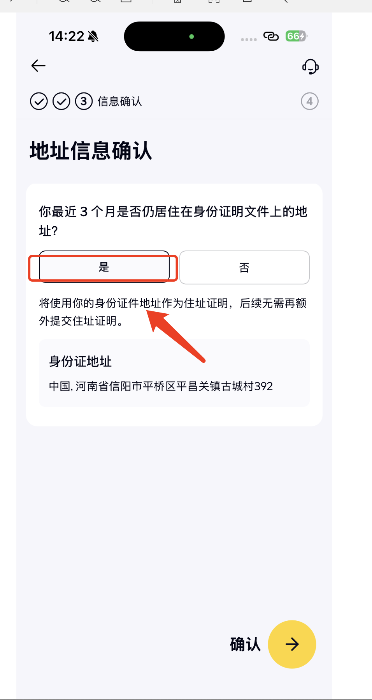 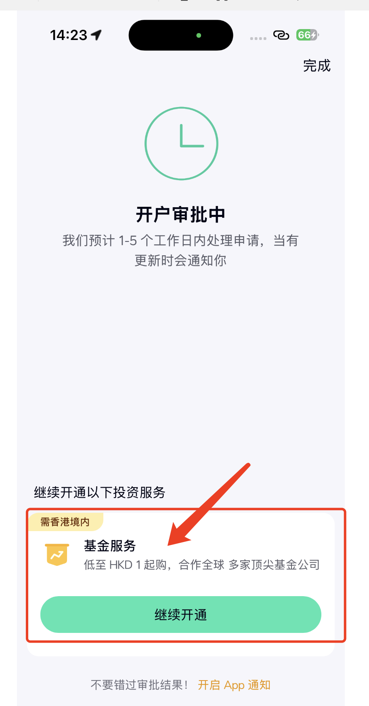

**11、** **基金服务**同样按需开通，风险问卷应按真实经验、财务情况与承受能力作答。

**12、** 完成之后记得抽空登录上去，看看有没有需要什么东西需要补充。

---

## 三、注意事项：补件、功能与费用分别确认

提交后查看审核和补件通知；开户获批后，再分别确认银行账户、投资服务和支付功能的状态。活动奖励、转账手续费和消费限额不要混为一谈。

| 注意事项 | 说明 |
|----------|------|
| **英文名字** | 必须与证件拼音一致 |
| **内地银行卡** | 开户时需要提供内地储蓄卡卡号 |
| **出入境证明** | 通过 12367 小程序下载 |
| **材料补充** | 开户后及时查看 App，可能需补充材料 |

## 四、开户被拒或卡住？常见原因 FAQ

### 众安开户为什么会被拒／一直补件？

常见卡点多与**材料不一致或缺失**有关，例如：英文姓名与证件拼音不符、内地银行卡非本人或无法完成验证、出入境证明未按页面要求上传／模糊、住址或用途填写与事实矛盾、手机在港收不到验证码。银行不会公布一套「必过话术」；收到拒绝或补件时，先读通知原文，按官方要求补，不要反复提交矛盾资料。

### 没有出入境记录能开吗？

本篇访港示例要求提供出入境证明；是否接受其他身份路径以 App 当前条款为准。不能赴港时，先比较 [见证开户怎么办理](/articles/bank/QonLSJp0)，而不是用虚假定位代替到场。

### 开户成功了，投资／支付却用不了？

银行基础账户、投资服务与支付功能是分开开通的。开户获批后逐项检查；给券商入金前再核对收款资料与限额，见 [众安银行怎么用](/articles/bank/4EB0zNOS)。

## 五、总结：先把基础账户开好，再按需添加服务

众安开户的重点是本人证件、银行卡验证和入境记录准备完整。完成后先核对收款资料与账户权限，再选择自己真正需要的投资或支付功能；邀请码保留在实际注册步骤中，方便填写。
