## 一、先分清银行账户、卡片和投资服务

**众安银行（ZA Bank）**通过 App 提供多项银行服务。很多读者想用它完成香港收付款，也有人关心卡片消费或股票交易；这几类用途需要分别看权限和费用。

本文先介绍账户，再按开户、转账、卡片和投资的顺序展开。还没开户可以先看材料准备；已有账户可以直接从目录跳到所需功能。活动与截图保留原稿记录，操作前核对本人页面的资格与报价。

---

## 二、众安介绍

我们首先还是要先了解一下众安银行，**众安银行（ZA Bank）** 是香港第一家虚拟银行。
**2019年3月27日**获得香港金融管理局（HKMA）颁发的首批虚拟银行牌照，**2020年3月24日**正式开业。

相比于其他的实体银行，众安没有一家线下实体分行，全程**手机 App 操作**，总部设在**香港数码港（Cyberport）**。
这也是数字银行的核心优势：把更多的经费用在线上产品的打磨上！

**关键发展里程碑（超全时间线）：**

- **2020年10月** — 推出香港首张可自定义卡号最后 6 位的 Visa 扣账卡（**ZA Card**）
- **2022年** — 获证监会证券交易牌照，上线基金；与 Wise 合作跨境汇款
- **2023年** — 成为香港超 80% 虚拟资产交易平台的结算银行；5 月推出零售用户虚拟资产交易
- **2024年2月** — 上线美股交易；11 月成为亚洲首家持牌银行为零售用户提供港币/美元直接买卖加密货币（BTC、ETH 等）的服务，**24/7 全天候交易**
- **2025年** — 港股全面上线；用户突破 **100 万**，存款超 **211 亿港元**，首次录得半年盈利
- **2026年** — 与 Nasdaq 合作实时美股数据；持续推出 StockBack 股票回赠等创新玩法；6 周年活动派 **600 万 StockBack** 奖励

> 💡 **ZA Bank** 强调"用户共创"和科技驱动，App 评分 **4.8 分**，支持内地访港人士用身份证+入境记录开户，**0 最低存款要求**，受香港存款保障计划保护（最高 **80 万港元**）。银行编号 387，SWIFT 代码 AABLHKHH。

那他为什么这么火？它不是传统银行的"线上版"，而是用科技重塑银行体验的**"未来银行"**——一 App 搞定存款、转账、消费、投资、保险、贷款。

特别适合**跨境用户、懒人理财族、喜欢边花边赚股**的朋友，常被称作"**港卡三剑客**"之一。如果你准备前往香港办理港卡，那他也是必选的港卡之一！

---

## 三、众安开户

聊完了基础的介绍之后，我们就来详细聊一下具体的开户教程了。在开始之前，大家需要准备如下的材料：

1️⃣ 此时人就在香港，下载众安银行 APP
2️⃣ 准备好你的**港澳通行证/身份证**，以及开通了漫游的手机号码
3️⃣ 准备好**入关证明**（小程序检索 12367）下载自己的证明

ok，准备好这些内容之后，我们就开始咱们的开户流程了！

**1、** 打开 App Store 输入 **ZA Bank** 下载众安银行，如图所示。

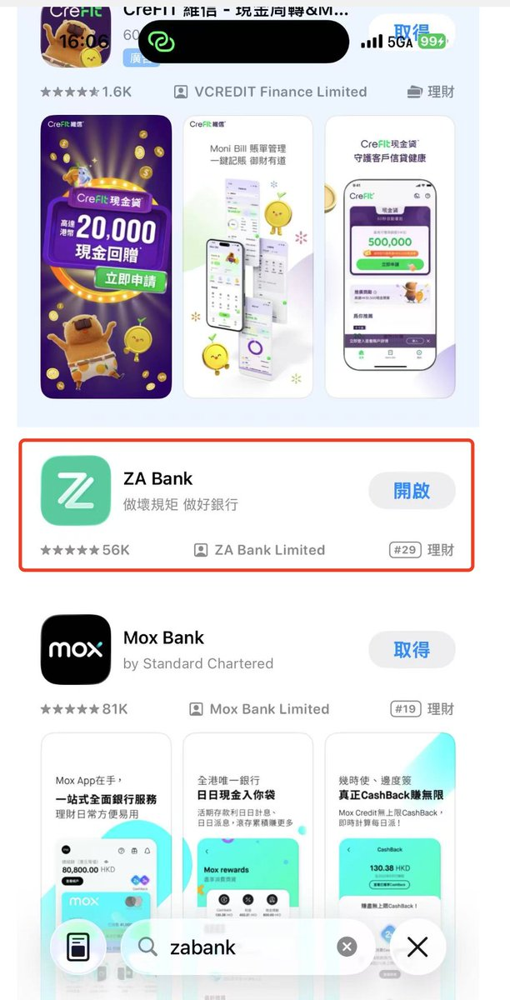

**2、** 点击立即开户，勾选自己的证件是**居民身份证**，然后看一眼要求，比其他的银行多了一个要求你填写**内地储蓄银行卡卡号**的要求，如图 2-4 所示。

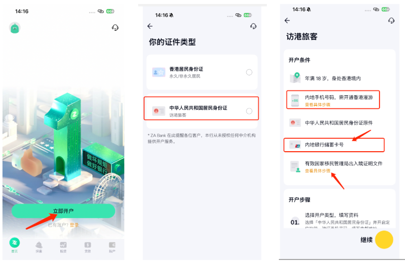

**3、** 如图 5 所示，可以看到众安银行的优势，感觉这个设计要比另外两家好，会给你说自己的优势，把自己的优势展示出来。

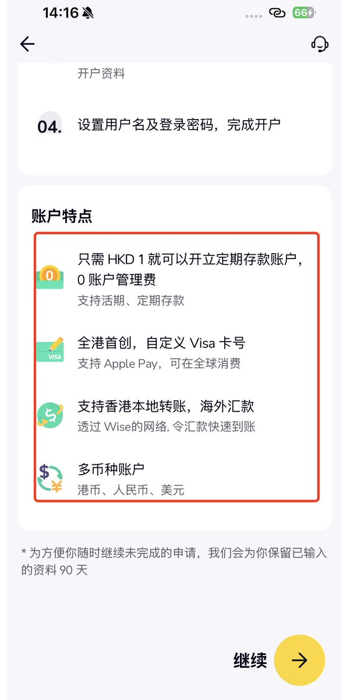

**4、** 填写自己的手机号和邮箱，然后进行身份证验证，如图 6-8 所示！
填写完毕之后，会问你是否有邀请码，这里大家填入：**T659B7**。填写用于绑定渠道邀请关系；下文第五节列出的邀请券包已于 **2026 年 5 月 27 日**结束，不要期待仍能按旧图领取那些奖励，现行权益以 App 邀请页为准。

> [注册 众安银行 账户](https://l.za.group/Dsh3x) · 邀请码：**T659B7**

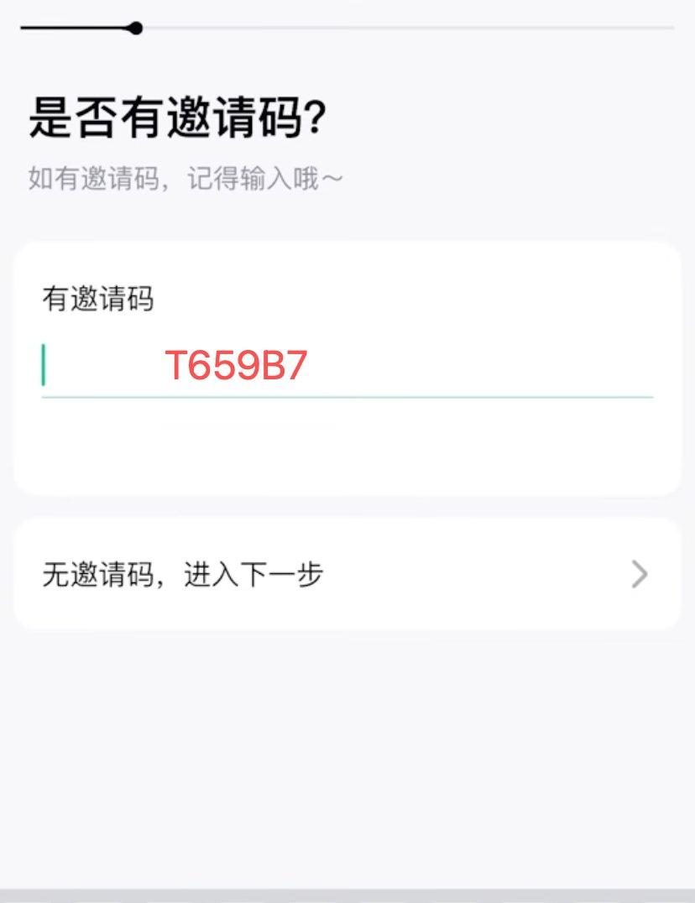

最后再确定一下如图 9-10 所示。

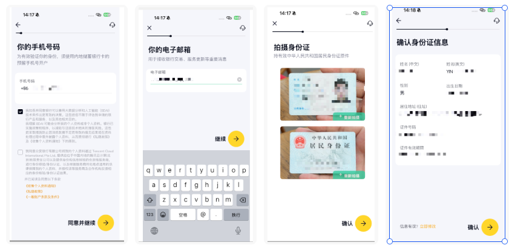

**5、** 同样是**英文名字**要格外注意，每个银行都会侧重再提醒一下，填写自己的纳税信息和职业信息，如图 11-12 所示。

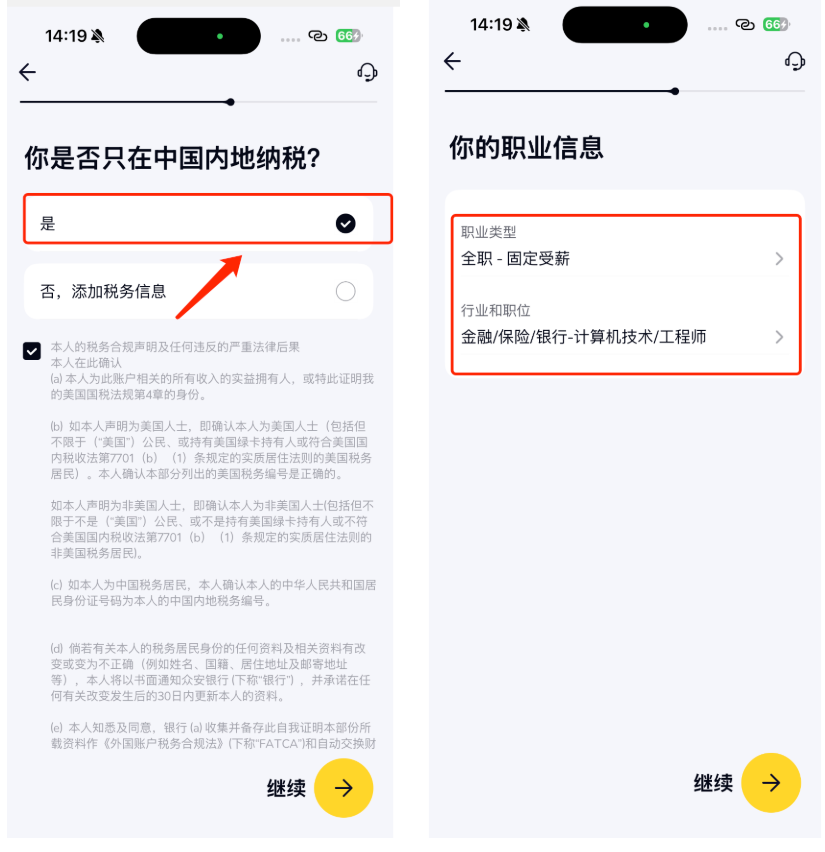

**6、** 按真实情况选择开户目的，如储蓄或日常开支，再确认开户资料；图 13–14 为字段示例。

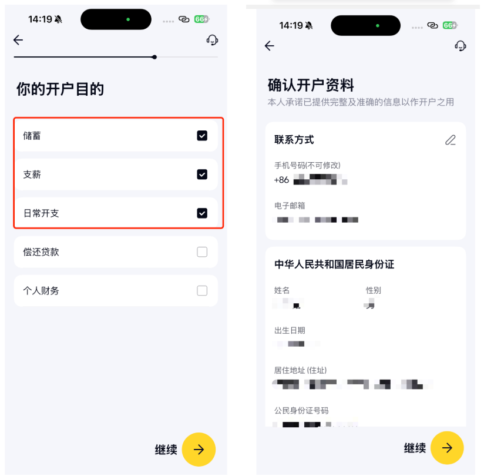

**8、** 设置密码，然后进行个人银行卡验证，最后按照我们前面一直讲到的提交自己的**出入境证明**即可，如图 15-17 所示。

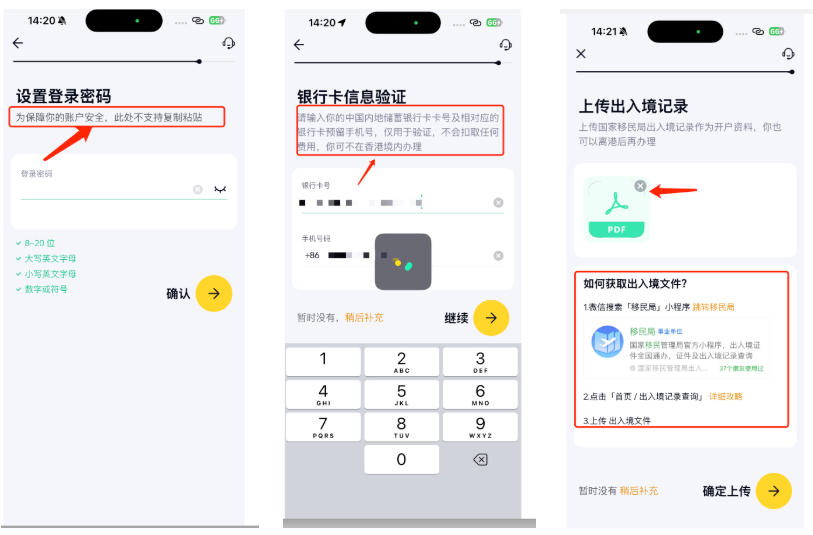

**9、** 有投资需求再申请投资账户；如图 18 所示的入口不是银行开户必选步骤。

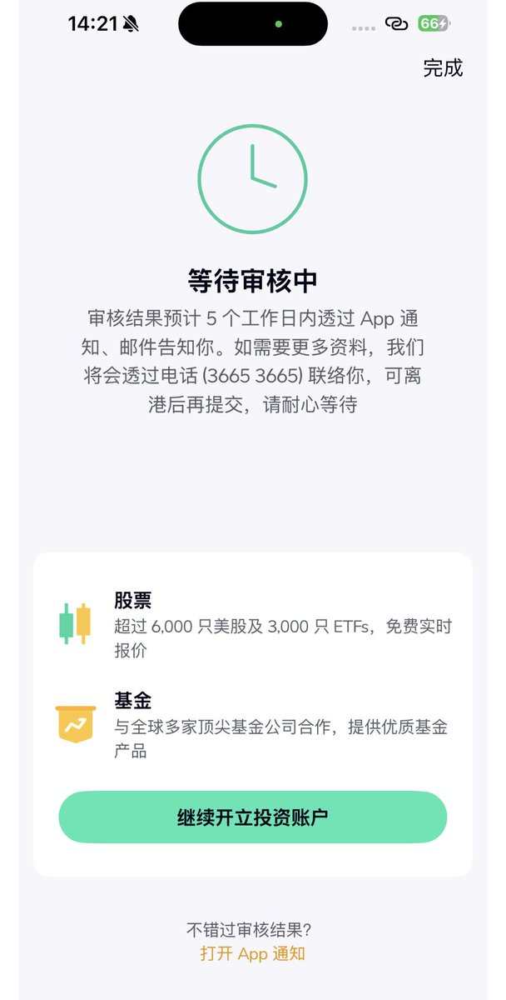

**10、** 如图 19-22 所示，把信息顺着填写完毕即可。

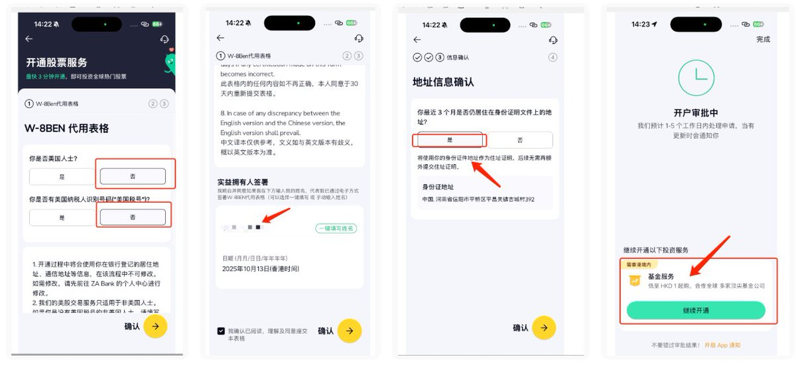

**11、** 在后续的基金服务同理，大家继续往后走即可。

**12、** 完成之后记得抽空登录上去，看看有没有什么东西需要补充。

以上就是成功完成了开户了，开户其实很简单，如果你之前申请开通过实体的汇丰/中银，就会发现，众安的开通简直简单到不能再简单了！

> 提交成功不等于获批，银行可能要求补件。获批后分别检查银行、投资和卡片服务的状态。

---

## 四、转账功能

聊完了众安的介绍和开户之后，我们就来聊一下众安的转账和消费等功能！

### 1、转数快

**ZA Bank 的转数快（FPS）** 是很多用户每天都在用的核心功能，特点如下：

- **完全免费**，全天候 **24/7 即时到账**，支持港币/人民币
- **首创 5 秒转账缓冲**：转错还能在 5 秒内取消
- 支持手机号码、邮箱、FPS ID 等多种收款方式

**登记转数快（4步，30秒搞定）：**

1️⃣ 打开 ZA Bank App → 点击左上角头像
2️⃣ 点「转数快和转账设定」→「我的转数快」
3️⃣ 选择 Proxy ID（推荐手机号码或邮箱）→ 设为默认收款银行
4️⃣ 验证码 + Face ID 认证 → 完成！

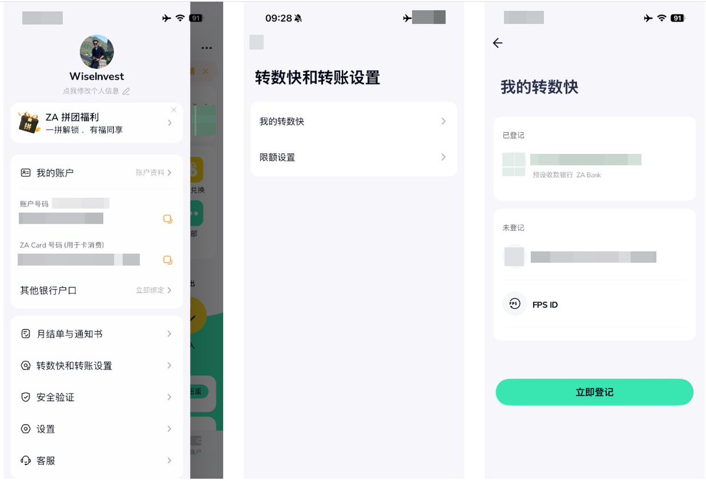

开通完毕之后，还要设置**转账限额**，香港这一点做的非常好，让你自己控制自己钱的安全：

- **本人转出限额**：即自己给自己的账户转出的额度
- **登记转出限额**：即自己设定的白名单转出额度
- **未登记转出限额**：即给陌生人转账的具体额度

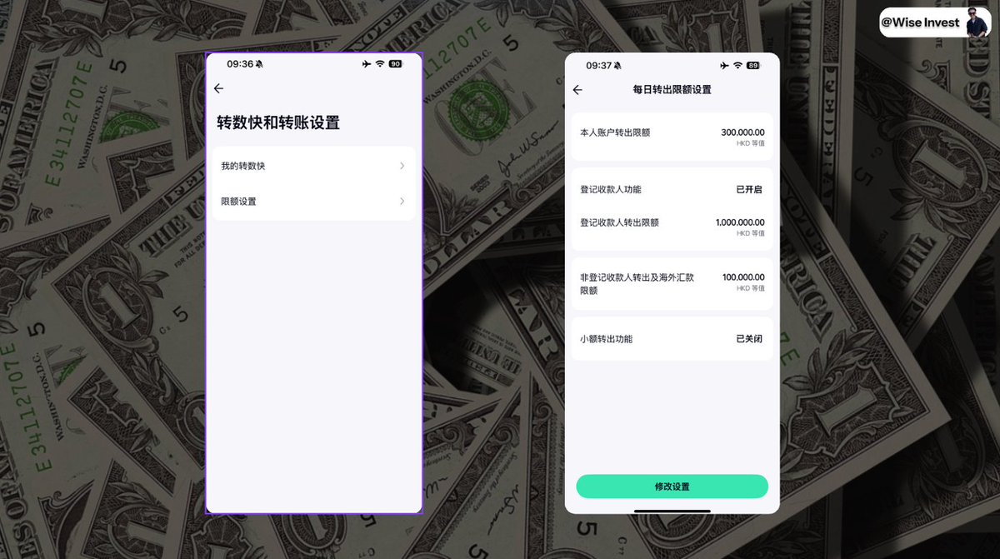

大家依次设置好额度就好，我基本上都设置一个 **10 万的额度**，如果你第一次设置比较少也没关系，后面也都可以修改，问题不大。

**从天星银行转入演示：**

1️⃣ 打开天星银行首页，点击转出，选择**转数快转账**
2️⃣ 输入自己预设好的手机号码，然后在转账银行那里选择**众安银行**
3️⃣ 确定转账，大家可以看到截图的时间，即 **3s** 即可快速直接到账

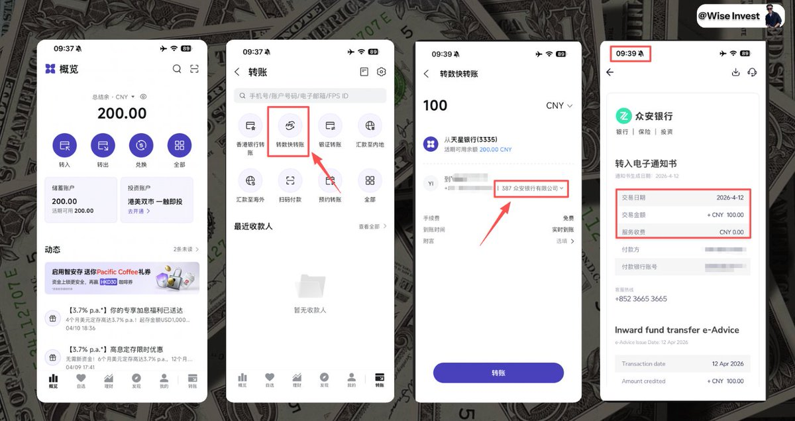

**从国内建设银行转入演示：**

1️⃣ 打开建设银行，在搜索框输入**「跨境支付通」**
2️⃣ 点击进去之后，选择立即汇出，然后输入一些关键数据
3️⃣ 原稿演示金额为 **200 RMB**。币种与收款方式按实际需要选择，银行和姓名使用收款账户的完整资料，汇款用途如实申报，不能一律填写旅游。

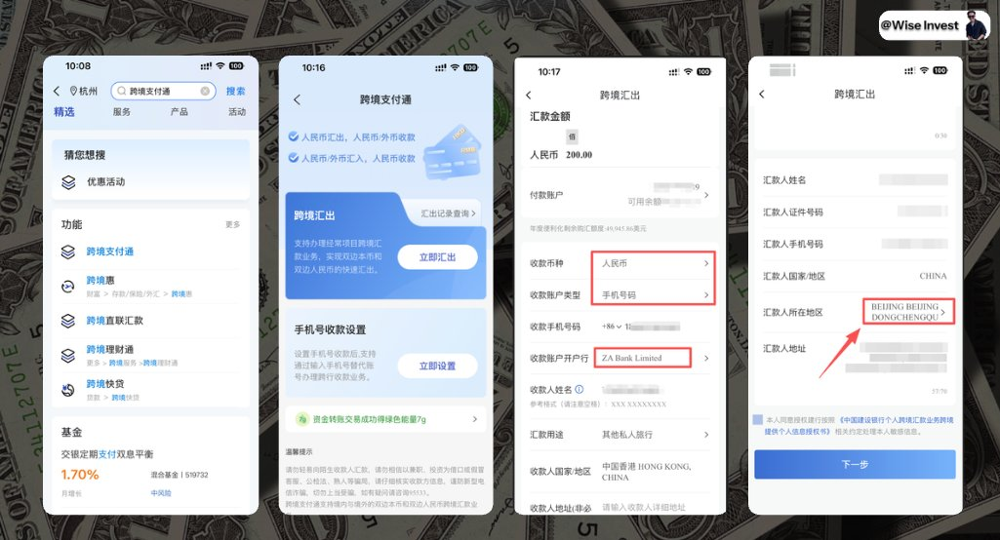

4️⃣ 填写真实汇款人地址，核对汇率、费用与收款人后再提交，之后检查实际到账。

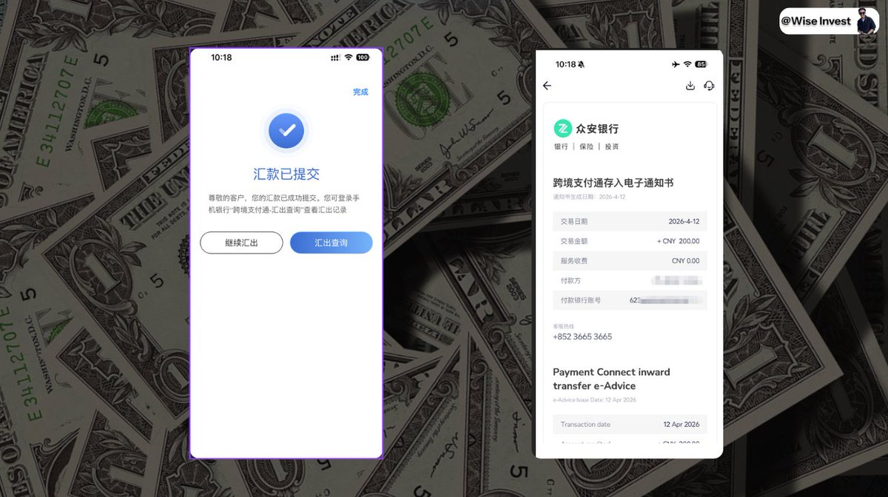

> **费用说明：** 香港本地 FPS 与内地跨境支付通是不同渠道。确认页应同时检查用途、汇率、费用和限额，不能只凭“手续费 0”判断无损到账。

### 2、绑定国内消费

原稿展示了将符合条件的账户或卡片绑定微信进行消费的方式。绑定资格、用途、汇率及渠道限额需分别核对，不把它等同于结汇或汇款，也不将旧文的“6.5 万”作为所有读者的统一限额。

具体教程我在之前的推文中有详细介绍，大家可以直接搜索 **WiseInvest513** 查阅我的相关内容进行学习。

### 3、入金券商

咱们办理众安的一个核心原因，是想要出金到券商中进行交易。这里也给大家演示了两个比较有代表性意义的券商，一个是**复星**、一个是**盈透**，详细步骤也都比较多，大家可以搜索我相关的入金教程进行学习。

---

## 五、Za Card

上面聊完了开户和转账之后，其实众安还有一个被大家津津乐道的功能，就是其 **ZA Card**，也就是 Visa 借记卡。

**ZA Card** 是香港第一张可自定义卡号最后 6 位的 Visa 扣账卡，特点如下：

- **无年费、无任何管理费**，你所消费的钱直接从活期账户扣款
- 支持 **Apple Pay / Google Pay**，非常适合用来绑定和订阅产品
- 实体卡的申领与寄送费用须查看当前卡片页面；不在卡面印敏感信息有助于保护卡资料，但不能保证不会盗刷
- 取现：香港 **3000+ Visa ATM 免费**，全球近 **300 万**可用
- 安全：App 一键锁卡、实时通知、自定义限额、生物识别

**如何开通？** 也非常简单！

1️⃣ 点击账户，点击 **ZA Card** 即可进行申请
2️⃣ 申请时候，你可以自定义你的卡号的后六位

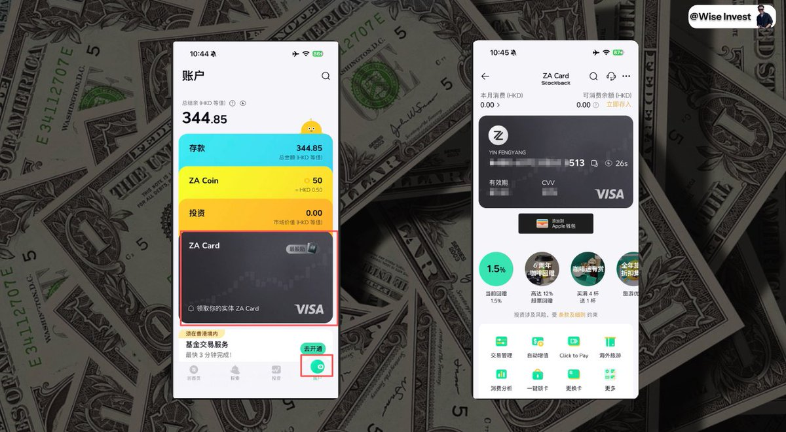

### 1、消费激励方式

下面保留原稿的消费回赠方案作为历史操作记录。实际适用消费、上限、活动期限与收费需在当前卡片条款中确认，两种方式不能只比宣传数字：

**第一种：最鼓励（推荐）**
原稿中符合条件的消费，按**股票回赠**方案展示 **1.5%** 回赠；不是所有消费都适用。举例子，你用此卡消费 1000 元，你可拿到 15 的消费返现。你可以拿这个钱去购买相对应的股票产品，也可以进行自选，例如谷歌/英伟达等明星产品。

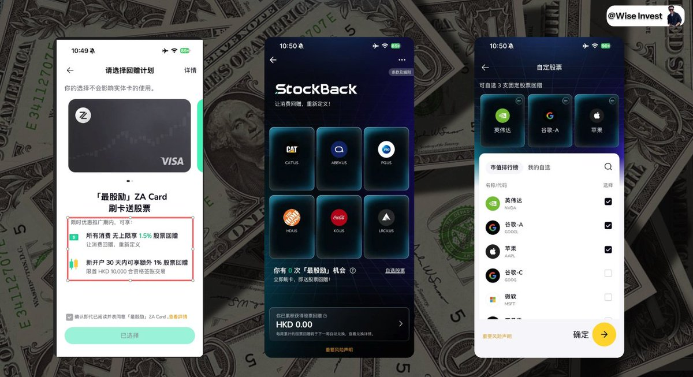

**第二种：最劲抽（不推荐）**
消费了来抽奖，最高是 **200% 回赠**，例如按 200% 计算，消费 100 对应 200 的回赠；仍须满足活动上限和适用条件。但是根据大量网友的实测，这个给的优惠跑不赢 1.5% 的回馈🤣。

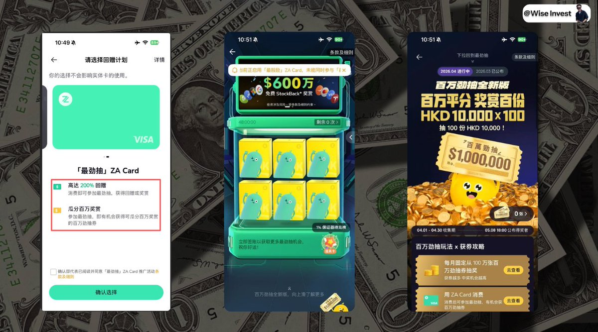

> 💡 **个人建议大家还是开卡之后选择股票回赠会更加好一些。**

### 2、费率说明

这里主要分为两种情况：

- **在香港消费港币**：完全没有任何问题，**零手续费**消费，消费完毕之后还可以领取到 **1.5% 的回馈**，如果你前往香港，直接使用此卡消费就是最舒服的！
- **消费外币**（例如美元/人民币等）：Visa 收取 **1%**，众安收取 **0.95%**，合计 **1.95%** 手续费，不太划算

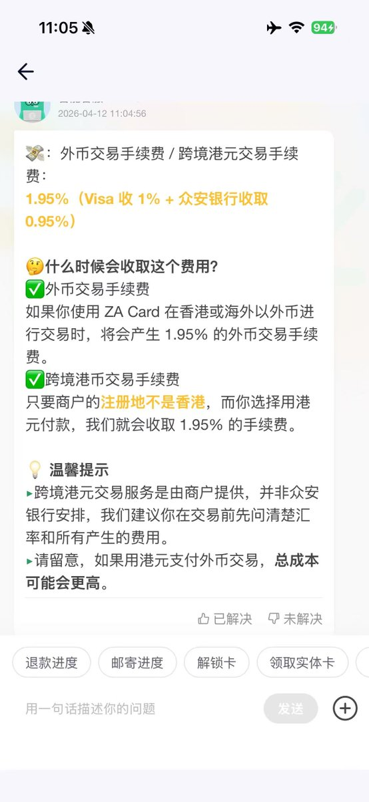

但是即便是 1.95% 的手续费，也被 **1.5% 的 StockBack 回赠**部分抵消，实际损耗极低。而且还记得前面提到的绑定微信消费吗？那个方案完美解决了众安里面的钱在**内地直接消费**的问题！

此外还有 **PowerDraw 抽奖**、指定商户高回赠（咖啡、甜点、旅游平台 **8% 折扣**至 2026.12.31）。

**ZA Card 综合优势：**

1️⃣ 花钱=赚股票，**闭环理财**
2️⃣ 跨境消费、网购、日常支付**一卡走天下**
3️⃣ 安全又省钱，综合手续费极低

如果你想要领取实体卡，也可以直接申请，注意你只能够领取**一次**，所以注意切换你想要的回赠方式，到时候自己支付一个 **35 港币**的邮费即可！

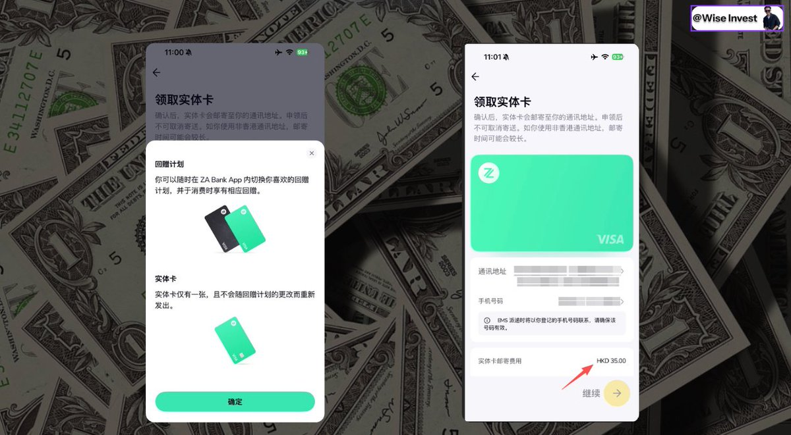

---

## 六、购买美股

那众安还有一个关键的功能，就是其可以**购买美股**，这也是最近其一大特色，包括目前老夏一直都在力推众安购买美股，所以这里就给大家重点聊一下这个板块！

**ZA Bank 2024年**起全面进军证券，于同年 11 月成为亚洲首家持牌银行为零售用户提供**港币/美元直接买卖加密货币**（BTC、ETH 等）的服务，24/7 全天候交易。

现在可以做到**港股+美股一站式交易**，**永久 0 经纪佣金 + 0 存仓费 + StockBack 股票回赠**是最大杀手锏。

**可买产品（2026最新）：**
- **美股**：超 6000 只股票 + 3000 只 ETF（Nasdaq 实时数据）
- **港股**：主要港股品种全面支持，直接从银行账户扣款，无需转仓！

**收费结构（超级透明）：**
- **经纪佣金**：港股、美股一律 **0%**（永久，新老用户通用）
- **平台费（港股）**：交易金额 × **0.05%**，最低 HKD **18**/单
- **平台费（美股）**：每股 USD **0.0099**，最低 USD **1.99**/单
- **存仓费**：0
- **基金**：原稿记录的认购与赎回费减免截至 **2026 年 7 月 31 日**，已结束，需查看当前收费

那关于众安和复星的对比，大家也可以搜索我相关的对比文章进行参考。

详细购买操作也非常简单，点击投资，选择产品，然后点击买入即可。

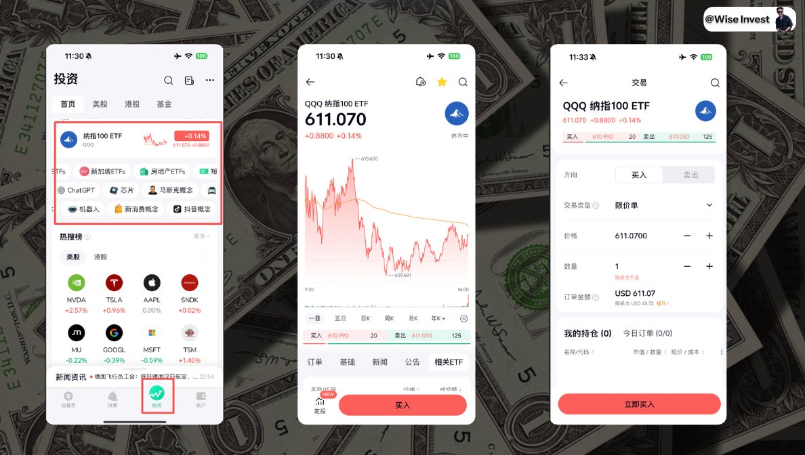

> ⚠️ **这里大家需要注意两个事情：**
>
> 1️⃣ 众安暂时**不支持碎股交易**，不像是盈透你可以想买多少就买多少，众安只能够**单股进行交易**，即你每次购买的必须是一整股，这个需要大家囤好资金再来进行交易。
>
> 2️⃣ **股息预扣税**与投资收益申报不是同一件事。税率取决于税务居民身份、收入类型、协定资格和有效税务表格；填写非美国居民表格并不保证所有产品统一适用 10%。按银行说明核对实际预扣记录。

比较银行与券商交易时，把每笔平台费、可交易单位、币种转换和税务文件维护一起考虑。股息与回购也不能混为一谈，选择产品不能只看近期股息率。

---

## 七、活动记录：区分利息、返现与股票回赠

上面基本上把众安的消费、美股、ZA Card 聊完了。这一节保留原稿活动记录，用来区分利息、返现与股票回赠；**其中邀请券包已明确结束，其余促销是否仍开放以 App 为准，不要把旧截图当成现行报价。**

### 1、存款利息（原稿记录）

这部分众安银行结合走路给资金**层层加息**。下列步数与加息数字来自原稿操作记录，上限利率是否仍为 **5%** 须在存款页核对。

操作步骤：打开首页 → 选择左上角存款 → 点击钱罐（原稿示意最高年利率 **5%**）→ 激活钱罐活动。

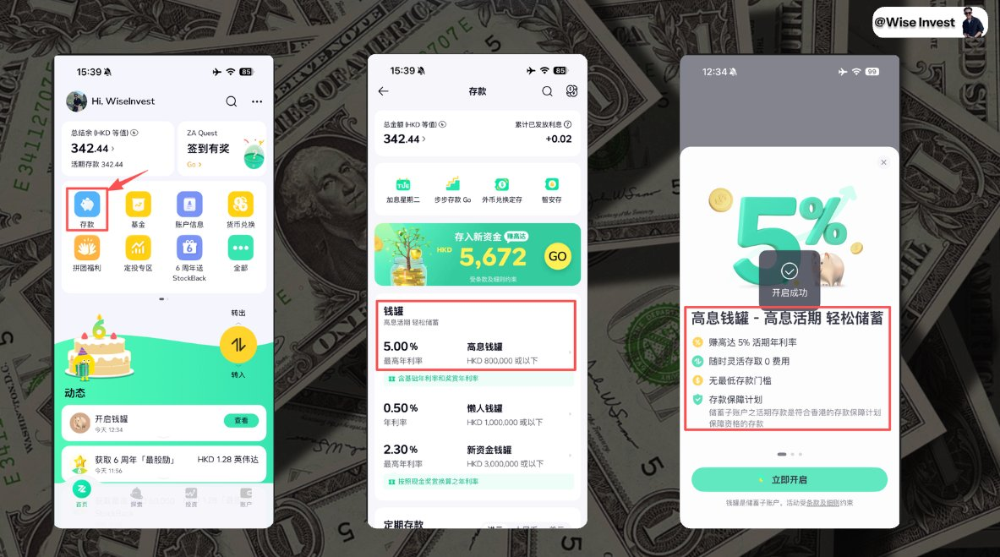

然后就可以看到一个**步步生息**的挑战，点击立即挑战，然后绑定自己的运动（苹果用户绑定健康数据），可以看到：

- 每日 **2k 步**，可以解锁 **0.29%**
- 每日 **1 万步**，可以解锁 **0.5%**

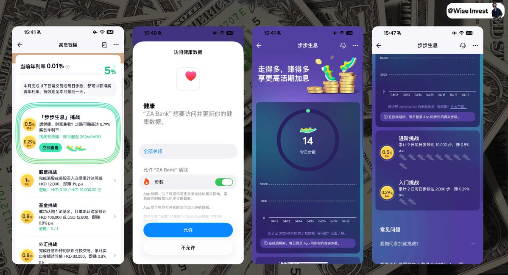

虽然是促销活动，但是这种和自己的**健康绑定**在一起的活动，我觉得还是非常有实际价值和意义的！

### 2、6 周年送 StockBack（原稿记录）

这是原稿中的周年庆活动说明；任务是否仍开放、奖励额度与截止日以 App 活动中心为准，不能默认“现在做任意刷卡/投资都会送股票”。

- **刷卡消费**：例如咖啡、餐饮、订阅 YouTube 等会员进行的任何活动，都会给你赠送股票
- **投资送**：完成股票加入自选、建立定投计划、完成港美股购买，都可以激活奖励
- **存款/汇款/转账**：都会赠送相对应的股票

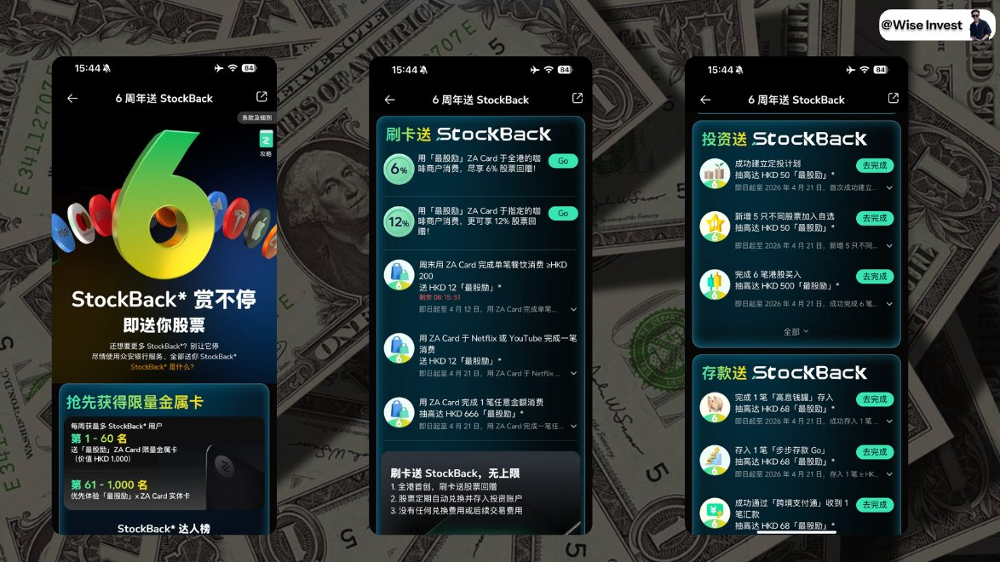

汇款、ZA Card 消费、证券交易和股票激励是不同功能。原稿记录的 **1.5% 回赠**与周年任务有各自条件，不能合并推导为无损转账或所有行为都可领取奖励。

### 3、邀请福利

以下为原稿记录的邀请活动，截图标注截至 **2026 年 5 月 27 日**，现已结束。保留规则供理解领取流程，当前邀请入口不承诺这些旧活动奖励：

- 刷 Za Card 可得 **2.5% 的股票回赠**
- 基金持仓 **800 的回赠券包**
- 股票现金 **1000 的回赠券包**
- 价值 **126 港币**的兑换立减券

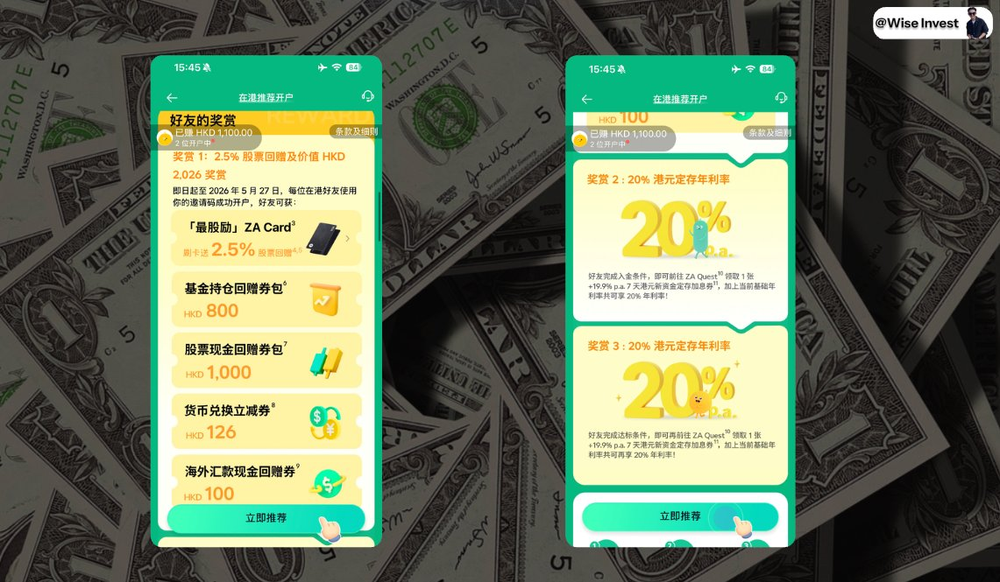

> 开户时可填写邀请码 **T659B7**；上方为已结束的活动记录，现行权益以 App 内的邀请规则为准。

---

## 八、注意事项：按功能分别核对

存款保障不覆盖股票、基金或虚拟资产。股票回赠也不是保本收益，消费金额、回赠上限与实际手续费一起计算；不要为了任务购买不需要的商品或反复交易。

转账用本人真实资料，首次使用某条路径先确认两侧都支持。任何旧截图中的费用、限额和活动都需要与当前账户核对，不能据此承诺零损耗或一定到账。

## 九、总结：围绕实际用途使用账户

ok，以上就是咱们关于众安银行的详细介绍了！

从众安银行的**发展历史**入手，然后给咱们介绍了其如何进行**开户**，以及不同情况下的**转账和消费**，如转账给香港/美国券商，绑定微信进行国内消费，详细的**购买美股**、以及最后的**福利**等内容！

可以说是目前你能够看到的最详细的关于众安银行的介绍了！那大家如果前往香港之前，记得看这篇文章好好学习学习哦，了解其特性以及其优点和可以赚钱的点！

ok，那如果你觉得本期的内容对你有帮助的话，也欢迎大家一键三连哦！
我们下一期给大家分享关于美股的所有投资的可能性，那大家就下期再见了！

<!-- seo-next-links -->
## 相关阅读

[众安银行开户教程](/articles/bank/2aiiqnjt){card}
[港卡与港股券商开户入金](/articles/series/hk-stock-funding){card}
