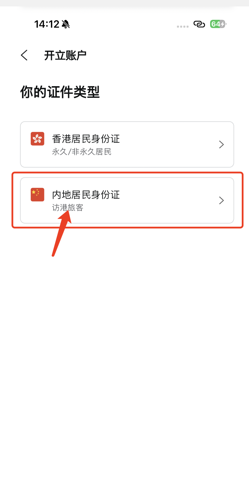
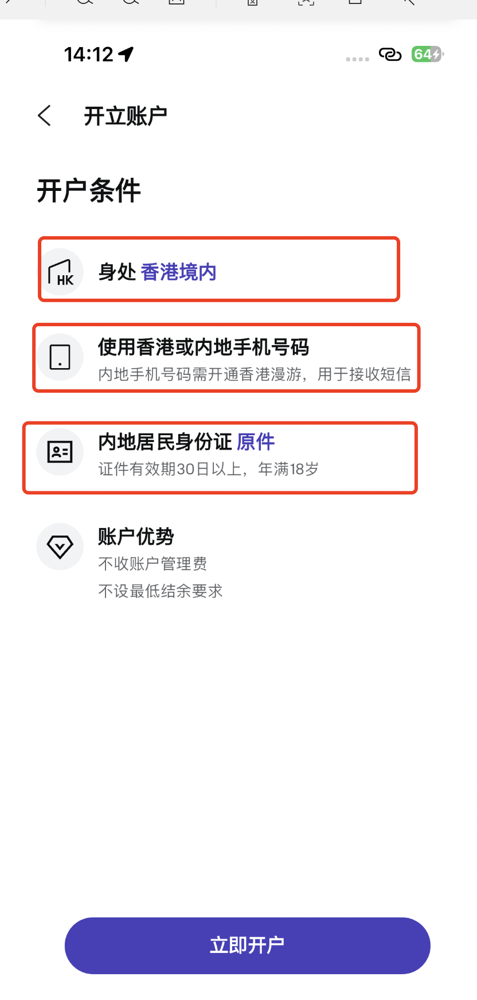
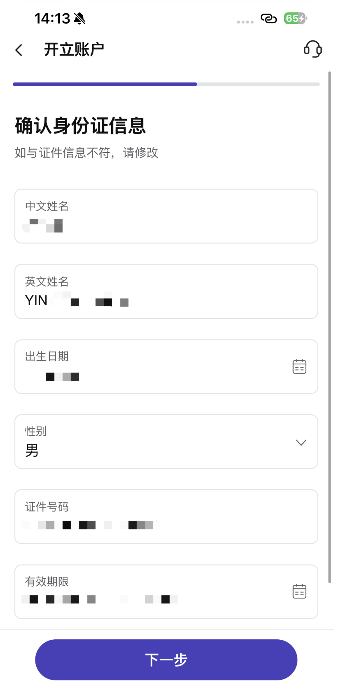
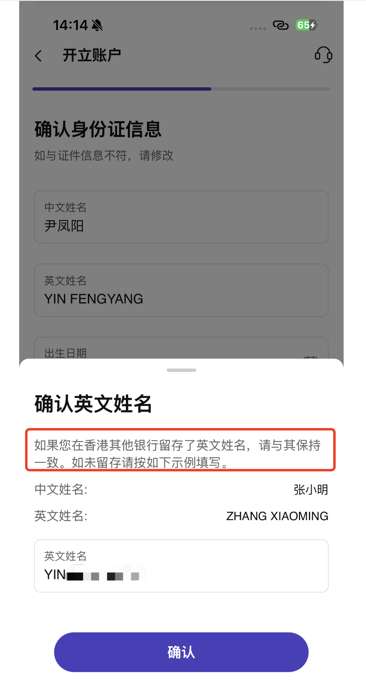
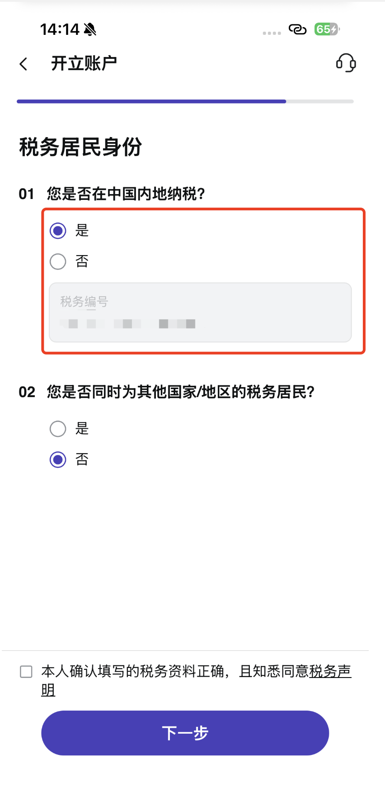
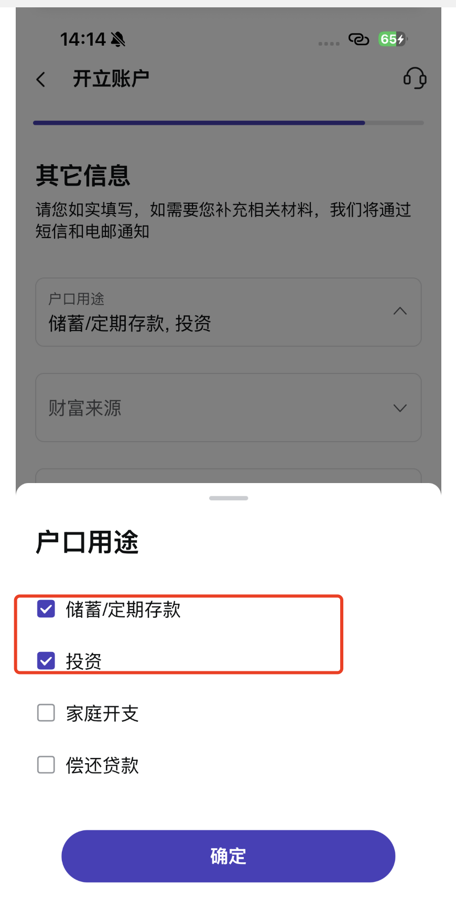
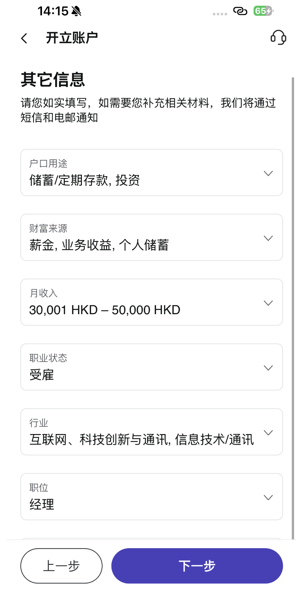
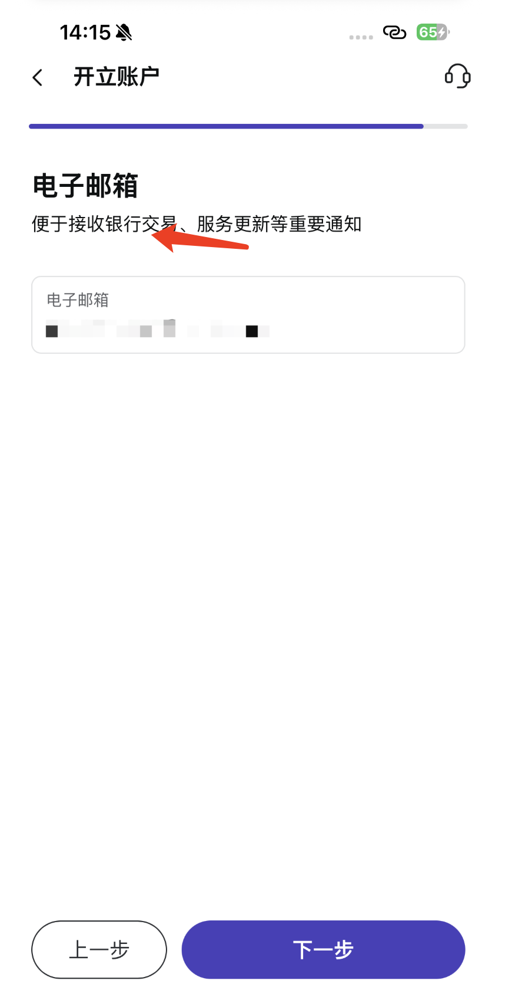
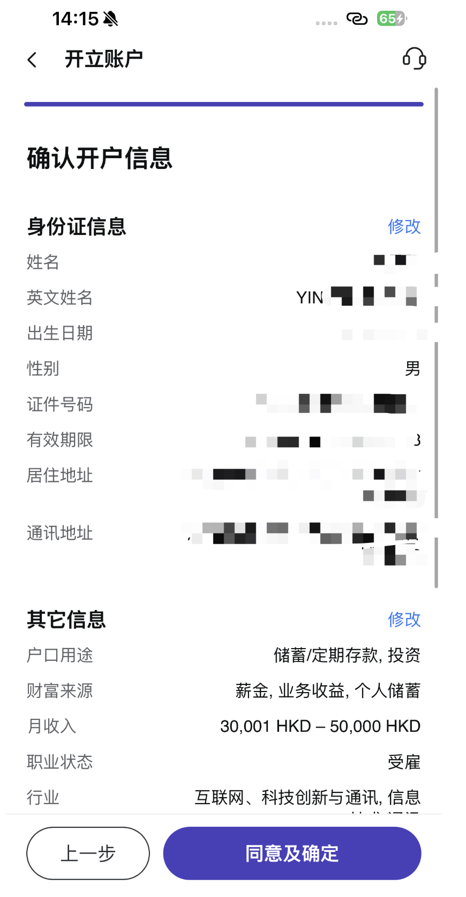
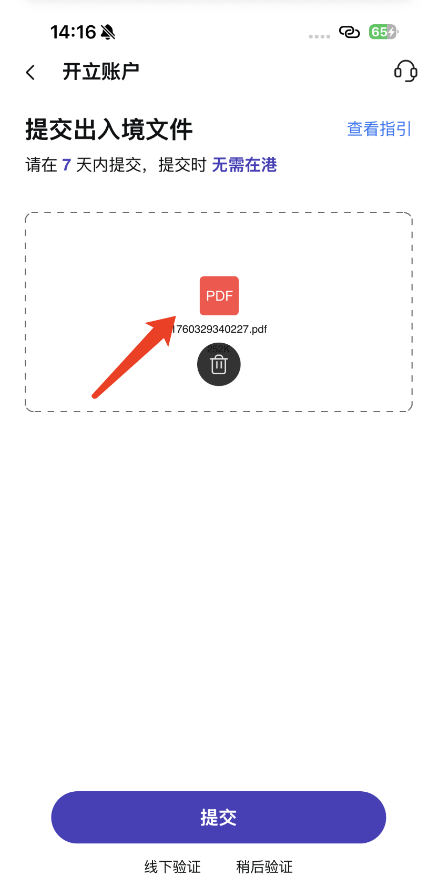

## 一、先认清银行，再准备访港材料

准备开香港银行账户时，大家可能在旧教程里看到“天星”，下载时又看到“大象”。先把名称认清，才不会拿着一家银行的要求去申请另一家。

**本文的天星银行原英文名为 Airstar Bank，现在使用 EleBank 品牌，中文名为大象银行。**它在 2026 年 4 月先更名为象象银行，同年 8 月再调整为大象银行，英文 EleBank 沿用。名称变更可核对[银行公告](https://www.elebank.com/zh-cn/PR_20260423.html)及[官方 App 的版本记录](https://apps.apple.com/cn/app/id1488056130)。

**Mox 是另一家银行，不能混用开户规则。**其主体为 Mox Bank Limited；本文原截图中的 Airstar App 与 Mox 并不相同，详见 [Mox 官方介绍](https://mox.com/zh/faqs/faq-general/)。

这篇先讲清银行账户申请和提交后的检查。银行账户、卡片和投资服务的权限需要分别看，完成银行开户不能推导为其他服务也已开通。

访港申请先准备好以下内容：

- **本人已年满 18 岁，提交开户申请时身处香港境内。**
- 本人有效身份证原件，以及赴港所需证件。
- 能接收验证码的有效手机号码、本人邮箱和真实个人资料。
- 银行要求的有效出入境记录查询文件。

当前官网支持访港旅客预填资料后在 **90 天内抵港提交申请**；预填不等于境外远程完成开户。上述资格与申请顺序依据[大象银行官方开户说明](https://www.elebank.com/zh-cn/open-account.html)，审核期间仍可能需要补件。

## 二、开户申请：按顺序核对资料

> **以下保留的是天星旧版界面。**用它理解资料填写顺序；现在下载应从 EleBank 官网入口进入应用商店，核对名称和开发者，不要求手机界面与旧图逐字一致。

**1、找到正确的 App。**旧图红框是“天星银行 Airstar Bank”；当前官方应用为“大象银行 EleBank（原天星银行）”，开发者为 Ele Bank Limited。

**2、选择与本人证件相符的开户类型，完成身份验证。**内地访港申请按内地居民身份证类型提交，核对在港状态、证件与所需出入境记录；不同证件类型不能照着截图随意选择。

  

**3、填写并核对姓名。**检查识别出的中文姓名、英文姓名与本人证件记录，发现识别错误先更正，不能照抄截图中的示例。

 

**4、申报税务居民身份与税号。**仅为中国内地税务居民的读者填写对应信息；同时具有其他税务居民身份时也需申报，不能统一照选“否”。

**5、如实填写用途、收入、行业和职位。**只有实际用于储蓄和投资时，才选择对应项目；申请资料要能解释自己的资金来源和预期使用方式。

 

**6、确认联系方式与整份申请。**邮箱、手机号应由本人持续使用；提交前再检查姓名、证件、地址和税务资料是否一致。

 

**7、上传出入境记录。**旧图展示的是文件上传步骤。通过官方移民管理服务查询并保存本人记录后，检查文件是否清楚、姓名与入境信息是否完整，再按银行要求上传；不要用他人记录或修改证明内容。

 

**8、保存提交结果，继续跟进审核。**记录申请编号或提交时间，在 App 中查看进度。出现补件要求时，先读清缺哪份材料、格式有什么要求，再补交对应文件。

**申请已提交、审核通过、账户可以使用，是三个需要分别确认的状态。**提交提示不能替代开户成功通知，也不能作为让他人向账户汇款的依据。

## 三、提交之后：查审核、补件与收付款条件

先回到 App 检查开户结果及是否仍有待办事项。看不到明确结果时，可以通过官网列明的客服渠道查询，不必反复创建新申请。

**大象银行当前开户说明写明没有最低存款要求。**若本人收到额外核验通知，应先向大象银行确认具体要求，再处理自己的申请；不要把其他银行的验证金额当作这家银行的开户门槛。

账户获批后，准备第一次收付款时，把下面几项核对清楚：

| 操作节点 | 要确认的内容 | 确认后再做什么 |
| --- | --- | --- |
| 查看账户 | 开户结果、补件状态、可用币种与功能 | 确认所需功能已开通，再安排转账 |
| 准备收款 | 本人账户姓名、账号、银行名称、币种及适用转账通道 | 将本次需要的资料交给汇款方，不复制教程中的资料 |
| 准备转出 | 实际收款人、收款银行、账号、币种与限额 | 核对费用、汇率和附言后再确认 |
| 转账已提交 | 转账记录、参考编号、处理状态 | 到收款账户核对入账，不能只看付款端扣款 |

不同通道的资料、费用和处理时间需分别检查，不能把上一笔的收款资料直接用于下一笔。**银行余额到账，也不意味着券商账户自动入金成功**；后续给券商转账时，还要核对券商自己的入金记录。

## 四、总结：先确认开户结果，再使用账户

这篇的顺序是：**认准银行 → 准备本人材料 → 身份核验与资料申报 → 提交和补件 → 确认开户结果 → 检查收付款资料。**原天星截图保留作参考，新名称和申请条件则按当前官方资料理解。

如果开户是为后续投资做准备，接下来还要查看券商接受的资金通道与同名要求。先把账户关系和资金路径接好，再进入具体转账与交易。

[美股从 0 到 1：账户、资金与投资流程](/articles/series/us-stock-zero-to-one){card}
