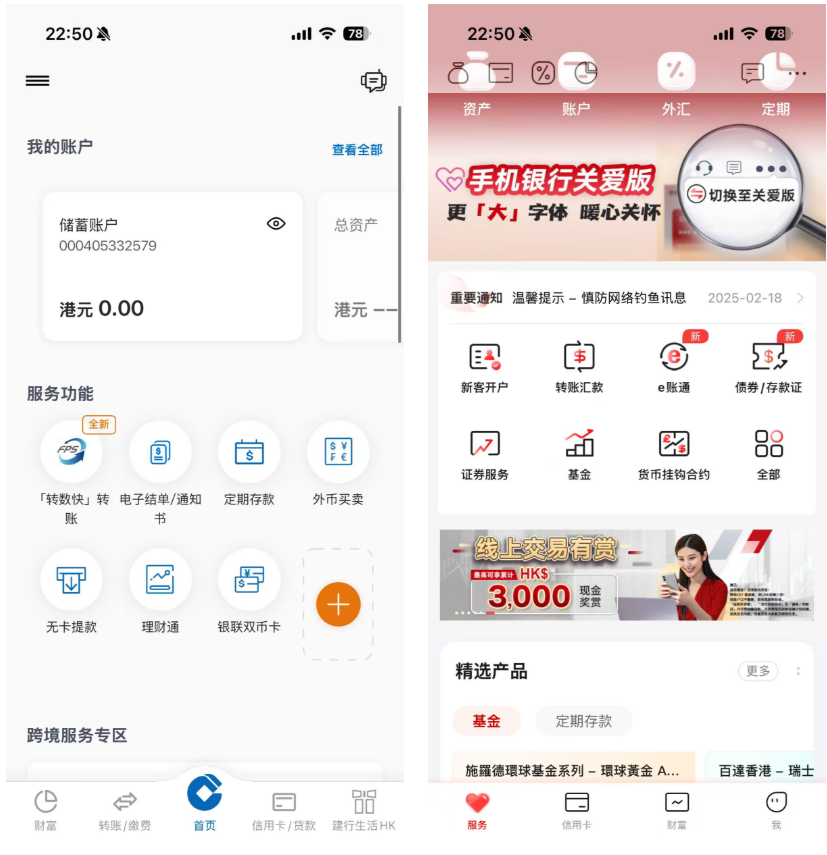

## 一、这篇教程解决什么问题

想在手机里管理储蓄与投资时，先分清银行账户和投资账户的权限。本文介绍**平安数字银行**，带你从准备证件、提交银行申请走到按需申请投资服务，并把活动条件与日常使用分开说明。

前面的银行教程可作为比较参考：

1️⃣ **实体银行开户教程**（汇丰 / 中银）
2️⃣ **虚拟银行开户教程**（蚂蚁 / 大象〔原天星〕 / 众安）
3️⃣ **WIse 开户教程**
4️⃣ **Ifast 开户教程**
5️⃣ **见证开户开卡教程**
6️⃣ **汇立银行开户教程**

不同银行是否接受访港申请，需要逐家核对，不能用这篇教程的旧判断代替当前资格。**Mox 与天星是两家不同银行**：原天星 Airstar 现使用大象银行 EleBank 名称，不能把 Mox 的材料和入金要求套到它身上。名称可核对[大象银行官方应用](https://apps.apple.com/cn/app/id1488056130)和 [Mox 官方介绍](https://mox.com/zh/faqs/faq-general/)。原天星的申请步骤整理在下面这篇：

[大象银行（原天星）开户教程](/articles/bank/ucHyMf8P){card}

---

## 二、平安数字银行介绍

**平安数字银行**（国际）有限公司是香港持牌数字银行，前身为平安壹账通银行（香港）有限公司，简称 **PAOB / PAO Bank**。

它于 **2019 年 5 月**获得**香港金融管理局（HKMA）虚拟银行牌照**，**2020 年 9 月 29 日**正式开业，是香港第 7 家虚拟银行。最初主打中小企业金融服务，**2023 年 11 月**被同属**平安集团**的陆金所控股以约 **9.33 亿港元**全资收购后，开始大力发展个人银行业务。

**2026 年 3 月 26 日**正式焕新品牌为"**平安数字银行**"，口号是"安心在·未来在"，定位为一站式数字金融服务平台。依托平安集团庞大的金融科技实力、保险生态和数据能力，在 **AI 风控**、跨境服务和综合金融上优势明显。截至 **2026 年 3 月 15 日**，个人银行客户存款总额已突破 **120 亿港元**。

### 1、核心产品体系

- **存款与储蓄**：活期 + 定期存款，无最低结余要求，支持灵活资金管理；核心账户活期利率基础不高，但新客有超强促销
- **支付与转账**：FPS 实时转账、跨境汇款、外汇兑换全覆盖，一站式操作
- **投资与财富管理**：2026 年 3 月重磅推出"**双实力理财服务**"——银行级资金安全 + 券商级交易体验！储蓄账户资金可直接用于投资**港股、美股、基金、货币基金**，无需额外转账；支持 **16 小时美股**交易、40+ 技术指标 + 实时热力图
- **保险**：全港数字银行中独树一帜！线上秒投汽车险、旅游险、家居险等；线下有专业顾问 1:1 咨询人寿、储蓄保险、财富传承方案，完美结合**平安集团**保险生态
- **其他**：全天候 App 管理、AI 智能风控（防深伪、异常交易监测）、e-KYC 快速开户，最快 **3 分钟**完成

### 2、安全性

- 香港存款保障计划对每名存款人在每家计划成员银行的合资格存款，保障上限为 **80 万港元**；股票、基金、保险及虚拟资产不属于存款保障。参见[存款保障委员会说明](https://www.dps.org.hk/en/for-depositors/features-of-dps/)。
- 采用多重生物认证、实时通知，**平安集团**科技背书，安全可靠
- 大部分核心服务（如账户维护、基本转账）免费或低费，强调透明普惠

### 3、原稿福利记录（2026 年 4 月，非当前承诺）

- **新客户迎新**：使用指定推荐码开户，成功开立储蓄账户后，首 30 天内首 **5 万港元**活期存款享 **8% 年利率**；同时开 1 个月定期存款，首 **5 万港元**也可享 **8% 年利率**
- **新资金定期**：港元新资金 3 / 6 / 12 个月最高 **2.75%**（100 元起存）
- **投资账户**：新开投资户可享最高 **2000 港元**现金回赠券
- **外币兑换定存**：额外高息优惠，利率每日更新，App 内实时查看

> 💡 **平安数字银行**综合实力强劲，尤其在投资无缝衔接 + 保险服务上领先同业，特别适合计划长期在港理财、跨境资金流动、或想一户打通银行 + 券商 + 保险的朋友。

---

## 三、开户教程

整个开户教程其实非常简单，但是有一个小问题比较麻烦，那就是**平安数字银行不允许截图**，所以所有的图片，我都是在实操的过程中用另外一台手机进行拍摄的，视觉效果上可能会有一些阅读压力。

开始前请准备如下材料：

1️⃣ 实名登记的**内地手机号码**
2️⃣ 在有效期内的**港澳通行证** & **个人身份证**
3️⃣ 按本人国籍、居住地与税务身份核对申请资格
4️⃣ **出入境证明**材料（汇立银行教程中有介绍如何获取）

ok，如果此时大家在香港基本上就应该都满足的，那我们就正式开始注册流程吧！

**1、** 打开手机应用商店检索"**平安数字银行**"，登录进来之后就开始完整的注册流程，输入自己的**手机号码**。

**2、** 关于邀请码大家可以填写 `293INR`，其实不输入也行，大家正常开通就行了。上文双 8% 迎新存款属于**已结束的历史活动**，填写邀请码不再等于仍能拿到那一档高息；现行存款利率与迎新条件以 App「存款」页为准。

> 注册 平安数字银行 账户 · 邀请码：**293INR**

**3、** 而后就是确定你的**登录密码**，继续进行下一步，提醒你需要准备的材料。

**4、** 然后就是验证你的**内地身份证**，以及自己的**港澳通行证**，通过拍摄 + **NFC 读取**的方式。

**5、** 这里多聊一下：**NFC 读取**是在手机的偏上方，就是你的摄像头旁边，一些朋友没有使用过的会放在中间部分，这个时候是读取不到 NFC 的，大家多加注意一下。

**6、** 而后就是验证你的**人脸**，以及上传你的**出入境记录**。出入境记录下载之后如何才能够被文件发现，我在汇立银行开户的时候也有详细的介绍，大家翻看上一期教程学习即可，这里不过多展开了。而后就是准备开设自己的银行账户信息。

**7、** 如实填写居住地址、个人信息、账户用途与收入来源。图片帮助你找到字段，不代表这些答案适用于所有人。

**8、** 最后就是再确定你的**税务信息**以及你的**身份证号码**是否正确，即完成了完整的户口注册、身份证认证、以及详细的开立银行账户的流程了。

其实整体上和之前咱们开的一些普通的数字银行没什么很大的区别，难度也不算是很高。

---

## 四、投资开立教程

聊完了注册之后，我们就来顺势来聊一下**投资账户**的开立教程。其实这个我们在之前聊到过，现在的数字银行或多或少都会支持投资了。

一方面是数字银行的线上运营成本更低，可以把更多资源放在产品上；另外一方面，支持**港美股购买**在最近一段时间好像已经成为了一个数字银行的标配了，像是**众安 / 澳门蚂蚁 / 大象（原天星）**等都在陆续支持港美股购买。

ok，那我们就开始吧：

**1、** 按 App 要求完成实际位置核验，如实填写教育、资产与投资经验。没有衍生品经验就按真实情况填写，不能为了开通产品照抄截图。

**2、** 按真实情况回答机构关联身份、美国税务身份等问题，阅读服务协议后决定是否接受。

**3、** 核对税务材料、上传合要求的真实地址证明并签名。**专业投资者并非普通开户的默认选项**，只有符合资格、理解相应安排且确有需要时才申请。

**4、** 确定完成之后即完成了申请，后续耐心等待审核通过即可。我当时在香港的时候没有补充我的地址证明，等到我回到内地之后重新补充了一下我的地址证明即成功通过了审核，就可以在**平安数字银行**里面购买港美股了！

**5、** 我最后也给大家截图了平安的券商界面，一些功能还算是不错，就是界面上其实还是有待提高，对比到一线的**众安**等还是有一些差距。

---

## 五、平安福利介绍

那聊完了开户和转账之后，我们来聊一下**平安数字银行**目前的功能以及其福利政策。

其实跟**汇立**相比，**平安数字银行**的定位更偏向一站式综合金融 + 平安生态，核心卖点不是单纯的高息吸储，而是真正让你"一部 App、一个账户"打通**存款、投资、保险**三大场景，尤其适合追求长期财富规划、跨境资金管理和综合保障的朋友。

### 1、存款

**平安数字银行**的活期 + 定期存款是入门级主力，**无最低结余要求**，**100 港元**起存，App 内操作超方便。核心账户活期基础利率不高（约 **0.5%** 左右），所以主力还是靠定期 + 新客促销来冲收益。

最新基准利率（2026 年 4 月 28 日参考，港元新资金 / 任何资金，具体以 App 实时为准）：

- **1 个月**：约 2.4%（现有资金）
- **3 个月**：2.7%（任何资金）
- **6 个月**：2.6%（新资金）/ 2.5%（现有资金）
- **12 个月**：2.75%（新资金）/ 2.5%（现有资金）

**历史活动记录**（截至 2026 年 4 月 30 日，现已结束；以下保留当时的规则）：

- **新客户迎新**：使用指定推荐码开户成功后，首 30 天内首 **5 万港元**活期存款享 **8% 年利率**；同时成功叙造 1 个月港元定期存款，首 **5 万港元**也享 **8% 年利率**（活期 + 定期双 8%，总计最高约 **HKD 656** 利息，超级划算！）
- **新资金定期**：港元新资金 3 / 6 / 12 个月最高 **2.75%**（100 元起存）
- **外币兑换定存**：额外高息优惠，部分可达更高水平（App 内每日更新）

> 上述双 8% 为已结束的活动，不作为当前邀请福利。开户后请查看 App「存款」页面的现行利率和条件。

### 2、投资与财富管理

这是**平安数字银行** 2026 年 3 月重磅推出的核心差异化功能——"**双实力理财服务**"：银行级资金安全 + 券商级交易体验！

储蓄账户的资金可以直接无缝切换（SWITCH）用于投资，无需额外转账、零延迟：

- 支持**港股、美股、基金、货币基金**全覆盖
- **美股交易长达 16 小时**（含盘前盘后），专业分析工具（40+ 技术指标 + 实时热力图）
- 卖出收益即时回流存款账户继续收息，资金利用率拉满

原稿还记录过投资户迎新：尚未持有投资账户的客户，新开投资户并启动服务，可享最高 **2000 港元现金回赠券**（股票 + 基金 + 笔笔返组合），开立后首 **60 天**内交易还有额外返还。**该记录未给出明确结束日，也不能当作 2026 年 11 月仍有效的现行承诺**；是否仍开放、各档门槛与兑换规则以 App 投资页为准。现有个人银行客户加开投资户的入口与耗时同样以本人页面为准。

### 3、保险（全港数字银行独家专属功能）

这点是**平安数字银行**真正领先同业的杀手锏——全港首家提供线上 + 线下全方位保险服务的数字银行，直接把**平安集团**的保险 DNA 植入 App！

- **线上**：秒投汽车险、旅游险、家居险等一般保险，无纸化、超快
- **线下**：专业保险顾问 1:1 咨询人寿、储蓄保险、财富传承方案，温度感拉满

真正实现"存款生息 → 投资增值 → 保险保障"一户搞定，特别适合大湾区客户或需要综合财富规划的朋友。

其他功能：

- **FPS** 实时转账、跨境汇款、外汇兑换全覆盖
- **AI 智能风控** + 多重生物认证，安全有保障
- 合资格存款适用上文说明的存款保障；投资与保险另行承担相应风险

> 上述双 8% 已在原稿中标明结束，不能据此安排当前存款。银行服务、投资和保险的费用及风险分别核对。

---

## 六、注意事项：问卷、活动与权限

风险问卷应反映真实经验与损失承受能力，不存在为了“过关”统一选择的答案。存款转成证券或基金后，也不能继续把它当作受存款保障的存款。

提交银行申请、开通投资账户、获得某项活动资格是不同结果。逐项查看审核与补件通知，保存活动门槛和达标记录，再决定是否投入资金。

## 七、总结：按用途开通，不为活动一次开全

ok，那以上就是关于**平安数字银行**的一个简单的开通和介绍了，到目前为止，我们关于香港目前可以开的数字银行都已经介绍完毕了，大家可以按照需求去进行学习了。

那最近也是临近咱们的五一假期了，如果你刷到了这个教程欢迎一键三连，到时候也可以一次性前往香港就把所有的银行都给安排下来。

其实虽然说目前的这些数字银行都已经开完了，但是很多的细节功能的介绍和玩法其实我们介绍的都还比较少，目前我们唯一单独介绍的产品银行，可能也就是咱们的**众安银行**了，可以看如下的教程进行学习！

那不同银行之间的汇率、存款利率，以及现在大家都在支持的**港美股购买功能**都如何呢？好像都还没有进行一个细节的对比，到时候后面，我就再慢慢地给大家进行连贯在一起进行介绍了！

---

### 延伸阅读方向

聊完了虚拟银行之后，我们下期内容将会重点就**建行亚洲**和**工商亚洲**，进行一些对比和转账的对比了，也算是第三部分银行卡的介绍了，专注于境内和境外同名银行转账，到时候参考一下费率等问题啦！

**ok，那我们就下期再见了！**
