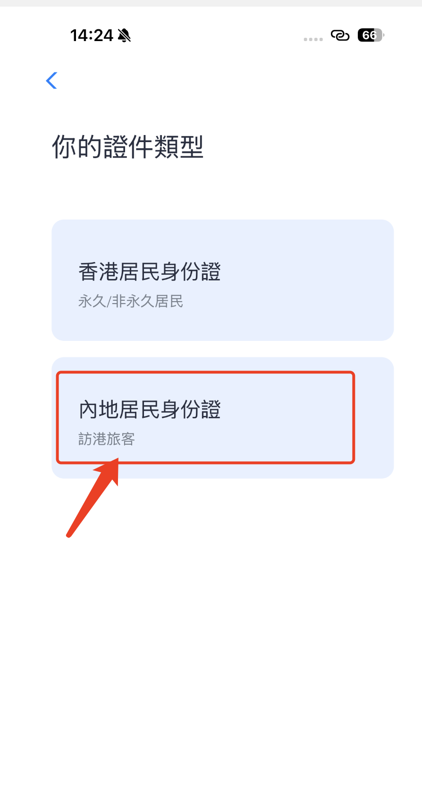
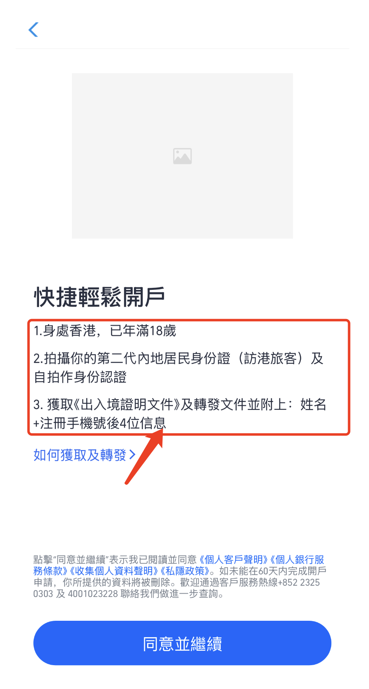
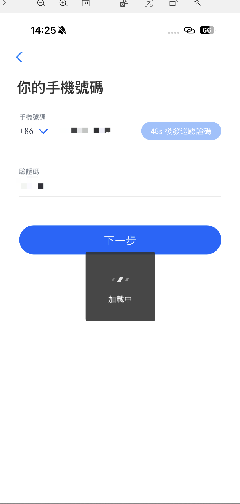
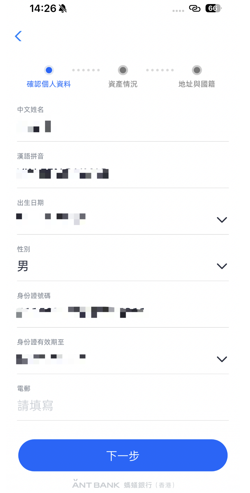
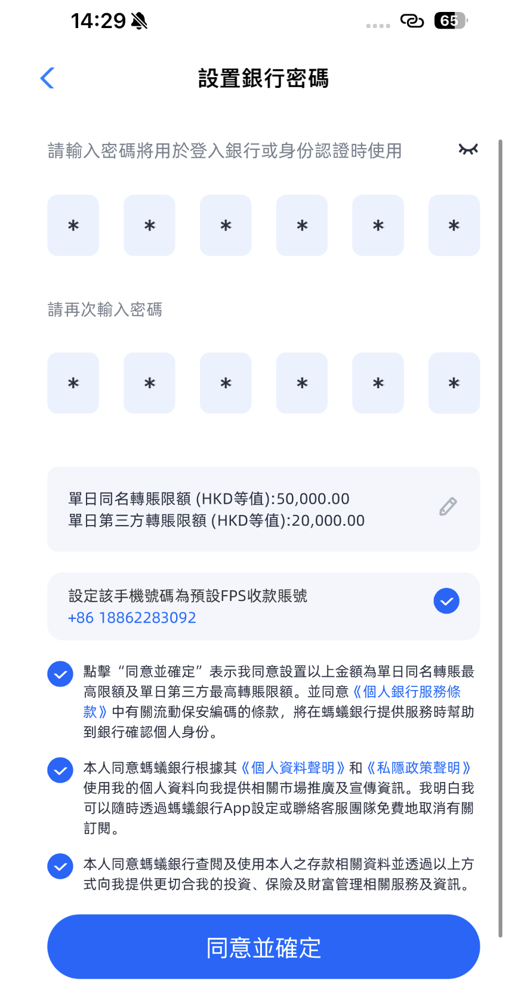
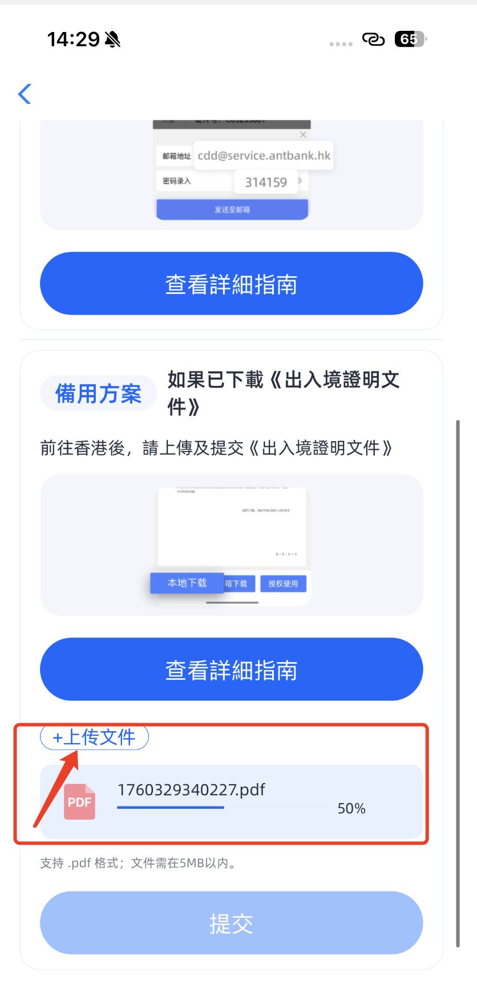
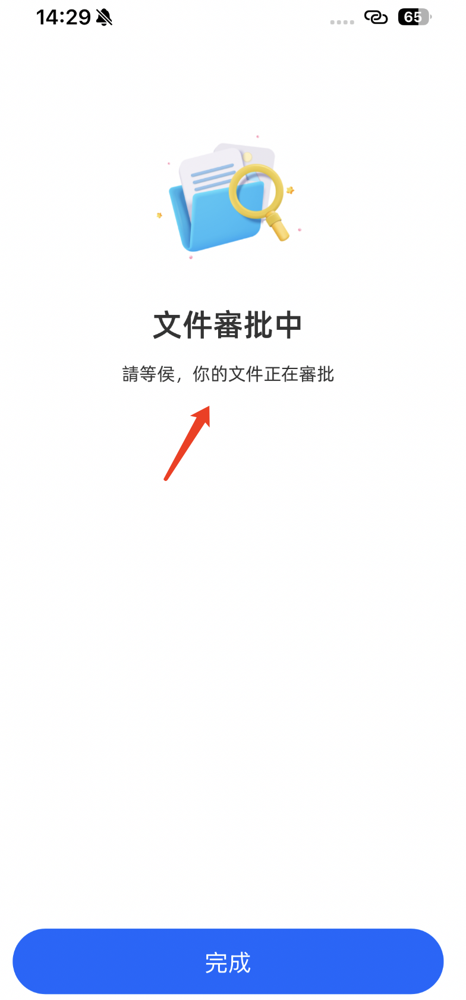

## 一、先了解蚂蚁银行（香港）与本文适用场景

**蚂蚁银行（香港）**主要通过 App 提供银行服务。如果你计划赴港办理账户，本文可以帮助你先准备材料，再对照截图完成申请。它与蚂蚁银行（澳门）是不同的账户与产品，不能混用开户条件或活动。

这里采用内地用户在港申请的示例；能否申请及需要补交哪些材料，以银行对本人资格的审核为准。

开户要求：

- 本人**亲自在港**
- 年满 **18 岁**
- 持有**内地居民身份证**
- 提供**出入境证明**

---

## 二、蚂蚁银行（香港）开户流程

**1、** 首先在 App Store 中检索"**蚂蚁银行（香港）**"下载对应的 App。

**2、** 选择**开启银行户口**，然后身份证件选择**内地居民身份证**，查阅开户条件：人在港、满 **18 岁**、有身份证，以及出入关证明。

  

**3、** 填写自己的**手机号**，验证自己的**身份证**，检查自己的个人信息。

   

**4、** 填写自己的**居住地址**，设置**登录密码**，再就是上传自己的**出入境证件**，即进入到审核界面。

> 💡 出入境证明可通过 **12367 小程序** 下载，选择中国人服务 → 出入境证明，下载后另存为文件即可上传。

   

---

## 三、注意事项：提交后还要检查什么

提交申请后，先检查 App 的审核状态和补件通知，不能把“提交成功”理解为已经开户。姓名、住址和证件须一致；若需要补充资料，通过银行官方入口提交。

开户后再查看可用币种、转账限额与费用。仅为领取活动奖励而开户前，也应先核对入资与留存条件，避免账户开好后长期闲置。

## 四、总结：准备完整比操作快更重要

这篇教程的主线是下载正确的 App、准备证件与入境记录、完成身份核验并跟进审核。确认账户已经可用后，再按真实用途安排收付款；不必因为别人开了多家银行，就一次申请所有账户。

<!-- seo-next-links -->
## 相关阅读

[港卡与港股券商开户入金](/articles/series/hk-stock-funding){card}
