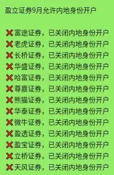
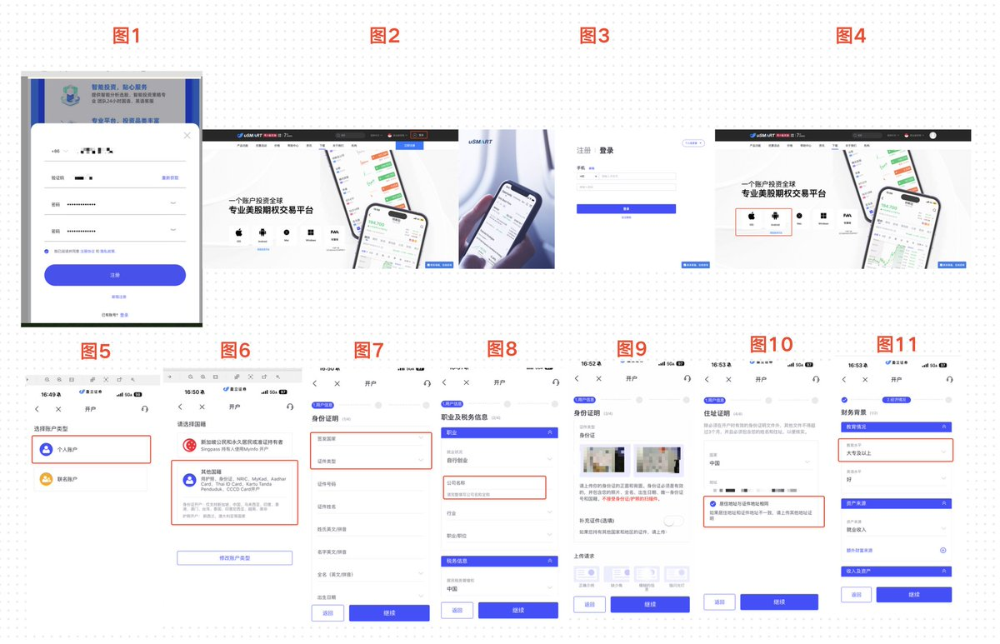
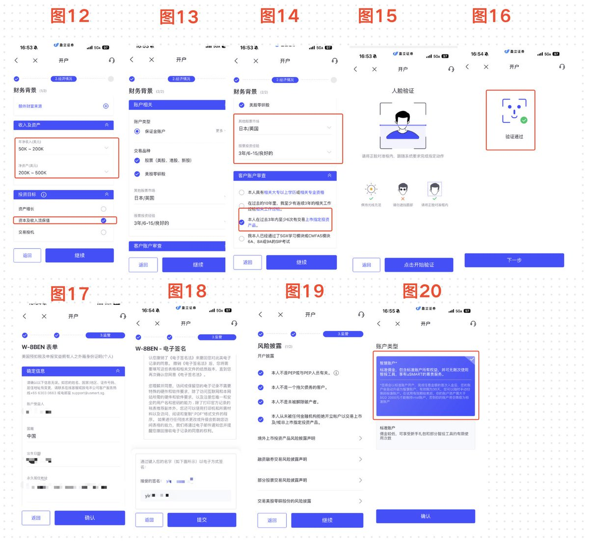
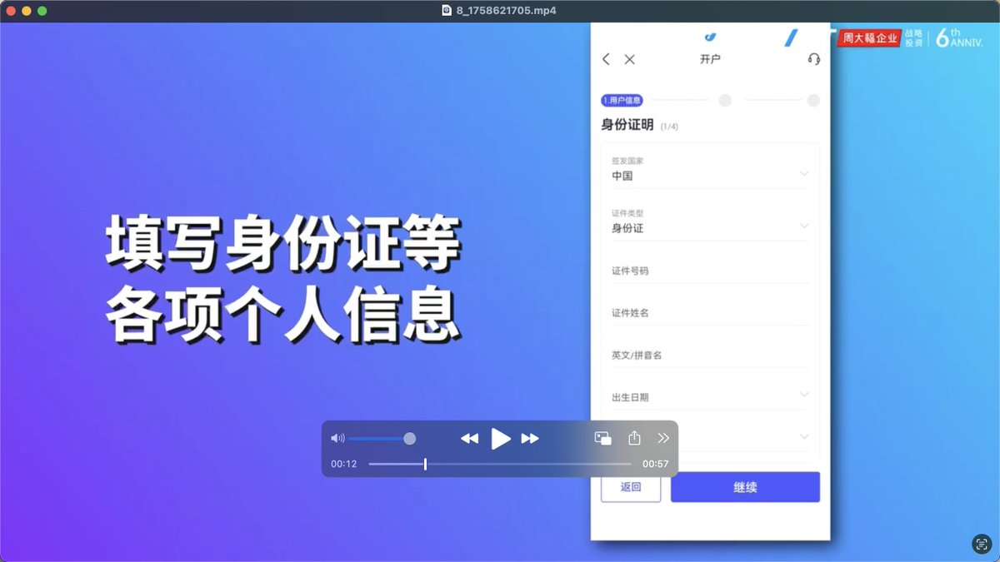

## 一、盈立新加坡怎么开户？先分清它和香港版

**盈立新加坡怎么用身份证开户？** 这篇教程讲的是盈立证券新加坡（uSMART SG App），不是盈立香港。根据 2026 年 11 月核对的[官方帮助中心](https://global.usmartsecurities.com/help-key/acctopen)，中国身份证仍被列为可接受的开户证件之一；你能不能申请、要补哪些材料，以当天官方 App 和页面提示为准。资料必须按本人真实情况填写。最常见的卡点，是把香港版 App 下载下来，结果登录不上新加坡账户。

2025 年 9 月 24 日，我们曾在 X 上发过一套盈立新加坡开户图文。那时不少内地用户关心：还有哪些券商接受中国身份证线上申请。下面这张对照表是**当时的快照**，不是 2026 年 11 月的市场结论，更不能理解成“现在只剩这一家”。

表中列出：截至 2025 年 9 月那一轮整理，盈立证券仍允许内地身份证开户；富途、老虎、长桥、华盛、哈富、尊嘉、熊猫、华泰、微牛、盈透、盈宝、立桥、天风等被标为已关闭内地身份证开户。各家政策后来都可能调整，办理前以对应券商当天规则为准。

如果更想比较港资券商，或已经决定走香港银行卡入金，可以另外看这些教程：

[致富证券怎么开户](/articles/broker/GaobLP0X){card}
[复星证券怎么开户](/articles/broker/sQSbLRe8){card}
[腾达证券怎么开户入金](/articles/broker/4k1kTctf){card}
[港卡与港股券商开户入金](/articles/series/hk-stock-funding){card}

## 二、和盈立香港有什么区别？要不要护照？

盈立这个品牌下面有不同持牌主体，不能混用同一套 App、同一套开户资格。

在新加坡，投资产品和服务由 **uSMART Securities (Singapore) Pte. Ltd.**（盈立证券（新加坡）有限公司）提供。2026 年 11 月查阅的[盈立新加坡官网](https://www.usmart.sg/cn)写明，该公司受新加坡金融管理局（MAS）监管，持有资本市场服务牌照（CMS），牌照号码为 **CMS101161**。官网介绍可交易美股、港股、新加坡及其他市场股票，以及期权、期货等品种；具体权限以账户审核结果和当天产品页为准。

[官方帮助中心](https://global.usmartsecurities.com/help-key/acctopen)把开户材料概括为：身份证件或护照、住址证明，以及税务居民身份和税务识别号（如有）。其中，身份证可接受的国家和地区包括新加坡、中国、马来西亚、印度、香港、澳门、台湾、泰国和印度尼西亚；其他国籍通常使用护照。帮助中心同时列出住址证明的常见类型，并要求证明文件上的姓名和完整地址清晰，有效期一般不超过三个月。你是否还要另传住址证明，以 App 当天提示为准：若居住地址与证件地址一致，2025 年的申请页允许勾选相同地址；若不一致，就按页面要求补充证明。

**要不要护照？** 对持有中国身份证、并在新加坡主体申请的读者，官方帮助中心已把中国身份证列为可接受证件，通常不必为了“先有护照才能开户”去另办一本。如果 App 后来要求补充其他证件，按当天提示准备，不要用别人的护照或非本人文件代替。

**盈立香港是另一家公司。** 香港主体是 uSmart Securities Limited，受香港证监会监管。2026 年 11 月查阅的[香港帮助中心开户说明](https://hk.usmartglobal.com/en/help-centre/40/detail/10127)写明：没有其他国家或地区居留证件、且人身处中国内地的内地居民，目前无法通过香港盈立 App 提交新的开户申请；该页问答还写到，内地用户需亲自前往香港开户。香港版的材料、是否需要港卡、审核方式都和新加坡版不同。本文只讲新加坡主体，不要把两套规则当成同一步骤。

## 三、开户前要准备什么？下载错 App 怎么办？

开始填写前，建议先备齐这些，并打开**当天**的 uSMART SG App，而不是只靠旧截图：

1. **本人有效的中国身份证原件。** 上传时要拍到原件，四角完整、文字清晰、避免反光。照片模糊，后面的人脸验证很容易失败。
2. **可接收验证码的手机号**，以及你准备长期用来登录的密码。内地号码在注册页选择对应区号即可；以当天页面可选区号为准。
3. **真实居住地址、职业、税务居民信息和财务背景。** 这些字段用于合规申报，必须按本人情况填写。
4. **已经确认是新加坡版的 App：** 应用名称一般为 uSMART SG，图标右下角带 **SG** 标识，不要下载成带 **HK** 标识的香港版。

作者后来在评论里确认过两个实际卡点：有人下载了**香港版 App**，同一个账号登录不了；身份证照片不清晰时，人脸验证也会失败。若你已经下错版本，卸掉香港版，改从官方新加坡渠道重新下载 SG 版，再用同一个注册手机号登录，不要另注册一个新号把申请做乱。官方下载入口见 [uSMART SG 下载页](https://www.usmart.sg/download)。

若 App 或官方页面要求你处于券商可接受的网络或所在地，请按官方要求和当天页面提示办理。资格会变化，本文不提供如何绕过地区或网络限制的方法。

站内福利页把盈立证券放在港资券商分类，当前邀请码是 **ckxq**。活动内容和奖励会调整，不要把 2025 年帖子里的股票券或优惠券金额当成现在还能领到的承诺；填写前到福利页或官方活动页核对当天规则。福利页上的注册按钮指向通用官网入口，本教程走的是**新加坡主体**，请下载 uSMART SG App，并在注册或开户流程里填写邀请码。

准备好后，用下面这张邀请卡核对邀请码；具体奖励以当天福利页和官方活动说明为准。

> [注册 盈立证券新加坡 账户](https://www.wise-invest.org/perk/broker#product-usmart) · 邀请码：**ckxq**

开户本身不是必须先办香港银行卡。作者也曾说明：入金不必须先办港卡。本篇只覆盖到提交申请；入金方式以账户获批后的官方指引为准。

## 四、App 里怎么填写身份和税务资料？

下面两组截图来自 2025 年 9 月 24 日的开户演示，按当时界面标了图 1 到图 20。界面改版后，字段名称和顺序可能不同，请以你手机上的当天页面为准。图中的红框只是当时需要留意的位置，**不是建议你照抄的收入、资产或交易经验答案**。

按当时的流程，字段含义可以这样理解：

1. **注册或登录。** 用本人手机号完成注册并设置密码。之后请用同一组账号登录 SG App，不要在 App 里再开一个互不关联的新号。
2. **选择个人账户。** 联名或其他类型按页面说明另行准备，普通个人申请选个人账户即可。
3. **选择国家/地区。** 当时的页面把新加坡、香港、澳门、安道尔单独列出；持有中国身份证、居住在中国内地的申请人，应选择「其他国家」，而不是新加坡或香港。选错主体或地区，后面的证件类型会对不上。
4. **身份证明。** 签发国家选择中国，证件类型选择身份证，然后填写证件号码、证件姓名、英文或拼音姓名、出生日期。拼音按本人证件姓名填写，姓与名不要颠倒。上图里的证件照片已做遮挡，只用于说明要上传人像面和国徽面。
5. **职业及税务信息。** 职业、公司名称、行业、职业职位按本人真实情况填写。税务居民国若是中国，按页面填写税务识别号；中国税务居民通常使用身份证号码作为税务识别号，但仍以当天表单说明为准。
6. **住址证明。** 居住国家若是中国，填写本人当前居住地址。若与证件地址相同，可按页面勾选；若不同，按提示上传符合要求的住址证明。不要为了申请而编造境外住址。

后半段同样只对照字段，不提供“更容易通过”的填法：

1. **财务背景。** 收入、净资产、资金来源和投资目标必须如实申报。截图里曾经出现过收入或资产区间，以及“资本保值”一类投资目标，那只是当时演示界面上的圈选位置，不构成推荐答案。
2. **账户相关与投资经验。** 页面可能询问保证金账户或现金账户、交易品种、其他投资市场经验，以及是否满足专业或经验相关的陈述。这些选项影响风险揭示和可用权限，必须按本人真实经历勾选。不要为了开通某类产品，去勾选自己并不具备的交易次数或资质。
3. **人脸验证。** 按提示正对摄像头，完成指定动作。验证失败时，先检查证件照片是否清晰、光线是否足够，再按 App 提示重试。
4. **W-8BEN 与电子签名。** 这是向美国税务申报相关的表格，用于说明非美国税务居民身份等事项。中国税务居民往往会在税务识别号一栏看到与身份证号码相关的填写提示，也可能看到与中国有关的税收协定措辞；是否勾选协定条款，以你当天看到的正式表单为准。本文不提供税务建议，作者也没有在公开教程里详细解答“税收协定是否要勾选”的问题。签名时输入本人姓名，不要代签。
5. **风险披露。** 仔细阅读每条声明，只勾选与自己情况相符的内容，例如是否为政治公众人物、是否了解相关产品风险。看不懂的条款，先停下来查官方说明或联系官方客服，不要为了往下点而全选。
6. **账户类型。** 2025 年 9 月的截图里，演示者勾选了「智盈账户」。当时页面还并列了「标准账户」，并提到智盈账户在智能工具和资产、试用规则上可能与标准账户不同。费用、试用期和资产门槛后来都可能调整。2026 年 11 月查阅的[官方价格页](https://www.usmart.sg/pricing)和官网都写明，不同账户类型收费有差异，细节以价格页为准。请在 App 和官方收费说明里比较后，选择适合自己的类型，不必照抄截图中的勾选。

填写身份信息时，也可以对照当时的操作示意：把身份证号码、姓名、拼音和出生日期逐项核对后再继续。

## 五、提交后怎么核对？入金要先办港卡吗？

提交后，在 SG App 里查看申请状态，并留意短信、邮件或站内通知。审核需要多长时间、是否要补件，以官方反馈为准，不要把别人的通过速度当成承诺。若状态变成需要补充材料，按清单补传清晰的原件照片或住址证明，避免反复提交模糊图片。

账户获批，只说明开户申请通过，不等于所有交易品种都已开通，也不等于资金已经到账。入金前到本人账户的官方入金页核对收款信息、币种和可用通道。作者曾说明：**入金不必须先办港卡。** 本篇不展开入金实操；具体银行、转账方式和到账时间，以你账户当时可用的官方指引为准。

若审核被拒绝或长期停在待处理，先核对是否下错 App、证件是否清晰、资料是否与证件一致，再通过官方客服说明。新加坡主体的客服邮箱在帮助中心列为 [support@usmart.sg](mailto:support@usmart.sg)，电话以官网当天公布为准。

## 六、常见问题

### 盈立新加坡现在还能用身份证开户吗？

2026 年 11 月核对的官方帮助中心，仍把中国身份证列为可接受证件。这不等于对所有申请人保证通过，也不等于规则不会再改。能否提交、要不要补件，以你打开 uSMART SG App 当天看到的提示为准。

### 为什么登录不了，是不是下错 App？

先看图标和名称：新加坡版是 uSMART SG，带 SG 标识；香港版带 HK 标识，是另一套账户体系。很多登录失败，是因为下载了香港版去登录新加坡账号。改用 SG App、用原来的注册手机号登录后再试。

### 开户一定要护照或港卡吗？

就新加坡主体而言，官方帮助中心已接受中国身份证，通常不必为了开户专门去办护照。若页面额外要求其他证明，再按提示准备。开户和入金都不把香港银行卡写成先决条件；是否需要其他银行账户，以入金页当天支持的方式为准。

### 截图里圈出的收入和交易次数要照抄吗？

不要照抄。红框只标出当时页面上值得留意的字段位置。职业、收入、资产、投资经验和风险揭示都必须按本人真实情况填写。把不具备的交易次数或资质当成“通过技巧”，既不真实，也可能造成后续限制。

### 邀请码用哪一个，以前的股票券还有效吗？

站内福利页当前使用的邀请码是 `ckxq`，请以 [盈立证券福利入口](/perk/broker#product-usmart) 当天展示为准。2025 年旧帖里的优惠券或股票奖励，以及后来在其他渠道看到的不同邀请码，都不自动等于现在仍有效。奖励规则会变，不要按过期海报去期待入账。
