## 一、先看这个账户是否适合你的需求

**第一证券 Firstrade**是本文介绍的美股券商账户。想直接买股票或 ETF，先确认自己是否符合申请资格，以及能否持续提供真实资料、使用本人资金账户和维护税务文件。

本文按“平台介绍—准备材料—申请步骤—注意事项—总结”展开。页面语言、宣传里的开户速度或别人的成功案例，都不能代替你自己的审核结果。

## 二、第一证券介绍

**第一证券**（Firstrade Securities Inc.），成立于 **1985 年**，总部位于美国纽约，是美国最早一批提供在线交易服务的券商之一。由台裔美国人 John Liu 创立，早期专注于服务华人社区，如今已成为全球投资者，尤其是亚洲地区用户（如香港、中国大陆）的热门选择。

它是美国金融业监管局（FINRA）和证券投资者保护公司（SIPC）的成员，受美国证券交易委员会（SEC）严格监管。税务居民身份、W-8BEN 等税务表格应按真实情况填写。券商品牌或开户地区不能直接推导出没有申报义务；信息交换制度与个人应履行的申报是不同问题。

### 核心优势

**零佣金交易：** 股票、ETF、期权、共同基金等全部**零佣金**（自 2019 年起实现），债券和 CD 交易费用也极低。这意味着你省下的手续费就是赚到的，尤其适合长期持有或频繁交易的用户。

**中文支持完善：** 官网和 APP 提供**简体/繁体中文**界面，客服支持中文电话、微信、在线聊天（工作时间覆盖亚洲时区）。这对非英语母语用户来说是巨大便利，许多香港投资者反馈比其他美系券商更易上手。

**无最低资金要求：** **0 元开户**，无账户维护费、无不活跃费。无论你是小额试水还是大额配置，都无压力。

**多样化投资产品：** 支持美股、ETF、期权（包括指数期权）、共同基金、债券、CD 定期存款等。还提供 IRA 退休账户和教育储蓄账户，适合长期理财规划。

**交易工具强大：** 移动 APP 和网页平台支持实时报价、图表分析、自定义警报。期权交易工具集成 Chain 视图和 Greeks 分析，适合进阶用户。夜盘交易几乎 24/7 可用，覆盖盘前/盘后时段。

**入金出金灵活：** 支持 ACH 转账（免费，从美国银行）、电汇（国际电汇费用由银行收取，通常 20-50 美元）、支票存款。香港用户常用 Wise、港卡入金，速度快、手续费低。出金同样免费 ACH 或电汇。

**安全保障：** SIPC 保护最高 **50 万美元**（包括 25 万美元现金），额外购买超额保险覆盖高达 1.5 亿美元。清算由 Apex Clearing 负责，资金隔离存储。

---

## 三、申请前的材料与操作步骤

聊完了上面的前置教程，也聊完了这个介绍，那我们就开始正式的注册开户教程吧，在开始之前，我还是有几个事情要和大家多叮嘱一下。

**1️⃣、** 请提前准备好自己的**护照号、地址证明**等信息，并且将其名称修改成为英文。

**2️⃣、** 准备好自己地址的**英文缩写**以及自己所在地的**邮编**。

**3️⃣、** 适当准备好一个**谷歌翻译**，如果遇到不是很懂的内容直接复制内容出去进行翻译！

**4️⃣、** 整套流程下来需要 **10-15 分钟**时间，所以请确保自己有完整的并且网络稳定的时间。

**5️⃣、** 尽可能按照流程进行，如果有不懂的部分请及时寻求 AI/博主帮助，防止开户不成功，前功尽弃。

ok，如果你已经成功准备好上述内容之后，我们就正式开始第一证券的注册吧！

**1、** 首先我们打开：`https://invest.firstrade.com/cgi-bin/login?ft_locale=zh-cn` 然后选择**立即开户**！

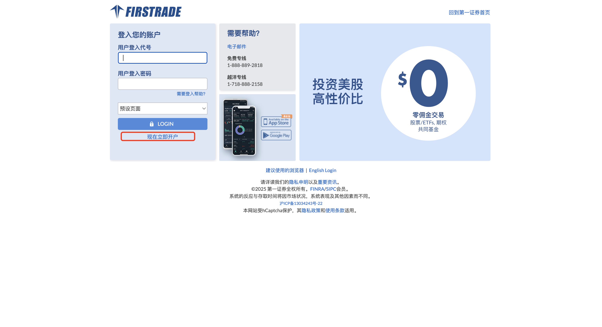

**2、** 接着选择**"非美国公民以及非美国永久居民"**进行申请和注册。

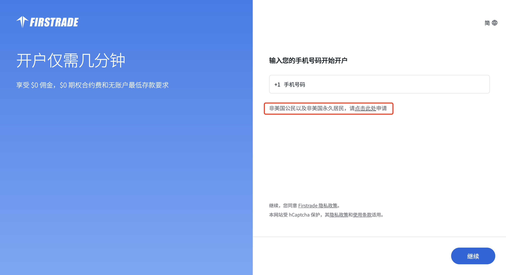

**3、** 选择**接受验证码**进行走注册流程。

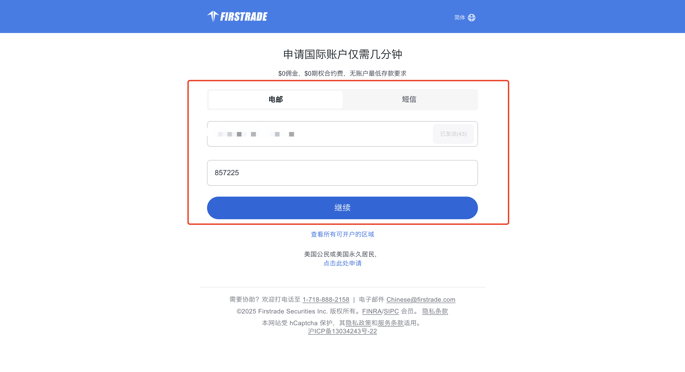

**4、** 定位位置在中国，国际和出生国家都是**中国**，在这里可以看到其要求：**1️⃣ 护照 2️⃣ 居住地址（英文）**，提前准备好。

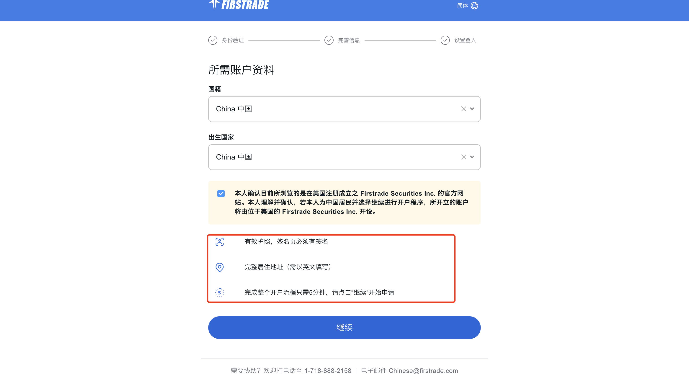

**5、** 而后准备**上传自己的护照**，其实就是有人像的那一页，两个都用同一个图片也是 ok 的。

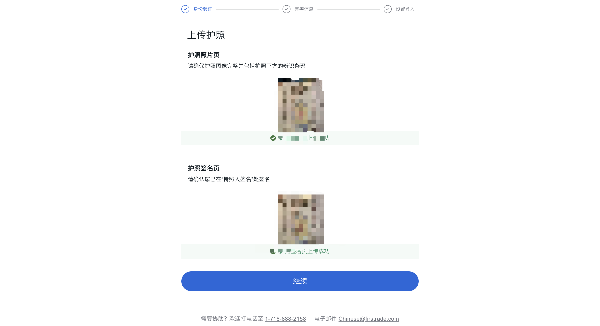

**6、** **护照号码**正常填写，而后**税务识别号码**就是自己的身份证号码。

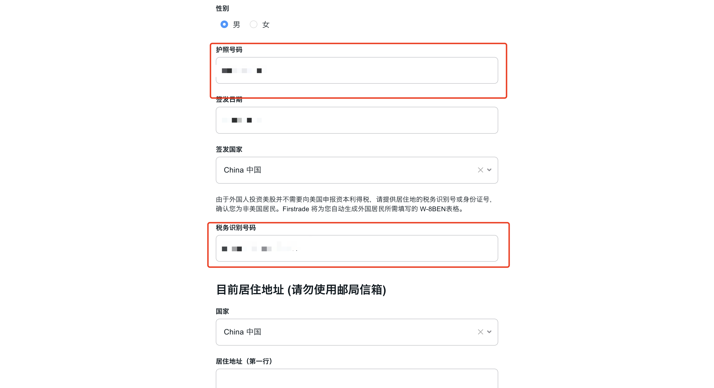

**7、** 记得提前用谷歌翻译把自己的**地址翻译成为英文**，而后进行填入。

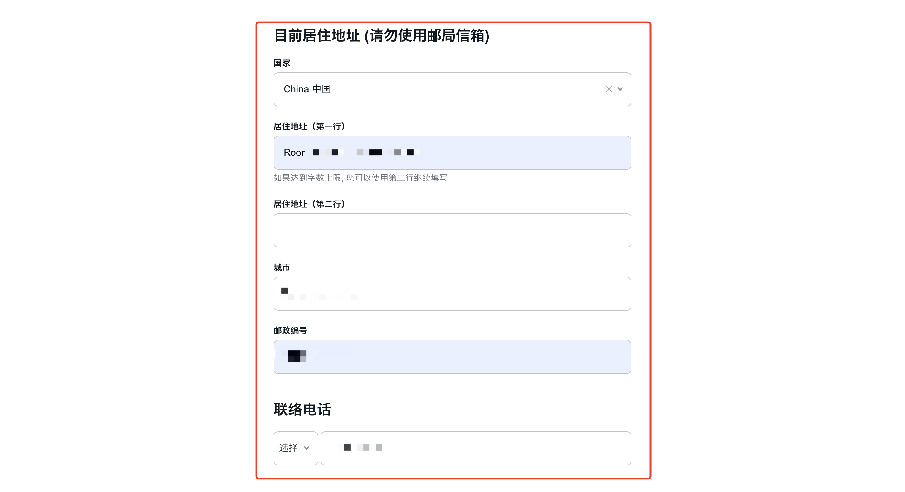

**8、** 工作情况按本人真实身份填写，无雇主时选择适用的职业状态，不能填入不相关的公司。

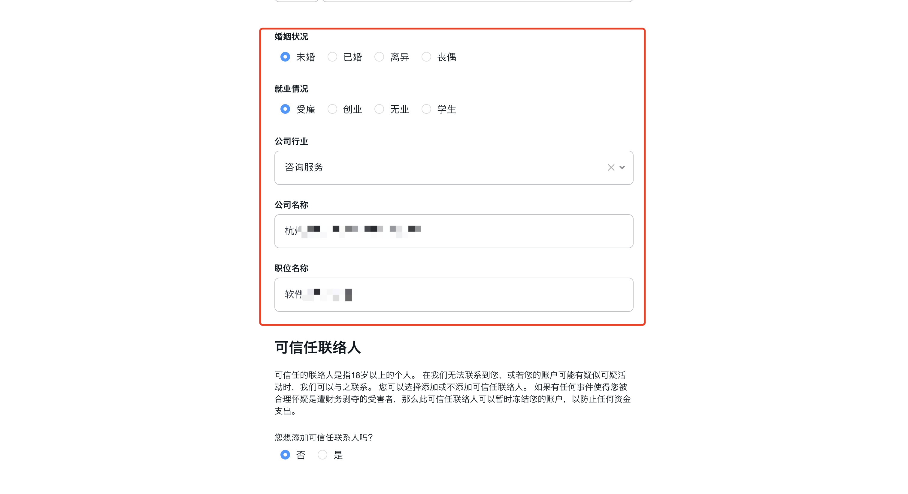

**9、** 按字段定义如实填写收入、总资产和可投资资产，注意币种与单位；投资经验和目标同样按真实情况填写，没有统一的金额大小排序或经验等级答案。

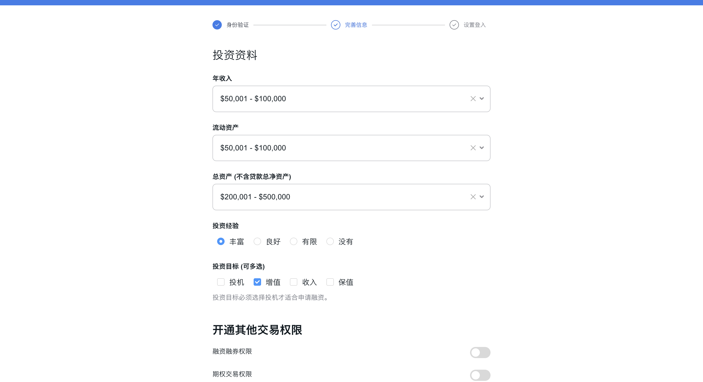

**10、** 完毕之后就设置自己的**登录名以及密码和 PIN 码**即可。

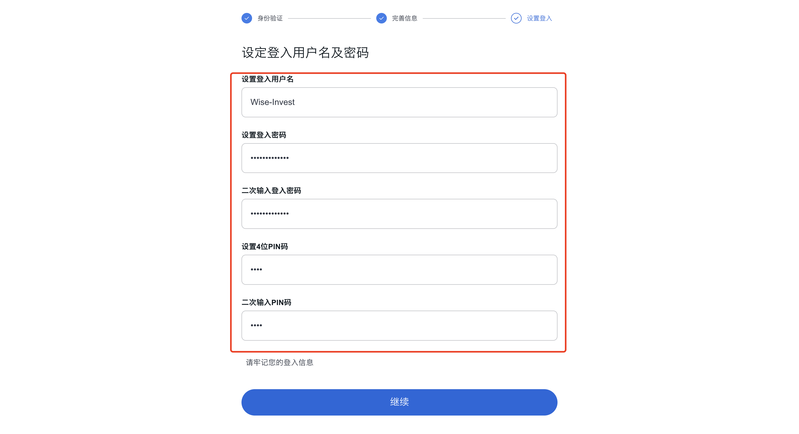

**11、** 完毕之后后续即可看到自己的**申请已经正常提交**了。

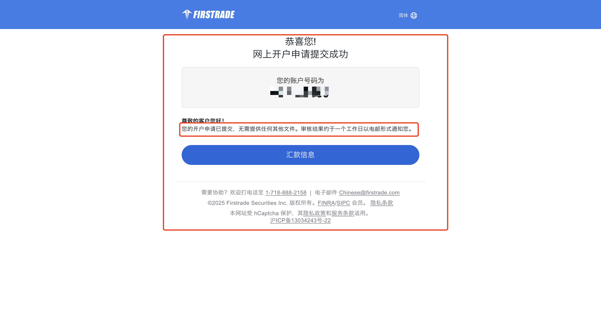

**12、** 而后回到首页输入自己的**用户名和密码**进行登录即可。

**13、** 确认账户实际用途，并逐项回答其他声明，不默认全部选择“否”。

**14、** 设置自己的**密保信息**。

**15、** 完成之后即可看到自己的**申请已经提交，在处理中**。

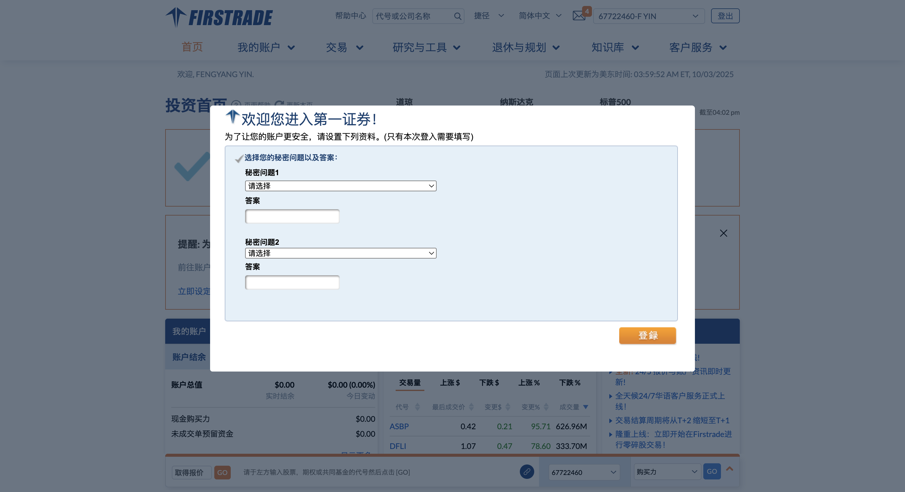

**16、** 而后成功通过之后即可完成**入金**的操作即可。

**17、** 那后面我们就来完善具体的**出入金系列教程**了，敬请期待！

---

## 四、注意事项：资料、权限和税务文件

证件、住址、雇主与投资经验都须真实；证明文件应为本人有效材料，不因截图未要求就忽略补件通知。没有融资或期权需求，先保持适合自己用途的权限。

W-8BEN 用于符合条件的非美国个人说明身份及申请适用的税收协定待遇，不是统一免税工具；填写前阅读[IRS 官方说明](https://www.irs.gov/instructions/iw8ben)。SIPC 也不赔偿股票跌价，不能把账户保护当作保本。

## 五、总结：提交后还要确认审核结果

以上就是第一证券的注册教程了，整体的流程还是比较简单的，对比于盈透还有嘉信都是比较**轻便**的。

那对比于盈透和嘉信，@LZRationalnvest 也做了一张图，大家可以参考！

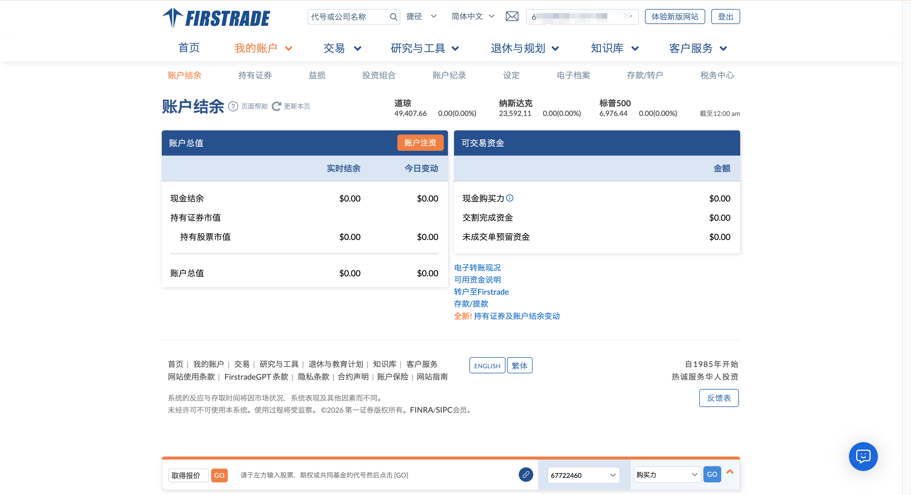

这里是 WiseInvest，励志在指数/美股/加密/中做最懂小白的博主，如果你对这些内容感兴趣，欢迎给我**点个关注**哦。那我们就下期再见了！

<!-- seo-next-links -->
## 接下来可以读

[美股账户准备与入金](/articles/series/us-stock-funding){card}
[BBAE 开户与入金教程](/articles/broker/I0AIBXus){card}
