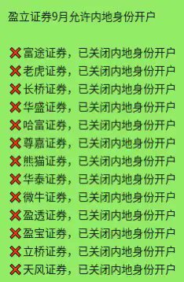
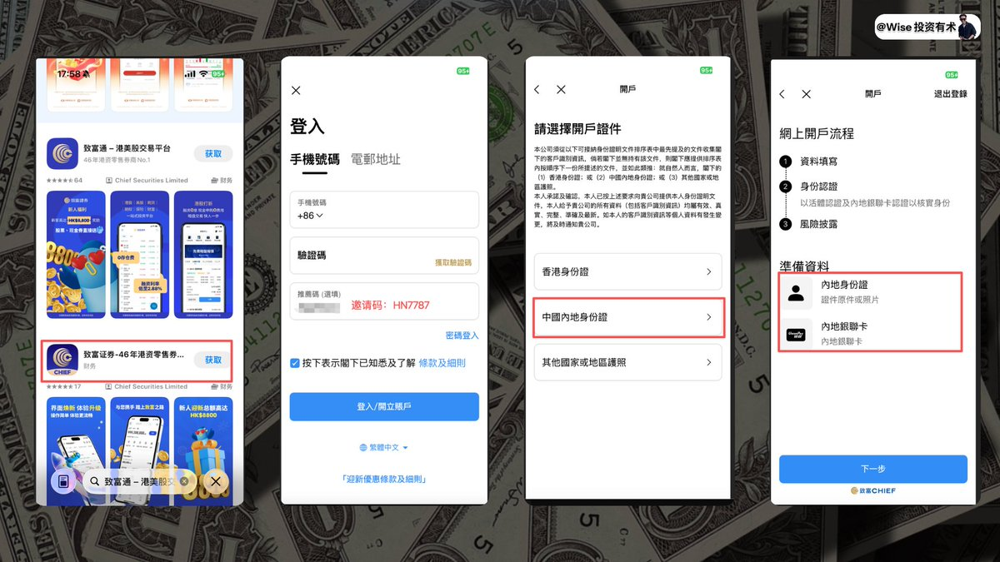
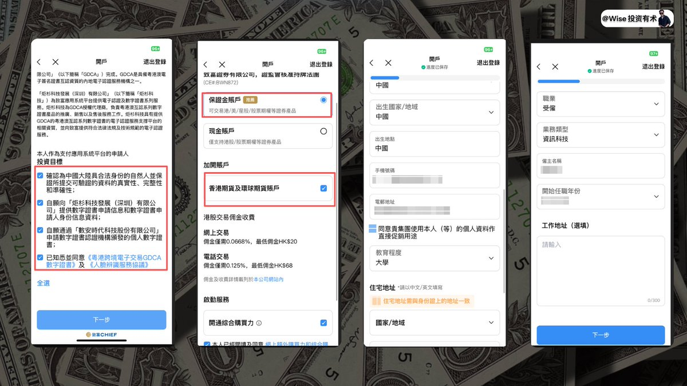
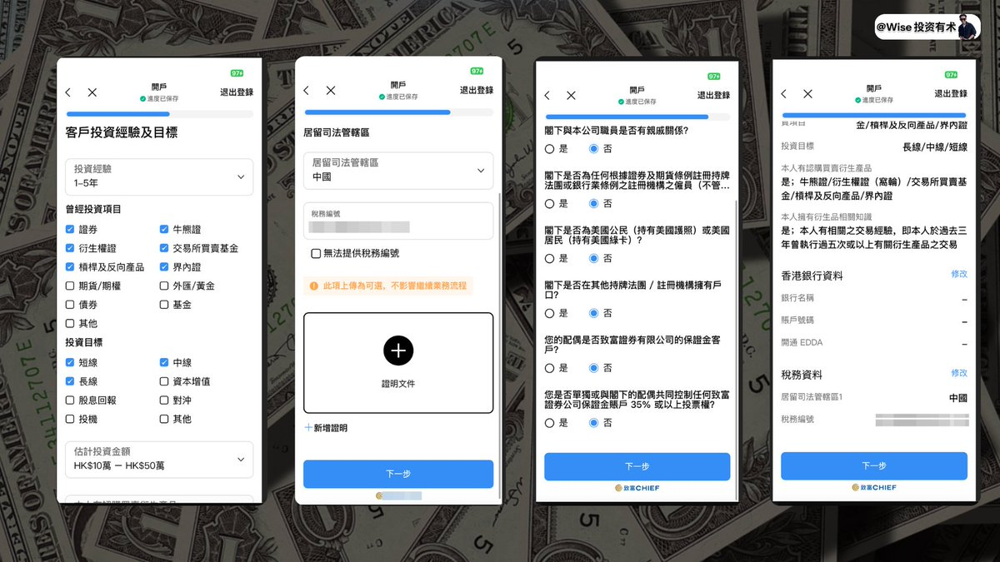
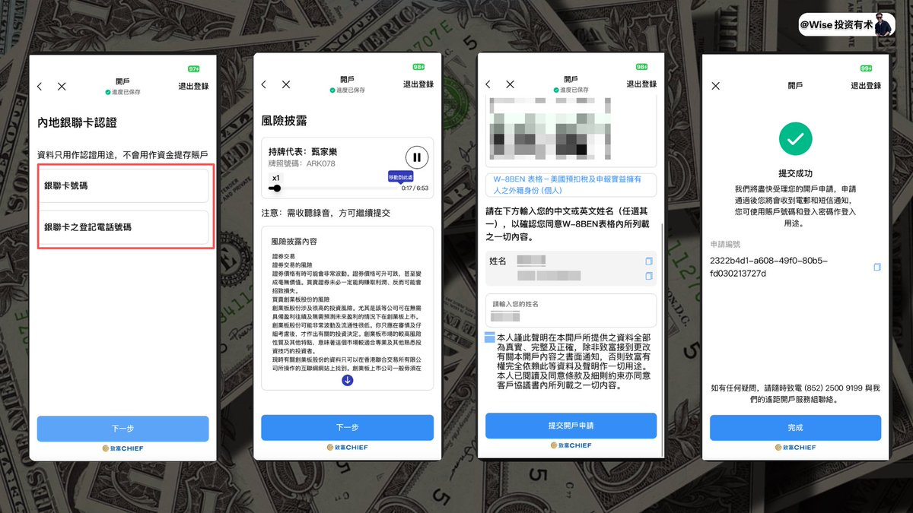
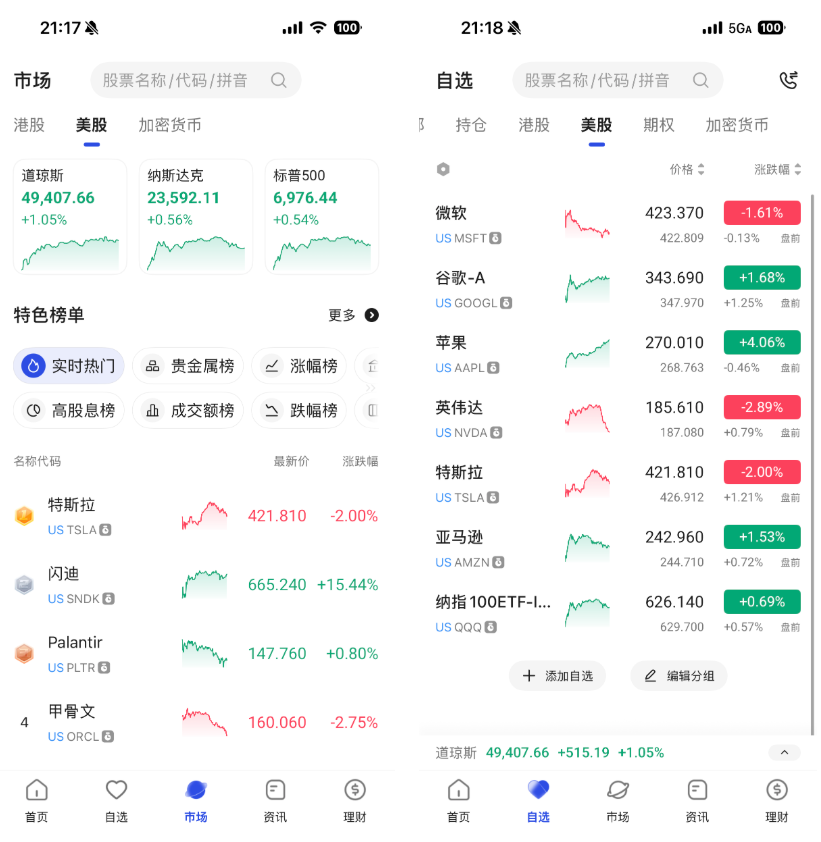

## 一、先了解致富证券与申请范围

**致富证券**是本文介绍的香港券商。对准备交易港美股的读者，先确认本人能否申请、需要哪些材料和入金方式，再比较交易费用与奖励。下文保留原稿开户截图，资格以本人当前申请审核为准。

如果用一张图来表示这个惨状的话，我想下图就是最佳的表示：

虽然很多证券都在陆续关闭开户的渠道，但是依旧还是有一些可供我们选择的。

而 Wise 在之前也分享过一个**盈立证券**的开户的教程，具体教程链接如下：2025 年盈立证券最全开户教程  大家可以点击链接进行学习！

而今天我们给大家推荐的是**致富证券**，相比于盈立证券，致富的历史要更加悠久，并且实力也更加雄厚，下面我们还是先来简单介绍一下，而后再进行具体的开户流程。

---

## 二、致富证券开户奖励和免佣怎么算？

**致富证券**（Chief Securities Limited），它是一家非常典型的香港本土老牌券商。致富证券成立于 **1979 年**（已有46年历史），隶属于**致富集团**（Chief Group），总部在中环，是香港本地资本的零售证券公司之一。

官网如下（点击前往）他们自称"**46年港资零售券商No.1**"。

### 主要特点和优势

**1、监管合规：** 持有香港证监会（SFC）第1、2、4、5、7、9类受规管活动牌照，覆盖证券交易、期货、资产管理、顾问等业务，受严格监管，客户资金有**投资者赔偿基金（ICF）保障**（最高50万港币）。

**2、分行网络：** 全港有**13间实体分行**，覆盖港岛、九龙、新界，是香港分行最多的证券行之一，适合喜欢面对面服务或传统风格的本地投资者。

**3、交易产品：** 支持港股、美股、A股（沪深港通）、新加坡股票、股票期权、期货、基金、债券、IPO打新、月供股票等。App叫"**致富通**"，也支持线上遥距开户。

**4、费用亮点**（2026年最新常见宣传）：

- **0 存仓费、0 平台费**（部分情况）
- 港美股 **LV1 免费即时报价**
- 孖展利率低至 **2.88%**（全港较低水平之一）
- 美股低至每笔 **US$0.99** 或每股 **US$0.01**
- 月供港美股基金**免佣**

**5、开户：** 支持**内地身份证线上开户**（无需存量证明或海外地址证明），很多内地投资者用它来玩港美股打新或长期持有。

**6、其他：** 有独立会计师每日复核客户资产的制度（香港首创），强调资金安全；经常有开户迎新优惠（如现金券、股票券、里数等，高达**几千港币**不等，视活动而定）。

---

## 三、注册教程

**1、** 打开 App 检索"**致富通**"，你可以看到两个选项，记得去选择下面的一个致富证券进行下载，界面更加符合我们现在的体感。

**2、** 然后选择输入自己的手机号进行注册，在注册页面填写邀请码 **HN7787**，确认完成邀请关系绑定后再提交。

> [注册 致富证券 账户](https://service.chiefgroup.com.hk/account-open/login?PromoCode=HN7787) · 邀请码：**HN7787**

通过 Wise 邀请渠道开户，入金达到**等值 10,000 港币**，即可解锁**美股免佣**。这项权益免的是佣金，平台费及其他交易费用另计；下文也会说明入金后如何领取交易券和股票奖励。

**3、** 然后选择中国内地的身份证，就可以看到其要求我们准备的材料，其实只需要有一个**内地的身份证 / 或者是内地的银行卡**即可完成注册流程，门槛不算是高，非常适合一些想要投资港美股，但是没有一些境外证明的一些朋友。

**4、** 逐项阅读声明与授权内容，确认适用后再勾选；不能直接全选。

**5、** 按真实需要选择账户与服务。融资、期权等附加权限并非普通股票开户必选项。

**6、** 然后是你自己的身份证信息，正常识别，识别之后会要求我们填写手机号码，和具体的邮件地址。

其实致富证券可以说是我看看到的开各种证券里面**最方便的一个**，基本上所有的东西都会给你预设好，所以直接不需要怎么动脑筋下一步就好了。

**7、** 但是这里注意下，你的**教育程度**其会默认是初中，记得修改成为对应的教育程度。

**8、** 如实填写职业、雇主与业务类型；自由职业、待业等情况按实际选项申报，不能借用阿里等公司的名称。

**9、** 检查预设的投资经验与目标是否符合本人情况，不符合就修改，不能以默认值代替真实答案。

完成之后其会要求你设置自己的香港港卡，这里你点击**稍后**即可，可以先不理会。

**10、** 税务编号就是自己的**身份证号**，然后提供证明这里可以不写。

**11、** 关联身份、税务与其他声明逐项核对，按真实情况回答。

**12、** 接着就是确定一下具体的信息是否有误，如果没有问题就直接进行下一步就好

**13、** 接着会让你**验证人脸**正常验证即可，完毕之后填写具体的银行卡卡号，以及具体手机号，按照实际情况进行填写

**14、** 听着他读一会这个风险披露即可继续进行下一步。

**15、** 而后 **W-8BEN** 会要求咱们进行签字，正常签字即可。

**16、** 完成之后即成功完成开户的申请，后续耐心等待开户通过即可

**17、** 整个过程不会很久，大概 **5-10 分钟**，你就可以成功审核通过，通过之后，即可正常完成后续的入金系列的动作了！

**18、** 最后成功开户，**致富证券**要比致富通的界面看起来"现代化"很多，所以大家最好是下载**致富证券**，使用起来更加舒服。

---

## 四、入金奖励：免佣、交易券和股票分别看

先把目前确认的 Wise 渠道福利讲清楚：填写 **HN7787**，入金**等值 10,000 港币**，即可解锁**美股免佣**。除了免佣，开户和入金还有各自的奖励条件，不能把宣传图里的所有金额都当成开户即送现金。

**开户礼：** 全新客户成功开户，可领取 **HK$1,000 打新全免卡（30 天）**及 **HK$200 台积电股票奖赏**。派发奖励时，账户资产净值需不少于 **HK$1,000 或等值货币**。

**入金礼：** 在开户后 **7 天内**达到相应入金档位，留存 **60 天**，并完成对应交易任务：

| 入金金额（港币或等值货币） | 港／美股交易要求 | 美股交易券 | 英伟达股票奖赏 |
| --- | --- | --- | --- |
| HK$10,000 | 完成 1 笔 | HK$100 | HK$200 |
| HK$200,000 | 完成 5 笔 | HK$200 | HK$300 |
| HK$1,000,000 | 完成 5 笔 | HK$200 | HK$400 |

例如，1 万港币这一档合计是 **HK$300 的交易券及股票奖赏**，不是 300 港币现金；交易券和股票奖励各有用途，也不要把不同入金档位叠加计算。

原图还列出了**推荐好友礼**：好友成功开户并在 **30 天内入金 HK$10,000**，推荐人可获 **HK$100 闪迪股票奖赏＋HK$100 美股交易券**。这部分属于推荐人的奖励，不计入新开户用户的入金礼。转仓则另有最高 **HK$1,800 交易券＋HK$5,000 股票奖赏**，对应资产档位和留存任务需单独核对，不能直接加到基础开户礼上。

下图为 **2026 年 4 月迎新版本**，供参考奖励结构与领取流程；渠道福利会持续更新，办理时查看对应活动的领取时间。

上次我们聊到过，2026 年的一个重要中心就是把**券商**这一块的内容给补充齐全，所以后面我们也会尽可能把市面上可以办理的证券教程也都给大家安排一遍。

日常大家可以选择 **2-3 个**进行开户办理，选择 **1-2 个**自己比较喜欢的进行日常使用即可。

那如果你不知道如何购买美股的话，可以重点看一下这个教程：**2026 年全网最全最详细普通人购买美股教程**，详细记录了各种购买和投资美股的方法！

那如果你觉得以上的内容对你有帮助，记得给我一件**三连**哦，大家的支持也是我持续更新下去的最大动力！

ok，那我们下期再见了！

## 五、注意事项：申请、入金与领取奖励分开

先确认开户审核通过，再从本人账户的入金页面取得收款资料；本文保留的是开户步骤及奖励条件，没有把未展示的银行转账操作当作已完成教程。身份核验、资金来源与交易权限均需如实填写。

免佣不等于免全部费用。入金档位、七天达标、六十天留存和交易任务分别检查，不能为了领取奖励进行不需要的交易。投资者赔偿也有产品和事件范围，不覆盖市场价格下跌。

## 六、总结：先确认能用，再衡量成本

致富账户的申请主线是材料准备、身份验证、资料核对与结果确认。开户后再按实际用途安排资金，并保留活动条件及达标记录；不需要为了凑齐券商而额外开户。
