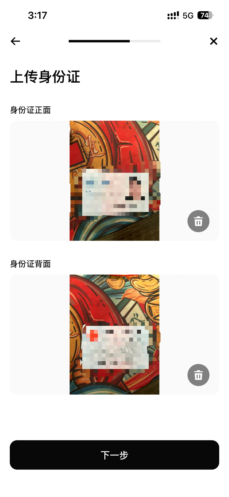
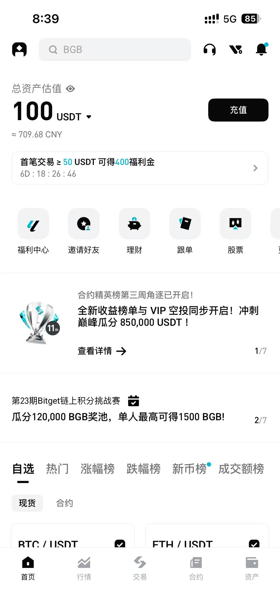
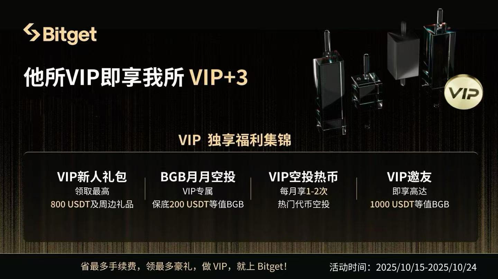

## 一、先分清账户、转入与产品

这篇从一个具体场景出发：**资产已经在本人钱包或其他交易所，想转入 Bitget，并看懂现货和赚币产品怎么使用。** 注册、转账与参与活动是三个不同的环节，不能因为账户开好了，就默认所有产品都适合自己。

先核对本人地区、身份与具体产品的服务要求。Bitget 当前使用条款说明，服务会受地区限制，不能通过 VPN 绕过适用限制；填写其他地区资料也不会改变真实资格。本次核对日期为 **2026 年 11 月 7 日**。[Bitget 使用条款](https://www.bitget.com/support/articles/360014944032/)

下面沿注册、转入、买卖与产品参与的顺序展开，重点看每一步完成后应核对什么。

如果还不熟悉交易所、钱包和基础买币流程，可以先阅读：

[币安注册与基础操作教程](/articles/crypto/GaM38JYk){card}

## 二、注册认证与安全准备

### 使用本人资料完成申请

**1. 获取官方应用。** 从官方网站确认下载入口，核对应用发布者，再进入注册页面。

 

**2. 填写账号和邀请码。** 使用本人邮箱或页面支持的手机号码，设置独立密码。Wise 邀请码是 **wise5130**，字母均为小写；提交前核对一次，未自动填入时复制后手动填写。

> [注册 Bitget 账户](https://partner.bitget.cafe/bg/8ax9wf4r) · 邀请码：**wise5130** · 福利：永久 20% 交易手续费返佣

> **Wise VIP 服务群另有条件：** 通过邀请渠道注册后，成功入金 1000U、完成 10000U 合约交易，可凭 UID 联系我申请加入。这是 VIP 服务条件，与永久 20% 交易手续费返佣分开；不要为了进群而进行不需要的交易。

**3. 进入身份认证。** 先确认本人适用的资格和材料要求，再上传资料。身份信息属于敏感资料，应核对提交渠道、隐私条款与授权范围；任何平台都无法保证“绝不泄露”，不能因为有监管就跳过这些检查。

**4. 按真实情况填写国家、证件与身份信息。** 居住地和证件签发地不一定相同，不能照抄下方旧图的选项。上传本人有效证件，并完成当前页面要求的人脸或其他验证。

    

**5. 查看审核结果。** 原记录中的 3–5 分钟只代表当时体验；审核、补件和权限开放没有统一完成时间。资料提交成功后，仍需看是否审核通过，以及拟用产品是否可用。

 

### 资金进入前，先完成安全准备

检查双重验证、登录设备和可用的提币保护，离线保存验证器恢复资料。不要向任何人提供验证码、验证器密钥或助记词；所谓客服让你远程共享屏幕、先转一笔“解冻款”，都应停止并从官方渠道核实。

## 三、从本人交易所或钱包转入

这一章讲的是**链上充值**。币安和欧易只是原图演示的两个转出端；其他本人账户能否转入，取决于双方支持的币种、网络与来源规则，不能写成“只能从这两家转入”。本篇不把链上充值和 C2C 法币买币混为同一步。

Bitget 官方充值说明要求在接收端选择币种与网络、取得地址，再从转出端发送；还要核对最低到账、费用和当前地址是否有效。[Bitget App 充值说明](https://www.bitget.com/support/articles/12560603811800)

### 原图一：从币安转入

先在 Bitget 找到充值加密资产的入口，选择目标币种，读取当前支持的网络。旧图选择 **USDT / BEP20**，只用于说明字段位置；本次转账必须使用本人账户实时生成的信息。

    

再到本人币安账户的链上提现页面，选同一币种、同一网络，填写刚取得的地址。需要 Memo / Tag 时一并填写。**币种相同而网络不同，仍可能无法到账。** 二维码也必须来自自己的本次充值页，不能扫描教程中的地址。

提交前检查地址首尾、提现数量、手续费和预计净到账。原图转了 **100U**，这是那笔示例的金额，不是所有账户的最低要求；首次验证金额也应满足当前最低到账要求。

    

提现申请受理后保存交易哈希，等链上确认及 Bitget 记账，再核对接收端充值记录和可用余额。不要只凭转出端的“成功”就继续下一笔。

### 原图二：从欧易转入

这个例子使用 **Arbitrum One**。先在 Bitget 取得对应币种与网络的实时地址，再去欧易选同一币种和网络；不能将上一笔 BEP20 的信息直接拿来使用。

逐项核对后提交提现，在双方记录中检查金额、哈希和到账状态。页面暂不支持该网络、显示维护或地址异常时，先暂停操作，不用“相近名称”的网络替代。

     

## 四、到账后的现货买卖与转出

资金到账后，先确认可用余额和目标市场，再提交订单。

1. **先看余额是否可用。** 总资产不一定都能下单；检查是否有挂单冻结、赚币产品占用，或页面提示需要账户划转。
2. **选择现货和准确交易对。** 例如 BTC/USDT 中，买 BTC 使用的是 USDT。看清产品是现货还是合约，不因名称相同就直接提交。
3. **理解限价与市价。** 限价需设置价格，可能等待或只部分成交；市价以可成交报价执行，价格会受市场和订单规模影响。
4. **提交前核对方向、价格、数量和费用。** 特别留意输入框是“买多少币”还是“花多少金额”。
5. **提交后核对订单与成交记录。** 委托成功不等于成交完成；部分成交、剩余挂单和撤单分别处理。核对实际成交数量、均价、扣费币种和资产余额。

卖出换回 USDT 后，还要检查可提现余额。准备转出时，先到本人接收平台取得有效地址，核对币种、网络、最低提现额与费用，完成当前要求的安全验证；保存哈希，直到接收端确认到账。卖出、平台内记账与链上提现是三个不同的状态。

## 五、怎样阅读赚币与打新活动

### 简单赚币：先拆开年化、额度与期限

旧界面从个人投资进入理财，再选择简单赚币。入口名称可能调整，识别产品时要看具体说明，不能仅凭名称判断风险。

  

旧图列有 USDT、USDC、USDE 等不同资产。它们的发行和运行机制并不相同；在交易所申购赚币产品，也不等同于银行存款。确认接受的资产、计息额度、期限、赎回条件以及损失承担后，再判断是否参与。

 

原教程记录过面向注册未满七天用户的活动：**1000U 对应 20% 年化展示、1000–2000U 对应 80% 年化展示**。这是历史活动的额度和年化样本，不是目前的固定报价，也不能推断全部余额都按最高档计息。

原图还有限制申购次数的条件。参与类似活动前，把符合资格的金额、计息天数和领取条件列出来，再估算收益；不为了接近最高年化而额外投入自己不需要配置的资金。这里的年化与邀请渠道的**永久 20% 交易手续费返佣**分别计算。

### 鲨鱼鳍：读结算条件，不能只看“保底”两个字

鲨鱼鳍是带有价格观察与结算条件的结构化产品。旧图使用 **7 天、6%–20% APR** 的示例；这不表示所有期次都相同。Bitget 的现行鲨鱼鳍用户协议提示包括市场、平台及本金无法收回的风险，因此不能将其概括成“保本理财”或“适合所有求稳用户”。[Bitget 鲨鱼鳍用户协议](https://www.bitget.com/support/articles/12560603775365)

 

申购前，按顺序读清楚**看涨或看跌方向、价格观察区间、观察方式、触发条件、结算公式与到期时间**。有些规则取决于期间是否触及边界，不能简化为“最后价格越高收益就越高”。将几种结算情景分别计算，再看自己能否接受对应结果。

  

还要检查申购币种与结算币种。旧图有 USDT 和 BTC/ETH 示例：即使拿回的币数量没有减少，币对法币的价格也可能下跌。页面中的最低年化或到期安排，不代表平台信用与资产价格风险消失。

 

### 打新活动：看实际任务与净成本

旧打新专区中有 Candybomb、PoolX、LaunchPad 和 Launchpool。它们不是一种产品，报名、持仓、质押、交易与认购不能混着理解。

**Candybomb：先确认任务是否符合自己的正常交易需求。** 原图展示了按活动条件分配奖励的方式。检查报名时间、有效交易量、奖励池分配和领取要求，再计算手续费与价差。

 

旧图中 **1000–5000 交易量**等区间只是当期任务示例。奖励人数、最终分配和币价变化都会影响净结果；不要新开重复账号、对倒或制造无实际需求的交易来刷量。

**PoolX：持有不一定等于已经参与。** 先看该期是否需要报名或质押、接受什么资产、是否有锁定以及如何退出，再检查参与记录。旧图中的 BGB、ETH、BTC 是当时的币种示例。

  

同一个项目在多个平台出现，不代表可以无成本连续获奖。跨平台转移时重新核对活动时间、资格、资产是否已解锁和网络费用，再比较额外奖励能否覆盖成本。

**LaunchPad：认购价格不保证上市后盈利。** 看清分配方式、扣款、未获配退款和解锁规则；上市后可能低于认购价，也可能暂时没有足够流动性。

**Launchpool：奖励要和投入资产的涨跌一起算。** 旧图展示质押 BGB 的入口，实际接受币种、分配方式和领取时间需读具体期次规则。

买入平台币再质押，会同时暴露于平台币价格变化和产品风险。不能说平台币收益一定更高；应记录参与前后资产数量、价格、奖励、费用和资金占用天数。

## 六、参与前后核对什么

把一次活动当成一笔可以复核的记录，而不是只看宣传页：

| 节点 | 需要保存的信息 | 没完成时先处理什么 |
| --- | --- | --- |
| 报名前 | 资格、任务期限、有效金额或交易口径 | 不清楚的条件先向官方核对 |
| 资金投入前 | 本金币种、锁定与退出方式、费用 | 没有退出安排时不投入短期要用的钱 |
| 参与后 | 订单编号、是否报名成功、实际达标记录 | 不凭总资产增加判断奖励已到账 |
| 活动结束 | 本金、奖励、扣费与可提余额 | 分清未领取、未解锁与已到账 |

净结果应包括奖励价值、投入资产涨跌及全部费用。把最高年化、奖励币数量或“预计收益”单独拿出来，都不足以判断是否赚到了钱。

## 七、后续学习与资料

先掌握一条自己确实需要的流程：**资格与认证 → 安全设置 → 链上到账 → 订单核对 → 资金转出**。能解释每一步资金在哪里、何时可用，再决定是否增加赚币或活动产品。

需要注册且符合资格的朋友，可以使用前文邀请入口，享永久 20% 交易手续费返佣；Wise VIP 服务群继续按前文单独列明的条件申请。邀请返佣不抵消币价下跌、交易亏损或资金占用。

原教程图片资料保留在[网盘](https://pan.quark.cn/s/d9773159ac4f?pwd=xG45)。
