公开轮认购已结束。Anthropic 于 2026 年 11 月 18 日定价 83 美元，高于此前公布的 70–78 美元发行价区间；11 月 19 日以代码 ANT 在纳斯达克开盘，11 月 20 日完成发行（含绿鞋）。11 月 17 日公开轮已截止。这篇仍按路演阶段的发行方案、收入、估值、SpaceX 对比和走势判断来拆这轮 IPO，并保留当时通过 Bitget IPO Prime 参与公开轮的说明。上市后怎么买，见下面这篇：

[Anthropic 股票怎么买？ANT 上市后的三条路径](/articles/broker/gmoScHqH){card}

哈喽大家好，我是 Wise。Claude 背后的母公司 Anthropic 正式启动 IPO 路演了，一直没有时间来聊，今天就索性放在一起讲清楚。

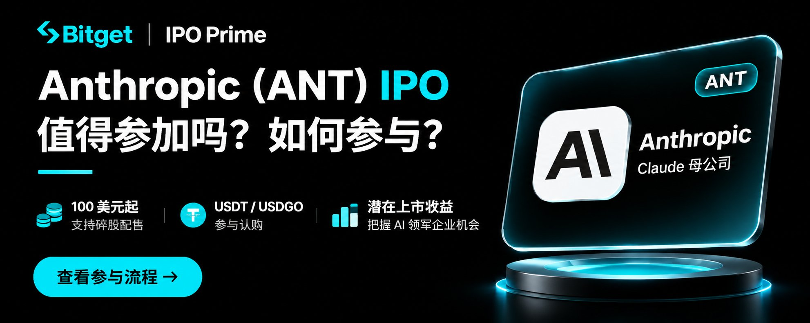

Claude Code 大家都不陌生，已经成为很多程序员和企业团队日常使用的工具。随着 AI Agent 不断发展，Anthropic 也逐渐从一家大模型研发公司，变成一家拥有大规模企业收入的 AI 公司。现在，它已经在纳斯达克上市了。

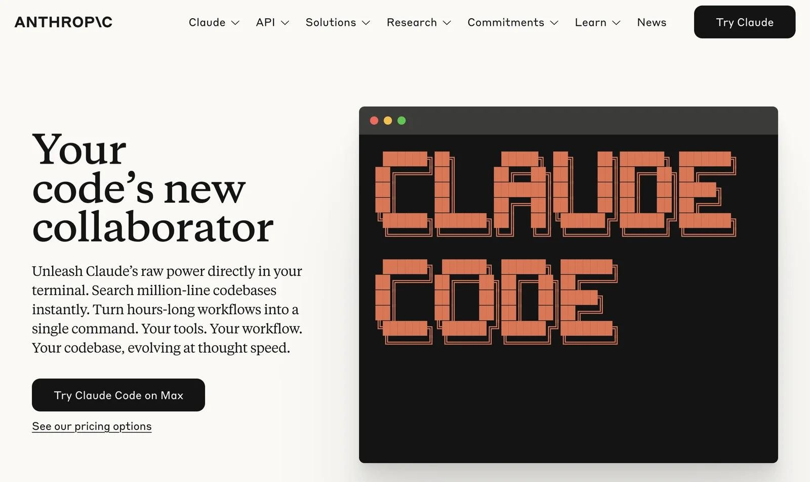

路演阶段公布的发行方案是：计划发行 8.25 亿股，发行价格区间为每股 70–78 美元，股票代码为 ANT，在纳斯达克上市。按照当时发行价格中点 74 美元计算，完全摊薄估值约为 1.33 万亿美元；按区间上限 78 美元计算，约 1.4 万亿美元。官方后来在 11 月 18 日把发行价定为 83 美元，高于这个区间。下文估值讨论仍按路演阶段公布的区间来展开，不再按 83 美元另算一个未核对的市值。

这个数字相当惊人。今年 SpaceX 以约 1.77 万亿美元的估值完成 IPO，已经创造了全球资本市场的历史纪录。当时 Anthropic 又准备以接近 1.4 万亿美元的估值上市。一家 AI 大模型公司，凭什么值这么多钱？这次 IPO 究竟有没有参与空间？上市之后股价又可能怎么走？

我想从公司收入、估值、SpaceX 对比、IPO 历史走势几个方面，完整聊一遍，最后再说说我自己通过 Bitget 参与这次公开轮的方式。

## 一、这次 ANT 的 IPO 定价是多少？

先给大家来看看具体的发行方案。根据 Anthropic 2026 年 11 月 10 日公布的路演公告和招股书：

- 股票代码：ANT
- 上市交易所：NASDAQ
- 计划发行：8.25 亿股
- 发行价格区间：70–78 美元
- 发行价格中点：74 美元
- 官方发行价：83 美元（2026 年 11 月 18 日定价，高于上述区间）
- 实际开盘：2026 年 11 月 19 日（代码 ANT，纳斯达克）
- 发行完成：2026 年 11 月 20 日（含绿鞋）

这里有一个细节需要说明。这次计划发行的 8.25 亿股中，Anthropic 自身发行约 8.0135 亿股，另外约 2365 万股来自部分现有股东出售。也就是说，并非所有发行股份都能给公司带来新的资金。

按照发行价格计算：如果最终发行价是 70 美元，本次发行规模约为 577.5 亿美元；如果最终发行价是 78 美元，发行规模约为 643.5 亿美元；按照 74 美元的中间价计算，发行规模约为 610.5 亿美元。另外，还有约 260 亿美元的 Class N 定向配售，对象包括 AMD、Broadcom、Google、美光、微软、英伟达、台积电等。所以，这次 IPO 所涉及的资金规模非常庞大。

不过，我们需要区分两个概念：IPO 募资规模和公司市值。发行价格乘以发行股份数量，计算的是本次发行的规模；公司市值则需要乘以公司上市后的全部股份数量。按照招股书的完全摊薄股本测算，74 美元对应的估值约为 1.33 万亿美元，78 美元对应的估值约为 1.4 万亿美元。

那这个时候问题就来了：市场愿意给一家 AI 大模型公司支付多高的溢价，以及为什么愿意支付那么多溢价？

## 二、Anthropic 现在有多赚钱？

分析 Anthropic，解铃还须系铃人，首先要看它的收入。很多人认识 Anthropic，是因为 Claude，也有人是因为 Claude Code。但如果只把它当作一个 AI 聊天机器人公司，就低估了它的商业模式。类比于现在的 SpaceX，它其实并不算得上是纯粹的单线程公司。

Anthropic 目前主要有几条收入来源：

- Claude 订阅服务：个人用户通过不同的订阅计划付费。
- Claude Code：面向开发者的软件编程工具，个人和企业都可以付费使用。
- 企业 API：企业通过 API 接入 Claude 模型，按照实际使用量付费。
- 企业服务：通过 Claude Enterprise 等产品进入企业内部的工作流程。

这里面，我尤其看重企业 API 和 Claude Code。因为个人订阅的收入相对容易测算，一个用户每个月支付多少钱，基本就能算出收入上限。企业 API 则完全不同。一家企业可能有几百、几千甚至几万名员工使用 Claude。随着模型接入更多业务流程，Token 消耗量、API 调用量以及企业合同金额都可能持续增加。

例如，一家软件公司原来需要几十名工程师完成的工作，现在可以通过 Claude Code 提高开发效率。假设它愿意为每个开发人员支付一定的 AI 使用费用，这就形成了一笔持续性的企业支出。如果 Claude 能够从软件开发场景扩展到客服、销售、数据分析、财务、法律等部门，Anthropic 的收入空间还会进一步扩大。

先看实际收入。Anthropic 招股书披露的数据相当惊人：2026 年第三季度，公司收入达到约 170 亿美元；2026 年前三季度累计收入约为 332 亿美元，同比增长约 13 倍。按照公司披露的历史数据：

- 2024 年全年收入约 3.86 亿美元
- 2025 年全年收入约 45.9 亿美元
- 2026 年前三季度收入约 332 亿美元
- 截至 2026 年 10 月底，收入运行率已经达到约 810 亿美元

从几年的变化来看，这家公司已经进入了非常夸张的商业化扩张阶段。

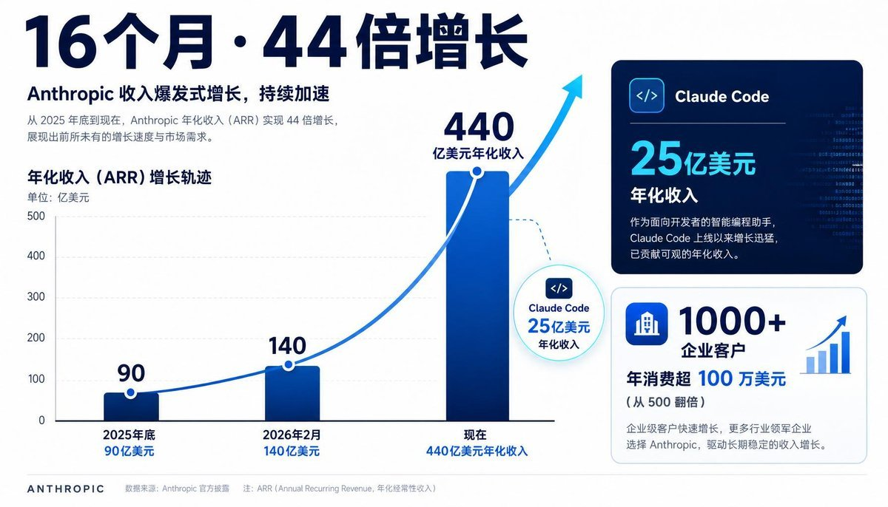

另外，截至 2026 年 9 月底，过去 12 个月贡献收入至少 10 万美元的客户超过 11,900 家。这说明 Claude 已经进入大量企业的正式采购和预算体系。企业愿意持续为 AI 能力付费，这件事情本身就具有很大的商业价值。

再看现金流和亏损。收入增长很快，不代表利润已经跟上。Anthropic 在 2026 年前三季度的 GAAP 净亏损约为 1040 亿美元。看到这个数字，很多人可能会觉得很离谱：一家前三季度收入 332 亿美元的公司，怎么会亏损超过 1000 亿美元？

这里面有一个重要的会计因素。约 943 亿美元来自可转换票据、衍生负债以及 SAFE 等融资工具的公允价值变动。这部分主要与融资工具的估值重估有关，不能简单理解为公司实际经营烧掉了 943 亿美元现金。但这也不意味着公司已经盈利。

招股书同时披露，Anthropic 在 2026 年前三季度的经营活动现金净流入约为 65.69 亿美元，而上年同期还是净流出约 20.24 亿美元。这是一个积极信号。不过，同期投资活动现金净流出约 365.46 亿美元，其中包括短期投资、服务器、网络设备和基础设施相关支出。因此，经营现金流转正还不能直接等同于自由现金流转正。

另外，公司还披露了约 9000 亿美元的算力及基础设施相关承诺，其中未来 12 个月约有 700 亿美元需要支出。这意味着它未来还需要持续投入大量资金，才能维持模型训练、推理服务以及企业客户增长。

我的判断是：Anthropic 已经证明了企业 AI 存在非常强的付费需求，也证明了 Claude 可以形成规模化收入。但它未来最大的挑战，是如何把收入增长转化成稳定的经营利润和自由现金流。如果模型调用量持续增长，但算力成本、数据中心投入和融资成本也同步增长，那么收入再高，最终留给股东的利润也可能没有想象中那么多。

## 三、1.4 万亿美元估值贵不贵？

现在来到最关键的部分。Anthropic 这次 IPO 的完全摊薄估值最高约为 1.4 万亿美元。这个数字究竟意味着什么？我们可以直接用市销率，也就是 P/S 来计算。

对于一家还没有稳定净利润、但收入高速增长的 AI 公司，PE 暂时很难作为主要估值工具。因为它目前的利润受到大规模算力投入、股权激励以及融资工具会计重估的影响。这个时候，市场更愿意参考未来收入和市销率。假设按照 1.4 万亿美元的完全摊薄估值计算：

第一种，按照当前收入运行率计算。Anthropic 目前披露的收入运行率约为 810 亿美元。1.4 万亿美元 ÷ 810 亿美元 ≈ 17.3 倍。也就是说，市场愿意为 Anthropic 当前每 1 美元的年化收入，支付约 17.3 美元的估值。如果按照 74 美元的发行价中点，对应估值约为 1.33 万亿美元，市销率则约为 16.4 倍。

第二种，按照 2027 年预期收入计算。根据路透社援引投行预测，Anthropic 2027 年收入可能达到 1350 亿至 1370 亿美元。我们取中间值 1360 亿美元。1.4 万亿美元 ÷ 1360 亿美元 ≈ 10.3 倍。这意味着，如果 2027 年收入预测兑现，Anthropic 对应的远期市销率将下降到约 10.3 倍。

第三种，按照 2028 年预期收入计算。部分机构对 Anthropic 2028 年收入的预测达到 2700 亿至 2800 亿美元。我们同样取中间值 2750 亿美元。1.4 万亿美元 ÷ 2750 亿美元 ≈ 5.1 倍。这就意味着，如果未来两年收入能够按照机构预测持续增长，今天看起来非常高的估值，可能会逐渐被收入增长消化。

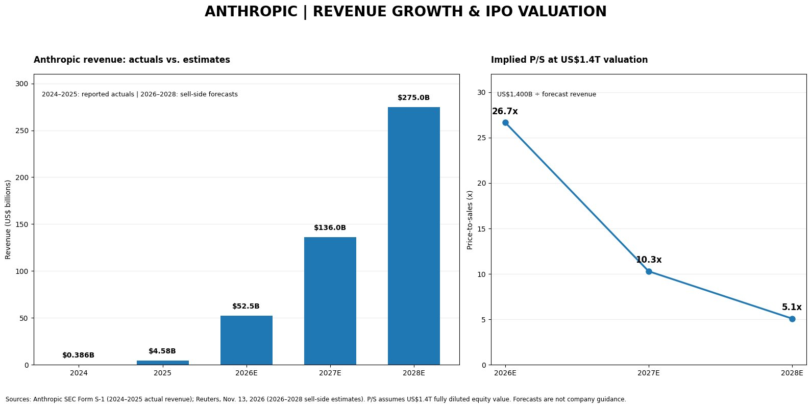

当然，这里面有一个很大的前提：机构预测能不能兑现？2027 年 1360 亿美元收入，意味着 Anthropic 需要在现有基础上继续大幅扩张。它需要面对几个问题：

第一，Claude 能不能持续保持模型竞争力？目前 AI 行业竞争非常激烈，OpenAI、Google、Meta 以及其他模型公司都在持续投入。如果 Claude 的模型优势被逐渐缩小，企业客户就可能重新分配预算。

第二，Claude Code 能不能形成长期使用习惯？目前 Coding 是 Claude 的重要增长来源，但企业 AI 的市场空间远远不止编程。如果 Claude 能够逐渐进入企业内部更多工作流程，收入就可能继续增长。

第三，算力投入能不能产生足够的回报？这是最重要的变量之一。Anthropic 已经披露了接近 9000 亿美元的算力和基础设施承诺。未来它必须持续提高单位算力带来的收入，并且让模型推理成本逐步下降。否则，即使收入达到 1000 亿美元、2000 亿美元，利润率也未必能够达到市场期待。

所以，我对这次估值的判断是：按照当前业务规模来看，1.4 万亿美元肯定已经包含了非常高的增长预期；按照未来两年的收入预测来看，这个估值又并非完全没有逻辑。市场买入的，是 Anthropic 在未来 AI 企业软件和智能体市场中的潜在位置。如果未来收入兑现、利润率改善，今天的估值就有机会被消化；如果收入增长放缓，或者算力投入无法转化成利润，估值回落也会非常快。这也是为什么我认为，这次 IPO 的交易价值，需要和长期投资价值分开看。

## 四、为什么拿 SpaceX 来对比？

这次 Anthropic IPO，可以拿今年的 SpaceX 做一个非常好的参照。因为两家公司有一个共同点：它们都处于一个有机会改变全球产业结构的行业，而且在各自领域都具备相当强的竞争力。但它们的商业模式完全不同。

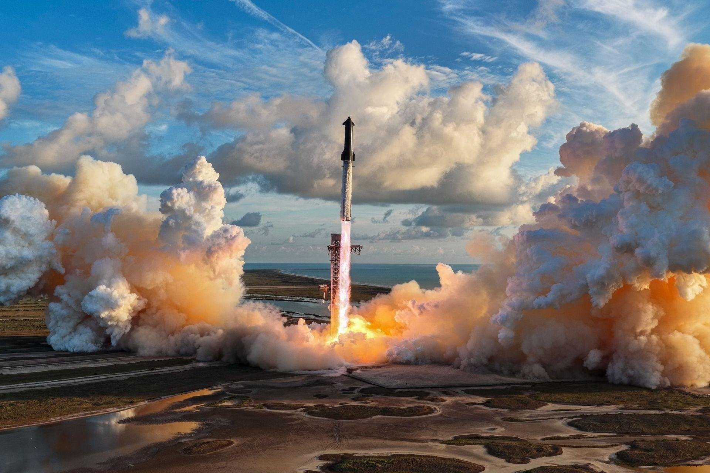

SpaceX 的核心业务包括火箭发射、Starlink 卫星互联网，以及 AI 算力基础设施等。Anthropic 的核心业务则是大模型研发、Claude 产品、企业 API 和 AI Agent。一个在解决太空运输、卫星通信和基础设施问题，一个在解决智能生产力问题。从行业属性来看，它们都具备很强的长期想象空间。

先看 SpaceX 当年的财务情况。根据 SpaceX IPO 招股书，2025 年公司的财务数据如下：全年营收 186.74 亿美元，营业亏损 25.89 亿美元，全年净亏损 49.37 亿美元，调整后 EBITDA 约 65.84 亿美元。

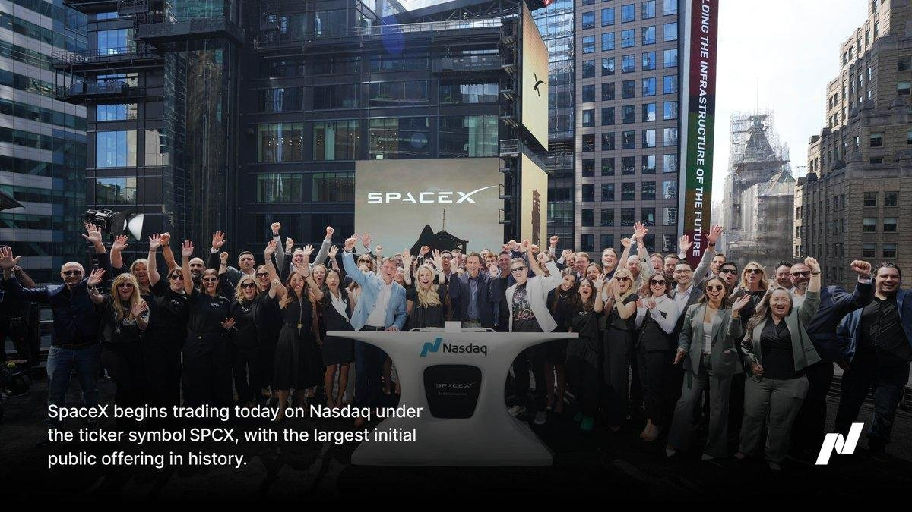

这里需要区分净利润和 EBITDA。SpaceX 当时已经有相当规模的收入，也拥有正向的调整后 EBITDA，但按照 GAAP 会计口径，2025 年依然处于亏损状态。它最终以约 1.77 万亿美元的 IPO 估值上市，发行价为每股 135 美元，募集资金约 750 亿美元，成为当时全球最大规模的 IPO。如果按照 1.77 万亿美元估值和 186.74 亿美元收入计算，它的 IPO 市销率接近 95 倍。这个估值有多夸张？可以说，当时市场给 SpaceX 定价时，已经把未来很多年的增长预期放进去了。

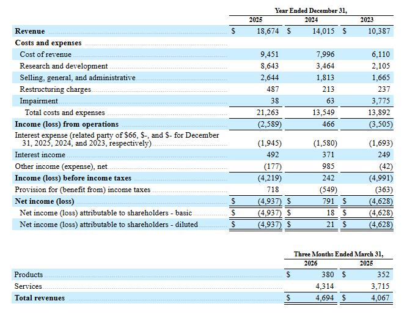

再来看 Anthropic。Anthropic 目前的收入运行率约为 810 亿美元，完全摊薄估值约为 1.4 万亿美元。两者放在一起：

- SpaceX：2025 年营收约 187 亿美元，IPO 估值约 1.77 万亿美元。
- Anthropic：2026 年 10 月收入运行率约 810 亿美元，IPO 估值约 1.4 万亿美元。

单纯按照收入规模来看，Anthropic 的商业化速度已经相当惊人。而且两家公司的估值逻辑也存在区别。SpaceX 的估值包含了火箭复用、Starlink 全球卫星互联网、未来太空运输以及 AI 基础设施等长期预期。Anthropic 的估值则包含了大模型技术、企业软件、智能体以及未来 AI 生产力市场的预期。

你会发现，资本市场愿意为这两家公司支付如此高的价格，背后都有一个共同因素：投资者愿意提前为未来十年的产业地位买单。所以，我不认为单纯拿两家公司的收入和市值进行比较，就能得出谁贵谁便宜的结论。它们的产业空间、增长周期、资本开支和商业化路径都不同。

但有一个判断可以确定：SpaceX 已经向市场证明，哪怕一家公司的当前盈利能力还没有完全兑现，只要市场相信它有机会建立一个巨大的产业平台，资本市场依然可能给予极高的估值。Anthropic 这次 IPO，面对的也是同样的定价逻辑。当然，SpaceX 有 Starlink 这种已经形成规模的基础设施业务，Anthropic 仍然需要证明自己能在激烈的模型竞争中保持优势。两者的风险不能直接画等号。

## 五、ANT 上市后股价可能怎么走？

这里可以参考一下过去几次大型科技公司 IPO 的表现，尤其是今年的 SpaceX。很多人看到一家公司上市，会觉得发行价就是一个比较便宜的价格。但实际情况往往很复杂。IPO 发行价格是公司和承销商在上市前确定的价格，上市首日的开盘价则是公开市场买卖双方竞价形成的价格。两者之间可能存在很大的差距。

### SpaceX 当时的走势

SpaceX 当时的 IPO 发行价为 135 美元。上市首日收盘价达到 160.95 美元，涨幅约 19.2%。随后股价经历了上市初期的价格发现、资金交易和市场重新定价。

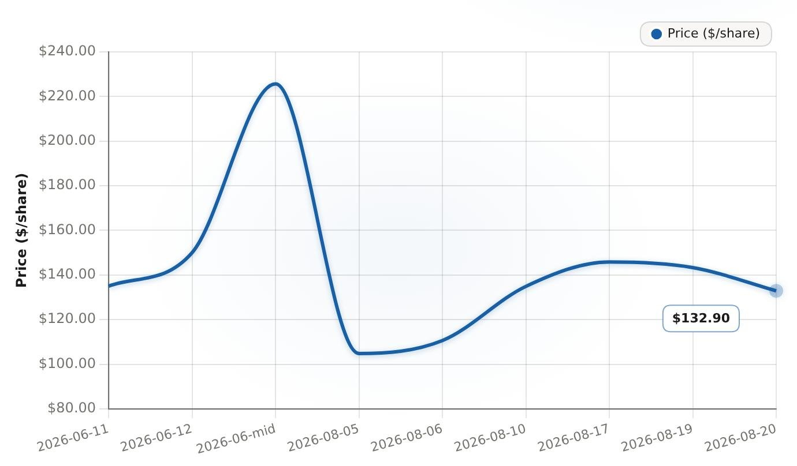

这里我想强调一点：我们不能只拿上市首日的涨幅来判断一家公司 IPO 是否成功。上市首日的价格，很大程度上反映的是当时市场的供需关系。真正影响后续走势的，是获配资金是否兑现、公开市场的买盘是否充足，以及公司的基本面能否支撑新的价格。SpaceX 的案例给了我们一个很好的参考：发行价、首日价格和上市后的交易价格，可能是三个完全不同的市场定价。

### 其他大型科技公司的 IPO

这里我还想补充几个案例。

- Airbnb（ABNB）：2020 年 IPO 发行价为 68 美元，上市首日收盘价达到 144.71 美元，涨幅超过 112%。
- Snowflake（SNOW）：2020 年 IPO 发行价为 120 美元，上市首日收盘价达到 253.93 美元，同样上涨超过 112%。
- Facebook（META）：2012 年 IPO 发行价为 38 美元，上市首日收盘价为 38.23 美元，基本没有明显上涨。之后股价经历了较长时间的调整。
- Uber（UBER）：2019 年 IPO 发行价为 45 美元，上市首日收盘价为 41.57 美元，直接跌破发行价。

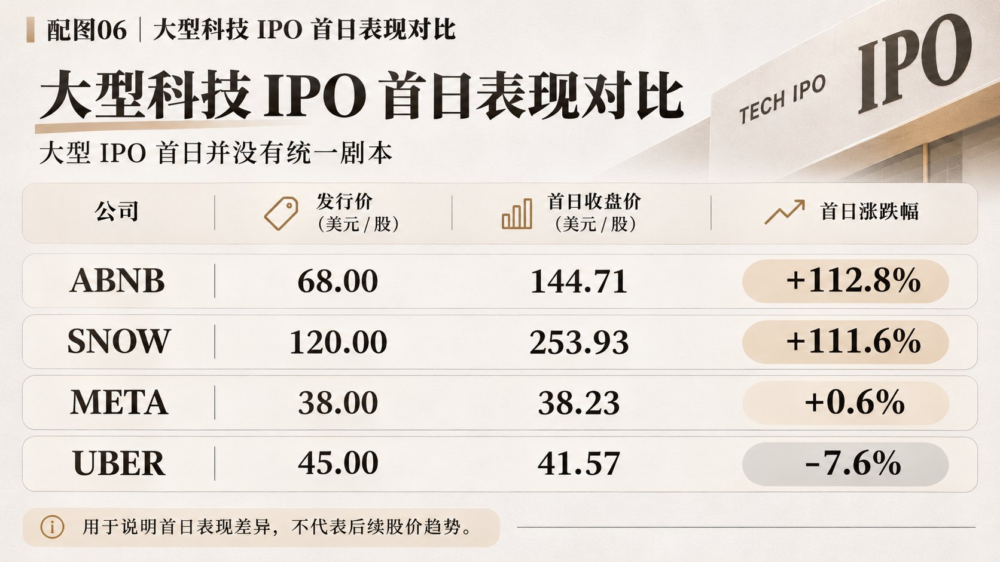

这些案例说明，大型 IPO 并没有统一的走势。市场情绪、发行定价、流通股数量、获配比例以及公司自身的基本面，都会影响上市后的表现。

### 我对 Anthropic 这次 IPO 的走势判断

现在回到 ANT。我认为这次 IPO 有几个需要重点考虑的因素。

第一，市场关注度很高。Anthropic 是全球最受关注的 AI 公司之一，Claude Code 又恰好处于快速增长阶段。这意味着它拥有非常强的市场关注度。路透社报道显示，截至 2026 年 11 月 12 日，Anthropic 的 IPO 订单规模已经达到可供发行股份的约六倍。这种认购热度，说明市场对于这次 IPO 的需求非常强。

第二，发行估值已经不低。1.4 万亿美元的完全摊薄估值，意味着公司已经提前获得了非常高的增长溢价。如果上市首日市场继续追高，短时间内很可能出现明显的价格偏离。这也意味着，打新获配和上市后追高，是两种完全不同的交易。

第三，后续还有算力和财报的考验。Anthropic 未来需要持续证明收入增长、算力效率和利润率改善。如果上市后的第一份财报没有达到市场预期，哪怕公司业务依旧增长，股价也可能出现调整。

我个人对这次 IPO 的判断是：我倾向于认为 ANT 上市初期会有很高的交易热度，存在首日溢价的可能性。但我不太愿意在上市初期就直接按照一个非常高的价格追进去。如果首日出现明显拉升，我会更倾向于观察早期获配资金是否兑现，以及市场能否消化首批抛售。如果出现一轮明显回调，成交量逐渐稳定，同时公司基本面没有发生变化，后面反而可能出现更好的参与机会。

我想参考 SpaceX 的上市过程，把 ANT 分成三个阶段：

- IPO 初期：关注发行价与实际开盘价之间的溢价，判断市场情绪有多热。
- 上市后的第一次调整：观察获配资金兑现、成交量变化，以及股价能否找到支撑。
- 上市后的第二阶段：结合财报、收入增长和企业客户变化，重新评估长期估值。

我更愿意等第二阶段的价格稳定之后，再考虑增加长期配置。当然，这只是我的交易预判，ANT 也完全可能上市后持续上涨，或者直接跌破发行价。不能把 SpaceX 的历史走势当成 ANT 必然重复的剧本。

## 六、怎么通过 Bitget IPO Prime 参与？

前面聊了这么多，最后说一下当时的参与方式。公开轮已于 2026 年 11 月 17 日结束，下面保留的是当时通过 Bitget IPO Prime 认购的说明，供已经参与或想回顾规则的人对照。上市后若要在公开市场买 ANT，请看[Anthropic 股票怎么买？ANT 上市后的三条路径](/articles/broker/gmoScHqH)。这次我自己也参加了当时的公开轮认购，使用的是 Bitget 的 IPO Prime。对于手里已经持有 USDT 或 USDGO 的用户来说，那种参与方式相对方便。

Bitget IPO Prime 本次开放了 Anthropic 的公开轮认购。根据当时页面和官方说明：

- 认购资产：USDT 或 USDGO
- 最低认购金额：100 美元
- 个人最高认购金额：25,000 美元
- 公开轮承销服务费：实际获配金额的 5%
- 配售方式：按照平台实际获得的份额及规则进行分配
- 获配资产：rANT
- 公开轮认购时间：2026 年 11 月 10 日 16:00 至 2026 年 11 月 17 日 16:00（北京时间）

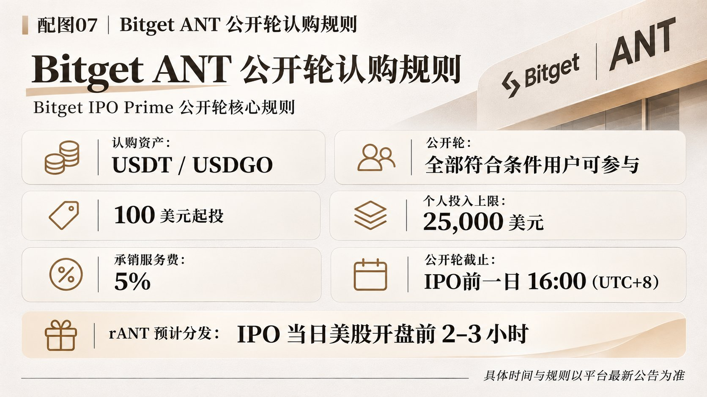

这里有几个地方需要提前了解。首先，认购 10,000 USDT，并不意味着你就能拿到价值 10,000 美元的 rANT。最终获配金额需要根据平台实际获得的配售份额，以及公开轮所有用户的认购情况进行计算。其次，5% 的承销服务费按照实际获配金额计算，没有获配的资金不收取这笔承销费用。第三，最终结算价格按照 Anthropic 正式 IPO 发行价格及适用费用计算。

还有一点需要说明：rANT 属于代币化资产，并不等于直接持有 Anthropic 的普通股，也不会自动获得股东身份、投票权等权益。Bitget 这项产品也没有得到 Anthropic 官方授权或背书。具体的资产支持、托管和赎回安排，应以产品文件为准。

认购入口在 [Bitget IPO Prime](https://www.bitget.com/zh-CN/spotlight/ipo-prime)。进入页面之后，找到 Anthropic（ANT），选择公开轮，使用 USDT 或 USDGO 提交认购。

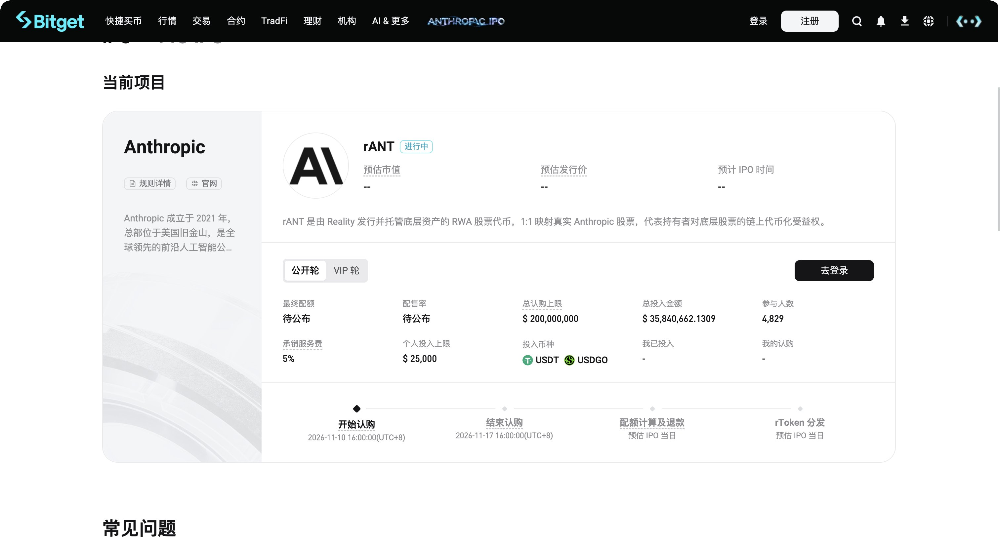

### 如果没有全部获配，剩余资金怎么办？

这个安排值得单独拿出来说一下。Bitget 这次针对 Anthropic IPO 推出了 IPO Prime 专属理财。用户在提交认购的时候，可以开启专属理财功能。等到配售结果出来之后，未获配的 USDT 或 USDGO 会按照规则自动转入对应的活期理财产品。当时官方公布的活动权益是：最高 10% 年化收益率，15 天专属收益期限，每小时派息，支持随时赎回。专属额度有限，按照先到先得的规则安排。

这里举个实际例子。假设你投入 10,000 USDT 参加 ANT 公开轮，最终配售结果出来，你获得了 1,500 USDT 的实际认购额度。那么剩余的 8,500 USDT，就可以按照规则自动进入专属活期理财。获配部分按照实际配售金额结算，公开轮还需要支付 5% 的承销服务费；剩余的 8,500 USDT 则按照符合条件的理财利率计算收益。

如果按 10% 年化、15 天计算：8500 × 10% × 15 ÷ 365 ≈ 34.93 USDT。也就是说，在符合活动资格、专属额度充足，并且实际获得完整 15 天 10% 年化的情况下，8500 USDT 大约可以产生 34.93 USDT 的利息。

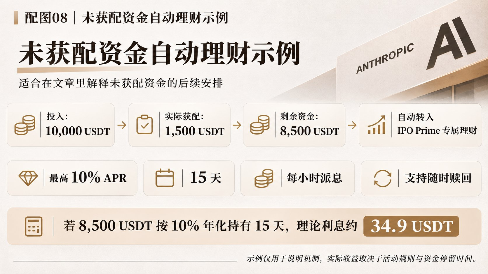

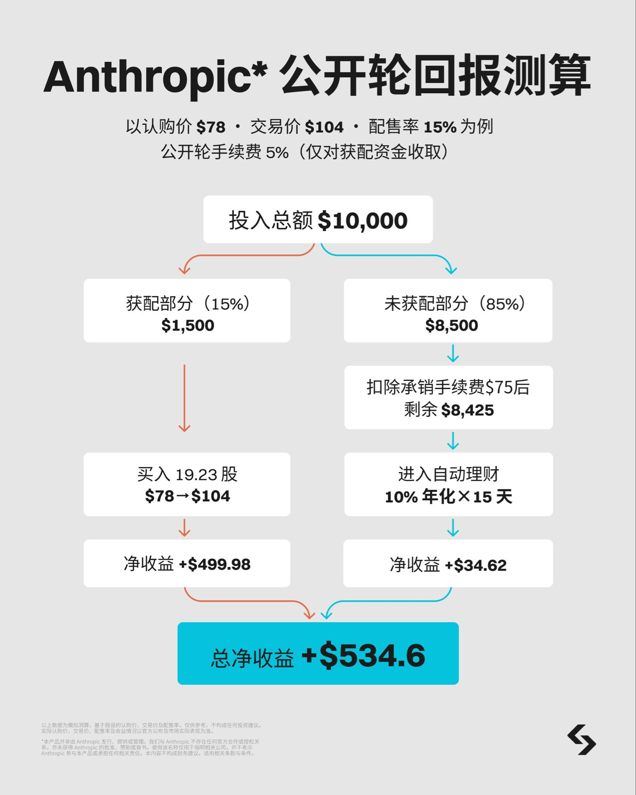

这个安排的好处在于，即便最后没有获得太多 ANT 配售，剩余资金也有机会获得额外收益，不需要自己再手动寻找理财产品。这里有一个操作细节：一定要检查认购页面底部的 IPO Prime 专属理财选项是否开启。官方说明该功能默认开启，但我还是建议大家自己检查一次。另外，专属额度有限，如果额度不足，剩余资金可能无法享受完整的专属活动利率，具体以平台实际安排为准。

### 如何注册 Bitget，以及如何找到 ANT 认购入口？

这部分我就不重复写一遍完整教程了。之前我们已经做过 Bitget 的注册、下载、账户设置以及 USDT 入金教程：

[Bitget 怎么注册、入金和买币](/articles/crypto/k3RVVcw4){card}

如果你还没有 Bitget 账户，可以先按教程完成注册和使用，再打开 [Bitget IPO Prime](https://www.bitget.com/zh-CN/spotlight/ipo-prime)，找到 Anthropic（ANT），选择公开轮提交认购。提交前检查这几件事：

- 账户已经完成身份认证
- 账户中有足够的 USDT 或 USDGO
- 确认认购金额以及 5% 的获配承销服务费
- 确认 IPO Prime 专属理财选项已经开启

提交之后，认购资金会进入锁定状态，不能随意撤销或转出。公开轮认购已于 2026 年 11 月 17 日 16:00（北京时间）结束。参考上次 SpaceX 先拉升、再回撤、再慢慢起来的过程，ANT 的走势也值得持续跟踪；但这只是对照历史路径的观察，不构成必然重复的交易结论。

## 七、常见问题

### rANT 是不是 Anthropic 的股票？

不是。通过 Bitget IPO Prime 获配的是 rANT，属于代币化资产，不等于直接持有 Anthropic 普通股，也不会自动获得股东身份或投票权。这项产品没有得到 Anthropic 官方授权或背书，具体的资产支持、托管和赎回安排，应以产品文件为准。

### 认购了一定能获配吗？

不一定。认购金额只是你提交的意向规模，最终获配要看平台实际拿到的份额，以及公开轮全部用户的认购情况。认购 10,000 USDT，并不意味着一定能拿到价值 10,000 美元的 rANT。

### 没获配的资金会收 5% 手续费吗？

公开轮 5% 的承销服务费按实际获配金额计算，没有获配的资金不收这笔费用。如果提交认购时开启了 IPO Prime 专属理财，未获配的 USDT 或 USDGO 可能按规则自动转入对应活期理财；活动利率、期限和额度以平台当时规则为准。

### 公开轮认购什么时候截止？

已经结束。按当时项目页，公开轮认购时间为 2026 年 11 月 10 日 16:00 至 2026 年 11 月 17 日 16:00（北京时间）。上市后怎么买，见[Anthropic 股票怎么买？ANT 上市后的三条路径](/articles/broker/gmoScHqH)。

### 上市后一定涨吗？

不一定。大型科技 IPO 没有统一走势：有的首日大涨，有的几乎平开，也有的直接跌破发行价。发行价、首日价格和上市后的交易价格，可能是三个完全不同的市场定价。本文对走势的判断只是个人观察，不构成投资建议。
