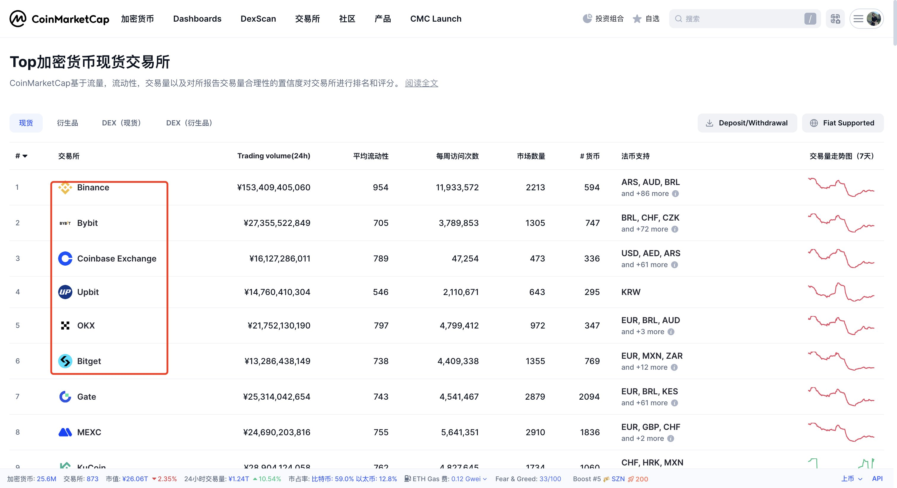
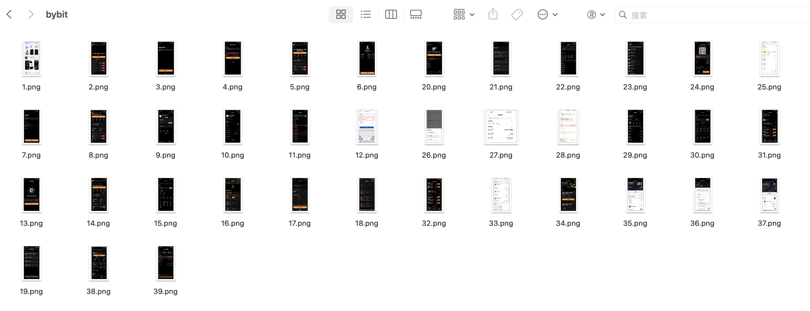

## 一、先确认服务资格与产品用途

这一篇先解决一个比“如何注册”更靠前的问题：**你是否可以使用 Bybit 的服务。** 能打开网站、下载 App，和符合账户资格是不同的事情。

截至本次核对的 **2026 年 11 月 7 日**，Bybit 官方服务限制页明确列有**中国大陆和香港**。因此，这篇不能作为面向这两个地区用户的开户指引；下面的账户流程仅供符合本人适用资格的读者理解。更换网络节点、填写其他地区地址，都不会改变真实资格。官方也提示，虚报所在地或居住地可能导致账户终止。[Bybit 服务限制说明](https://www.bybit.com/en/help-center/article/Service-Restricted-Countries)

Bybit 的交易、赚币与活动入口需要分别理解：现货是两种资产之间的买卖，合约还涉及保证金与杠杆，赚币产品则有自己的期限、计息和退出条件。**开通账户，不等于所有产品都能使用。**

交易所账户与卡产品的资格需要分别确认，不能相互替代。若你符合资格并打算申卡，另见 [Bybit Card 怎么开](/articles/vcard/wYKRLDvK)；还不熟悉币与账户概念时，可先读 [BTC、ETH、USDT 入门](/articles/crypto/UOMdQwU3?series=crypto-basics)。

## 二、注册前准备什么

先检查本人地区、身份及所选产品的服务要求。符合条件后，再准备以下材料：

1. **本人长期使用的邮箱和安全验证方式。** 设置独立密码，避免与其他网站共用。
2. **当前页面接受的有效身份证件。** 国籍、居住地、证件签发地按真实情况填写，不能为了通过审核而任选国家。
3. **可自行控制的转出账户。** 如果计划链上入金，要能查看转账记录、交易哈希和提币费用。
4. **账户与资金记录。** 保留认证结果、转账和成交记录，方便核对资金来源、异常和后续申报。

证件种类与补充材料取决于本人身份和页面要求，不能笼统地说“护照和身份证没有区别”。审核中收到补件通知时，先处理通知，再检查具体功能是否已开放。[Bybit 身份认证常见问题](https://www.bybit.com/en/help-center/article/Individual-KYC-FAQ)

## 三、注册、认证与安全验证

### 符合资格后，再进入注册入口

从官方入口进入网站或获取 App，核对域名、应用发布者和下载来源。在注册页填写本人邮箱、设置密码，并确认 Wise 邀请码为 **WISE6666**。邀请链接未自动带入时，可以复制后手动填写。

> [注册 Bybit 账户](https://partner.bybit.com/b/WISE6666) · 邀请码：**WISE6666** · 福利：永久 20% 交易手续费返佣

**20% 指邀请渠道的交易手续费返佣，不是本金收益率。** 提交后检查邀请关系是否已绑定；资格审核与邀请关系是两件事，使用邀请码不会放宽服务限制。

> **Wise VIP 服务群另有条件：** 通过邀请渠道注册后，成功入金 1000U、完成 10000U 合约交易，可凭 UID 联系我申请加入。这是 VIP 服务条件，与永久 20% 交易手续费返佣分开；不要为了进群而进行不需要的交易。

### 认证与安全设置分别完成

进入身份认证页面，按本人真实信息填写国家或地区、证件资料，并完成页面要求的验证。提交后查看状态：**待审核、需补充资料和审核通过不能混为一谈。** 审核通过后，也要单独确认拟用产品的权限。

接着检查安全设置中的双重验证、防钓鱼信息及可用的提币保护。使用身份验证器时，将恢复资料离线妥善保管，不把密钥、验证码或恢复码发给客服和陌生人。二次验证能增加保护，不能保证账户永远没有风险。

## 四、链上入金怎样检查结果

原教程演示的是**从另一个交易所链上转入 USDT**，不是 C2C 买币。先在本人 Bybit 账户取得实时充值信息，再到转出账户操作，顺序不能颠倒。网络与地址核对可对照 [第一次转币：网络与到账](/articles/crypto/oWHIVCLt?series=crypto-basics)；若转出端是币安，也可先看 [币安注册与使用](/articles/crypto/GaM38JYk)。

1. **在接收端确认资产和网络。** 找到加密货币充值入口，选择准备转入的币种，再核对当前支持的网络、最低充值额和所需确认数。需要 Memo / Tag 的资产必须一并填写。
2. **取得本人实时地址。** 旧记录用过 USDT 的 BSC 网络，但这不表示所有时候都应选 BSC。应以本次两端同时支持的网络为依据，不向文章图片中的地址转账。
3. **到转出端核对同一组信息。** 在本人交易所或钱包中选择相同币种与网络，粘贴地址，检查首尾字符、附加标签、手续费和预计实际到账金额。
4. **首次先验证一笔满足最低要求的小额。** 提交后保留交易哈希。区分“转出申请受理”“链上确认”和“接收平台记账”，不要只看转出端的成功提示。
5. **回到接收端核对记录。** 检查币种、净到账金额、账户余额及是否可用。未到账时先查哈希和确认数，再向官方支持提交记录，不连续重复转账。

官方充值说明强调资产、网络、最低金额及附加标签等要求；错用网络或遗漏标签可能造成损失。[Bybit 充值说明](https://www.bybit.com/en/help-center/article/How-to-make-a-deposit)

原稿收到 **100U** 是当时那笔记录，不是统一开户门槛。网络拥堵、提币审核和手续费都会影响结果，不能把它写成“秒到、无损耗”。

## 五、现货买卖与资金转出的文字流程

### 先确认订单买的是什么

以下用 **BTC/USDT** 解释现货流程：购买 BTC 会使用 USDT，卖出 BTC 会换回 USDT。Bybit 官方现货说明区分现货与合约，也介绍市价、限价等订单类型。[Bybit 现货常见问题](https://www.bybit.com/en/help-center/article/FAQ-Spot-Trading)

实际操作时按这几个节点核对：

1. **确认账户与市场。** 先看资金是否属于可用余额，页面是否为现货，避免进入杠杆或合约界面。余额不可用时，先查冻结、产品占用和账户划转提示。
2. **核对交易对和方向。** 看清 BTC/USDT、买入或卖出，以及输入的是数量还是金额。不要只认缩写相似的代币名称。
3. **理解订单类型。** 限价单要设定价格，可能暂时不成交；市价单按可成交报价执行，成交均价可能与看到的最新价不同。
4. **提交前读一遍订单。** 检查价格、数量、预计支出与手续费。提交后查看订单状态、已成交数量和成交均价。
5. **把订单和余额对起来。** 部分成交时，未成交部分仍是挂单；撤单也不会撤回已经成交的部分。用成交记录核对资产变化，不凭提交成功判断买入完成。

### 卖出之后，还要核对能否转出

卖出得到的 USDT 仍是平台内的加密资产，不会自动回到银行卡。准备链上转出时，先在**本人接收账户**取得有效地址，再核对币种、网络、最低提现额、费用和可提现余额。

确认没有未完成订单或产品占用后，按当前页面要求完成安全验证；保存提现记录与交易哈希，直到接收端显示到账。遇到审核、冻结或不支持的网络，先解决原因，不靠更改身份资料或借用他人账户绕过。

## 六、邀请返佣、新手任务与赚币产品

### 新手奖励不能直接当作现金收益

本文邀请渠道的**永久 20% 交易手续费返佣**，与平台新手任务是两套规则。原教程曾记录：身份验证后的 **20U 手续费折扣券**，以及入金 **100U**、交易量超过 **10U** 后的 **20U 等值代币任务**。这些数字保留为历史例子，不代表现在仍可领取。

参与前逐项读清楚奖励类型、报名时间、净入金口径、有效交易量、领取截止时间和可提现条件。手续费券不能直接等同于现金；为了任务反复买卖，还会产生手续费、价差和价格波动，不能说“无损赚 20U”。

### 活动名称相似，资金占用不同

原稿介绍过 SpotX 下的任务、Launchpool、Launchpad 等入口。阅读具体活动时，可以用下表区分：

| 活动类型 | 提交前看什么 | 结束后核对什么 |
| --- | --- | --- |
| 交易或任务奖励 | 报名资格、有效任务、交易成本、奖励上限 | 是否达标、奖励形式、领取与解锁时间 |
| 质押或锁仓赚币 | 接受什么资产、是否锁定、退出规则 | 本金资产数量、奖励币数量、实际到账 |
| 代币认购 | 定价、分配规则、退款和上市安排 | 获配数量、未获配退款、能否出售 |

为了参与而买入平台币或项目代币，还要承担该币的价格变化。奖励数量更多，不等于总收益更高；认购价也不保证低于上市后的市场价。

### 年化要换算成实际占用天数

旧记录中的“新手 **555%**”是限额、限期条件下的年化展示。假设只有 **300U** 符合资格、按该年化计息 **2 天**，单利示意为 **300 × 555% × 2 ÷ 365 ≈ 9.12U**，不是投入 300U 就能长期得到同样回报。

实际参与还需看有效额度、计息起止、结算币种、赎回限制与产品风险。先记录投入金额和占用时间，再核对实际领取的奖励，不能只截图最高年化。

## 七、怎样比较入口与继续学习

比较交易所时，先看本人能否使用，再看所需交易对、实际费用、订单深度、出入金和安全设置。交易所不是银行，规模和品牌印象不能替代账户条款，也没有“大额交易一定无滑点”的保证。

这张旧对比图用于回看原教程的产品分类；具体资格、费用和活动按本文的检查顺序重新确认。没有必要为了凑奖励把所有账户都开一遍，更不应把预计奖励当作开户必得收益。

如果想继续理解跨交易所转账和活动的区别，可以阅读：

[币安注册与基础操作教程](/articles/crypto/GaM38JYk){card}

原教程的补充图片保留在[网盘资料](https://pan.quark.cn/s/58e380db5375?pwd=JhAm)。
