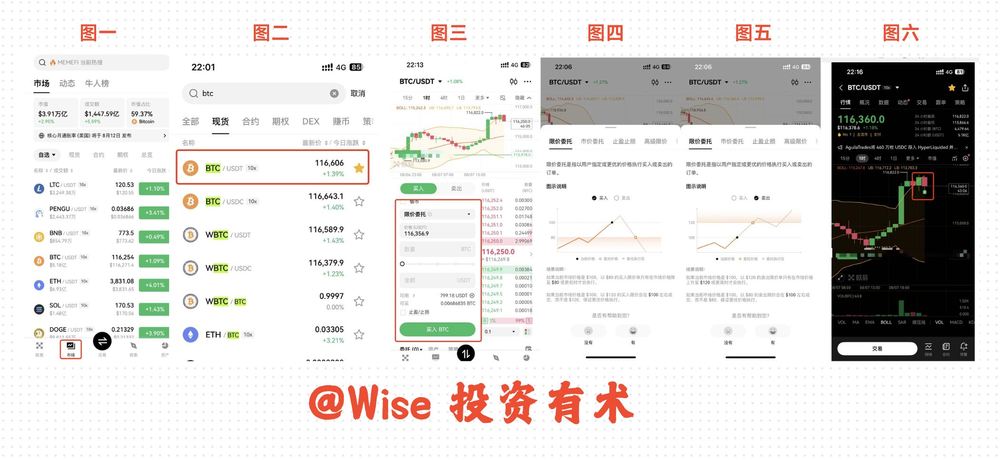

USDT 已经到账，打开交易页面以后，却同时出现价格、数量、金额、市价、限价。填哪个？按下买入以后，为什么 BTC 余额还是零？

这一课只完成一件事：用一笔连续的假设交易，跟着钱和币的变化，走完买入、撤单和卖出。你可以只在纸上演算，不需要用真实资金练习。

## 一、先给这笔交易设定清楚的起点

假设账户里一共有 **100 USDT、0 BTC**，没有借款，没有其他挂单。本课将其中 60 USDT 作为买入委托金额，其余留在账户里。数字仅方便计算，不代表建议投入的金额或比例。

统一假设 BTC 买入价格为 100,000 USDT，交易手续费为成交额的 0.1%，且**都从 USDT 余额扣除**。现实中费用可能从买到的币或其他资产扣收，先用同一种计价方式把机制讲清，再对照自己的成交单。

第一步查看可用余额所在账户。资金账户有 100 USDT，现货页面却没有可用资金，可能还需要按平台要求进行内部划转。已经被挂单占用、处于限制中的资金，也不能当作全部可用。

[C2C 买入与账户划转](/articles/crypto/mk7xplfU?series=crypto-basics){card}

## 二、打开现货页面，把五个字段对上

先确认产品是普通现货，再搜索 BTC/USDT。BTC 是本次买卖的资产，USDT 是报价与结算资产。部分平台或地区产品采用不同展示方式，应以实际订单的支出和收到币种为准。

| 页面字段 | 本课填写或查看的内容 | 容易看错的地方 |
| --- | --- | --- |
| 产品 | 现货 | 同一个 BTC 名称也可能出现在合约页 |
| 方向 | 买入 BTC | 买入与卖出针对前面的 BTC，不是针对 USDT |
| 订单类型 | 限价 | 指定可接受价格，不承诺立即成交 |
| 价格 | 100,000 USDT / BTC | 是每枚 BTC 的报价，不是本次投入金额 |
| 数量／金额 | 0.0006 BTC／60 USDT | 数量与金额单位不同，不能把 60 填进 BTC 数量框 |

数量关系是：**60 ÷ 100,000＝0.0006 BTC**。手续费另外准备，所以“可用余额全部投入”与“委托成交额等于全部余额”不能简单画等号。

对照真实界面时，可以进入已有币安、OKX 教程中的现货部分。原图用于识别字段位置，旧报价和按钮位置不代表当前账户状态。

这张站内旧图可以按三个位置读：图二先确认“现货”分类和交易对；图三看价格、BTC 数量、USDT 金额与可用余额；图四、图五对照买入上限和卖出下限。图六的 K 线标记不能代替订单成交明细。截图中的行情与倍数标签不作为本课参数，实际操作仍须确认普通现货、没有借款。可点击图片放大查看。

[币安注册、入金与现货入口](/articles/crypto/GaM38JYk){card}
[OKX 现货买入图解](/articles/crypto/mAPQm7WZ){card}

## 三、限价买入后，钱和币怎样变化

确认限价与数量后提交订单，先到“当前委托”查看状态，再查看成交明细。限价买单限制最高买入价格，可以按限价或更好的价格成交；如果没有足够卖单，就可能继续等待。[币安限价单说明](https://www.binance.com/en/academy/articles/what-is-a-limit-order)

假设本单最终全部以 100,000 成交：

- 成交数量：0.0006 BTC。
- 成交金额：60 USDT。
- 假设手续费：60 × 0.1%＝0.06 USDT。
- 剩余 USDT：100 − 60 − 0.06＝39.94 USDT。

注意，本课的手续费扣收方式是特意设定的。如果真实成交单显示费用从 BTC 扣除，就要用“成交数量减去 BTC 手续费”核对净入账，不能硬套这里的 0.0006。

| 时点 | 已拥有 BTC | USDT 的状态 | 应看哪份记录 |
| --- | --- | --- | --- |
| 提交以前 | 0 | 100 可用 | 资产明细 |
| 已提交但未成交 | 0 | 委托资金被占用，可用余额减少 | 当前委托 |
| 全部成交 | 0.0006 | 本例剩余 39.94 | 成交明细＋资产余额 |

平台可能按规则预留费用，所以挂单阶段实际冻结金额以页面为准。这里要建立的判断是：**钱被占用，不等于已经换成 BTC。**

## 四、部分成交后撤单，究竟撤回什么

现在换一条分支：仍然下单买 0.0006 BTC，但只成交了 0.0002 BTC，剩余 0.0004 没有成交。假设已成交部分价格同样是 100,000。

已花的成交金额是 20 USDT，费用是 0.02 USDT。撤掉剩余委托以后，账户应有 **0.0002 BTC 和 79.98 USDT**，且该订单不再有待成交数量。

撤单不会自动卖掉已经买到的 0.0002 BTC。它结束的是剩余买入请求。实际点击撤单时，系统还可能发生新的撮合，因此必须以最终累计成交量为准，而不是点按钮前记住的数字。

同样，看到“已撤销”也不要只看一个状态词。打开订单详情，核对累计成交是否为零、手续费是否已发生、剩余占用是否释放。

## 五、市价与限价怎样选择执行方式

市价单通常按订单簿中当时可成交的报价执行。最新成交价只是上一笔交易的信息；你的订单如果吃掉多个价位，成交均价会不同，这就是需要理解的滑点。[币安市价单说明](https://www.binance.com/en/academy/articles/what-is-a-market-order)

看一组虚构卖盘：100,000 的价位只卖 0.0002 BTC，100,200 的价位再卖 0.0004 BTC。如果市价买入 0.0006 BTC 且恰好按这两档成交，成交额就是 20＋40.08＝60.08 USDT，均价约 100,133.33。费用另计。

如果限价买单上限是 100,000，就不会为了凑齐数量而主动买到 100,200；剩余部分可能等待。价格可控与尽快成交，是不同的执行取舍。市价也不保证任何市场状态下都能全额执行，平台保护规则与流动性可能限制结果。

限价不等于一定享受 Maker 费率。如果报价能立即与已有订单成交，也可能按 Taker 收费。看成交记录中的实际费率和角色，不根据按钮名称猜费用。[币安 Maker 与 Taker 说明](https://www.binance.com/en/academy/articles/what-are-makers-and-takers)

## 六、把买到的币卖出，再对一遍账

回到第三节“全部买入”的分支：手里有 0.0006 BTC、39.94 USDT。后来假设卖价变为 110,000，提交卖出 0.0006 BTC，且全部成交。

卖出成交额：0.0006 × 110,000＝66 USDT。卖出手续费：66 × 0.1%＝0.066 USDT。净收到：65.934 USDT。

账户最终 USDT 是 **39.94＋65.934＝105.874**，BTC 为零；相对原来 100 USDT，净增加 5.874 USDT。

买入成交额只用了 60，所以 BTC 涨了 10%，整个 100 USDT 账户不会跟着赚 10%；剩余资金没有参与价格变化，买卖还各有费用。卖出只是把持仓换回 USDT，后续法币收款另有流程。

[成交成本与盈亏怎样核算](/articles/crypto/IGa4mDO7?series=crypto-basics){card}
[卖币、法币出金与到账核对](/articles/crypto/S0Ao7yaY?series=crypto-basics){card}

## 七、下不了单时按状态排查

| 表现 | 先检查 | 别急着做什么 |
| --- | --- | --- |
| 总资产有钱，现货可用为零 | 所在账户、挂单占用、资产币种和账户限制 | 再充值一笔 |
| 数量或金额无效 | 最低下单额、步长、精度与输入单位 | 随意加几个零 |
| 提交成功但没有持仓 | 当前委托和累计成交 | 重复点买入 |
| 不能卖出全部数量 | 其他卖单占用、扣币手续费、精度与最小额 | 切到杠杆或借币页面 |
| 看到取消成功但 BTC 仍在 | 最终累计成交量 | 以为系统没撤掉而反复操作 |

小额尾数可能低于可交易门槛，不代表资产消失。是否有零碎资产处理功能及其费用，要单独看平台规则。

## 八、做一题，检查是否已经学会

起始 100 USDT，限价委托买 0.0006 BTC，只成交 0.0002，随后撤单。之后把这 0.0002 BTC 全部以 90,000 卖出。仍假设买卖费率 0.1%，费用都从 USDT 扣除。

先自己回答：撤单后有没有 BTC？卖出后账户有多少 USDT？

**答案：**撤单后有 0.0002 BTC、79.98 USDT；卖出成交额为 18，费用 0.018，最终有 97.962 USDT。本次净亏损 2.038 USDT，BTC 归零。

如果能从订单记录一步步算到这个结果，再换一个平台时，你就有办法判断“我做完了什么”，而不只是记住哪个按钮是绿色。
