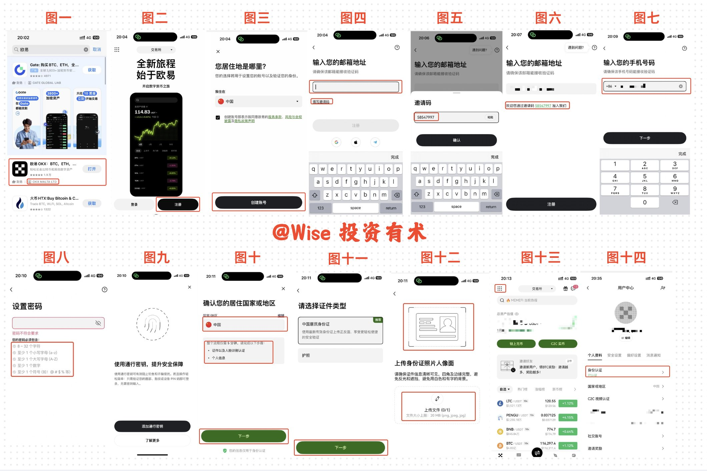
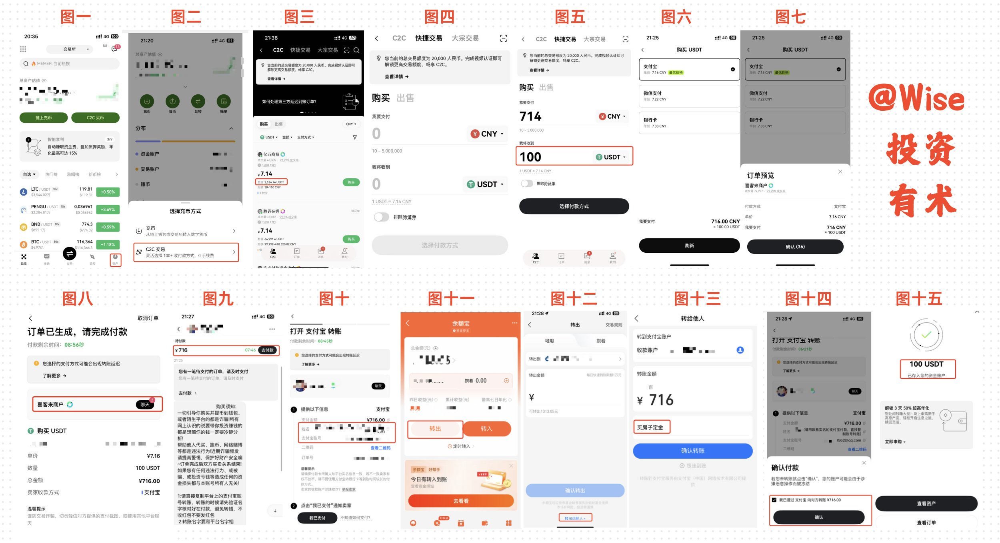
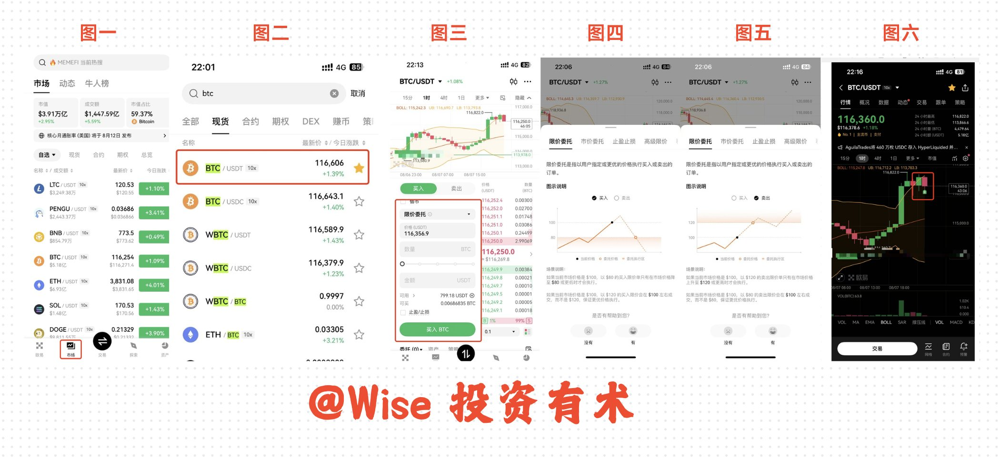

## 一、先看路径：资格 → 注册 → 入金 → 核对

这篇只讲 OKX **交易所账户**里的注册、入金与现货买入，不展开 Web3 钱包。交易所像数字资产的撮合与记账入口；某一实体在某地取得牌照，不代表所有地区都能使用全部服务。

建议按下面四步阅读，后面章节也按同一顺序展开：

1. **资格**：核对本人所在地、居住地与对应服务实体；能下载应用不等于具有开户或交易资格。
2. **注册**：用本人邮箱／手机完成注册与安全设置，填写邀请码并做身份认证；提交后核对邀请关系是否真正绑定，以及充值、提现、交易权限。
3. **入金**：在本人账户可用的前提下，用 **C2C** 取得 USDT（或其他可用入金路径）；法币付给交易对手，平台按规则托管资产与处理争议，不等于付款没有风险。
4. **核对**：订单是否完成、币是否进入正确账户、现货是否真正成交，分别看余额、均价、数量与手续费，不以页面弹窗或对方截图代替最终结果。

> **历史备注（可跳过）：** 原稿开篇写于 2025-08-07 前后，含当时的市场感受，**不作为当前行情或买入依据**。文中旧截图的报价、支付方式、邀请码样式与付款备注只用来标操作位置；实际注册请用正文邀请码 **WISE6666**，付款用途须如实填写，勿照抄图中错误示例。

币安、Bitget 另有配套教程；若还分不清币、交易所与钱包，可先走加密入门五课。

[BTC、ETH 与稳定币基础](/articles/crypto/UOMdQwU3?series=crypto-basics){card}

---

## 二、注册与账户认证

**1、** 从本人适用地区的官方渠道获取应用，核对开发者和域名。能下载应用不等于具有开户或交易资格。

**2、** 打开注册入口，查看当前可申请的产品及所需资料。

**3、** 如实填写国家、居住地与身份资料，不按旧截图代选地区。

**4、** 输入自己的邮箱账号，确保可以接收到验证码，同时填写 Wise 邀请码：**WISE6666**，提交前核对一次。

**准备好注册时，只点下面这一张邀请卡。** 邀请码和链接已经带好，不必再另找入口，也不要把文末 VIP 入口当成注册按钮。若只想先核对福利与教程总览，可打开 [欧易注册入口（福利中心）](/perk/crypto#product-okx)。

> [注册 OKX 欧易 账户](https://www.vmutkhamuut.com/join/WISE6666) · 邀请码：**WISE6666** · 福利：永久 20% 交易手续费返佣

使用电脑端时优先点卡片上的注册按钮；未自动填入时，复制 **WISE6666** 后手动填写。新手任务等限时奖励是另一类活动，以福利中心实时显示为准，不等于注册即送，也不与这里的永久 20% 手续费返佣混谈。

**5、** 提交后检查邀请关系是否实际绑定；填写过邀请码不等于已经核验成功。

**6、** 后续输入自己可以接收验证码的手机号，绑定手机号。

**7、** 输入特定密码（注意密码不要和其他平台账号密码一致，容易被盗取，建议更换新的密码）。

**8、** 按设备与账户支持情况设置通行密钥或验证器，并保存恢复方式；这些设置不能替代密码、设备和钓鱼防护。

**9、** 按本人真实资料选择地区和当前接受的证件，阅读身份验证要求。

**10、** 按要求上传证件并完成人脸等验证；提交资料之后仍要等待审核。

**11、** 查看认证结果，并进一步核对本人账户的充值、提现和交易权限。

**12、** 点击左上角九个点，再点击个人头像，即可看到自己的个人认证信息。

审核时间因资料和账户状态而异。先完成安全验证，再进入资金操作，不把旧截图的速度当作承诺。

> 下图保留原操作流程，其中邀请码为旧版示例；实际注册请填写正文中的 **WISE6666**。

---

## 三、入金购买 USDT

本节用“通过 C2C 取得 USDT，再进入 BTC/USDT 现货”说明一种路径。**USDT 不是所有平台唯一接受的购买资产**，本人账户支持什么法币或交易对，需要分别核对。

USDT 的目标是跟踪美元价值，但它不是银行里的美元存款，市场报价、买卖差价和发行方风险也不能忽略。

### C2C 订单里，钱和币分别交给谁

C2C/P2P 是与另一位用户交易。法币按订单付给交易对手，平台按规则提供订单、资产托管与争议处理。平台参与处理，不等于付款没有风险，也不构成对本人当地交易资格的保证。

操作前先核对：本人是否能使用该服务、付款账户是否同名、所选法币和支付方式是否可用。不能把某篇教程或一个可见入口当作法律或资格结论。

### 从选单到收币，逐步核对

1. **选币种和法币。** 进入本人账户可用的 C2C/P2P 页面，查看买入目标与实际支付单位。
2. **读报价和订单条件。** 比较金额上下限、支付方式、交易对手记录与付款时限。快捷和自选入口都要看最后的报价，不能先断言哪个更便宜。
3. **下单后核对收款信息。** 使用本人同名付款账户，核对订单内收款人及账户。不要接受私聊临时更换的第三方账户。
4. **实际完成付款，再确认已付款。** 保存未经修改的原始凭证；付款备注不得虚构买车、买房等交易用途。如果银行或支付服务不允许该用途，不借别人的账户、改用途或拆单绕行。
5. **检查释放和余额。** 查看订单是否完成、实际收到多少币、币在哪个账户。页面通知、对方截图和最终余额分别核对，不承诺几秒到账。
6. **出现异常，保留订单处理。** 已付款却没收到币，按本人对应规则提交申诉。不要为“重新下单”重复付款，也不要在未处理完付款去向时随意取消订单。

下列 OKX 官方交易规则注明适用于已验证的非中国注册用户，争议规则限定非人民币交易；它们解释同名付款、错误支付和未释放资产的处理，不能直接套用于所有中文读者。实际使用须匹配本人账户的适用规则。[OKX P2P 交易规则](https://www.okx.com/help/okx-p2p-user-transaction-rules) · [OKX 争议处理说明](https://www.okx.com/help/okx-p2p-dispute-handling-rules)

下面保留原入金操作图，图中的人民币报价、支付方式及时间均为历史界面示例，不能照抄成当前订单条件。**图十三红框里的“买房子定金”是旧稿错误备注示例，不得照抄；付款用途应如实填写。** 这里只保留操作位置，不沿用该建议。

想进一步理解交易对手、平台托管和账户划转，可以读配套基础课；其中币安界面仅作另一平台的例子，不替代 OKX 的订单规则。

[C2C 入金的交易关系与订单检查](/articles/crypto/mk7xplfU?series=crypto-basics){card}

## 四、购买 BTC 与成交核对

先在资产明细中确认 USDT 已到账且可用；如需在资金账户和交易账户间划转，按账户提示完成。接下来用 BTC/USDT 现货解释下单。

**1、** 搜索 BTC/USDT，确认进入的是现货市场，别把同名合约页面当成现货。

**2、** 选择买入，查看支持的订单类型。常用的市价单与限价单都是委托订单：市价单按可成交报价撮合，限价单限制愿意接受的价格。

**3、** 输入买入金额或 BTC 数量时，看清输入框单位，并核对最低下单额、可用余额与费用。

**4、** 以限价单为例，价格触及你的限价仍可能等待或部分成交，不能保证立即买到。提交后看订单状态；准备撤单时，也要核对哪些数量已经成交。[OKX 限价单说明](https://www.okx.com/en-us/help/what-a-limit-order)

**5、** 成交后检查均价、实际 BTC 数量、手续费和剩余 USDT。未成交的部分不算持仓，K 线上的标记也不能替代成交明细。

如果想把持有 BTC 与合约头寸分清，可以继续看这一课，里面用假设数字解释保证金与盈亏：

[现货、杠杆与合约的区别](/articles/crypto/gQbW1WDG?series=crypto-basics){card}

原图保留买入入口的位置；其中价格与金额不代表当前市场报价。

---

## 五、注意事项与风险边界

- **服务资格按本人账户核对。** 语言界面、可见入口或旧教程截图，都不能代替所在地／居住地规则；不能用的产品不要强行绕过。
- **交易所账户与 Web3 钱包分开。** 本文步骤停在交易所内的注册、入金与现货；链上转账与私钥保管另有基础课，勿把平台记账当成链上到账。
- **C2C 付款边界。** 使用本人同名付款账户；不接受私聊改收款方；不虚构买房、买车等用途；不让陌生人代收代付。异常时保留订单与凭证走申诉，不为“重新下单”重复付款。
- **稳定币与报价。** USDT 不是银行存款；买卖有价差，发行方与市场风险仍在。旧图里的人民币报价只作界面示例。
- **现货与合约。** 熟悉现货买入按钮，不等于已理解保证金、仓位、费用与强平；准备接触合约前先读清对应规则。
- **邀请与福利。** 注册邀请码以 **WISE6666** 及福利页当前说明为准；填写不等于已绑定。本文确认的是**永久 20% 交易手续费返佣**；新手任务等限时奖励另行核对，不与返佣混谈。
- **安全习惯。** 密码勿与其他平台共用；通行密钥／验证器要保存恢复方式；不在不明链接输入种子或验证码。

---

## 六、OKX 常见问题 FAQ

### 大陆用户还能注册／使用 OKX 吗？

先分清**当地法规**与**平台服务资格**。[银发〔2026〕42 号通知](https://www.csrc.gov.cn/csrc/c100028/c7614318/content.shtml)明确境外主体不得向境内非法提供虚拟货币相关服务；OKX 也要求按**实际居住国家／地区**完成身份认证，受限制地区无法使用对应服务，且不得改选其他国家选项绕过。[OKX 身份认证资格说明](https://www.okx.com/zh-hans/help/individual-identity-verification-eligibility-review-time-and-supported) 因此，本文不能承诺「大陆用户一定还能开」。正确做法是：用真实居住地打开官方注册与认证页，看本人资料当下支持的证件与产品；能下载 App 不等于有开户、C2C 或现货权限。香港等地对部分中心化交易服务另有限制，以账户页提示为准，不套用旧截图。

### KYC／身份认证被拒怎么办？

按页面或注册邮箱写明的原因处理。官方归纳的常见原因包括：证件过期或不支持、图片不完整或模糊、填写信息与证件不一致、人脸认证未通过、年龄或地区受限、身份信息已用于其他账户。[为什么身份认证失败](https://www.okx.com/help/why-did-my-account-verification-fail) 修正后从身份认证页重新提交；审核中且无新任务时，不要重复提交同一材料。不要用修图、他人代镜、虚构居住地或更换证件所属人等方式尝试「过审」——官方说明不支持随意更改已认证身份信息，相关限制可能无法解除。

### OKX 手续费多少？20% 返佣怎么算？

Maker／taker 费率以本人账户费率页与 VIP 等级为准，本文不抄一张会过期的表。本文确认的邀请福利是：通过 Wise 邀请渠道注册并绑定后，对符合规则的**交易手续费永久返佣 20%**——返的是手续费，不是本金收益。C2C 另有买卖价差；提币另有网络费。注册入口与返佣说明见 [福利中心 · 欧易](/perk/crypto#product-okx)。

### 国区 App 和网页入口怎么选？

从本人适用地区的**官方渠道**获取应用或打开官网，核对开发者与域名。能下载、能看行情，不等于具有开户或 C2C／现货权限；地区与居住地以真实资料填写，不按旧截图代选。

### 视频／人脸认证过不了怎么办？

按页面补件提示重拍，保证光线、证件边角与本人面部完整；多次失败先读官方帮助或联系客服，不要用修图、他人代镜等方式尝试「过审」。审核时长因资料而异，旧教程里的「几分钟」不作承诺。

### 为什么资金账户有币，现货却下不了单？

C2C 等到账后，资产常先在**资金账户**；现货交易前需按页面做**资金账户 → 交易／现货账户**划转，并确认方向没有选反。这是站内划转，不是链上提币。

### 现货和合约有什么区别？新手要不要开合约？

现货是按成交价持有资产；合约涉及保证金、杠杆与强平，亏损可能超过本金预期。本篇步骤停在现货。分不清之前，先读 [现货与合约入门](/articles/crypto/gQbW1WDG?series=crypto-basics)，不要为了「看起来一样的买入按钮」直接开合约。

### 注册时忘了填邀请码，还能补吗？

多数情况下，邀请关系需在注册提交时绑定；事后能否补绑取决于平台当时规则与账户状态，**不能默认一定能补**。以官方帮助中心说明及客服答复为准；本文邀请码为 **WISE6666**，仅供符合资格且尚未提交的注册使用。准备注册时，回到上文那一张邀请卡即可。

## 七、总结与下一步

本篇把 OKX 走成一条可核对的线：**资格 → 注册认证 → C2C 入金 → 现货成交核对**。入金方式仍须按本人资格、资金来源与当地可用服务选择；其他平台规则不能直接套用。

配套教程入口：

[币安怎么买币](/articles/crypto/GaM38JYk){card}
[Bitget 怎么注册入金](/articles/crypto/k3RVVcw4){card}
