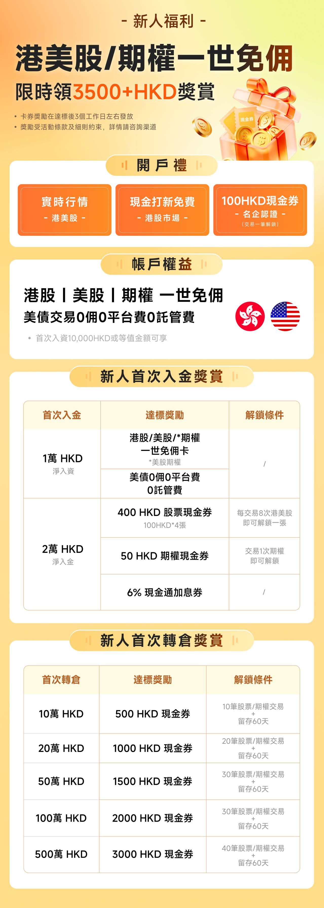
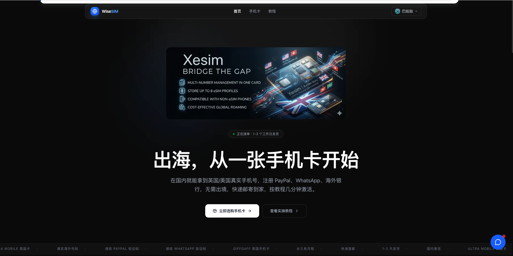

## 一、先分清投资工具，再规划账户

想买港美股，最容易犯的错误是先收集一串开户链接，再想自己为什么要开这些账户。银行、支付服务和券商分别解决不同问题，开通其中一个，不代表其余环节自然就能走通。

如果只是想用人民币参与海外指数表现，可以先了解境内 QDII、ETF 或联接基金；如果希望直接持有港美股证券，再研究符合自己身份与居住地条件的证券账户。本文是一份入门路线图，具体表格和步骤放在各产品教程里。

## 二、准备之前，先确认三件事

| 问题 | 需要准备的答案 |
| --- | --- |
| 想买什么 | 指数基金、个股或其他产品，持有多久，能承受怎样的波动 |
| 是否符合开户条件 | 本人证件、真实地址、税务居民信息及平台要求的证明 |
| 资金如何进入和退出 | 合规资金来源、允许的汇款用途、同名要求、全部费用及退出路径 |

个人购汇不能因为经过境外账户中转，就改变用途限制。[外汇局个人购汇说明](https://www.safe.gov.cn/xiamen/file/file/20211022/f4794075e84e40dd9394be523a52731b.pdf)明确了尚未开放的境外证券投资等用途边界。先核实自己能使用的资金安排，再看操作教程。

## 三、国内卡、境外银行与支付服务，各自负责什么

国内银行卡可以用于其允许的换汇和汇款业务。兴业银行寰宇人生等产品的汇款优惠，需要核对办理地区、账户条件和当前收费，手续费低不等于任何用途都被允许。

原有的[银行与汇款学习入口](https://www.wise-invest.org/s/p0ilie7g)可以帮助认识流程，但不能作为个人资金用途已经获准的证明。

iFAST 是英国银行服务路径，不是香港银行账户；Wise 是支付服务，也不能因支持港币就被称作港卡。申请前分别核对收款账户信息、资金保障、允许的付款对象，以及券商是否接受该渠道。不要把不同产品统称为“中转卡”。

## 四、香港港卡

如果有条件前往香港，可以办理实体港卡或虚拟港卡：

- **实体港卡教程**：[实体卡教程](https://www.bilibili.com/video/BV1iC15B7Em1/)（汇丰 / 中银等）
- **虚拟港卡教程**：[虚拟卡教程](https://www.bilibili.com/video/BV1zw1UBLEaj/)（众安 / 蚂蚁 / 天星等）

---

## 五、券商

### 复星

> [注册 复星证券 账户](https://h5.fotechwealth.com/pages/startAccount.html?channel=030005&aeCode=B2&invitationCode=AGVPK3&langType=zhCn) · 邀请码：**AGVPK3** · 福利：入金等值 10,000 港币，解锁免佣

注册时确认填写邀请码 **AGVPK3**，入金达到**等值 10,000 港币**即可解锁免佣。开户材料如有疑问，可以联系我了解流程；审核结果以券商为准。

复星券商可查阅此地址进行学习：[查看复星开户教程](https://www.wise-invest.org/articles/broker/sQSbLRe8)

下图保留的是复星证券 **4 月历史活动**，其中现金券等奖励是否仍开放，请以账户内最新活动为准：

---

## 六、其他推荐

### 1、见证开户

见证开户由相关银行按客户资格、开户地区和材料要求办理。不同银行的资产门槛、维持时间及是否需要面签并不统一；先取得银行的具体要求，再决定是否准备资产，不能把“50 万、3 个月”当作通用获批条件。相关服务入口：

[见证开户](https://www.wise-witness.com/)

### 2、giffgaff 手机号购买

如果某项服务需要你长期持有境外号码，可以了解 **giffgaff** 等产品。先确认服务是否接受该号码，再核对激活、漫游和保号规则；低频发短信的费用不能等同于全部持有成本，也没有保证一张卡能使用 20 年的期限承诺。

[手机卡购买链接](https://www.wise-sim.org/)

---

## 七、注意事项与后续学习

账户资料、地址和税务信息应真实一致；先确认出入金两端姓名与币种，区分银行余额、支付账户余额和证券资产。开户或持有账户本身，不免除相关税务义务。

如果需要讨论具体操作，可以加群交流**投资、理财、出海、Web3、港卡**等内容，但审核和资金规则应向对应机构核实。

## 八、总结：先选路径，再按顺序开户

还在认识投资工具，先读指数与基金基础；已经确认有符合要求的境外账户和资金条件，再进入[港股账户准备系列](/articles/series/hk-stock-funding)或[美股账户准备系列](/articles/series/us-stock-funding)。一条能理解、能维护的路径，比同时开很多账户更实用。
