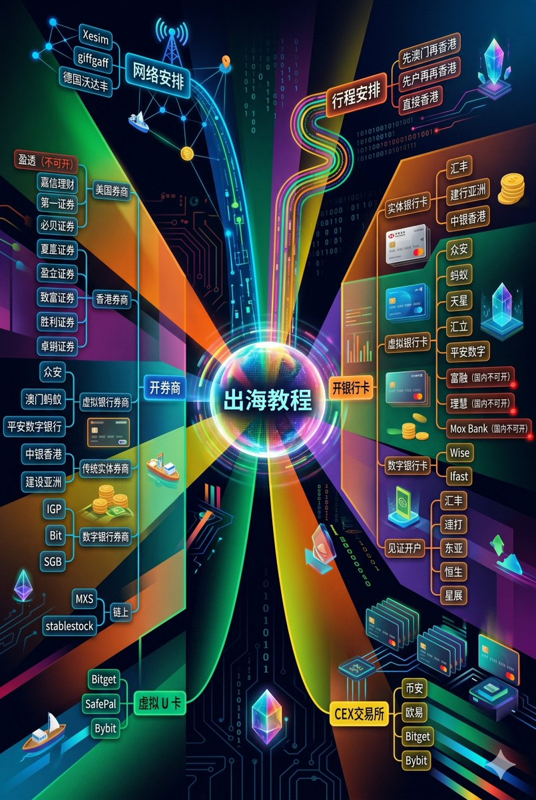
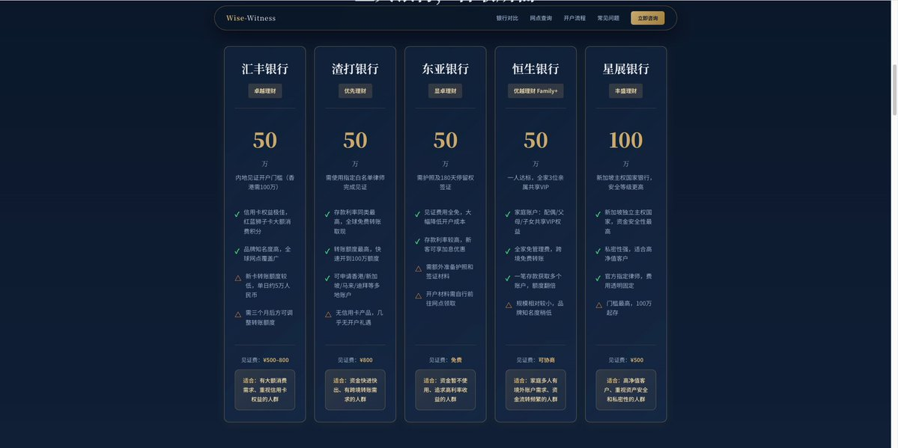
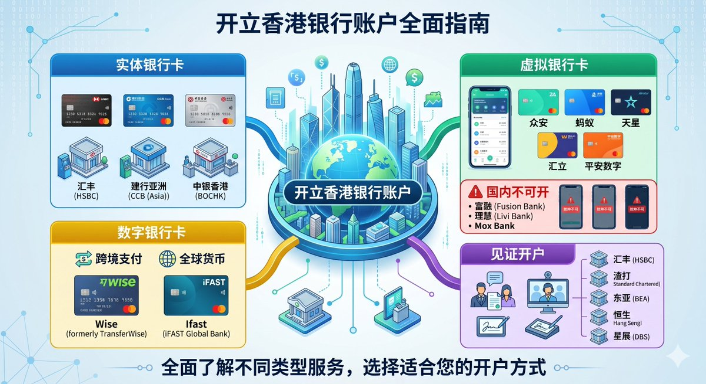
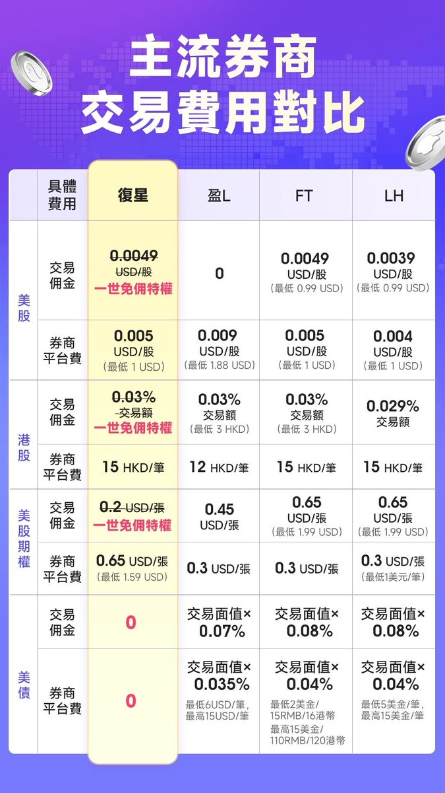
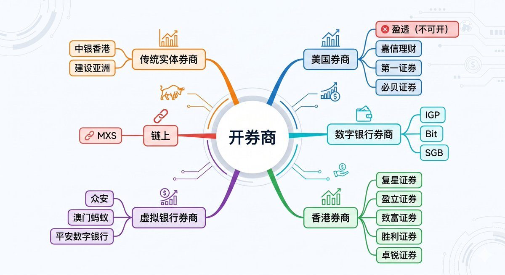
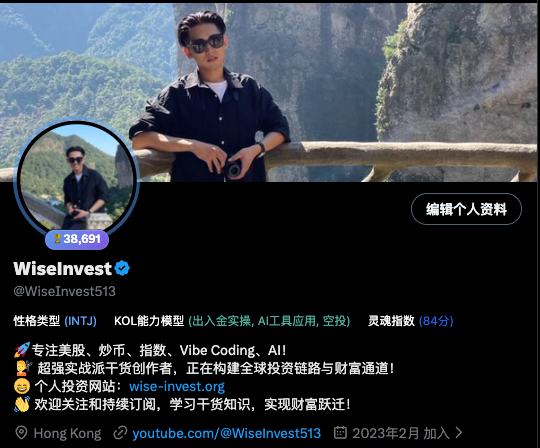
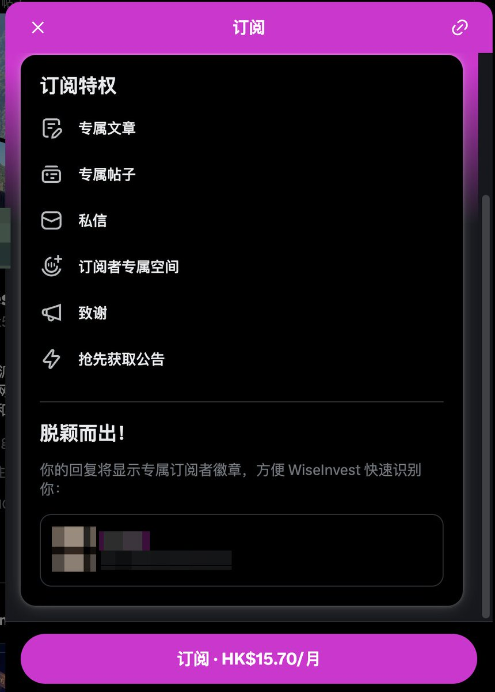

## 一、教程太多时，先确定自己要解决什么

港美股相关教程里经常同时出现银行、券商、支付服务和手机卡。每个看起来都有用，却很容易学着学着就把开户当成了目标。

这篇把站内教程整理成一张学习地图。刚开始认识指数，可以先学习基金；确实需要直接持有境外证券，再检查账户和资金条件；遇到付款或号码问题时，才补对应工具。

| 当前需求 | 先读什么 |
| --- | --- |
| 认识纳指、标普与人民币基金 | [指数投资学习路线](/articles/series/nasdaq-investing) |
| 准备香港银行与券商 | [港股账户准备系列](/articles/series/hk-stock-funding) |
| 比较美股账户和资金路径 | [美股账户准备系列](/articles/series/us-stock-funding) |
| 解决付款或手机号码需求 | 本文支付卡和手机卡章节 |

下面保留原稿的路线图供查找。旧图中的产品、费用和开户条件可能变化，进入具体教程后还需核对当期要求。

## 二、行程安排

> 出行前核对有效旅行证件、签注或适用入境许可，以及银行需要的入境记录与预约材料。证件办妥不等于银行必定接受开户，先确认条件再安排行程。

然后就是安排上，我这里推荐的行程安排是有两条路，一条行程是**先澳门再香港**兼顾旅游+开卡。可以参考如下的教程安排：

---

那另外一条路其实也就比较简单了，就是你**直接前往香港**办理，可以直达香港，也可以在深圳/广州等地进行一个中转。

具体教程可参考：[赴港行程安排教程](https://www.youtube.com/watch?v=8zzn-IHIBIk&t=2s)

---

## 三、银行卡开立

> 银行是否支持远程申请、是否要求人在当地，以及需要哪些证明，取决于银行和申请人情况。先看产品介绍与材料清单，再开始填表。

银行有无网点、是否发实体卡、能否线上申请是不同维度。下面按使用入口分组：有网点的银行、数字银行、跨境支付/银行服务和见证开户。它们不是互斥的法律分类，最终以开户实体和账户协议为准。

### 1、实体银行卡

站内整理了**汇丰香港**和**中银香港**等开户教程。线上或网点路径各有资格要求，不用“某家容易、某家难”替代材料检查。

提前通过银行官方入口确认预约、材料和费用；不要把第三方介绍当作银行保证获批。

[汇丰银行开户教程](https://www.wise-invest.org/articles/bank/WoxUXncV){card}

[中银香港开户教程](https://www.wise-invest.org/articles/bank/AO9Yfph5){card}

还有一个是**建行亚洲（港澳）**，顾名思义就是咱们的建设银行对应的香港的银行卡，好处就是可以和本地境内的卡进行一个比较好的系统转账。

[建行亚洲开户教程](https://www.wise-invest.org/articles/bank/0uzSFs7d){card}

### 2、虚拟银行卡

数字银行的客户资格和申请方式各不相同。站内有众安、香港蚂蚁、天星 Mox、汇立和平安数字银行的教程；**天星与 Mox 是同一家银行**，不能重复列作两家。是否接受你的申请，需核对各银行当前条件。

以下为对应学习入口，不代表所有读者均能申请成功。

**1️⃣ 众安、蚂蚁、天星教程**

[众安银行开户教程](https://www.wise-invest.org/articles/bank/2aiiqnjt){card}

[蚂蚁银行开户教程](https://www.wise-invest.org/articles/bank/OwFAe2JD){card}

[天星银行开户教程](https://www.wise-invest.org/articles/bank/ucHyMf8P){card}

**2️⃣ 汇立开户教程**

[汇立银行开户教程](https://www.wise-invest.org/articles/bank/wMpXaoI5){card}

**3️⃣ 平安数字银行开户教程**

[平安数字银行开户教程](https://www.wise-invest.org/articles/bank/wgBs7jp3){card}

### 3、数字银行账户

**Wise** 与 **iFAST** 提供不同的跨境服务：Wise 是支付服务，iFAST 对应英国银行路径。支持港币不等于拥有香港银行账户，是否能开户、获得收款资料或开卡需分别检查。

**1、Wise 支付账户**

[Wise 注册与账户准备教程](https://www.wise-invest.org/articles/bank/Ysn8tPfj){card}

**2️⃣ Ifast 数字银行账户**

[Ifast 数字银行账户开户教程](https://www.wise-invest.org/articles/bank/AARzryKJ){card}

### 4、见证开户

其实还有一种方式，如果你在中国大陆，无法前往香港，但是有计划开汇丰、渣打、东亚、星展和恒生等银行，可以采用的方式就是在国内存钱一段时间，再然后进行**见证开户**的方式进行开卡。

[见证开户详细教程](https://www.wise-invest.org/articles/bank/QonLSJp0){card}

这种好处就是你可以开其他国家的银行账户，坏处就是需要一定的门槛，大家也都需要有一定的体量，具体如下所示。

### 5、总结

以上入口涵盖不同银行与支付服务。比较时记录开户主体、存款或资金保障、账户费用、收付款范围，以及自己是否具备长期维护条件。

基本上满足大家各个方面不同的需求，大家可以根据自己不同的情况进行资料和内容的自取了！

---

## 四、券商开立

> **Tips**：券商目前主流的分为港资和美资券商，当然现在细分下来还有传统实体银行券商、虚拟银行券商、数字银行券商，我这里也都聊一下。

### 1、美资券商

美股账户可比较**盈透、第一、嘉信、BBAE**等入口。开户资格取决于实际实体与申请资料，不能统一称为已经关闭；CRS 是否适用也不能代替个人税务判断，更不等于无需申报。

目前我们已经给大家制作了第一证券和嘉信证券的教程，分别如下。

**1️⃣ 嘉信理财开户教程**

[嘉信理财开户教程](https://www.wise-invest.org/articles/broker/MWyWMwwN){card}

**2️⃣ 第一证券开户教程**

[第一证券开户教程](https://www.wise-invest.org/articles/broker/eKIyMXl8){card}

其他券商的最新教程集中在下面的美股账户准备系列，先比较条件和完整成本：

[美股账户准备系列](/articles/series/us-stock-funding){card}

### 2、港资券商

港资券商其实可以开户的还是比较多的，例如**致富、盈立、卓锐、胜利、复星**等券商。咱们也制作了致富、盈立、复星等教程，教程分别如下。

**1️⃣ 复星证券开户 & 入金教程**

> [注册 复星证券 账户](https://h5.fotechwealth.com/pages/startAccount.html?channel=030005&aeCode=B2&invitationCode=AGVPK3&langType=zhCn) · 邀请码：**AGVPK3** · 福利：入金等值 10,000 港币，解锁免佣

[复星证券开户教程](https://www.wise-invest.org/articles/broker/sQSbLRe8){card}

[复星证券入金教程](https://www.wise-invest.org/articles/broker/myu8sVmc){card}

**2️⃣ 致富证券开户教程**

[致富证券开户教程](https://www.wise-invest.org/articles/broker/GaobLP0X){card}

我这里个人比较推荐的是**复星证券**，如下是其和其他证券的一个对比图，大家可以作为参考。

需要了解复星或致富的材料流程，可以联系我获取教程协助；最终资格和审核由券商决定。证件、地址和税务资料按实际情况填写，不因使用渠道链接就省略平台要求。

### 3、虚拟银行券商

其实如果就论购买港美股而言，现在很多的虚拟银行也都在支持港美股的购买，例如我们聊到比较多的**众安银行**就做的比较好，那其实不只是众安，例如澳门蚂蚁、天星、平安数字等其实也都支持港美股的购买。

目前我只是对众安进行了一个详细的介绍和对比，大家可以查阅此教程详细了解众安银行购买港美股的一些情况和费率对比。

[众安银行购买港美股教程](https://www.wise-invest.org/articles/bank/4EB0zNOS){card}

### 4、实体银行券商

这个其实就是实体银行中购买港美股，就像是我们前一段时间开的**建行亚洲**，其中也内置了投资产品的购买。但是这些传统券商他们的优点比较明显，那就是资金可以在银行里面进行比较低损耗地周转，但不同账户和产品的费用需要逐项比较，所以这部分我们暂时不展开做推荐。

### 5、数字银行券商

这里其实我在之前聊到过，**Ifast** 是被我们忽视的一个银行，其 IGP 就是一个比较好的业务，到时候我也会给大家进行一个比较详细的介绍。这部分内容我在前面也聊到过，大家可以先看一下之前的教程，然后后续我们再进行比较具体的详细的分析。

### 6、总结

其实如果做总结，我们可以在以下渠道购买到港美股：

| 类型 | 平台 |
|------|------|
| 美国传统券商 | 盈透 |
| 香港传统券商 | 复星 |
| 香港数字银行 | 众安 |
| 传统银行券商 | 建行 |
| 数字银行券商 | Ifast |

但是他们之间的区别和费率呢？那又是一个比较大的内容了，欢迎关注后续持续分享！

---

## 五、交易所学习

> **Tips**：目前的交易所可分为 CEX 和 DEX 交易所，我们重点关注 **CEX 交易所**，因为更加容易上手，相关的服务做的也都会更好。这里我们就直接放出对应的学习教程，大家按照教程进行学习就好。

### 1、币安交易所

[币安交易所注册&使用教程](https://www.wise-invest.org/articles/crypto/GaM38JYk){card}

### 2、欧易交易所

[欧易交易所注册&使用教程](https://www.wise-invest.org/articles/crypto/mAPQm7WZ){card}

### 3、Bitget 交易所

[Bitget 交易所注册&使用教程](https://www.wise-invest.org/articles/crypto/k3RVVcw4){card}

### 4、Bybit 交易所

[Bybit 交易所注册&使用教程](https://www.wise-invest.org/articles/crypto/e6utod7B){card}

---

## 六、虚拟 U 卡

> **Tips**：虚拟 U 卡部分也是我们在过去多次聊到的，其功能多变，非常适合咱们在 Web2 和 Web3 之间进行资金的流通。在过去推荐过多次，我这里再做一个小总结。

### 1、Bitget 虚拟 U 卡

首先的虚拟 U 卡，可以用来进行 Web2 和 Web3 的资金流转和消费，你可以直接拿这张卡绑定在国内的美团/淘宝中进行消费，可以直接把 Web3 里面的钱直接进行消费，而且费率友好，且在一定的额度之内，消费都是**免手续费**的。

[Bitget 虚拟 U 卡开卡教程](https://www.wise-invest.org/articles/vcard/WK8p1cCV){card}

### 2、SafePal 虚拟 U 卡

和 Bitget 背后的 U 卡服务商是同一家，如果说 Bitget 更加适合日常的消费，那 **SafePal** 更加适合大家用来进行资金的流转。是否可向具体券商或银行转账、是否支持所需币种及用途，需要按账户协议和收款机构要求逐项核对；不能从拥有卡片推导出所有资金通道均可使用。

[SafePal 虚拟 U 卡开卡教程](https://www.wise-invest.org/articles/vcard/E4lD5AIn){card}

不同地区和卡片计划的证件要求可能不同，准备前先核对各自资格，不按有无护照机械选择。

### 3、Bybit 虚拟 U 卡

Bybit Card 与交易所账户是相关但不同的服务。申请资格、证件和发卡地区需要单独确认；某次订阅成功的个人经验，也不能保证所有商户持续接受这张卡。

[Bybit 虚拟 U 卡开卡教程](https://www.wise-invest.org/articles/vcard/wYKRLDvK){card}

---

## 七、网络/手机卡安排

> **Tips**：目前越来越多的产品正在逐步要求大家使用境外手机卡进行注册，所以境外手机卡也要准备提上日程！

[境外手机卡申请教程](https://www.wise-invest.org/articles/simcard/EAN52fdr){card}

另外一款是保号神卡 **giffgaff**，具体教程如下：

[giffgaff 保号神卡申请教程](https://www.wise-invest.org/articles/simcard/isBZdnTm){card}

手机卡是否适合自己，要看开通资格、验证方式、设备兼容与长期漫游规则。先核对运营商的当前要求，不用旧文章概括某个国籍永远能开或不能开。

这些东西不确定未来会如何，所以大家如果有计划和规划的，可以提前准备上了。

---

## 八、福利特供

正如我的介绍所言，我正在构建**全球投资链路与财富通道**！

如上虽然制作了非常多的内容，但是大家也都可以看到我们依旧是还有非常多的内容正在排期中。其实我们可以预见的是在 2026 年，**美股/链上美股**都会是一个非常重要的板块，就包括最近港股打新重新火爆了起来，我也正在准备制作教程分享中！

我会继续研究美股与相关工具，也会持续检查自己的判断，那如果你看到了这里，你也对出海、投资、Web3、美股感兴趣的话，欢迎关注。我也期望我通过这些内容的介绍，帮助大家来打开这个世界！

那同时介于内容偏多，即便是很多朋友看完了内容，但是总归是依旧会有很多问题，所以我也借助推特的订阅系统开了一个订阅。我也来聊一下我的订阅都会有哪些福利：

🎁🎁🎁

- 我过去创业了三年时间，对于商业有自己独特的理解，可以来聊**商业**
- 构建了许多关于投资以及美股内容，可以来聊**投资/理财**，帮助你做财务规划
- 如果你对**创作**感兴趣，可以帮助你进行内容转发和冷启动
- **专属 VIP 服务群**，进行专属订阅者专属服务
- 固定每个季度进行好礼赠送（书籍/周边等）
- 回关 + 优先回复 + 优先关注

🎁🎁🎁

原稿中的 X 订阅价格为每月 **2 美元**，当前价格需在订阅页面核对，没有设置很高的价格，其实也不靠这个赚钱，只是为了能够给更多对这些内容感兴趣的朋友提供专属的支持与服务，期望能够帮助更多的朋友打开这个投资世界的大门。

💐💐💐

原稿还记录了**前 10 名订阅者获赠价值 69 元 giffgaff 手机卡**的活动。名额是否仍有剩余需先确认，不把限量旧活动当作持续领取的承诺。

[点击订阅 WiseInvest（2美元/月）](https://x.com/WiseInvest513/creator-subscriptions/subscribe)

---

## 九、使用这些教程前的注意事项

开户资格、汇款用途和税务是不同问题。拥有境外账户不改变个人购汇用途限制；资料应真实，资金来源、同名规则、费用和退出方式需在转账前确认。涉及股票、基金或链上产品时，还应单独检查持有权利和风险。

教程截图用于帮助找入口，不能照抄截图里的个人资料、充值地址或旧费率。交流和福利是学习辅助，不替代机构审核，也不保证投资收益。

## 十、总结：按需求学习，不必一次开齐账户

ok，以上就是今天内容的全部部分了！

我尽可能把目前我能够想到的，以及未来我们准备规划的内容都给大家详细地整理了出来，目的也非常明确，那就是**尽可能以一篇内容就解决大家遇到的所有的关于投资/美股/理财/开户/Web3，乃至出海的一些问题**！

但是这些东西依旧是非常非常之多，我们目前依旧处在一个"入门"的阶段，但是大家也不用担心，我们后续也会持续就这条路一直走下去，也会一直给大家带来更多有价值的分享。

那如果你觉得上述的内容对你有帮助，也记得不要忘记**一键三连**了，大家的发财手也是对于我创作内容的最大支持了。

最后的最后，其实我最近也在微信里面建立起来了一些交流群，目前群内加在一起也有 **1000+ 人**了，我也在努力维持群的正常运转。核心也很简单，那就是多数朋友都聊 Telegram 电报聊起来不舒服，而且最近网络又比较卡顿，所以还是把微信群给建立起来，给大家一个自留地用来交流和聊天。

所以如果你想要找个地方和我一起交流聊天，可以直接扫描此二维码加入群聊，此二维码是活码，所以任何时候你有计划加入群聊，都可以扫码了，我们就群内互动交流和聊天了！

以上就是咱们这期教程的全部内容了，期望能够在大家的投资和理财的道路上给予大家一些帮助，打开通往复利致富世界的大门。

我也会在这个路上一直陪着大家，实现人生意义上的**财富自由**。

我们下期再见！
