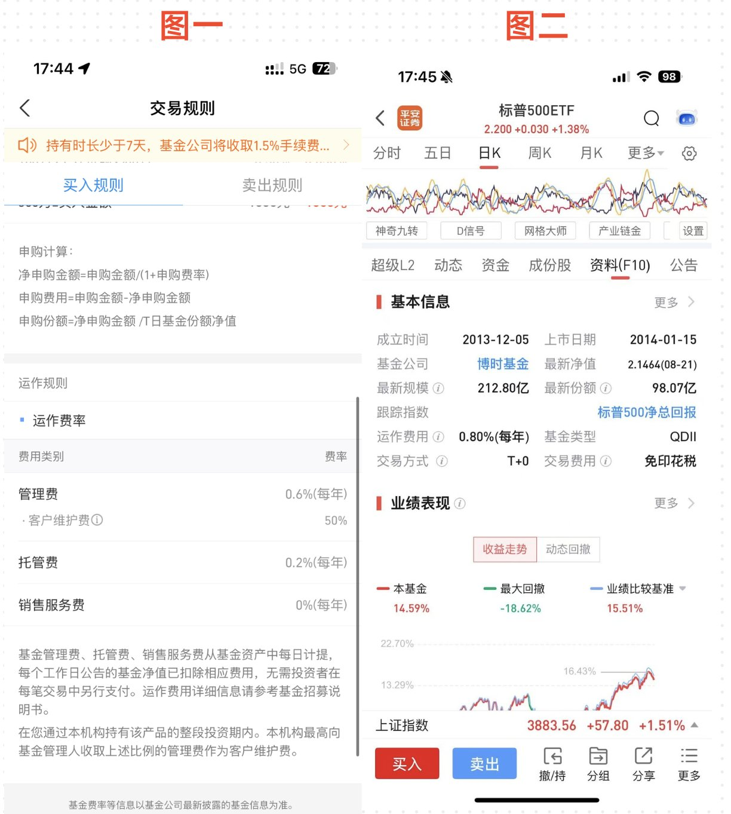

最近很多朋友通过我写的内容了解到了纳斯达克和美股定投，很多朋友也都开始行动了起来，这点我表示很开心，可以帮助到大家。

但一到实际购买，新的问题就来了：同样写着“标普500”，为什么券商 App 和支付宝里的价格不一样？为什么涨幅不同？是不是换到场内，收益就一定更高？

前面我们已经分享了很多关于支付宝和券商 App 投资的事情。这一篇把其中最容易混淆的部分单独拆开：**你按什么价格买入，付了哪些费用，什么时候能拿回钱。** 把这三个问题讲清楚，比简单排一个“哪个渠道最好”的名次更有用。

## 一、先认清买的是什么：同一个指数，两种基金份额

### 场内、场外说的是交易方式

“场”指证券交易所。场内买卖，是通过证券账户，在交易所按市场报价成交；场外申赎，是通过基金公司、银行或基金销售平台，按基金合同约定的净值规则申购、赎回。

所以，**场内不等于国内，场外也不等于国外**。券商 App 里也可能同时提供场内交易和场外基金申购，不能只看 App 名字判断。

我们用跟踪标普500的产品举个例子：

| 产品 | 代码 | 你持有的份额 |
| --- | --- | --- |
| 博时标普500 ETF | 513500 | 境内上市、跟踪标普500的 QDII ETF 份额 |
| 博时标普500 ETF 联接 A | 050025 | 主要投资目标 ETF 的场外联接基金份额 |
| 博时标普500 ETF 联接 C | 006075 | 同一联接基金的另一类收费份额 |

这里跟踪的是**标普500，不是纳斯达克100**。产品对应关系可在[博时基金官方说明](https://www.bosera.com/column/infoDetail.do?classid=0002000200020005&infoid=2976008)核对。

### 联接基金多了一层，但不能直接判定“更差”

联接基金以目标 ETF 为主要投资对象，同时会保留合同要求的现金或其他资产，以处理申赎等需求。你不用自己在盘口下单，也可以按金额定投，这是它解决的问题。

虽然标的一样，但投资工具和交易逻辑差别很大。联接基金不是 ETF 的另一种购买界面，而是一只单独运作、单独计算净值的基金。

## 二、成交价格：场内看市价，场外看净值

### 场内的“买贵了”，可能是溢价

ETF 有两个容易混淆的数字：**基金净值**代表每份基金对应的资产价值；**市场价格**是交易双方愿意成交的报价。市场价格高于参考净值叫溢价，低于它叫折价。

举个简化例子：假设每份资产价值始终是 1 元，你用 1.10 元买入，后来溢价消失、价格回到 1 元，你亏损约 9.09%。这个过程中，底层指数甚至可以没有下跌。

跨境 ETF 还涉及境内外交易时差。软件显示的净值可能对应上一估值日，盘中估值也可能有误差。看见“折价”不能直接认定捡到了便宜，要先确认参考值的日期和口径。

### 场外按净值申赎，不是跟别人抢报价

普通开放式基金的场外申购，通常采用未知价原则：提交申请时还不知道最终适用的净值。具体用哪一天的净值，取决于申请是否在受理截止时间前、当日是否为基金开放日等条件。

它没有场内盘口那种供需造成的成交溢价，但仍有市场涨跌、汇率和申赎等待时间的影响。**净值晚公布，不等于可以用旧价格买入。**

| 比较项目 | 场内买卖 ETF | 场外申赎联接基金 |
| --- | --- | --- |
| 成交依据 | 实际撮合的市场价格 | 合同约定的适用净值 |
| 下单时能否控制价格 | 可用限价单，但未必成交 | 通常按金额申购，不能锁定盘中价格 |
| 额外观察项 | 折溢价、买卖价差、盘口深度 | 受理截止时间、开放日、确认规则 |
| 共同风险 | 底层资产与汇率波动 | 底层资产与汇率波动 |

## 三、费用比较：把一次性成本与持续成本分开

很多人只对比“管理费”，算出来的结果并不完整。你至少要把以下几项放到同一张账单里。

| 成本 | 场内 ETF | 场外联接基金 |
| --- | --- | --- |
| 买入、卖出 | 券商佣金，可能有最低收费 | 申购费、按持有期限分档的赎回费 |
| 持有期间 | 管理费、托管费等计入净值 | 管理费、托管费及部分份额的销售服务费 |
| 隐性交易成本 | 买卖价差、滑点、溢价回落 | 申赎时间安排、现金仓位等影响 |
| 跨境相关成本 | 基金运作中的换汇、境外税费等 | 同样可能通过基金资产与净值体现 |

场内佣金按你的账户协议看，不能把股票交易的“最低五元”机械套到所有 ETF 账户。假设一笔 200 元买入被收取 5 元最低佣金，单边就是 2.5%；这只是计算示例，却足以说明小额定投为什么要查最低收费。

联接基金也不能简单理解成“两层管理费全部叠加”。应查基金合同对投资目标 ETF 部分是否免收本层管理费、托管费，再比较实际综合成本。费用从净值计提，并不代表你没有承担。

### A/C 份额，没有统一的“两年分界线”

A 类常见前端申购费，C 类常见持续销售服务费；两类都可能有短期赎回费。持有多久更划算，要使用销售平台折扣后的申购费、实际销售服务费和赎回费计算。

详细费用算例放在下面的支付宝教程中，这里先记住：**“免申购费”不等于免费，“场内费率低”也不等于任何买入价格都划算。**

[支付宝购买实操](/articles/index/mSIqvwVp){card}

## 四、交易速度与跟踪表现，分别应该怎么看

### 当天能卖，不代表当天能提现

部分跨境 ETF 支持 T+0 回转交易，但这不是所有 ETF 的通用规则，也不代表卖出资金当天就能提现。上交所的[ETF 常见问题](https://etf.sse.com.cn/fund/quertion/)区分了股票 ETF 与部分支持 T+0 的品种。实际还要看交易所、产品和账户规则。

场外 QDII 的确认与赎回到账可能跨多个工作日，境内外节假日还可能延长等待。不能统一写成“T+1 确认、T+2 到账”。如果一笔钱近期要用，先看预计到账日，再决定是否赎回。

### 现金仓位与跟踪差异，不只有一个方向

联接基金保留部分现金，会降低对目标 ETF 的即时暴露：上涨时可能少涨，下跌时也可能少跌。它并不能推出“场外每年固定少赚多少”。

比较收益时，先统一币种、起止日期、是否含分红，再区分三个概念：

- **跟踪差异**：某段时期基金收益与对应基准收益之间的差距。
- **跟踪误差**：这种收益差距在多个观察期中的波动程度。
- **投资者实际收益**：还受自己买卖时间、成交溢价、佣金和申赎费影响。

不能拿人民币基金净值，直接减去美元指数涨幅，就断言基金经理跟踪得不好；也不能把一段场内价格上涨全部当作基金资产的增长。

### 套利机制不等于普通用户稳赚的操作

ETF 的一级市场申赎与二级市场交易，有助于价格向净值靠拢，但申赎门槛、额度、结算和交易成本都会限制套利。卖出 ETF 再买联接基金，期间仍有市场与时间差风险，并不是一笔自动锁定利润的交易。

## 五、回到自己的场景，选能长期执行的方式

如果你每月金额较小，希望自动扣款，也不愿意看盘口，场外基金的便利性可能更有价值。重点是看清份额类别、申赎费用和限购，避免定投计划经常扣款失败。

如果你已有证券账户，愿意确认佣金、溢价和买卖价差，场内 ETF 可以提供更直接的下单体验。它的灵活性是一个工具，不是要求你每天高抛低吸。

如果你正准备从一种方式切换到另一种，先把原持仓的赎回费、卖出成本、新产品的买入成本算出来。为了省一小笔年费，立刻承担更大的交易损耗，未必值得。

我后续也会持续写一些更加容易懂的内容，分段把整个流程给大家梳理下来。下一步可以开始筛选具体产品，或者返回完整学习路线，按自己的进度继续。

[产品筛选指南](/articles/index/KGs3Ns3k){card}
[纳指学习路线](/articles/series/nasdaq-investing){card}
