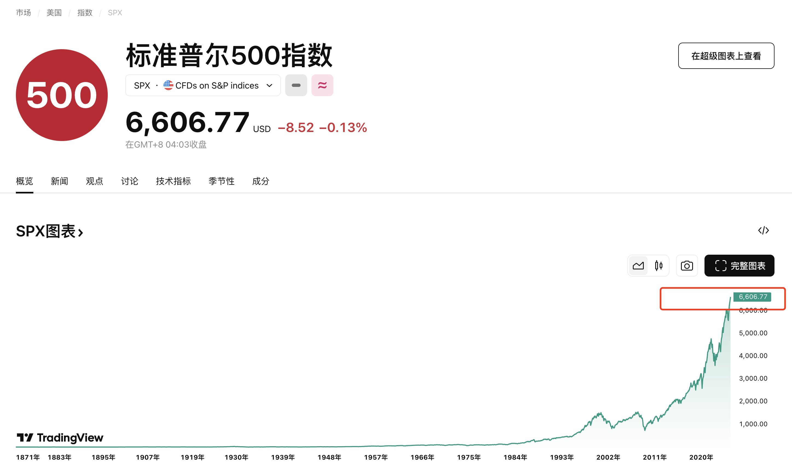
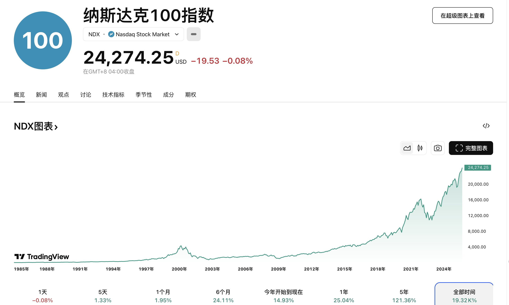
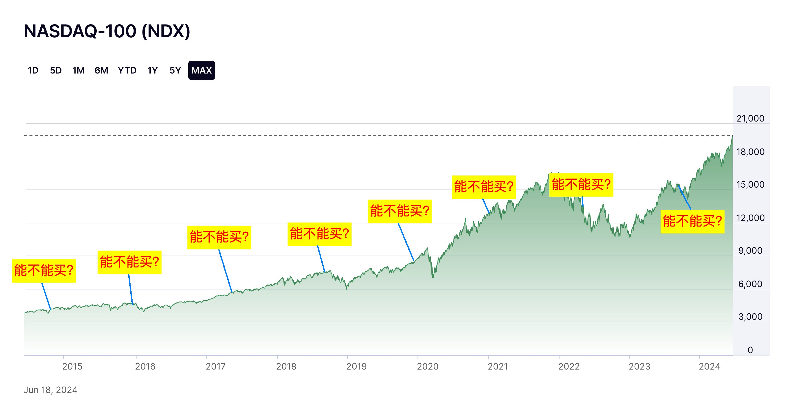

最近分享了很多关于标普、纳指投资相关的内容，收获了很多朋友的关注。评论区里重复出现的问题，往往不是“按钮在哪里”，而是“我现在到底该不该开始”。

今天先给大家整理 **10 个问题**。虽然前面文章里讨论过其中一些内容，但把它们放在一起，更容易看清：你是在做长期投入计划，还是临时追着市场涨跌作决定。

这一课适合已经认识指数、准备安排第一笔资金的朋友。先想清用钱时间和回撤承受能力，再讨论一次买入还是分批。如果这些还没有答案，可以先读[投资入门第一课](/articles/index/UO8oZS5M)。

## 一、先分清资金是已经在手上，还是以后才赚到

### 1. 为什么要定投，一次性买入不行吗？

可以，但这是两种不同的资金情境。

如果每个月工资到账后才有新钱，你是在**把新增收入持续投入**。没有必要为了等一笔大钱，让本来可以执行的计划一直悬着。

如果现在已有10万元，选择一次投入还是分成几个月，讨论的是**现有资金如何进入市场**。一次投入让资金更早承担市场风险，也更早参与上涨；分批投入减少一开始全部暴露的压力，但上涨期间可能因部分资金还在场外而少赚。

FINRA 的[定期定额投资说明](https://www.finra.org/investors/insights/dollar-cost-averaging)也区分了行为纪律与资金等待的机会成本。它没有替所有人给出同一答案。

我更希望大家提前写好投入安排：为什么选择这个比例、分几次、什么时候完成。不要先凭兴奋一次买满，跌了又临时把自己改成短线交易者。“80%先买、20%留着”这样的比例，也要结合自己的现金流和承受能力判断，不能直接套给所有家庭。

### 2. 月定投和日定投，有什么区别？

核心区别是投入时间、操作次数和交易成本。月定投通常更容易匹配工资到账，日定投把金额拆得更细，也需要考虑最低佣金、申购限制与扣款管理。

我个人的操作偏向于月定投，资金回笼之后再作安排。但每个人的生活与经营开支不同，不能照搬别人的收入投入比例。

如果希望通过定投形成储蓄纪律，可以设置到账后的固定日期，同时给日常生活和应急资金留下空间。频率是执行工具，日投不会自动获得比月投更高的收益。

## 二、面对高位和回调，如何把判断写成规则

### 3. 现在看起来很高，要不要过段时间再买？

“比过去高”与“相对未来盈利很贵”是两个问题。指数创新高，并不能单独证明应该卖出；长期上涨的图，也不能证明今天买入不会经历回撤。

先看自己的时间：这笔钱如果几年内要用，价格判断再乐观也解决不了期限错配。如果是长期资金，再决定一个自己能承受的投入节奏。

假设买入后下跌30%，你是仍能按原计划生活和储蓄，还是会被迫卖出？这个答案往往比“下周是不是低一点”更重要。

### 4. 择时买入和持续定投，收益差距大吗？

没有统一答案。差距取决于选了什么资产、什么时候买卖、空仓多久、有没有错过上涨，以及交易费用。

定投的价值在于把投入安排固定下来，减少每个月都猜一次市场的负担。它不会保证收益，更不会保证总比一次性买入划算。

择时也需要一套可检查的规则。只记得自己避开的一次下跌，却忽略长时间等低点时错过的上涨，很容易高估自己的能力。

### 5. 能不能等回调时再建仓？

可以选择等待，但“等回调”需要写得更具体：相对哪个价格下跌多少、等多久、期间上涨怎么办，以及触发条件后是否真的执行。

还有一种更容易管理的安排：按原定节奏投入长期资金，把预先确定的小部分备用额度用于调整。前提是这笔备用钱属于投资预算，不能挪用生活保障资金。

花时间学习会改善理解，但不会让人稳定预测每次回调。降息、黑天鹅等信息也不能直接变成必胜的买卖开关。

## 三、长期看好，也需要允许市场和计划出错

### 6. 总有人说明年会暴跌，这种预测可信吗？

市场完全可能大幅下跌，不需要等到“世界末日”。盈利预期下降、估值收缩、流动性变化，都可能让优质公司的股价下跌。

但“可能下跌”与“确定某年某月暴跌”之间，差着可验证的依据。指数会调整成分，并不因此免疫系统性风险，也没有规定必须在多长时间内回到前高。

对长期投资者，更实用的是做压力演练：如果股票部分回撤30%或40%，生活和投入计划会发生什么变化？这是一种预算检查，不是对最大跌幅的预测。

### 7. 要不要提前落袋为安，等跌了再买回来？

投资你要明白自己主要的策略是什么、目标是什么。

如果是因为即将用钱、资产比例明显偏离计划，或者原来承担的风险已经不适合自己，卖出有具体理由。如果只是“赚了不少，感觉要跌”，就还需要回答何时买回，以及判断错误怎么办。

可以预先设定定期检查或再平衡条件。例如定期检查股票资产是否超过自己设定的范围，而不是每次看到盈利数字就作一次临时决定。具体范围由自己的资金期限和承受能力决定。

## 四、渠道选择，不能直接排成收益名次

### 8. 场内和场外到底是什么意思？

场内是通过证券账户在交易所买卖，场外是通过基金公司、银行或销售平台申购赎回。支付宝是常见的场外入口，但它不是“场外”这个概念的全部。

同一个指数，可以对应境内 ETF、场外联接基金、境外上市 ETF 等产品。它们的费用、币种、税费、成交价格和操作条件不同，没有固定的“美股账户收益 > 国内券商 > 支付宝”排序。

更详细的比较放在[场内与场外基金怎么选](/articles/index/26IkwBvR)。

### 9. 直接买境外 ETF，收益就一定更好吗？

某些境外 ETF 的基金费率较低，但你的实际成本还可能包括换汇、汇款、佣金、税费和账户维护。

举个仅用于说明成本的例子：假设一次汇款和换汇合计损耗100元，转入2000元就是5%。即使产品每年省下一点费率，也可能需要很久才能覆盖这笔固定成本。

先确认自己是否有符合规则的开户资格与资金安排，再比较长期总成本。拥有港卡或某个券商账户，本身不等于所有资金用途都被允许。完整路径可读[投资纳斯达克的六类入口](/articles/index/gCSTzdEB)。

## 五、最后一个常见误区：A/C 不能只看字母

### 10. A 类长期、C 类短期，这样记够不够？

可以作为初步印象，但下单前还要算一下。

A 类常见申购费，C 类常见持续销售服务费，两类都可能收短期赎回费。平台申购折扣不同，适合的持有期限也会变；没有所有基金通用的两年分界线。

如果持续定投，最近一笔的钱也有自己的持有天数。不要以为账户开了两年，所有份额就都达到免赎回费的期限。具体算例见[支付宝购买实操的费用部分](/articles/index/mSIqvwVp)。

## 六、把答案变成一页自己的建仓计划

很多事情先从整体了解，再分步学习，会有不错的效果。读到这里，可以给自己写下四句话：

1. 这笔钱来自哪里，哪些部分近期会用到。
2. 目标资产是什么，为什么选择它。
3. 是新增收入定投，还是现有资金分批，计划何时执行。
4. 出现回撤、收入变化或需要用钱时，按什么条件调整。

如果四句话还写不出来，继续补知识比急着找一个“最佳买点”更有效。计划清楚后，进入实操部分的[纳指购买渠道](/articles/index/gCSTzdEB)，找到支付宝、银河或港美券商的对应教程；已经持有的朋友，可以继续看[资金安排与持有问答](/articles/index/eq4k5aIU)。完整的计划模板在[蓝皮书第22章](/book/nasdaq#chapter-22)，各课顺序可以返回[学习路线](/articles/series/nasdaq-investing)查看。
