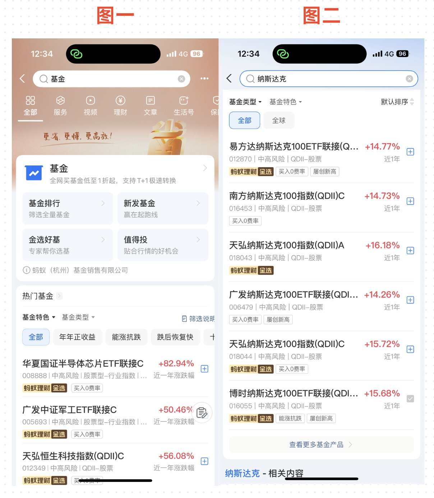
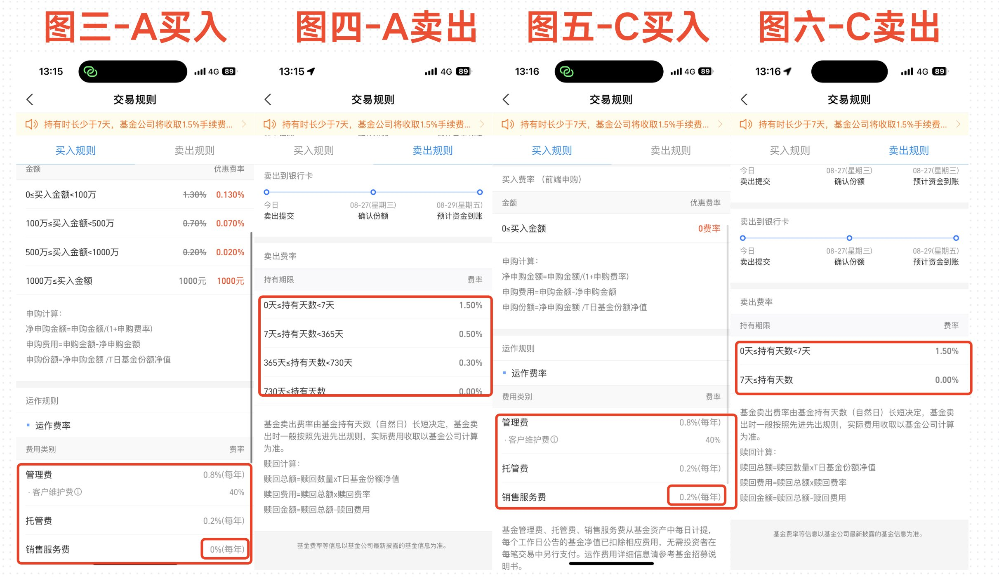

打开支付宝，搜索“纳斯达克”，会出现一长串名字：ETF、联接、QDII、A、C……看起来差不多，代码却不同。第一次买基金，卡在这里很正常。

这里给大家举个例子：**广发纳斯达克100 ETF 联接（QDII）人民币 C，代码 006479**。我们分别介绍这些词代表什么，再走一遍搜索、比较费用、提交申请和确认份额的过程。

这篇解决“怎么读页面、怎么完成一次申购”。如果还不清楚纳指与标普是什么，可以先读[股票、债券、基金与指数入门](/articles/index/UO8oZS5M)；如果还在比较不同购买渠道，先看[产品筛选指南](/articles/index/KGs3Ns3k)。

## 一、先找到基金，再确认代码和份额

在支付宝的搜索入口查找“基金”，进入基金服务后，再搜索指数名称或六位基金代码。界面位置可能调整，但确认产品的顺序不变：**完整名称 → 基金代码 → 跟踪指数 → 份额类别和币种**。

下图展示搜索过程，便于认识操作入口。截图中的收益和开放状态属于当时页面，查找产品时还需要核对当前是否可申购。

不要只挑搜索结果里近一年涨幅最高的一只。名称里带“科技”“纳斯达克”或“美国”，并不一定跟踪同一个指数。先确定你想买纳斯达克100，还是标普500，再看对应产品。

## 二、把一串基金名称拆开，就没有那么难了

### 广发：谁管理这只基金

这是基金的管理公司，即广发基金管理有限公司。它负责产品运作、投资组合管理、信息披露等。不同基金公司可以发行跟踪同一个指数的产品，但费用、复制方式、限购状态和跟踪表现可能不同。

### 纳斯达克100：它跟踪什么

纳斯达克100是一项指数，涵盖在纳斯达克上市的大型非金融企业。它不等于纳斯达克综合指数，也不是纯科技行业指数；指数的筛选和调整规则可在[Nasdaq 官方介绍](https://www.nasdaq.com/products/global-indexes/nasdaq-100)查看。

这里买到的是基金份额，通过基金间接参与这组公司的市场表现。你不会因为买了几百元联接基金，就在证券账户里分别收到苹果、微软等公司的股票。

### ETF：一种可以在交易所交易的基金

ETF 是 Exchange Traded Fund。本文讨论的是跟踪指数的 ETF，但 ETF 这个形式本身也可以用于其他策略，不能把所有 ETF 都理解成同一种投资。

普通投资者通常用证券账户在交易时间内买卖 ETF。成交价由市场报价决定，可能偏离净值；“有套利机制”不代表任何时候都没有溢价。

### 联接：主要投资目标 ETF 的基金

简单来说，它并不是 ETF 本身，而是“**买 ETF 的基金**”。你通过基金销售平台申购联接基金，由管理人按合同投资目标 ETF，并管理现金和申赎。

以本例为准，基金主要投资目标 ETF——广发纳斯达克100 ETF。官方产品资料列明了目标 ETF 投资比例及现金等要求，不能统一写成“所有联接基金都拿80%—95%去买 ETF”。详见[广发基金产品资料](https://gfwx.gffunds.com.cn/funds/?fundcode=270042)。

### QDII：境内机构投资境外的制度安排

QDII 是合格境内机构投资者。对购买本例人民币份额的人来说，你申购的是境内基金，境外资产投资由基金按合同执行。

人民币份额并不消除汇率影响。如果其他条件不变，美元相对人民币升值会提高美元资产折算成的人民币价值，反向变动则会拖累。是否对冲汇率，还要看产品安排。

### A/C：同一基金不同的收费份额

先把代码对应清楚：**270042 是人民币 A，006479 是人民币 C**。基金还有其他币种或份额，不能只记住字母就忽略代码。上述对应关系可在[广发基金的份额公告](https://www.gffunds.com.cn/jjgg/zdsj/202408/P020240812355475170671.pdf)核对。

| 常见费用 | A 类 | C 类 |
| --- | --- | --- |
| 申购费 | 常见前端申购费，销售渠道可能打折 | 常见不收申购费 |
| 销售服务费 | 常见不收取 | 常见按年费率逐日计提 |
| 赎回费 | 根据持有天数等规则确定 | 同样要看持有天数，不能默认随时免费 |
| 管理费、托管费 | 看合同的费率与计提基数 | 看合同的费率与计提基数 |

字母帮助你找到费率表，不能代替费率表。“A 长期、C 短期”可以作为第一层理解，但没有适用于所有基金的两年分界线。

## 三、A 类和 C 类，怎样算出自己的成本

### 先看折扣后的费率

下面的买卖规则截图可以用来认识字段。真正下单时，需要在产品页面打开“交易规则”“买入规则”“卖出规则”等栏目，核对当前收费。

管理费、托管费、销售服务费通常在基金资产中计提，已经影响净值，不会每天单独向你的银行卡扣款。计算持仓表现时，不要在净值收益上再重复扣一遍。

### 用一个简化算例理解分界点

假设投资 10 万元，A 类折扣后申购费率为 **0.12%**，无销售服务费；C 类申购费为零，销售服务费率为 **0.20%/年**。两类共同的费用先不比较，并暂不计赎回费。

这些是**教学假设，不是上面基金的现行报价**。按常见外扣法，A 类申购费约为 **100000 − 100000 ÷ 1.0012 = 119.86 元**。

| 假设持有期限 | A 类差异成本 | C 类差异成本 |
| --- | --- | --- |
| 1 年 | 约120元申购费 | 约200元销售服务费 |
| 3 年 | 约120元申购费 | 约600元销售服务费 |
| 10 年 | 约120元申购费 | 约2000元销售服务费 |

为了看清费用机制，表中 C 类按资产始终约为10万元做线性估算。实际按每日资产计提，会随净值、持仓与规则变化，不能把这张表当作真实账单。

粗略分界点可以用 **A类实际申购费率 ÷ C类年销售服务费率** 估算。本例约为 **0.6年**；如果 A 类申购费没有折扣、变成1.3%，粗略分界点则约为6.5年。两者相差很大，这就是不能一律按“两年”选择的原因。

### 定投每一笔都有自己的持有时间

你从两年前开始定投，不代表今天赎回时所有份额都持有了两年。上个月、上周买的份额仍可能处在收费期。赎回前要看份额持有天数及基金的赎回顺序规则。

了解完毕这些基础内容之后，再去选择 A 还是 C，就有了具体依据：计划持有多久、实际折扣多少、临时卖出可能付多少费用。

## 四、提交申请后，还要完成这些检查

### 第一步：看清开放状态与申请日期

先查看是否开放申购、单日限额、申请截止时间、预计确认日期。QDII 可能受到境内外节假日和额度安排影响；页面能搜索到，不等于今天一定可以买。

### 第二步：输入金额，核对订单信息

完成销售平台要求的身份验证与风险测评后，输入金额，检查产品代码、A/C类别、币种、费率和预计确认规则，再决定是否提交。名称很接近时尤其要核对代码。

### 第三步：确认的是申请，成交的是份额

支付成功通常表示申请已经提交，后续还要看基金确认结果。假设净申购金额为1000元、适用净值为2元，才可换算为约500份；实际还受费用和份额取舍规则影响。

确认后查看交易记录中的**申请日期、确认日期、净值、费用和份额**。不要把当天扣款成功当作已经按屏幕上的旧净值买到了。

### 第四步：定投要检查扣款是否真的执行

设置扣款周期和金额后，留足余额，检查首笔交易是否成功。限购、暂停申购、余额不足都可能影响计划。定投工具帮你执行纪律，但不会替你判断这笔钱能否长期不用。

## 五、看到 LOF、FOF，不用把它们当成另一套暗号

基本上了解前面的内容之后，还有几个特殊的点需要给大家补充：

| 名称 | 它说明的维度 | 要继续看什么 |
| --- | --- | --- |
| QDII | 境内机构投资境外的安排 | 投资范围、币种、额度与申赎规则 |
| LOF | 上市型开放式基金，可有场内交易和场外申赎 | 场内外份额衔接、转托管、折溢价 |
| FOF | 基金中基金，主要投资其他基金 | 底层基金、资产配置、各层实际费用 |
| ETF 联接 | 以目标 ETF 为主要投资对象 | 目标 ETF、投资比例、费用减免条款 |

这些词描述不同维度，可以同时出现。QDII-LOF 仍然属于 QDII，不是“有些基金不是QDII，而是LOF”。LOF 能场内买卖，也不意味着它适合新手做套利或高频交易。

## 六、买完以后，用什么标准继续观察

先检查产品有没有按照你理解的方式运作：跟踪标的是否一致、费用和限购有没有调整、定投是否执行。再把基金表现与**同币种、同区间、同分红口径**的基准比较。

历史收益页面还要核对区间与计算方式。近一年涨幅高，不代表未来一年也会相同；一次上涨后再下跌，即使涨跌百分比相同，也未必回到原来的本金。关于这些数字怎样计算，可以接着读[复利与定投算例](/articles/index/uikdmSlX)。

已经完成购买，下一步看[买入后的持有检查](/articles/index/eq4k5aIU)。如果还想了解场内 ETF 的账户准备，可以看[银河开户与费率教程](/articles/domestic/o0RA5e1p)；需要先复习区别，再回看[场内与场外基金怎么选](/articles/index/26IkwBvR)。也可以返回[完整学习路线](/articles/series/nasdaq-investing)，或进入[《纳斯达克投资蓝皮书》的计划章节](/book/nasdaq#chapter-11)，把每次下单变成一套能坚持的安排。
