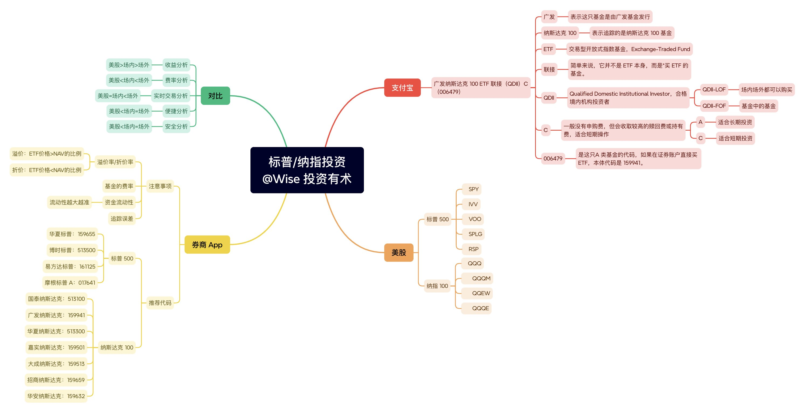
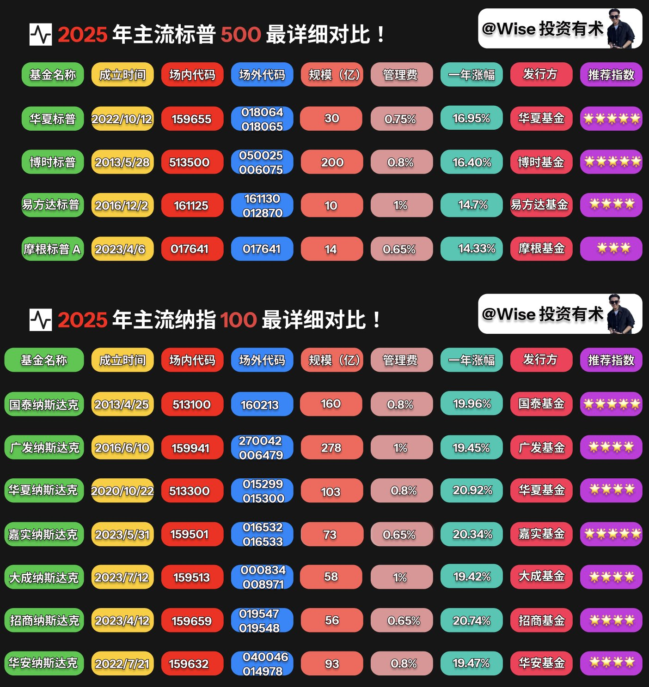
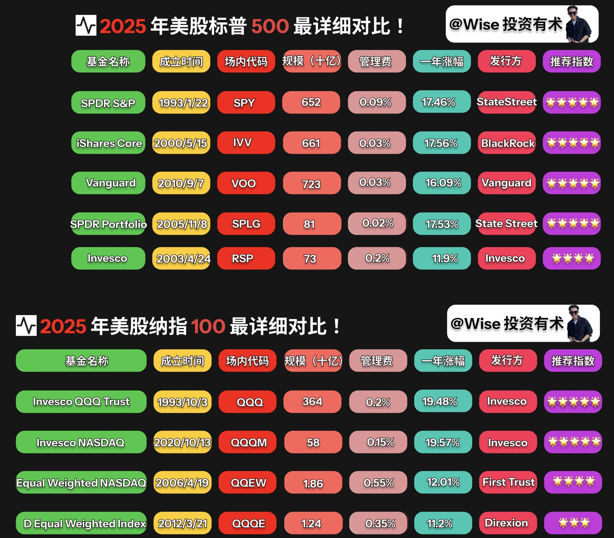

前面我们聊过资产基础、复利和定投，接下来就进入更具体的问题：想投资纳斯达克100或标普500，到底在哪里购买，又该怎么从一长串代码里选出适合自己的产品？

我在最初接触这些信息的时候，看到的也都是零碎的信息，东一榔头西一棒子，花费了大量时间去研究、尝试。把知识放到同一个框架里之后，才更容易理解每种工具解决什么问题。

这一篇沿着三条主线展开：**支付宝等场外平台、境内证券账户、境外证券账户中的美国上市 ETF**。读完之后，你应该能确认自己买的是什么，再按费用、交易价格与账户条件比较候选产品。

还没有形成投入计划的朋友，先看[建仓与定投问答](/articles/index/iAj0LfIU)。已经确定要比较渠道的，可以从下面开始；若想进一步了解代币化产品等不同资产结构，再读[六类投资入口比较](/articles/index/gCSTzdEB)。

## 一、先选投资目标，再选购买渠道

### 同样写“纳指”，未必是同一个指数

先确认完整跟踪标的：纳斯达克100、纳斯达克综合指数、某个科技行业指数，并不能因为名字相近就互相替代。标普500也与标普科技等行业产品不同。

然后检查基金是否包含杠杆、反向、期权覆盖等策略。它们的收益机制可能与普通指数基金明显不同。尤其一些杠杆与反向 ETF 追求的是每日目标，长期表现不能简单按指数涨幅乘倍数理解，见[SEC 杠杆与反向ETF说明](https://www.investor.gov/introduction-investing/general-resources/news-alerts/alerts-bulletins/investor-alerts/sec)。

### 用同一张表比较三条路径

| 路径 | 通常持有什么 | 主要便利 | 需要额外检查 |
| --- | --- | --- | --- |
| 支付宝、银行等场外平台 | 境内 QDII 或联接基金份额 | 人民币申购、按金额定投 | A/C费用、限购、确认与到账 |
| 境内证券账户 | 境内上市的跨境 ETF、LOF 等 | 盘中按市价买卖 | 溢价、买卖价差、佣金与流动性 |
| 提供美股交易的境外证券账户 | 美国上市 ETF 份额 | 直接交易目标基金 | 开户资格、资金来源、换汇、税务与交易成本 |

三种路径服务不同条件。没有境外账户，并不妨碍先学习或使用符合条件的人民币基金；有境外账户，也不意味着任何一只美股 ETF 都比境内产品适合自己。

## 二、人民币场外基金：把名称和交易规则读完整

### 从代码确认产品，而不是从涨幅榜选名字

打开平台的基金入口，搜索指数名称或产品代码。进入详情后，依次核对基金管理人、跟踪指数、份额类别、币种和当前开放状态。

以广发纳指100 ETF 联接为例，**人民币 A 为270042，人民币 C 为006479**。字母、币种与代码需要一起核对，不能把 C 写成 A。对应关系见[广发基金份额公告](https://www.gffunds.com.cn/jjgg/zdsj/202408/P020240812355475170671.pdf)。

基金名称中的“联接”表示它以目标 ETF 为主要投资对象，“QDII”说明境内机构投资境外的安排。LOF、FOF 则描述另外的产品特征，不是与 QDII 互斥的分类。

### 比较长期费用，要带上自己的持有时间

场外基金常见费用包括管理费、托管费、申购费、销售服务费与赎回费。A/C 的差异通常集中在申购费和销售服务费，但还需要看各自的赎回档位。

重点看**渠道折扣后的实际费率**和**计划持有期限**。同样是 A 类，申购是否打折，可能显著改变它与 C 类的成本分界；不要套用“超过两年一定选 A”的固定结论。

联接基金投资目标 ETF 的部分，是否免收本层管理费和托管费，也要查合同，不能把两层标示费率直接相加。

### 看清净值日期与确认日期

场外申购一般按合同约定的净值规则确认，提交时看到的往往是已公布的历史净值。跨境基金的开放日还受境内外节假日等因素影响。

下单之后，要在交易记录中确认实际份额和适用净值。具体名称拆解、费用算例与操作过程，集中放在[支付宝购买实操](/articles/index/mSIqvwVp)，这一篇不重复整套步骤。

## 三、境内场内 ETF：除了费率，更要看买入价格

### 溢价与折价：多付的钱，需要单独算

ETF 有市场成交价，也有基金净值。溢折价率的基本计算是：

**（市场价格 − 参考净值）÷ 参考净值 × 100%**

注意是比例，不能把“价格 = 净值 + 溢价率”直接相加。例如净值为2元、溢价率5%，对应价格是2.10元。

假设你以5%溢价买入，之后净值不变、溢价归零，亏损约为4.76%，还没有计算佣金。这笔损失不会因为你打算长期持有就自动消失。

跨境产品的参考净值、IOPV或第三方估值，可能有交易时差和估算误差。检查日期、估值方法与基金公告，再判断屏幕上的溢价数字。不要把估值当成保证成交的真实价值。

### 佣金、价差和盘口，比“能交易”更具体

场内买卖有券商佣金，是否有最低收费应按账户约定确认。买价与卖价之间的差距也是成本，大额订单还可能影响成交价格。

流动性要结合成交额、盘口深度和买卖价差看。基金规模大不等于每一刻的报价都好，成立时间长也不等于买入没有风险。

可以用限价单约束自己愿意支付的价格，但限价单可能无法成交。不要因为等待成交，就不断追着报价抬高买入价。

### T+0、结算和取款，是不同的事

部分跨境 ETF 支持当日买入后卖出，具体适用范围见[上交所ETF常见问题](https://etf.sse.com.cn/fund/quertion/)。这不代表所有 ETF 都支持 T+0，也不代表卖出资金当天可转出到银行卡。

实际交易还受交易时段、停牌、申赎状态和账户规则等限制，不能用一句“随时买、随时卖”概括。

### 跟踪差异与跟踪误差，要用正确口径

一段时期内，基金净值收益与对应基准收益的差额叫跟踪差异；多个观察期中，这种差额的波动程度是跟踪误差。它们不是同一个指标。

比较时先统一币种、日期和分红口径。美元指数与人民币基金的差距可能包含汇率变化；场内市价涨幅还可能包含溢价变化。不能把这些都归到基金经理“追踪得不好”。

## 四、美国上市 ETF：产品清楚，也要算完整账户成本

### 先认识常见产品对应什么

| 指数目标 | 常见产品例子 | 应核对的核心信息 |
| --- | --- | --- |
| 标普500 | VOO、IVV | 投资目标、费用、分红、交易价格与价差 |
| 纳斯达克100 | QQQ、QQQM | 投资目标、费用、成交活跃度与账户支持 |

这是用于认识产品的例子，不是按未来收益排序的推荐名单。官方资料可分别查看[VOO](https://workplace.vanguard.com/assets/corp/fund_communications/pdf_publish/us-products/fact-sheet/F0968.pdf)、[IVV](https://www.blackrock.com/us/individual/products/239726/ishares-core-sp-500-etf)、[QQQ](https://www.invesco.com/us/en/financial-products/etfs/invesco-qqq-trust-series-1.html)与[QQQM](https://www.invesco.com/us/en/financial-products/etfs/invesco-nasdaq-100-etf.html)。

截至2026年11月6日，Invesco 官网所列 QQQ 费用率为0.18%，QQQM为0.15%，相差0.03个百分点。费率后续仍可能调整，比较时要打开当期官方资料。

### 单价低，不等于估值便宜

两只基金可能都跟踪标普500，但每份价格不同。这与基金设立时的份额安排、后续拆分等有关，不能仅因为一份价格低，就认为它投资的公司更便宜。

对于相同投入金额，主要比较对应资产暴露、费用、跟踪表现和交易条件。如果账户不支持碎股，还需要考虑整份购买后留下的现金。

### 美国上市，也有溢价与交易限制

美国上市 ETF 同样存在买卖价差、折溢价和基金跟踪问题。市场交易活跃，只是可能改善交易条件，不能让这些成本自动归零。

账户还涉及结算、可用资金、交易权限及税务资料。研究产品之前，先确认自己的真实身份和资金安排符合账户规则；账户能开，不等于任意跨境汇款用途都可以。

具体开户与入金文章集中在[美股账户准备系列](/articles/series/us-stock-funding)。这里先把产品挑选的方法讲清楚。

## 五、把旧清单当作样本，学会自己更新比较表

下面两张境内外基金对照图是2025年的历史样本，可以用来认识代码、费率、规模等字段。图中的费用、规模、简称和涨幅属于当时数据，不能直接作为当前购买清单。

实际筛选时，可以为两三只候选产品各写一行：

| 比较项 | 记录什么 | 常见误区 |
| --- | --- | --- |
| 跟踪目标 | 完整指数名、策略、币种 | 名字有“纳指”就当作同一资产 |
| 持有成本 | 当前费用与计提规则 | 只看管理费，漏掉其他费用 |
| 进入、退出 | 佣金、申赎费、换汇、汇款 | 只算买入，不算退出 |
| 成交质量 | 溢价、价差、流动性 | 长期持有就忽略买入溢价 |
| 跟踪表现 | 同口径净值与基准 | 直接比较人民币和美元涨幅 |
| 可执行性 | 限购、扣款、确认和到账 | 能搜索到就认为一直能买 |

选择基金不是参数越多越好。先排除标的不一致、条件不符合、成本看不懂的产品，再比较剩下的几只，通常比在几十个代码之间反复横跳更有效。

## 六、下单前，留下一份能复查的记录

整理下来，下单前至少应能回答：

1. 我买的是哪项指数的哪只基金，代码、份额和币种是什么？
2. 这笔钱可以放多久，买入后遇到回撤是否影响生活？
3. 买入价是否存在明显溢价，费用是否符合预期？
4. 何时确认或结算，未来如何退出和取回资金？
5. 出现什么变化时，我会重新检查这只产品？

理解完这些，再选择产品，就不只是抄一串代码。即使以后平台界面、基金限额和费率变了，你也知道该重新查什么。

### 低年费的优势，需要多久才能覆盖换产品成本？

如果已有产品费用较高，换成低费率产品看似简单，但应先把卖出、买入、价差、可能的税务与渠道成本列出。节省的是后续持续成本，付出的是当前执行成本。忽略后者，容易为了很小的长期费率差，反复更换产品，反而增加账户摩擦。

虚构例子：两个同目标产品持续费用差0.05个百分点，换产品一次性执行成本约0.2%。在资产金额不变、费用差稳定且忽略其他因素时，简单覆盖时间约0.2%÷0.05%=4年。这不是任何真实产品的切换建议，市场变化、税务和收费调整都可能改变结果；它说明要同时看金额与时间。

未来投入使用新候选，与一次性卖出全部旧持仓，是两个不同决定。前者可以逐步改变新增资金去向，后者涉及现有资产实现与退出。两种方式各有条件，不能因某费率低就自动选择全量迁移。应先问原有路径哪里真的影响计划，是否值得增加操作。

费用差还需与数据精度匹配。如果费率是临时减免，或两个产品费用定义不同，简单除法可能没有意义。更低的显示数字也可能遗漏其他费用。先核实正式文件、生效日期与减免结束条件，再计算，能够避免把一个短期展示优惠当成长期优势。

### 排名很精确，输入却可能不完整

假设两只基金的页面分别显示近一年上涨18%和19%，你还不知道起止日、币种、分红与份额，不能立刻认定第二只执行更好。收益比较至少需要同一天的截止、同区间基准、相同收益定义。不同渠道可能更新不同步，截图不是完整数据集。

一次排名靠前，也可能来自暂时现金、净值时差或某个统计窗口。要评价跟踪，应查看多段足够长、口径一致的结果，以及管理人解释。若一个候选只有很短历史，可以承认证据不足，不必强行为每只产品填一个精确跟踪评分。未知不是劣质，也不能被假定优秀。

规模与成交也有时间问题。年度事实表描述的是当时资产，今天盘口描述的是当前执行。两者能共同帮助判断，却不应被加权成永远有效的综合分数。一个看起来精细的十项评分，如果忽略数据日期和缺失处理，可能比清楚列出取舍更容易误导。

筛选工具最应该做的，是保留数据身份和可比边界，让用户知道哪些指标可以排序，哪些需要确认。对文章读者来说，自己也可以这样记录：事实、日期、来源、未知项。下一次数据变化时，能看见差异来自市场、业务还是统计方法，而不是把所有变化当成推荐意见改变。

## 七、按自己选择的渠道，继续下一课

选好候选产品后，先用[复利与定投测算](/articles/index/uikdmSlX)和[定投与一次买入问答](/articles/index/iAj0LfIU)检查自己的投入计划。已有明确计划，可以直接进入[纳指购买渠道](/articles/index/gCSTzdEB)，按支付宝、银河场内 ETF 或港美券商路径继续操作；需要复习场内外区别，再回看[两类基金的详细比较](/articles/index/26IkwBvR)。

已经持有之后，可以看[资金安排与回撤问答](/articles/index/eq4k5aIU)，把买入、持续投入和退出放进同一个计划。完整顺序在[纳指与标普学习路线](/articles/series/nasdaq-investing)。零碎的信息变成体系，靠的是这些问题能前后接上，而不只是把所有代码收集齐。
