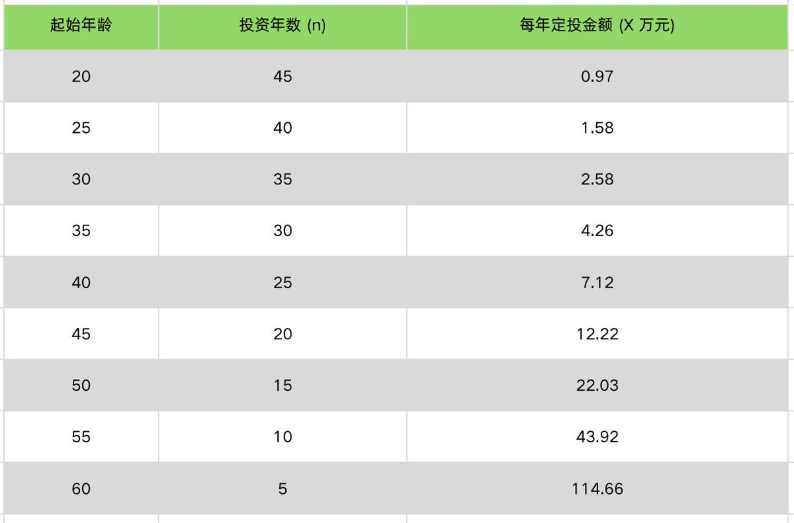
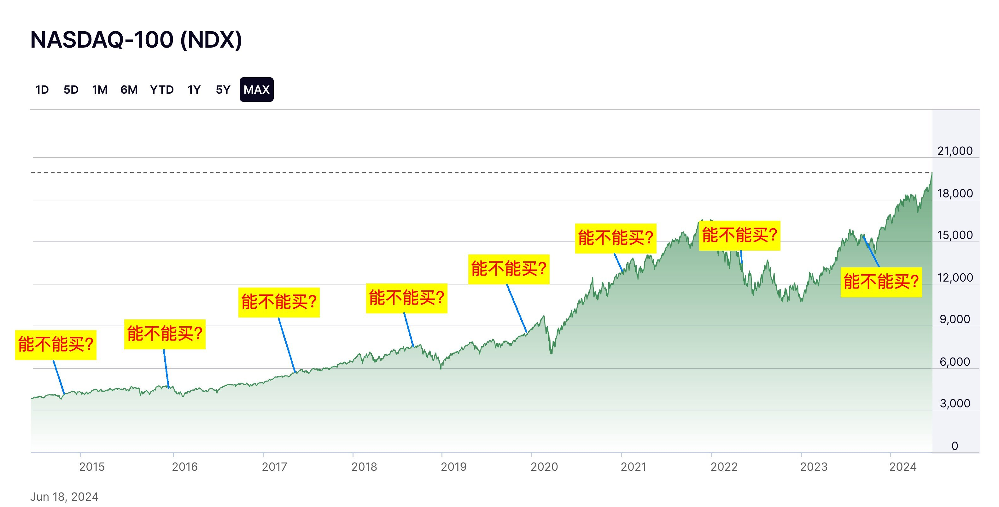

每年投入一笔钱，几十年后能不能积累到几百万元？看到一张长期收益表时，我们很容易被最后一列的大数字吸引，却忽略为了走到那里，每年需要投入多少，以及中途可能发生什么。

但真正值得算清楚的，是三个变量：**你能投入多少，能持续多久，以及结果对收益率假设有多敏感。** 如果只看最终数字，很容易把一张数学演示表，误认成一款稳定理财产品的承诺。

我们用**700万元人民币目标**来算账。它只是一个演示目标，是否足够支持未来生活，还要看你的支出、家庭责任与居住地，不能直接等同于每个人的财富自由标准。

这一课接在资产与指数基础之后，帮助大家理解收益与投入；需要补习前一课，可以从下方进入。下面所有固定收益率都是情景假设，不是市场预测。

[资产与指数基础](/articles/index/UO8oZS5M){card}

## 一、不再追加本金，复利怎样计算

### 先把投入条件写完整

首先举个例子：现在一次性投入**10万元**，之后不再追加，也不取出；假设每年回报为10%，收益继续留在账户中，20年后会是多少？

计算公式是：

**FV = P ×（1 + r）的n次方**

其中 P 是初始本金，r 是年回报假设，n 是年数。在这个例子中，结果为：

**100000 × 1.1的20次方 ≈ 672750元，也就是67.27万元。**

这就是复利计算：后续增长不仅作用于最初的本金，也作用于此前留在账户里的收益。

### 把收益假设换一下，差别就出来了

| 假设年回报 | 初始本金 | 20年后账面价值 |
| --- | --- | --- |
| 4% | 10万元 | 约21.91万元 |
| 7% | 10万元 | 约38.70万元 |
| 10% | 10万元 | 约67.27万元 |

表中不计费用、税收、通胀，也没有中途现金流。三种情景的差距很大，所以做长期计划时，不能只留下最好看的那一列。

这里没有得出“应该找到年化10%的稳定产品”。股票基金的收益会变化；年化是描述或模拟一段时间的结果，不是每年自动到账的利息。

## 二、持续投入，先数清到底投了多少次

### 初始10万元，加上20次年末投入

那我们再回到持续定投：初始投入10万元，此后每个年末再投入10万元，连续20年。固定年回报仍假设为10%。

公式为：

**FV = P ×（1 + r）的n次方 + A ×［（1 + r）的n次方 − 1］÷ r**

A 是每年年末追加的金额。代入后，期末账面价值约为**640.02万元**。

这里的本金必须数对：**初始10万元 + 20次 × 10万元 = 210万元**，对应账面增值约430.02万元。只计算20次年末投入，会漏掉最初的10万元。

### 年初、年末和月定投，不能混用一个答案

本例的最后一次10万元在第20年末投入，刚投入就统计期末价值，没有再增长一年。若改为每年年初投入，每笔钱多在市场里待一段时间，结果自然不同。

同样，每月投入不能直接把年度公式中的数字改小就结束，还需要匹配投入次数与复利周期。用计算器时，要核对起始本金、追加金额、追加频率与复利频率。可以用[SEC 复利计算器](https://www.investor.gov/financial-tools-calculators/calculators/compound-interest-calculator)尝试不同假设，注意其月投入设置与本例年末投入的区别。

| 同样投入210万元 | 假设年回报 | 20年后账面价值 |
| --- | --- | --- |
| 初始10万，每年年末再投10万 | 4% | 约319.69万元 |
| 初始10万，每年年末再投10万 | 7% | 约448.65万元 |
| 初始10万，每年年末再投10万 | 10% | 约640.02万元 |

可以看到，持续创造结余与投资回报，是一起起作用的。前期本金还不多时，增加稳定储蓄，往往比每天寻找“再高一点的收益率”更容易由自己控制。

## 三、倒推700万元目标，需要投入多少

OK，我们了解了计算规则之后，现在来倒推。

假设**初始本金为零，每年年末投入相同金额，到65岁时达到700万元名义资产**，每年需要投入的金额为：

**A = 目标金额 × r ÷［（1 + r）的n次方 − 1］**

这里 n 等于65岁减去当前年龄；当假设收益率为零时，直接用目标金额除以年数。

| 开始年龄 | 可投入年数 | 假设4%时每年投入 | 假设7%时每年投入 | 假设10%时每年投入 |
| --- | --- | --- | --- | --- |
| 25岁 | 40年 | 约7.37万元 | 约3.51万元 | 约1.58万元 |
| 35岁 | 30年 | 约12.48万元 | 约7.41万元 | 约4.26万元 |
| 45岁 | 20年 | 约23.51万元 | 约17.08万元 | 约12.22万元 |

“每年不到2万元，40年后到700万元”，只对应这里的10%情景。换一个假设，所需投入就明显不同；10%那一列不能单独充当家庭预算。

开始得早，确实会增加可投入的次数和复利时间。但它不能保证成功，也不能代替资金期限、资产选择和风险管理。若算出的投入额超出能力，可以调整目标、延长时间或增加收入，而不是靠提高收益假设让表格看起来可行。

## 四、从计算表走到真实市场，还差哪些条件

### 年化回报不等于每年都涨同样多

假设100元先涨50%、再跌50%，最后只剩75元。两年的涨跌算术平均是零，复合结果却是亏损。

一次性投入、没有中途现金流时，给定最终复合收益就能算期末价值。但持续定投过程中，每笔钱经历的市场区间不同；即使某段指数的起点和终点一样，不同涨跌顺序也会影响投入计划的结果。

因此，不能仅拿一个指数过去的长期年化，就直接算出自己的未来定投收益。

### 名义700万元，不等于今天的700万元购买力

假设未来40年每年通胀都是2%，40年后的700万元，折算为今天购买力约为**317.02万元**：

**700万元 ÷ 1.02的40次方 ≈ 317.02万元。**

2%同样只是演示条件。实际通胀、个人消费结构和居住地都会影响购买力。规划退休支出时，要区分目标写的是未来的金额，还是今天的购买力。

### 费用、税收与中途取钱，会改变积累路径

基金费用、交易费用与税费可能降低可留在账户里的金额。跨币种投资还要考虑汇率，中途买房、应急取出也会影响复利基数。

长期计划不必假装生活永远不变。更合理的做法，是给短期支出留出安排，定期检查长期投入是否还能继续。

## 五、寻找产品之前，先理解长期持有的前提

标普500、纳斯达克100相关基金，可以作为学习股票指数投资的入口，但它们都不是固定年化产品。基金还存在费率、跟踪方法、交易溢价与币种等差异，不能把指数历史回报直接当作自己的净收益。

谈到长期积累，很多人会想到巴菲特。但学习长期投资，也要学习如何面对判断错误。巴菲特在伯克希尔[2024年度致股东信](https://www.berkshirehathaway.com/letters/2024ltr.pdf)中谈到了自己的投资失误。长期积累需要良好的资产与决策，也需要检查和修正；不能只凭持有年数，推断自己能复制另一个人的财富。

我更希望大家记住：**时间能放大持续投入和复利的影响，也会放大错误假设与长期费用的影响。** 计算之前把条件写清楚，结果才能帮助决策。

## 六、给自己的计划做一次现实检查

可以拿出一张纸，写下目前可投入本金、每年可持续新增金额、用钱时间和目标金额。分别用较低、中间、较高的回报假设计算，不把最好情景当作唯一答案。

然后再问：如果收入暂时下降，计划能不能暂停？如果临近用钱时市场下跌，是否有其他资金安排？这些条件与计算结果一样重要。

完成后，先把定投与建仓的节奏安排好，再选择购买渠道，进入对应的操作教程。需要重新核对基金费用和跟踪情况，可以回看产品筛选方法。下面列出这些课程与完整学习路线，不需要为了看懂复利，先开通所有账户。

[定投与建仓问答](/articles/index/iAj0LfIU){card}
[纳指购买渠道](/articles/index/gCSTzdEB){card}
[产品筛选指南](/articles/index/KGs3Ns3k){card}
[纳指与标普学习路线](/articles/series/nasdaq-investing){card}
