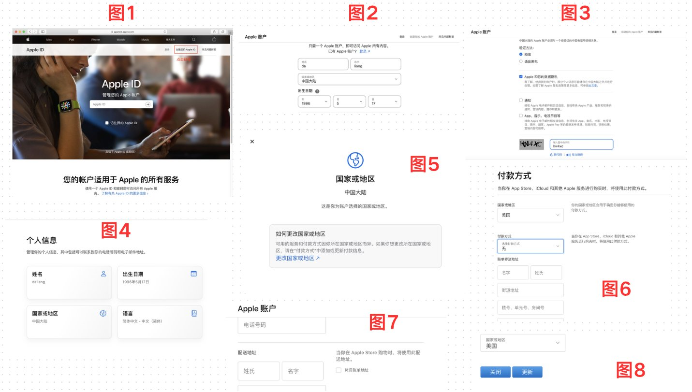
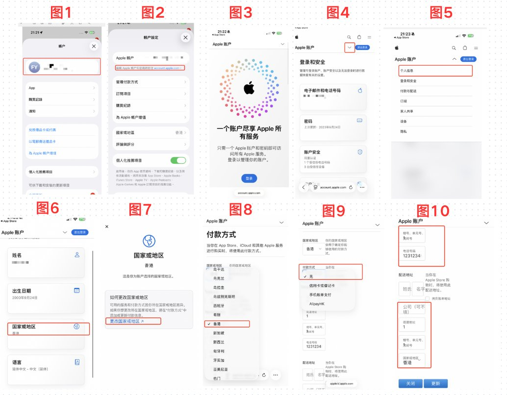

## 一、写在前面

在前面的教程中，多次聊到了港区 ID 和美区 ID 等，用于下载各种 App。

但是我发现评论区有很多小伙伴还是没有对应的 ID，所以今天就给大家制作一期教程，来详细讲解一下这部分内容。

Apple 账号（原 Apple ID）用于登录 App Store、iCloud 等服务。商店地区影响可用内容和付款方式，不会自动赋予你其他应用的开户或使用资格。

本期的内容主要分为两部分：

**①** 讲解如何从零到一注册一个美区 ID 账号。

**②** 讲解如何修改现有的国区 ID 为港区 ID。

分别对应大家如果没有美区 ID，可以看教程注册，以及如果你现在有多余的国区 ID，如何修改成为港区 ID 教程！

### 操作前先检查

准备自己可长期使用的邮箱和手机号。如果要更改现有地区，先处理余额、阻止更改地区的订阅、未完成订单及家庭共享状态，并准备新地区有效的付款和账单资料。不同地区的应用和已购内容可能不同，先做好必要备份。

这些要求见 [Apple 更改国家或地区说明](https://support.apple.com/en-ca/118283)。不能把“付款方式选无”理解为资料可以随意编造。

---

## 二、注册美区 ID

**1、** 打开苹果的官网：[https://appleid.apple.com/account](https://appleid.apple.com/account) 点击**创建您的 ID**。

**2、** 填写真实姓名、出生日期、实际适用的国家或地区，以及自己控制的邮箱。按年龄和地区要求完成验证，不为了创建账号随意改变生日。

**3、** 填写手机号，验证方式选择**短信验证**，去掉下方公告前面的两个勾（那两个是广告推送），填写验证字符，点击继续。

**4、** 第 2 步里填写的邮箱里去找一下验证码，填进去，点击继续。

**5、** 这时候会收到手机验证码，填进去点击继续。

**6、** 注册成功后默认自动到登录与安全界面，这个时候就注册成功了，接下来点击**个人信息**。

**7、** 点击国家或地区——继续点击下方蓝色字体**更改国家或地区**。

**8、** 仅在符合新地区要求时更改为**美国**，按页面选择有效的付款方式。是否提供“无”选项与具体流程有关，不能保证每个账号都出现。

**9、** 填写本人真实且符合要求的账单地址和联系方式。不要使用地址生成器、他人身份或随机电话；缺少符合要求的资料时，先保留原地区并咨询官方支持。

**10、** 如果页面要求配送地址，检查是否与实际地址一致。仅在确实相同时使用“拷贝账单地址”。

**11、** 点击最下面的**更新**按钮，即可成功将账号更新成为美区 ID 账号了！

---

## 三、修改港区 ID

聊完了如何从零到一注册美区 ID 之后，我们再来聊一下如何修改一个现有的国区 ID 成为港区 ID。

**1、** 打开自己的苹果 ID，点击右上角入口。

**2、** 然后点击蓝色的字体进入到浏览器登录到官网。

**3、** 直接点击登录，人脸验证或者是账号密码登录。

**4、** 点击倒三角，然后选择**个人信息**，点击进去。

**5、** 选择**国家和地区**，然后选择**更改**，选择**香港**。

**6、** 按要求填写新地区的付款资料、真实账单地址和可用电话。页面未提供“无”时，不通过虚构信息强行完成。

**7、** 最后完成之后，点击**更新**，即可更新这个 ID 归属地。

**8、** 最后你就成功得到了一个苹果港区 ID，后续可以正常下载对应的 App 啦！

---

## 四、注意事项：先保护原账号的数据和订阅

截图用于识别页面位置，界面和可选项可能变化。具体创建方式可对照 [Apple 创建账号说明](https://support.apple.com/en-us/108647)；如果地区更改失败，先检查余额、订阅与家庭共享，不要连续提交随机资料。

“媒体与购买项目”和 iCloud 登录涉及不同用途。操作前确认自己修改的是哪一项，不为下载某个 App 就随意退出同步照片和备份的主账号。不要使用他人的 iCloud 账号，也不要把自己的密码、验证码或恢复密钥交给卖家。

## 五、总结：账号自己掌握，地区资料与实际情况一致

没有账号，先创建并完成验证；需要更改商店地区，再检查余额、订阅和新地区资料。下载应用后，其服务资格仍需单独核对。把账号和恢复方式长期维护好，比一次性下载成功更重要。
