## 一、写在前面

哈喽，大家好，这里是 WiseInvest，我是你们的老朋友 Wise！

作为数字游民，我们时常需要去各个地方跑，那经常出去的朋友都知道无论是流量还是卡来说都是出行必备的。

对于我们多数的国行手机来说，我们用的都是传统的 SIM 卡，即是一张实实在在的塑料卡片，要插进手机卡槽里，每张卡只对应一个运营商的号码/套餐，换运营商就要换卡。

而对于很多美版手机来说，其已经内置了 eSIM，即这种就是直接焊接/内置在手机主板上的一个小芯片（手机出厂时就有了），它本质是一个可编程的存储空间，能通过网络下载并保存多个运营商的"配置文件"（叫 Profile 或 eSIM profile），每个 profile 就相当于一张虚拟的 SIM 卡。

好处也非常显而易见——一个手机可以有不同的电话号码，可以随时切换，出行也比较方便，直接购买各种 eSIM 流量包，扫描二维码之后就可以立马激活，不用再购买各种 SIM 卡，也不用开各种昂贵的路由！

如果手机没有原生 eSIM 功能，可以进一步了解 XeSIM 这类实体工具卡。是否适用仍取决于具体型号、系统和运营商配置，不能按“国行/美版”一概判断。

---

## 二、Xesim 介绍

对于 Xesim 来说，其外表看起来就是一张普通的 SIM 卡，但是其实是一张特殊的实体 eUICC 卡（可编程的 eSIM 芯片做成实体卡的样子）。

它用于保存和管理兼容的 eSIM 配置，号码和通信服务还要向运营商申请。多个配置能否同时启用、能否用于特定服务验证，需要另外确认。

如下图所示，我在前几天购买了 Xesim 家的 X2 Pro 已经到货了，所以今天我就给大家来讲一下具体的使用方式！

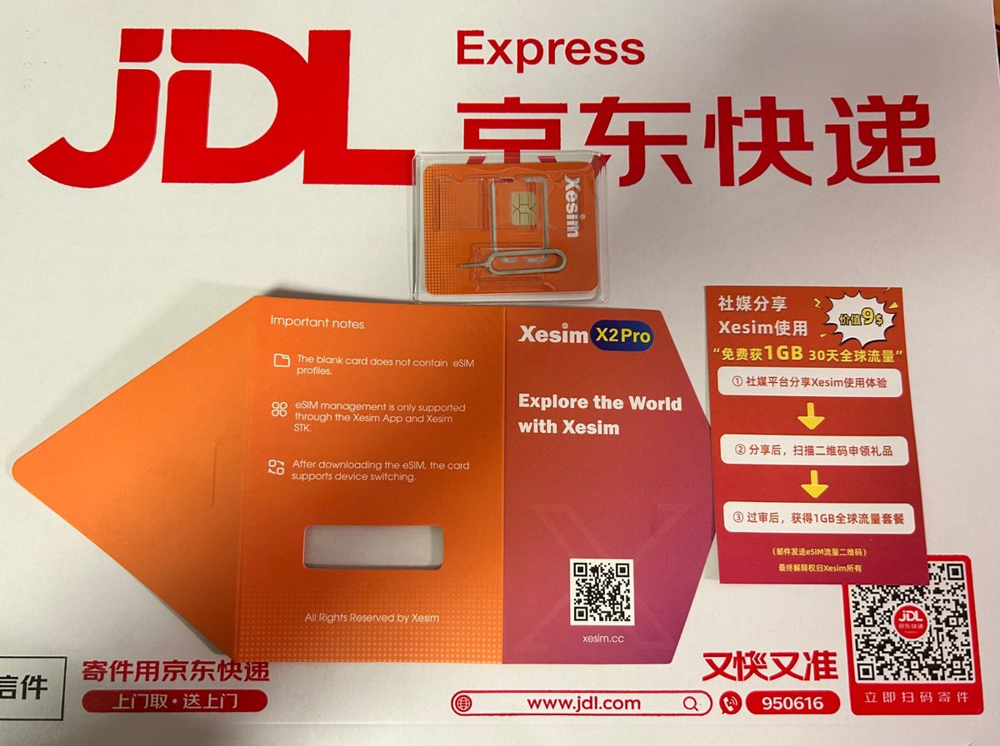

使用下方的 XeSIM 购买入口，在结算时填写优惠码 **WISE666**。

> [领取 XeSIM 优惠](https://xesim.cc/?DIST=RkJHFVg%3D) · 优惠码：**WISE666**

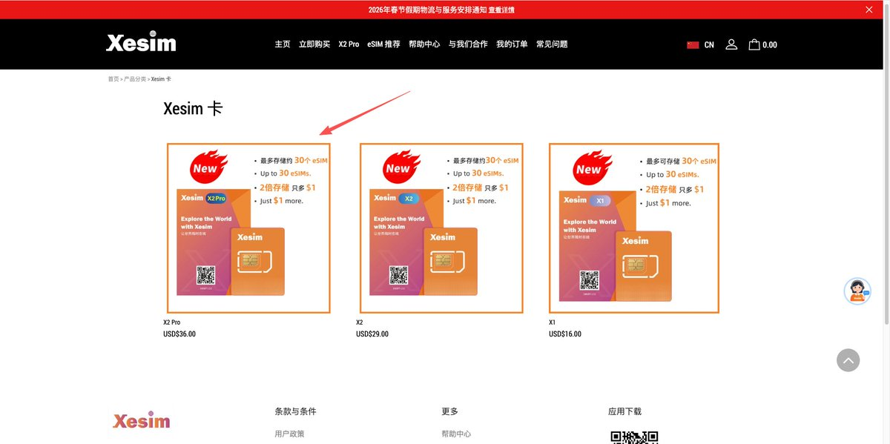

本文以 **X2 Pro** 为例，其 SeedLink 用于下载配置，不应当成无限期的日常上网套餐。先核对有效期、续期费用和手机支持情况，再选择型号；可参考 [XeSIM 官方使用指南](https://help.xesim.net/userguide)。

输入折扣码 **「WISE666」**，我给大家申请了一个九折折扣。

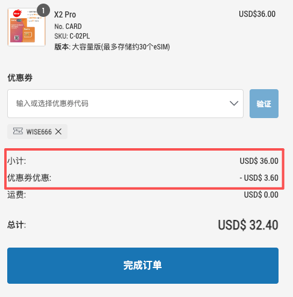

---

## 三、具体使用

如下是 X1/X2 和 X2 Pro 的一些使用方式对比，大家可以先行了解一下。

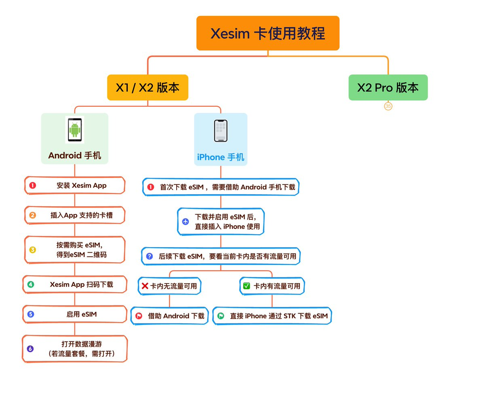

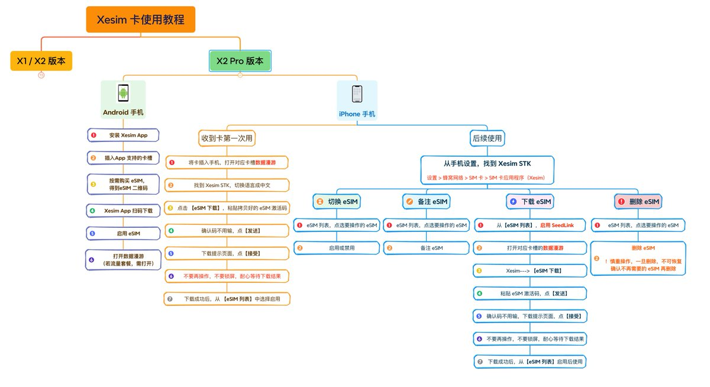

然后我们就开始操作细节：

### 1. 收到 Xesim 卡后，将卡插入 iPhone

先核对卡片型号及手机兼容性，按设备要求装入对应卡槽；如果不能识别，先检查卡片安装和官方兼容说明。

### 2. 打开数据漫游开关

手机设置 → 蜂窝网络，找到对应 Xesim 卡槽对应的移动网络，打开数据漫游开关。如果手机有使用 VPN，也请先关闭 VPN。

### 3. 下载 Xesim App

从苹果应用商店 AppStore 搜索 **Xesim App**，下载安装。

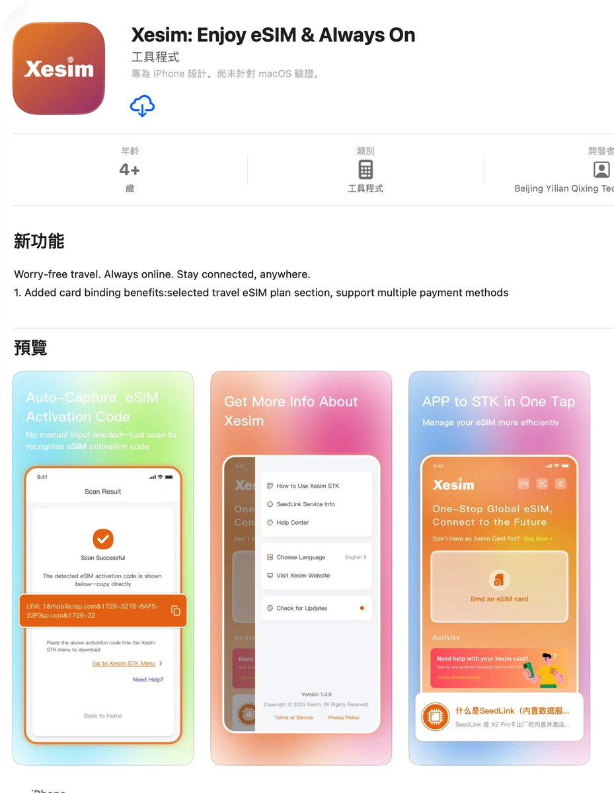

### 4. 在 Xesim App 上绑定 Xesim 卡

绑定后，可以查看 SeedLink 有效期，也可以通过 App 来续期 SeedLink 服务。

- **X2 Pro**：可以通过短信验证码绑定
- **X1 和 X2**：必须要通过绑定码（插入 Android 手机，App 上可查）或官网订单信息绑定

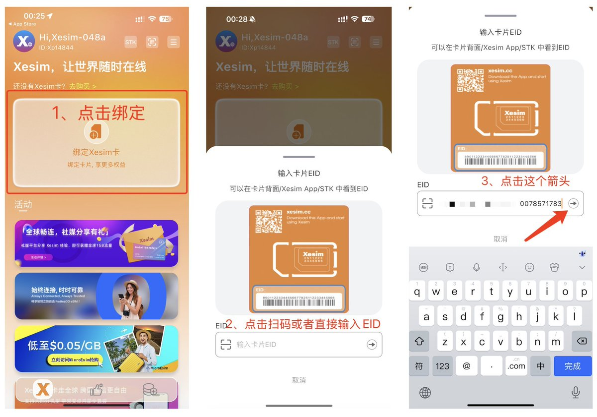

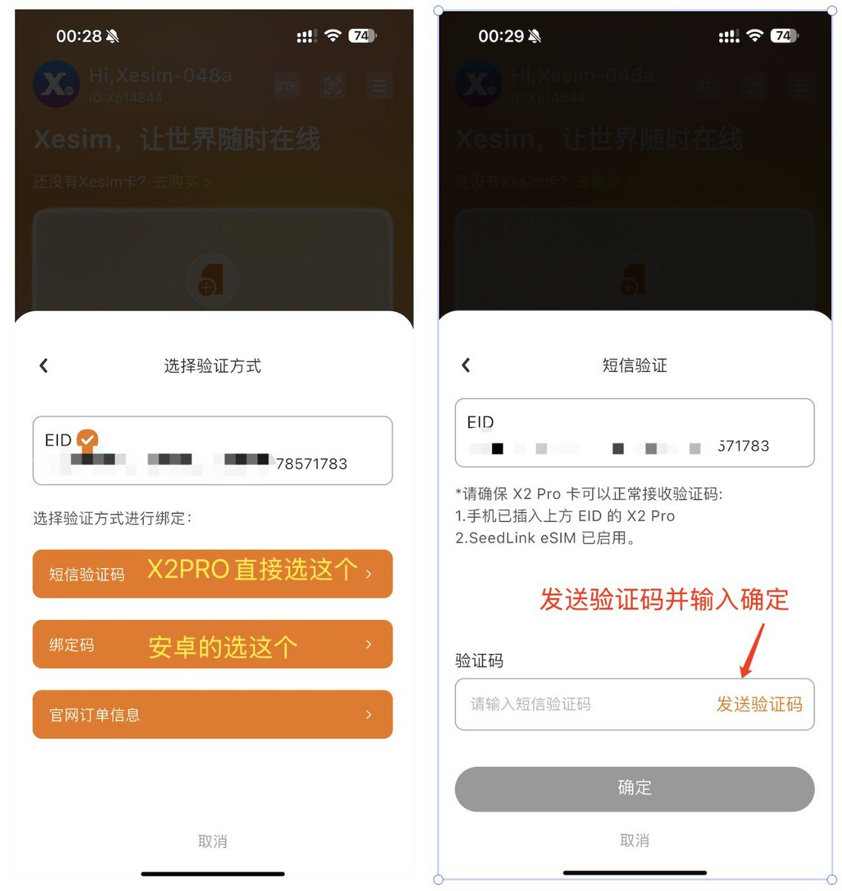

### 5. 购买所需 eSIM 套餐

购买后，会得到 eSIM 二维码（也叫 eSIM 激活码，是一串以 LPA 开头的字符串）。

> eSIM 激活码可能限制下载次数和设备迁移。先核对运营商条款，再扫描或删除配置；不要公开二维码。

这部分内容参考了鱼总的沃达丰卡注册教程：[教程链接](https://x.com/AI_Jasonyu/status/2017934338889834825)，大家可以自行看教程，然后去购买对应的卡。

### 6. 识别并拷贝 eSIM 激活码

申请完毕之后，你会得到对应的 PDF 和二维码，识别并复制其中的激活码。

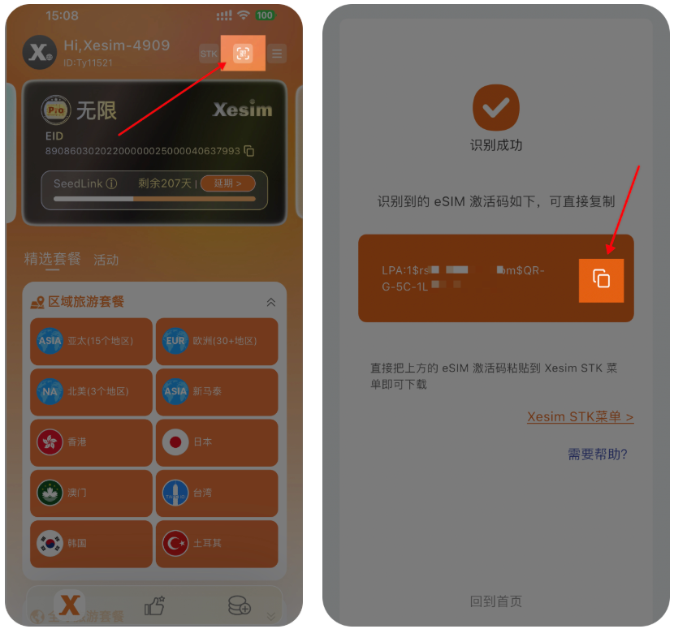

### 7. 通过 Xesim STK 下载 eSIM

首先打开 Xesim 对应卡槽的数据漫游开关，然后：

**① 找到 Xesim STK：**
iPhone：设置 → 蜂窝网络 → SIM 卡 → SIM 卡应用程序中找到 STK

**② 切换语言为中文：**
Xesim → Language → Chinese (Simplified)

**③ 点击"eSIM 下载"：**

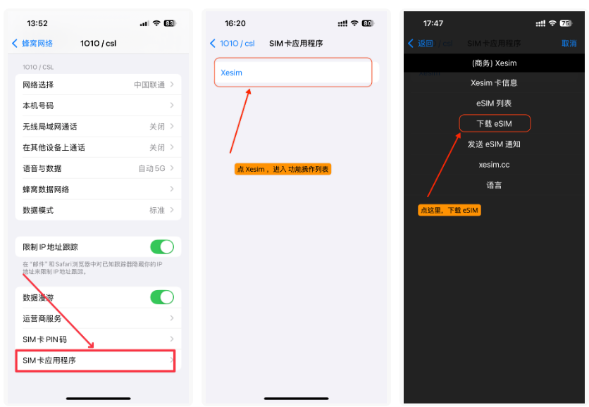

在激活码输入框中，粘贴拷贝好的 eSIM 激活码，点击【发送】。

确认码页面，不用输入，直接点【发送】（大多数都没有确认码，如果 eSIM 供应商提供了确认码，则需输入）。

**④ 等待下载完成：**

点击【接受】后，切记：**不要锁屏，不要任何操作，不要点 STK，耐心等待**，直到下载结果提示。整个下载过程大约需要 40～90 秒。

提示下载成功后，可以去 eSIM 列表里看到新下载的 eSIM。

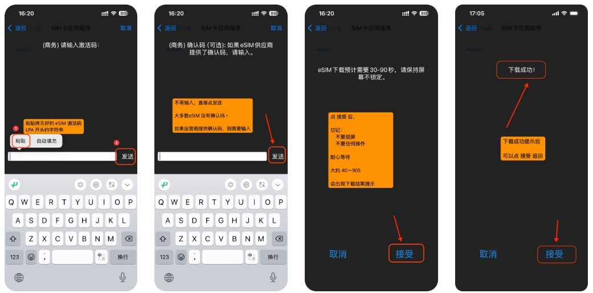

下载成功后，按运营商说明完成启用或必要的 PIN 操作，核对号码、套餐有效期和网络。不要猜测 PIN，多次输入错误可能需要 PUK 解锁。

---

## 四、注意事项：工具卡与套餐分开维护

完成时间取决于购卡、运营商审核和下载过程，不能保证一小时走完整个链路。工具卡能够重复使用，不代表所有运营商配置都能导入，也不意味着 SeedLink 或套餐终身免费。

使用 STK 下载前，要确认卡内有可用的数据通道；X2 Pro 可在 SeedLink 有效期内使用它。下载完成后重新检查默认上网卡和漫游开关，避免按不适合自己的费率产生数据费用。

更换设备或删除配置前，确认能否重新下载。二维码和激活信息只保存在自己控制的位置；遇到错误，先记录提示，再向对应运营商或 XeSIM 支持渠道排查。

## 五、总结：先完成一次完整的配置检查

按“设备兼容 → 绑定卡片 → 准备可用配置 → 下载启用 → 检查套餐和网络”的顺序操作。能够管理多个配置是便利，真正长期可用还需要维护套餐、号码和下载权限。

OK，今天的内容就到这边了，最后就是我做了一张图，记录了我目前的平台，如果有大家平时比较喜欢的平台，也欢迎大家前往关注！

那我们就下期再见啦！
