哈喽大家好，我是 Wise。

我相信大家最近被问得最多的，其实就一句话：现在是不是有 AI 泡沫，而且已经破了？美股连续多个交易日下跌，科技股尤其难看，很多人已经开始用「泡沫破裂」来解释眼前的价格。

The Kobeissi Letter 在 11 月 20 日发了一篇长文，标题是：[45 天蒸发 6 万亿美元：这是泡沫，还是机会？](https://x.com/KobeissiLetter/status/2123789428862660980)

这篇文章里面他们把过去 45 天里发生了什么、什么已经被定价、接下来可能怎么走，写得比较完整。

我今天下午起床，看到这篇内容被很多朋友都在转发，但是原文是英文的。其实我在想，能不能把它翻译成中文，并且加上一些我的思考。

我把这篇按原文顺序完整汉化过来，配上原图，方便大家直接阅读。

PS：文中的数字、事件和判断，都来自这篇文章本身。

汉化之后，我会再补上我自己的几条思考。

我们现在被问得最多的问题是：有没有「AI 泡沫」，它破了吗？美国股票已经连续 31 个交易日、平均每天蒸发约 2250 亿美元。下面我们会把事情是怎么走到这一步的、现在正在发生什么、以及我们接下来怎么看，完整拆开讲一遍。

自 2022 年 11 月以来，我们一直对 AI 高度看多，把它称为历史上最大的技术革命。我们「要么持有资产，要么被落下」的立场，建立在创新驱动的回报和通胀复利的结合之上。

过去 6 周，AI 交易经历了启动以来最严峻的考验之一，力度可以和 2025 年 4 月贸易战那一轮相比。建议先收藏这篇文章，未来几周可以再回来对照。

现实是，AI 正在冲击全球市场、经济和文明既有的秩序。冲击会带来情绪的两极分化，而资产价格的大幅波动，又会把这种分化再放大。

这正是我们眼下看到的情况。

其实在开始之前，我一直都是继续唱多的，所以我依据“泡沫没有破裂”的角度进行考虑和推进，ok，我们开始吧

## 一、过去 45 天非常混乱

在开始之前，有必要先看清楚：自 10 月 6 日——也就是标普 500 上一次创出历史新高的日子——以来，到底发生了多少事。

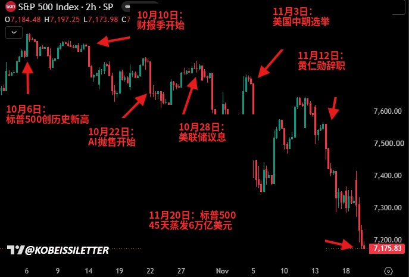

在过去 45 天里，市场连续消化了大量伊朗战争消息、2026 年三季报、围绕 AI 资本开支和自由现金流的担忧、10 月美联储议息、美国中期选举、英伟达（NVDA）的争议，最终市值蒸发了 6 万亿美元。

不仅如此，Anthropic 的 IPO 刚刚完成逾 1000 亿美元的融资，是历史上规模最大的 IPO，并在最近几个交易日明显抽紧了市场流动性。

作为投资者，在这样的时刻，重要的是先退一步，问自己一个关键问题：什么已经变了，什么其实已经被定价了？

## 二、很多东西已经被定价：资本开支和自由现金流的担忧

这轮下跌，主要是从一件事开始的：美国大型科技公司在 AI 上的资本开支，以及这会对 2027、2028 年的自由现金流和盈利能力意味着什么。

这些担忧是真实的。

亚马逊（AMZN）、Alphabet（GOOGL）、Meta（META）和微软（MSFT）四家公司的合计资本开支，在 2026 年三季度增加了 369 亿美元，达到创纪录的 2019 亿美元。

这个数字在过去 12 个月里翻了一倍还多，较 2024 年一季度上涨 356%。过去 3 年，大型科技已经在资本开支上花了 1.6 万亿美元。

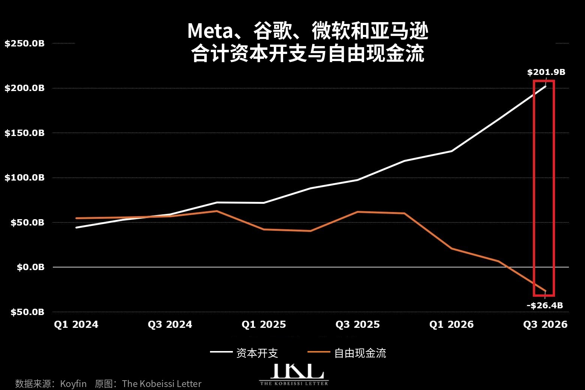

但同样需要承认的是：要完成一场历史上最大的技术革命，创纪录的基础设施投入是必要条件。自由现金流短暂转负，是长期建设必须付出的短期成本。

这些恐惧里，有很多已经被定价了；但在资本开支的投资回报更加清晰之前——很可能要到 2027 年一、二季度——这些担忧不会轻易消失。

从来没有一个市场，一边是如此巨大的恐惧，一边又是如此强劲的增长。截至目前，标普 500 公司 2026 年三季度每股收益同比大约增长 31.9%，是至少 4 年来最强的同比增速。

实际盈利已经连续 13 个季度超过预期。AI 建设的力度，比多数人意识到的更强。

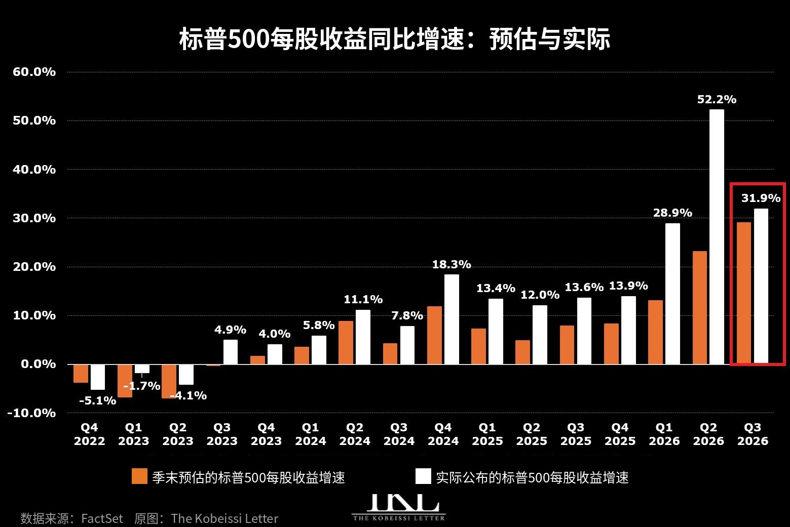

## 三、民主党「横扫」美国中期选举——「特朗普看跌期权」结束了

接下来，我们认为，科技股这轮回撤里很大一部分催化，和美国中期选举的结果有关。这次选举，实际上结束了我们所说的「特朗普看跌期权」（Trump Put）。

从特朗普 2016 到 2020 年的第一任期，以及他第二任期至今都能看到：当市场波动加大、而特朗普又有能力去影响市场时，市场会客观地感到安心。所谓 Trump Put，是一种对冲、一种默认：如果市场变得很难看，特朗普会出来干预，因为稳定的市场一直是他的优先事项之一。

随着民主党「横扫」中期选举，我们认为，Trump Put 实际上已经结束了。进一步催化这一退守机制结束的，是 11 月 4 日下面这条帖子：

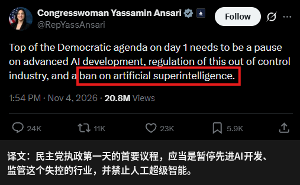

参众两院易手后，特朗普干预市场的能力已经被部分削弱。要求禁止 AI 的声音开始升温，市场已经在计价：到 2027 年 1 月民主党接管后，可能出现更严厉的监管，甚至禁令。

Trump Put 的结束不会被逆转，也会让美股出现更陡的回撤；但我们认为，监管担忧被定价得过了头。

美国禁止 AI，这件事不会发生。即便这样的禁令真能执行，也等于把美国在全球 AI 竞赛中的位置让给中国。

未来会有更多监管，也可能出现新的税种，但市场假设的情形，比我们认为真正会落地的要极端得多。

归根到底，无论谁执政，美国都应该想赢。

## 四、美联储正在对着一个已经焦虑的市场加息

在 AI 投资担忧和政治格局变化之上，美联储还在积极加息。

伊朗战争接近第 300 天，美国通胀已经连续 67 个月高于美联储 2% 的目标。美联储主席沃什（Warsh）已经说得很清楚：他的首要任务，是把通胀压回 2%，没有例外。

这意味着，建设 AI 本来就已经很贵，现在还会更贵。更不用说，美国联邦债务的情况还更糟。

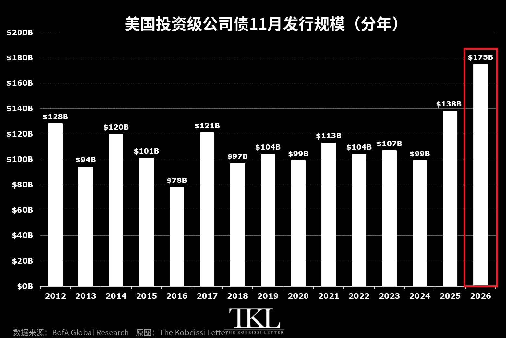

如图所示，美国投资级公司债 11 月的发行规模预计同比增加 370 亿美元，约 27%，达到 1750 亿美元，将是有记录以来最高的一个 11 月。我们认为，美联储在这种背景下加息，进一步加剧了近期的不稳定。这种情况会改变吗？

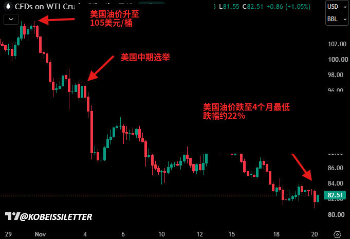

政治权力更迭和这轮市场下跌，已经让油价在本月大约下跌 22%。叠加上市场动荡，美联储对 2027 年的展望很可能会改变，尤其是在伊朗战争更接近结束的情况下。

11 月 2 日，我们发布过下面这篇关于中期选举前美国油价的分析，并给出低于 93 美元的判断。此后，油价已经跌到 2026 年 8 月以来的最低水平。

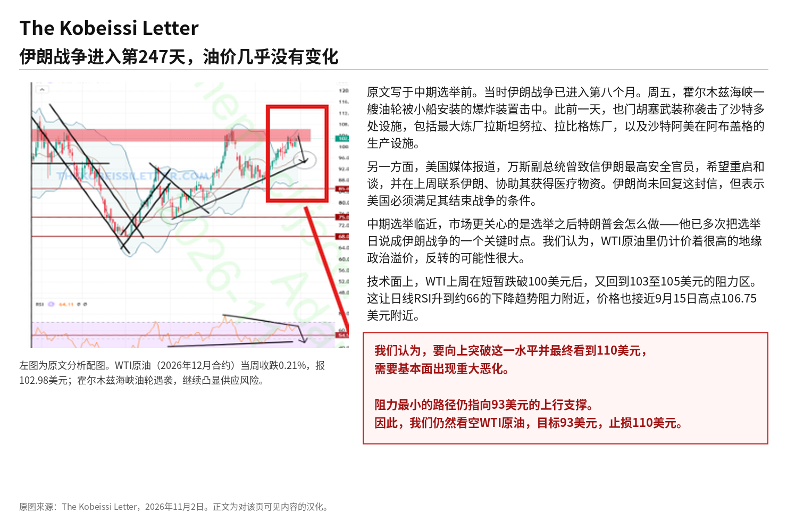

即便油价回落，「更高、更久」短期内仍会持续，但我们认为，到 2027 年中，政策变得不那么紧缩的可能性正在增加。

## 五、英伟达、AMD 和对华芯片问题

过去两周，英伟达失去了黄仁勋这位「AI 革命」的核心人物，股价在数周内下跌约 40%；AMD 则被指控向中国走私芯片。市场已经把这些事情的后果，计价得非常严重。

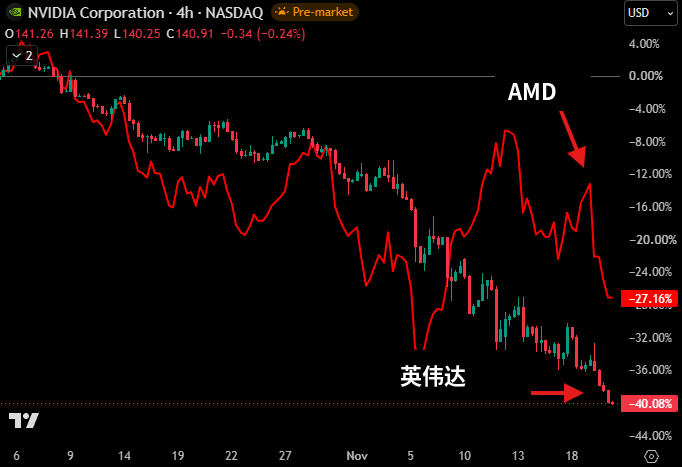

你们大概都已经看到，我们在英伟达这件事上表达得很明确，并且很早就采取了这样的立场：在被证明有罪之前，黄仁勋应被视为无罪。我们主张，在独立调查给出明确事实之前，董事会应把位置留给黄仁勋，而不是直接把门关上。

我们给出这个判断，是因为黄仁勋对 AI 革命、对美国的成功，都有巨大的创新和影响。但现在英伟达的股价，几乎已经按「黄仁勋不会回来」来定价，也相当于把公司的前瞻指引整个打了折扣。

AMD 这边也是同样的情况。11 月 19 日有做空报告指控其向中国走私芯片，而这项指控远未被证实。

受这些事件影响，科技板块的预期市盈率已经落到 2020 年 3 月以来的最低水平。

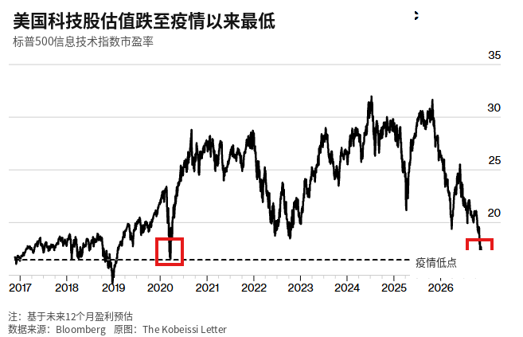

英伟达的预期市盈率降到了 9 倍，成为标普 500 里最便宜的股票之一，而且相对它正在发生的盈利增长，便宜的程度更加明显。

这意味着什么？市场并不相信预期市盈率里的那个「E」。即便英伟达给出 2028 财年大约 7500 亿美元收入的指引——而且即便没有黄仁勋也是如此——市场仍然拒绝接受。

眼下这个市场里，埋着大量「超预期」的空间。

## 六、眼下，情绪已经到了危机水平

10 月 15 日，我们发布过一篇题为「隐形熊市」的分析，指出标普 500 表面之下，尤其是科技股，已经出现熊市。那才是情绪转向的起点。它并不是从中期选举或英伟达事件才开始的。

如下图所示，后面这些事件，只是把转向加速了。

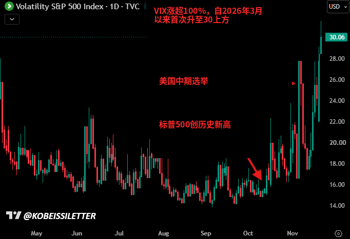

波动率指数（VIX）较 10 月低点已经上涨超过 100%，并在 11 月 5 日录得 2018 年 2 月以来最大的单日涨幅。把这种突然上升的恐惧，再叠上 Anthropic（ANT）IPO 明显抽走市场流动性，情况就更清楚了。

机构对这次 IPO 的需求达到 4000 亿美元，零售在周二账簿关闭后达到 1000 亿美元，合计接近当时预期 78 美元发行价、644 亿美元融资规模的 8 倍。

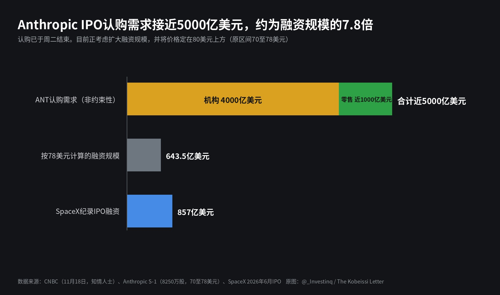

情绪骤变，再加上流动性被大幅抽走，就出现了我们本周看到的行情：股票、黄金、加密货币等几乎一起下跌。

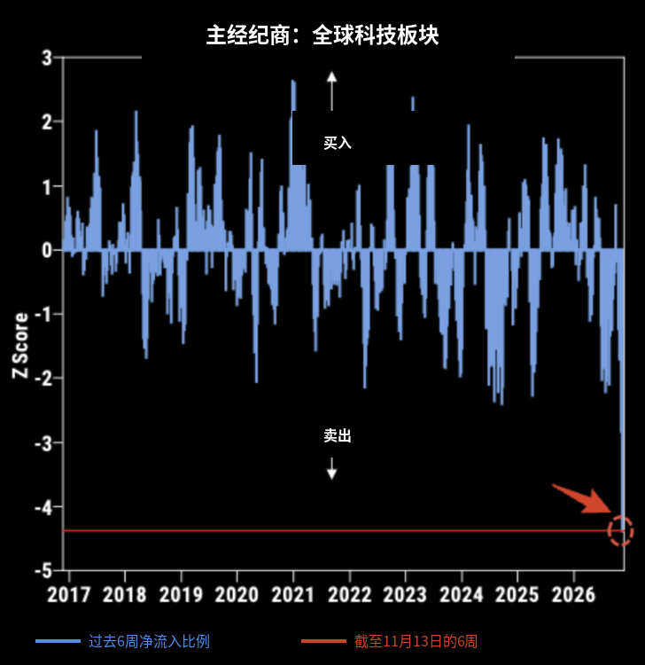

对冲基金在本月录得十多年来最大的过去 6 周净流出。用一句话说，就是一场抢着出门的「逃命」。

一旦流动性回来，我们认为市场会重新稳住。

## 七、结论：接下来会怎样？

这又回到最初的问题：有没有「AI 泡沫」，它破了吗？

我们的回答是：没有。

毫无疑问，AI 革命正面临启动以来最重要的考验之一。但我们认为，市场已经开始计价一个比当前基本面更悲观的结果。

我们认为，市场正处于一次正常回调之中。即便标普 500 再从当前点位下跌 10%，也仍落在健康回调的范围内。

如果有人现在就喊出延续到 2027 年的漫长熊市，等于是在赌上面这些因素不仅会兑现，还会变得更糟。负面情绪已经大量反映在当前资产估值里，我们对市场上迅速传播的「标普 500 再跌 30% 以上」的说法，会比较谨慎。

现实是，情绪已经变得极度两极化；而我们认为，这种两极化会像以往一样，带来机会。

在当前点位，市场计价的是一组组合：利率维持高位、AI 监管趋于严厉、AI 基础设施投资回报令人失望，以及科技行业里一些最重要的公司继续面临长时间的不确定性。正因为如此，进入 2027 年，正面超预期的空间其实不小。

我们并不是说市场已经见底。波动率仍会偏高，流动性仍然受限，不确定性还在，继续下跌完全可能。

但风险收益比正在变得更有吸引力，尤其是那些资产负债表健康、盈利增长仍在加速、竞争优势比较牢固的高质量科技公司。

我们认为，相当多的悲观已经被定价，而市场却低估了正面超预期的可能。一旦尘埃落定，我们预期抄回高质量科技股的资金会很快回来，类似 2025 年 4 月那一次。

长期来看，持有资产的人会继续赢。

原文末尾还有他们自己的业绩曲线和订阅入口，那部分不属于这篇复盘，我没有转载。想核对原文和配图，可以直接看[这条帖子](https://x.com/KobeissiLetter/status/2123789428862660980)。

## 八、我的思考

翻译完之后，我想单独说几句我自己的看法。这些是对照，不是把上面的结论直接换成我的结论。

第一，这个问题本身问得对。真正该问的，不是「跌了这么多，是不是泡沫破了」，而是：什么已经变了，什么其实已经被价格算进去了。

因为下跌是事实，但下跌本身不能自动证明 AI 的长期逻辑断了。用一个恐慌标签，去解释 45 天里叠加在一起的很多件事，往往会把判断做窄，所以我们更多需要考虑的就是，为什么前段时间能够形成单边上涨行情呢？现在又能够形成单边下降行情？

这些内容其实我在我们过去的内容中都有和大家聊到过。我说上次我们在博弈美联储不加息，博弈科技股的财报会好，博弈川普能够赢得年中选举。

如果这些都通过了，现在一定是单边上涨行情。

现在和之前唯一变化的，就是科技股的支出过于庞大，以及川普丢失了年中选举，这就是最大的原因。

第二，资本开支和自由现金流的压力，我不觉得是被吓出来的假问题，而是切切实实存在的真问题。

四家大型科技公司一个季度 2019 亿美元的资本开支，过去三年 1.6 万亿美元，谁都不能假装没看见。

但我也同意一个关键的信息，即：现在更缺的，是这些投入什么时候能被收入和现金流验证，而不是再补一个「泡沫破裂」的结论。

把观察窗口放到 2027 年一、二季度，其实会更好一点，因为我们之前就和大家聊到过，例如谷歌现在的财报非常难看，但是谷歌想要把财报做得好看其实非常简单：他只需要在下个季度缩减支出，在收入不变的情况下，财报数据就会非常好看。

但是愿不愿意做，以及能不能这样做，是另外一回事。

第三，这次价格之所以走得这么急，情绪和流动性的分量可能比基本面更大。中期选举后的政策预期、英伟达管理层事件、AMD 的做空报告，再叠上 Anthropic IPO 抽走大量认购资金，任何一条单独拿出来，都足以让短期定价变形；几条叠在一起，就很容易出现股票、黄金、加密货币一起跌的局面。

这会让持仓很难看，但「很难看」和「AI 资本开支突然失去意义」，不是同一件事。

上面提到的黄仁勋去向、对华芯片指控、AI 禁令能否落地，目前都还存在很大的不确定性，我更愿意把它们当作「已被市场狠狠计价的风险」，而不是已经落定的事实。

所以说在当下的这个前提之下，你就可以理解为程序下杀，再导致情绪下杀，才导致连环爆仓啊。所以说，你说他一定是情绪如此低了嘛，也不一定，它的基本面其实还是在的。

第四，估值被压缩之后，赔率确实在变好，但这不等于已经见底，更不等于现在就该加高杠杆去抄。

上面也写了：波动还会高，流动性还紧，继续下跌完全可能。我自己的立场更简单——如果你本来就是按长期持有高质量科技资产、按[纳斯达克从 0 到 1](https://www.wise-invest.org/articles/series/nasdaq-investing) 这条线来配置的，这次回调更需要避免的，是在恐慌里把长期仓位砍掉；也要避免因为「看起来便宜了」就一下子把风险开得太大。

资产负债表健康、盈利还在增长、竞争优势比较清楚的公司，才是回调里值得对照的对象，而不是所有带 AI 标签的资产。

这个时候抄不抄底的核心就在于，我们能不能去回顾一下历史的情况：在历史前提下跌了多少，对应市场的反馈如何。都要进行详细的计算，才能够得出最后的结果，到底是能抄底还是不能抄底。

## 九、常见问题

Q：这篇是原文翻译，还是你们自己的市场判断？

前面主体部分是对 The Kobeissi Letter 2026 年 11 月 20 日文章的完整汉化，数据和判断以原文为准。「我的思考」这一部分才是我自己的对照。

所以大家可以先看原文的部分，然后最后再来看一下我的一些思考。

Q：原文是不是认为 AI 泡沫已经破了？

不是。原文的明确回答是：没有。他们把这次下跌看作一次正常回调，认为市场已经计入了偏悲观的情形，但不否认波动和继续下跌的可能。

Q：这是不是意味着市场已经见底？

原文没有这样说，其实我也不会这样说。估值和情绪被压下来之后，赔率可能变好，可流动性、政策和个股事件都还没有完全落地。见底是事后才能确认的事情。

包括我自己也是如此，要看市场能不能下跌。其实现在没有任何人能够阻止市场的下跌，也没有任何利好的情绪释放来阻止市场下跌，所以我们只能继续等待市场跌到一个无可再跌的位置。

## 十、我自己最后聊两句

整体来看，我今天睡醒之后，看到大家都在聊这篇内容。

我本以为会聊到非常多有价值、深入的思考，但是翻译过后发现，内容其实算是中规中矩，只不过是把过去所有的事情都给串联了起来。

其实如果此时此刻你对一个市场并没有非常了解，你看一天这个内容，就可以对这个市场这轮下跌的核心原因有一个基本了解，也算是这篇文章的价值所在了。

最后来说，我的观点依旧是如此。前面讲过很多次，一定要等有好的情绪利好释放之后，这轮行情才会止跌。

对于美股而言，我依旧希望大家不要丧失信心，任何下跌都会导致市场行情有更高的反弹。

其实我们可以对比一下 QQQ 今年年初的走势。之前在小红书直播的时候，我说 QQQ 从 2025 年 11 月份开始，可能到一月份、二月份就会上涨。但后来不是爆发了战争嘛，它一路下跌，直到三四月份底，才迎来了一个单边上涨行情。

这个上涨行情，从整个历史上来看，都可以算是一次载入史册的上涨。

其实你就可以发现，QQQ 的韧性是非常强的，美国科技股的韧性是非常强的，包括美国市场的韧性也是非常强的。因为对于纳斯达克、QQQ 还是说美国市场来说，他们其实都在不断地吸取全球市场的血。

而且我之前和大家聊了个观点，那就是关于“容器”的概念。什么是“容器”的概念？在 2000 年那个时候，美国的债务非常高，它就采用了互联网科技发展，用这个“容器”去承接债务，然后平稳地度过。

现在 AI 也是如此。AI 从 2022 年到 2026 年，只不过发展了差不多四年左右的时间，从整个历史的长河来看，这四年其实是沧海一粟的。

从整个 AI 的发展来说，我并不觉得就到此结束了。

无论是美国的、中国的，还是全球的其他企业和公司，他们对 AI 算力的需求一定是庞大的。

只要他们对 AI 算力的需求是庞大的，那无论是谷歌、英伟达，还是云公司，亦或是存储公司，他们的产能依旧是供不应求的。

只要供不应求，只要基本面都在，只要依旧能够创造价值，那 AI 就没有破灭啊。
