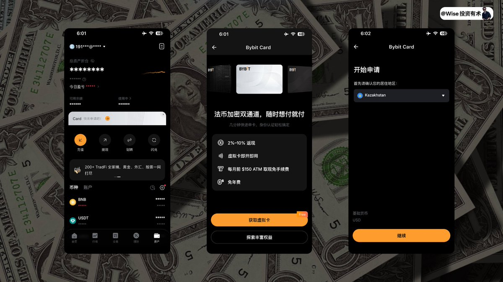
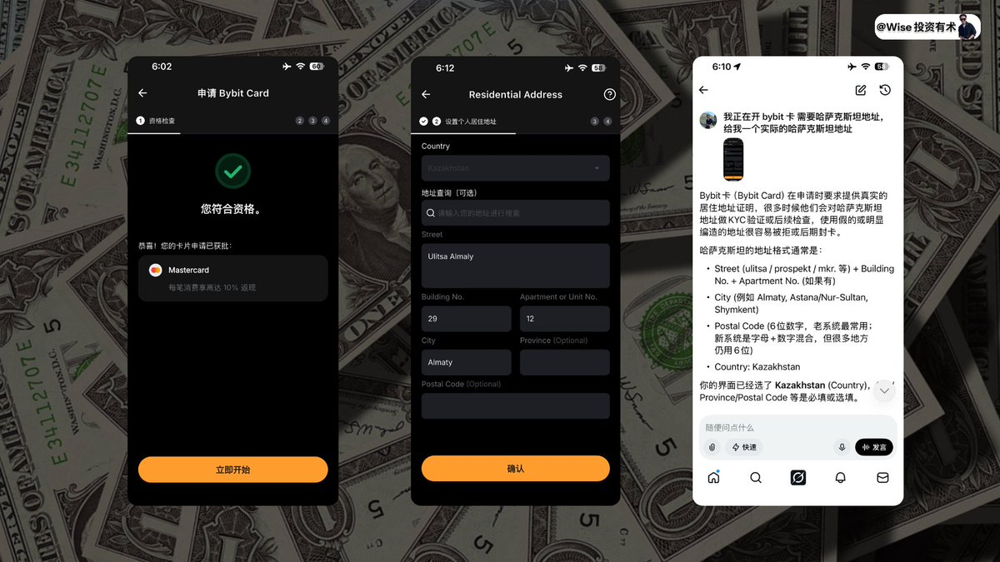
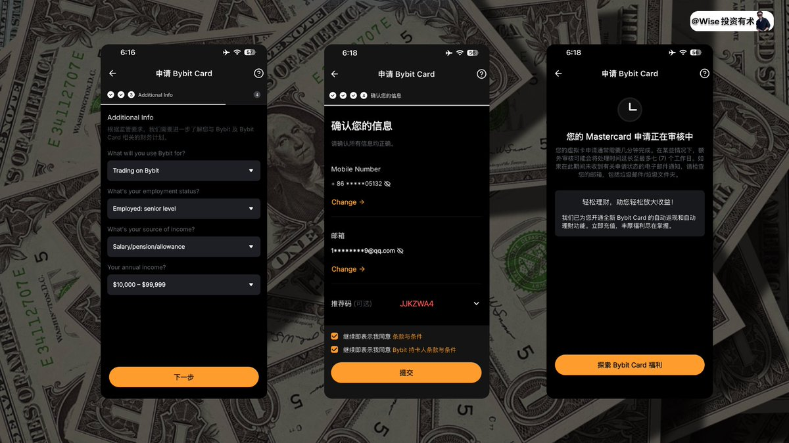
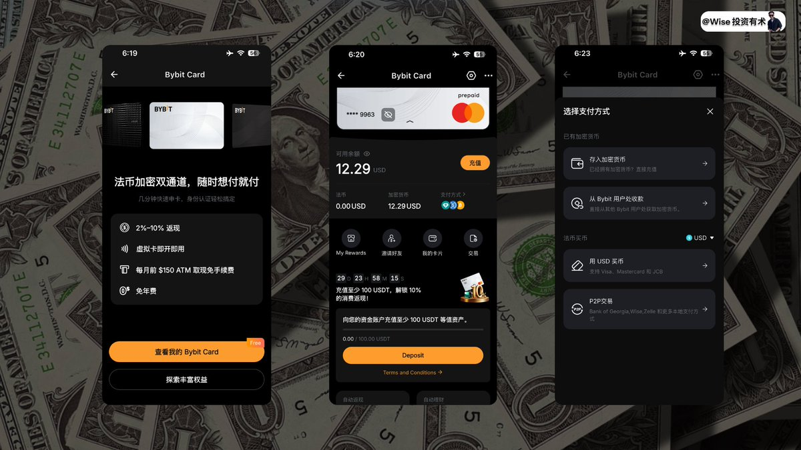
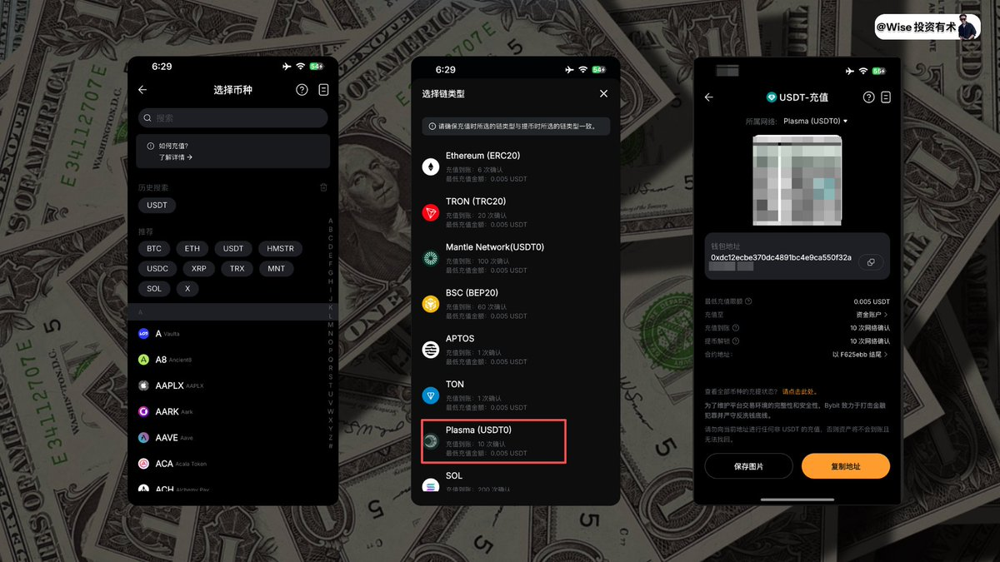
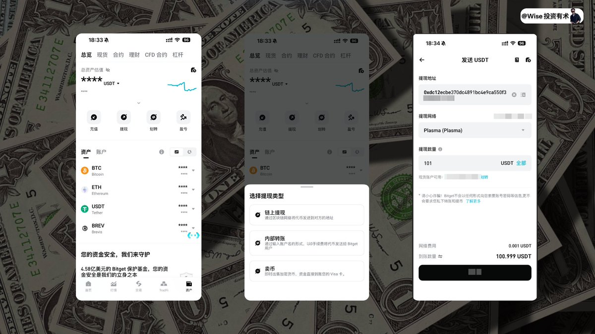
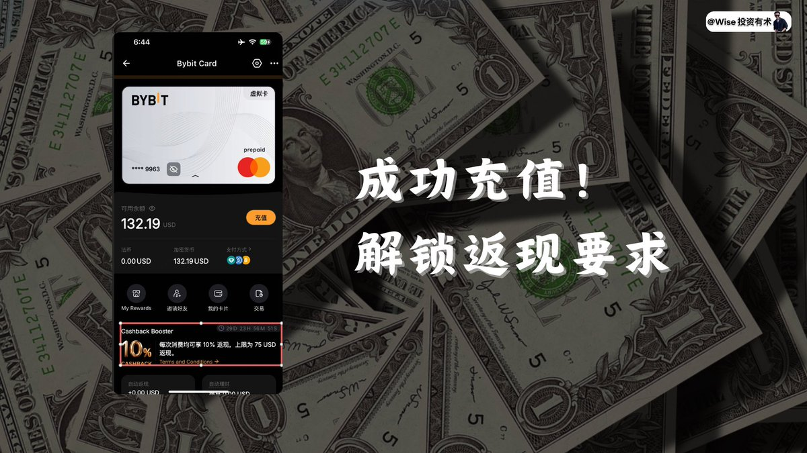

## 一、Bybit Card 大陆还能开吗？先给结论

**Bybit Card 大陆还能开吗？** 先答资格，再谈「怎么点」。

官方帮助中心写明：Bybit Card **目前仅在有限国家／地区提供**；申请时要选择 **Country of Residence（居住国）**，若不在支持列表，页面会先登记兴趣，而不是直接发卡（帮助中心文《How to Get Started with Bybit Card》，页内更新时间约 2026-06-10）。**卡片资格与交易所账户是否已 KYC 是两回事**——能注册／能登录，不等于能开卡。

对**如实填写居住地为中国大陆**的用户：公开帮助流程要求先选居住国；若申请页无法进入、提示不支持或只让 waitlist，应视为**当前不可直接办**，停止并改走其他合规路径。下文「开卡步骤」适用于**本人居住国已在官方支持列表、且申请页真实可用**的账户；截图不能证明大陆用户一定能过。

核对日口径：**2026-11-09（Asia/Shanghai）**。名单与政策会变，最终以[官方帮助中心开卡说明](https://www.bybit.com/en/help-center/article/How-to-Apply-for-Bybit-Card)与**本人 App 卡片申请页**为准——本文不编造一份「永久白名单」。

还在比较「大陆还能办哪张 U 卡」时，先回对比枢纽，不要死磕单卡：

[大陆现在还能办哪张 U 卡？资格、条款与随用随充怎么核](/articles/vcard/ACGrkqnQ?series=crypto-tools){card}

开卡前也可先核对接交易所侧限制：

[Bybit 还能注册吗？资格与入金核对](/articles/crypto/e6utod7B){card}

## 二、资格怎么核：居住国、KYC、地址证明

按官方申请顺序，虚拟卡大致是：Finance → Card → Apply → **选择居住国** → 完成卡片侧身份核验 → 提交真实住址等资料。注意：

1. **居住国必须真实。** 帮助中心写明若不在支持国家，会登记兴趣并在开通时再通知。把居住国改成截图里的哈萨克斯坦／澳大利亚等「看起来能过」的选项，属于虚假资料，可能带来封卡或资金受限；**本文不提供任何改居住地、借地址或伪证明步骤。**
2. **交易所 KYC ≠ 卡片 KYC。** 官方注明卡片身份核验可能更严，即便账户已做过认证，仍可能要求更新证件或地址证明。
3. **VPN／换节点不能改变资格。** 网络出口改变不了你实际居住地与银行／发卡合规要求。
4. **旧教程里的「亚洲卡／某国版本」**只说明作者当时账户看到的选项，不能当作大陆通用通道。

若申请页对你不可用：保存提示原文 → 停止重复撞审 → 打开 U 卡对比枢纽，按如实居住地、条款服务地区、随用随充与绑支付重新筛选。

## 三、若居住国已支持：开虚拟卡怎么走

以下步骤只在**本人申请页已展示可申请卡片**时有意义。界面会改版；以当日页面为准。

**1️⃣、** 打开 Bybit，进入**资产／Finance**，找到 **Card／虚拟卡** 申请入口。

**2️⃣、** 先看福利区文案（例如消费返现）。原稿记录过约 **10%**、单次上限约 **75U** 等数字——那是**历史活动样本**，是否仍有效一律以账户页为准。

**3️⃣、** 点击获取／申请虚拟卡后，**如实选择居住地区**并查看可申请的卡片。截图中的某地区版本只适用于符合该地区要求的人，不是「随便选一个就能过」的清单。

**4️⃣、** 按页面完成资格检查与身份核验；更换网络节点不能改变实际居住地或申请资格。

**5️⃣、** 地址使用**真实居住地址**及页面要求的证明，不能从地图或 AI 生成地址代填。需要英文格式时可辅助翻译本人真实地址，但不改变内容。

**6️⃣、** 如图示意填写 Street、Building No、Unit No、City 等字段（字段名以页面为准）。

**7️⃣、** 按本人情况填写用卡目的、收入与雇佣信息；截图只说明字段位置。

**8️⃣、** 确认邮箱与手机号。若注册时只用过邮箱，这里常需补手机号。

> 注册 Bybit Card 账户 · 邀请码：**JJKZWA4**

邀请码是否仍接受、福利内容以申请页为准；过期活动按历史标注。

**9️⃣、** 提交后等待审核。帮助中心称多数情况数分钟，少数可至约 7 个工作日；以站内通知／邮件为准。

**🔟、** 通过后可在卡片管理页查看卡号、有效期与 CVV；勿把完整卡信息发到公开聊天。

## 四、充值与奖励：核对网络和卡片规则

开卡成功后卡内可能仍为 0，需要按卡片页支持的方式充值。原稿记录过充值约 **100U** 才解锁当时的消费返现——同样是历史样本，门槛与比例以账户页为准。

充值可从 Bybit 站内划转，也可从其他交易所链上转入。转入前建议先过一遍网络与地址检查：

[转账网络、地址与到账检查](/articles/crypto/oWHIVCLt?series=crypto-basics){card}

下面用 **Bitget** 举例（注册见 [Bitget 怎么注册入金](/articles/crypto/k3RVVcw4)），说明「同网络、先小额」的核对习惯；网络名称与手续费会变。

**1️⃣、** 在卡片侧点**充值**，进入充值界面。

**2️⃣、** 选择存入加密货币（如 USDT），网络以**收款页当前列出的为准**（作者当时用过手续费很低的网络作示例，不能当作永久最优）。复制收款地址前核对币种＋网络。

**3️⃣、** 在 Bitget 资产里选择提现／链上提现，粘贴地址，**网络必须与收款页一致**，先小额测试再到账。

**4️⃣、** 到账后在卡片页确认余额与（若有）返现解锁状态。

## 五、注意事项：返现不等于每笔消费收益

原稿中的充值门槛、返现比例与上限属于当时卡片活动记录，须核对适用卡种、消费范围、返现周期及上限口径，不能直接套用到所有账户。网络费也会变化，充值前核对币种、网络和最小到账金额。

卡号、有效期、CVV 和验证码不要公开发送。绑定成功不代表每个商户都接受，先确认账单费用与实际消费状态，再安排订阅。

## 六、大陆资格与返现 FAQ

### 大陆护照 KYC 过了，是不是就能办 Bybit Card？

不一定。护照／证件证明的是身份，卡片申请看的是**居住国是否在支持列表**以及地址核验是否通过。交易所 KYC 通过 ≠ 卡片申请通过。

### 网上说选某国／改地址就能过，可以跟吗？

**不要。** 官方流程要求如实选择居住国；不在支持列表时应登记兴趣或换合规产品。改居住地、借地址、伪证明违反条款，可能导致拒卡、冻卡或资金受限。本文不提供此类步骤。

### 新旧卡／亚洲卡版本怎么区分？

Bybit 可能按地区或发卡安排提供不同卡面与规则。旧教程截图里的「亚洲卡」字样、返现比例和充值门槛**不能套用到所有账户**。以本人 App 卡片申请页展示的版本名为准。

### 充值多少才有返现？10% 还在吗？

原稿记录过充值约 **100U** 解锁消费返现、以及当时的比例与上限，那是**历史活动样本**。是否仍有返现、比例、商户范围、结算周期与上限，一律以**本人卡片奖励／活动页**为准；过期活动按历史标注，不要按视频数字做资金规划。

### 大陆办不了，下一步看哪篇？

先打开对比枢纽，按如实居住地与绑支付场景筛选；需要交易所资格时再读 Bybit 注册文。不要在同一张卡上反复用矛盾资料撞审。

[大陆现在还能办哪张 U 卡？资格、条款与随用随充怎么核](/articles/vcard/ACGrkqnQ?series=crypto-tools){card}

### 返现到账慢或没有，先查什么？

核对：该笔消费是否在活动范围内、是否已过结算周期、卡片状态是否正常、奖励是积分还是现金等价物。仍对不上再走官方客服，并保留账单；不要按非官方「补领」链接操作。

## 七、总结：先资格，再申请，最后小额实测

先确认**居住国是否在官方支持列表、本人申请页是否真实可用**；不符合就停止并回到 U 卡对比枢纽。符合条件时，再按真实资料完成身份与地址验证，按支持网络充值，并用小额消费核对返现与账单。只有卡片状态、支付场景和总成本都符合需要，才适合作为常用支付方式。

> 本文用于帮助理解 Bybit Card 的资格核对与操作顺序，不构成开户、支付、税务或投资建议。发卡地区、费用、汇率、返现与商户受理会变化；提交资料或充值前，请以官方说明与本人账户页为准。勿使用虚假居住地或伪造材料申请。
